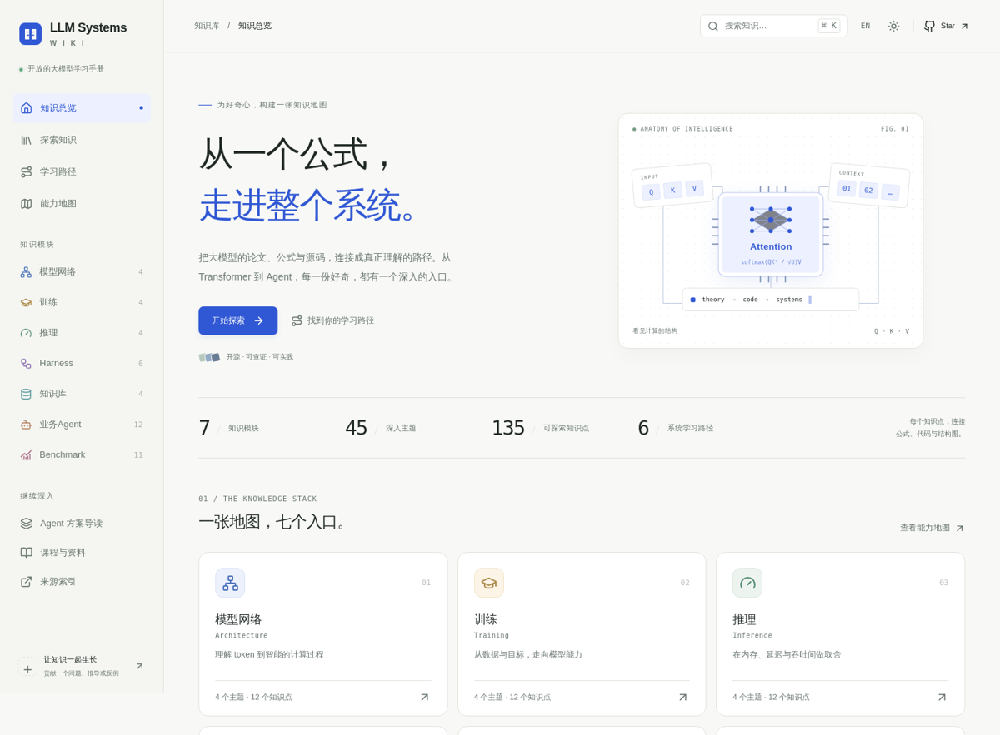
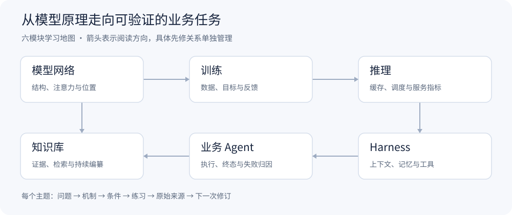

# LLM Systems Wiki

**简体中文** · [English](README.en.md)

[**打开知识库网站 →**](https://yanbozhang.github.io/llm-systems-wiki/)

**从公式到源码，系统学习大模型与 Agent。**

一本持续更新的中文工程学习手册：把论文、官方文档和固定版本源码拆成可以推导、运行、画图解释的知识点。面向希望理解 Transformer、训练与推理、RAG、Agent Harness 和 Benchmark 的开发者。

[](https://github.com/yanbozhang/llm-systems-wiki/actions/workflows/check.yml)
[](https://github.com/yanbozhang/llm-systems-wiki/releases)
[](https://github.com/yanbozhang/llm-systems-wiki/stargazers)

**v1.0：7 个模块 · 45 个主题 · 135 个知识点 · 45 份 Python 教学示例。** 每个知识点都有公式与符号说明、代码与步骤解释、Mermaid 实现图、原始来源与边界条件。

[开始学习](docs/大模型持续学习知识库.md) · [全部知识点](docs/知识点索引.md) · [能力地图](docs/能力地图.md) · [Agent 方案导读](docs/Agent开源方案导读.md) · [版本变化](CHANGELOG.md)

[](https://yanbozhang.github.io/llm-systems-wiki/)

## 第一次来，从三个入口选择

| 你想做什么 | 入口 |
|---|---|
| 系统学习基础、运行小例子 | [仓库导览](docs/仓库导览.md) · [基础入门](wiki/paths/基础入门路径.md) |
| 看2026年论文和开源工程的变化 | [七模块研究进展](wiki/frontiers/README.md) · [在线阅读](https://yanbozhang.github.io/llm-systems-wiki/research/) |
| 找原文、版本和本地保存记录 | [来源资料库](sources/README.md) · [完整索引](sources/来源索引.md) |

本轮研究选读覆盖14篇ICML/ACL 2026论文和14个开源项目，明确区分会议论文、已读取全文、官方摘要、发布版本和当前提交。每条来源都有独立资料目录；本地全文缓存不随GitHub仓库公开分发。

## 从一个具体问题开始

| 你想弄懂什么 | 阅读入口 | 可运行的教学示例 |
|---|---|---|
| 为什么注意力要除以根号维度？ | [Transformer 与自回归生成](wiki/topics/Transformer与自回归生成.md) | [transformer.py](examples/network/transformer.py) |
| GQA 如何改变 KV 缓存预算？ | [MHA、MQA 与 GQA](wiki/topics/MHA与MQA及GQA.md) · [KV 缓存估算](wiki/topics/KV缓存原理与显存估算.md) | [kv-cache.py](examples/inference/kv-cache.py) |
| LoRA 与 DPO 分别在优化什么？ | [SFT 与 LoRA](wiki/topics/监督微调与LoRA.md) · [偏好学习与 DPO](wiki/topics/偏好学习与DPO.md) | [preference.py](examples/training/preference.py) |
| 检索到了，为什么仍会答错？ | [RAG 与引用回答](wiki/topics/RAG与引用回答.md) · [检索与回答评测](wiki/topics/RAG检索与回答评测.md) | [rag.py](examples/knowledge/rag.py) |
| Codex CLI 的工具调用如何进入执行？ | [Codex CLI 架构与执行](wiki/topics/CodexCLI架构与执行.md) | [codex-cli.py](examples/agents/codex-cli.py) |
| Claude Code 的反馈循环与扩展边界是什么？ | [Claude Code 工作流与扩展边界](wiki/topics/ClaudeCode工作流与扩展边界.md) | [claude-code.py](examples/agents/claude-code.py) |
| 手机 Agent 怎样从截图走到任务终态？ | [Mobile-Agent](wiki/topics/MobileAgent多智能体协作.md) · [AppAgent](wiki/topics/AppAgent探索与技能学习.md) · [UI-TARS](wiki/topics/UITARS感知与动作执行.md) | [mobile-agent.py](examples/agents/mobile-agent.py) |
| 为什么 Agent 需要检查点，而不只是对话历史？ | [LangGraph](wiki/topics/LangGraph状态图与持久化.md) · [AutoGen](wiki/topics/AutoGen对话团队与终止.md) | [langgraph.py](examples/harness/langgraph.py) |
| AI 编程工具怎样读取、修改和验证仓库？ | [OpenHands](wiki/topics/OpenHands事件流与运行时.md) · [SWE-agent](wiki/topics/SWEAgent与智能体计算机接口.md) · [Aider](wiki/topics/Aider仓库地图与编辑协议.md) | [aider.py](examples/agents/aider.py) |
| 两个排行榜分数真的能比较吗？ | [评测协议](wiki/topics/评测协议与可复现性.md) · [指标与统计](wiki/topics/评测指标与统计推断.md) | [benchmark-metrics.py](examples/benchmark/benchmark-metrics.py) |

## 系统学习地图



| 模块 | 主题 / 知识点 | 内容 |
|---|---:|---|
| [模型网络](wiki/modules/模型网络.md) | 4 / 12 | Transformer、注意力头、RoPE、FFN 与归一化 |
| [训练](wiki/modules/训练.md) | 4 / 12 | 预训练、SFT、LoRA、DPO、GRPO |
| [推理](wiki/modules/推理.md) | 4 / 12 | Prefill/Decode、KV 缓存、分页、调度与性能 |
| [Harness](wiki/modules/Harness.md) | 6 / 18 | 状态、上下文、记忆、工具、LangGraph、AutoGen |
| [知识库](wiki/modules/知识库.md) | 4 / 12 | RAG、来源版本、混合检索、GraphRAG 与 LLMWiki |
| [业务 Agent](wiki/modules/业务Agent.md) | 12 / 36 | 任务闭环、GUI、AI Coding、失败归因与八个工程案例（含 Codex CLI、Claude Code） |
| [Benchmark](wiki/modules/Benchmark.md) | 11 / 33 | 协议、统计、污染、通用/代码/Agent/RAG/多模态、裁判、性能与安全 |

选择[基础入门](wiki/paths/基础入门路径.md)、[系统工程](wiki/paths/系统工程路径.md)、[Agent 开发](wiki/paths/Agent开发路径.md)、[Benchmark](wiki/paths/Benchmark学习路径.md)、[GUI 智能体](wiki/paths/GUI智能体实践路径.md)或[AI 编程智能体路径](wiki/paths/AI编程智能体实践路径.md)。课程与源码入口见[系统学习资源指南](docs/系统学习资源指南.md)，能力目标以[能力地图](docs/能力地图.md)为准。

## 怎样用这本 Wiki

1. 选一个知识点，先读问题、前置条件和符号定义，独立完成手算或状态推演。
2. 对照教学函数运行小输入，再改变一个条件，解释输出为何变化。
3. 沿文章中的固定提交链接阅读生产实现，记录教学模型省略了什么。
4. 用[学习记录](templates/学习记录模板.md)和[实验记录](templates/实验记录模板.md)留下证据；遇到错误提出更正。

示例仅依赖 **Python 3.11+ 标准库**，不需要 API Key、GPU 或联网：

```bash
git clone https://github.com/yanbozhang/llm-systems-wiki.git
cd llm-systems-wiki
python examples/inference/kv-cache.py
python examples/harness/langgraph.py
```

网站提供全文搜索、模块筛选、学习路径、文章目录、代码高亮、公式与结构图，以及本地收藏、明暗主题和中英文导航。知识正文目前为中文。

每个示例旁的文章解释输入、输出与生产实现差异。教学计算和单元测试验证的是小规模数学与状态性质；完整模型跑分、真机任务及框架端到端实验单独记录，当前未声称复现。Claude Code 专题只解释公开工作机制与扩展接口，Codex CLI 专题基于固定提交的公开源码。

## 参与贡献

欢迎贡献一个公式更正、一段源码导读、一个反例或可复查的实验。[贡献指南](CONTRIBUTING.md)说明本地开发、内容契约、检查命令和 PR 要求；[知识点问题模板](https://github.com/yanbozhang/llm-systems-wiki/issues/new?template=knowledge.yml)用于提交更正。

如果某篇文章帮你理解了机制，欢迎 **Star 收藏**、分享该文章链接，或提交你的推导与反例。最有价值的传播是让下一个读者能直接找到问题、代码和证据。

## 网站开发

展示层位于 `web/`，直接读取现有 Markdown 与知识清单；[开发说明](web/README.md)包含本地启动、类型检查、构建与测试方式。网站通过 GitHub Pages 发布，打开上方链接即可阅读。

## 来源与许可

[来源索引](sources/来源索引.md)与[知识点清单](knowledge/units.json)把解释关联到论文、文档和源码版本。仓库原创内容与教学代码采用 [MIT License](LICENSE)；引用的论文、课程、商标与第三方代码保留各自权利和许可，不因链接或短摘而改为本仓库许可。
