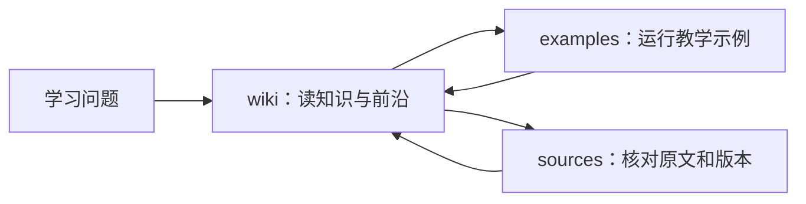

# 仓库导览

这个仓库可以当作一本带代码和出处的学习手册。第一次来不需要理解JSON清单或构建脚本，先选择下面的一条路线。

## 我应该从哪里开始

| 你现在的目标 | 从这里进入 | 会得到什么 |
|---|---|---|
| 没系统学过大模型 | [基础入门路径](../wiki/paths/基础入门路径.md) | 前置知识、主题顺序和练习 |
| 想解决一个具体问题 | [知识点索引](知识点索引.md) | 公式、教学函数、结构图与反例 |
| 想了解2026年的新工作 | [2026研究进展](../wiki/frontiers/README.md) | 七模块的论文与工程变化，以及对应基础章节 |
| 想核对文章是否有依据 | [来源资料库](../sources/README.md) | 原文链接、版本、读取范围与本地保存记录 |
| 想运行一个小例子 | [教学代码说明](../examples/README.md) | 无需GPU或API Key的Python示例 |
| 想改进内容或网站 | [贡献指南](../CONTRIBUTING.md) | 修改位置与必要检查 |

## 目录只需要先认识三个

`wiki/`是正文，`examples/`是配套代码，`sources/`是证据。`docs/`帮助你选择路线和判断掌握程度。主题里的代码是教学模型；新论文的跑分是作者报告的实验结果，二者都不等于你已在自己的环境中复现。

## 其余目录供维护者使用

| 目录 | 含义 | 什么时候打开 |
|---|---|---|
| knowledge/ | 主题、知识点、能力、声明及研究进展的机器清单 | 新增或移动内容、检查引用关系时 |
| schema/ | 内容和工具必须遵守的契约 | 准备贡献内容或修改检查器时 |
| scripts/ | 资料整理、来源抓取与离线检查工具 | 维护资料库时 |
| tests/ | 教学函数和维护工具的测试 | 修改代码后验证行为时 |
| web/ | 把正文展示成网站的Astro代码 | 修改网站布局与交互时 |
| templates/ | 学习、实验、主题与更新模板 | 记录一次学习或复现时 |
| candidates/ | 尚未核验的新来源线索 | 整理候选资料时，不能直接当已确认知识 |
| releases/ | 历史版本的内容指纹清单 | 回查旧版本时 |
| user-notes/ | 个人学习记录 | 记录自己的理解与进度时 |

## 内容如何连起来

一篇主题有稳定的topic ID；每个知识点有unit ID，连接一段公式、一个教学函数、一张实现图及来源ID。每条来源ID对应独立资料目录。标题或网站样式变化不会改变这些身份。

新增研究进展放在`wiki/frontiers/`，并指回基础主题。已有结论出现错误时，才在原文中写清更正依据和版本，不让“最新”静默覆盖历史材料。

[打开阅读网站](https://yanbozhang.github.io/llm-systems-wiki/) · [返回仓库首页](../README.md)
