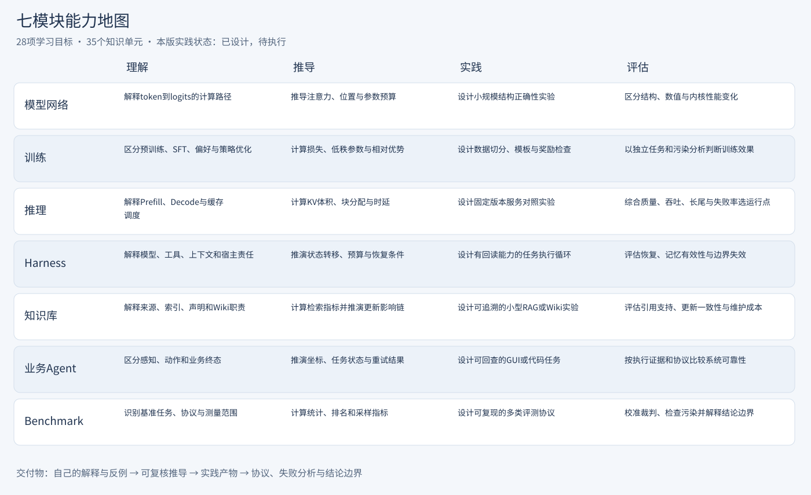

# 能力地图

能力地图说明“学完后应该能做什么”，不判断任何读者已经掌握什么。每个模块设置理解、推导、实践、评估四层，共28项能力目标；主题、练习与可提交产物相互关联。

## 七模块四层能力

| 模块 | 理解 | 推导 | 实践 | 评估 |
|---|---|---|---|---|
| [模型网络](../wiki/modules/模型网络.md) | 解释token到logits的计算路径 | 推导注意力、位置与参数预算 | 设计小规模结构正确性实验 | 区分结构、数值与内核性能变化 |
| [训练](../wiki/modules/训练.md) | 区分预训练、SFT、偏好与策略优化 | 计算损失、低秩参数与相对优势 | 设计数据切分、模板与奖励检查 | 以独立任务和污染分析判断训练效果 |
| [推理](../wiki/modules/推理.md) | 解释Prefill、Decode与缓存调度 | 计算KV体积、块分配与时延 | 设计固定版本服务对照实验 | 综合质量、吞吐、长尾与失败率选运行点 |
| [Harness](../wiki/modules/Harness.md) | 解释模型、工具、上下文和宿主责任 | 推演状态转移、预算与恢复条件 | 设计有回读能力的任务执行循环 | 评估恢复、记忆有效性与边界失效 |
| [知识库](../wiki/modules/知识库.md) | 解释来源、索引、声明和Wiki职责 | 计算检索指标并推演更新影响链 | 设计可追溯的小型RAG或Wiki实验 | 评估引用支持、更新一致性与维护成本 |
| [业务Agent](../wiki/modules/业务Agent.md) | 区分感知、动作和业务终态 | 推演坐标、任务状态与重试结果 | 设计可回查的GUI或代码任务 | 按执行证据和协议比较系统可靠性 |
| [Benchmark](../wiki/modules/Benchmark.md) | 识别基准任务、协议与测量范围 | 计算统计、排名和采样指标 | 设计可复现的多类评测协议 | 校准裁判、检查污染并解释结论边界 |

## 如何证明自己掌握

理解层提交自己的解释与反例；推导层提交带假设和单位的计算或状态推演；实践层提交可复查的输入、步骤、预期与产物；评估层提交协议、失败分析与结论边界。单纯阅读、运行一个示例或获得一个分数，都不足以自动完成四层能力。

[capabilities.json](../knowledge/capabilities.json)保存每项目标、关联主题和交付物。跨模块引用用于连接学习内容，不表示后者必须完全掌握前者所有章节。

## 内容成熟度与个人进度分开

当前35个主题均含说明、推导或案例以及实践设计；未执行的实验明确为designed，尚无本库大模型实验复现证据。主题的worked表示有教学示例，不表示读者已会实现，也不表示研究结论已被独立复现。

个人进度记录在[学习记录模板](../templates/学习记录模板.md)，绑定所学版本和能力ID。更新知识后，只提示复习受影响内容，不自动将原来的阅读记录升级为掌握新版本。

## 跨模块练习

以[跨模块实践项目](跨模块实践项目.md)组织一次小型知识助手设计：来源与检索连接知识库，预算与状态连接Harness，终态连接业务Agent，模型与服务连接网络/训练/推理，最后由Benchmark提供统一评测协议。

返回[知识地图](大模型持续学习知识库.md)，或选择[Benchmark学习路径](../wiki/paths/Benchmark学习路径.md)。
