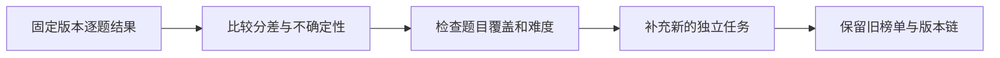
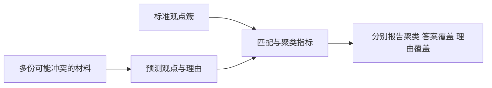

# Benchmark研究进展

核对截止：2026-10-25。结合[评测协议](../topics/评测协议与可复现性.md)、[指标统计](../topics/评测指标与统计推断.md)和[RAG评测](../topics/RAG检索与回答评测.md)阅读。除了模型得分，新工作也在检查测试还能否区分模型，以及评分流程有没有改变题目本身。

## 排行榜接近满分后，还能提供多少信息

ICML 2026的《When AI Benchmarks Plateau》研究60个LLM基准的饱和情况，并分析任务设计、数据构造和评测形式等属性。官方摘要报告，测试年龄等因素与饱和有关，隐藏测试数据并未在该研究中表现出保护作用。本轮核验范围为会议摘要与作者项目说明，未完整取得论文全文；这些观察不应被解释成所有私有测试都无用的因果结论。[论文记录](../../sources/library/2026-paper-benchmark-saturation/README.md)

即使暂时不复现作者的饱和统计量，也可以先检查榜单分差相对于评测不确定性是否足够大。对同一组样本上的两个模型，使用配对差值：

$$
\widehat\Delta=\frac1n\sum_{i=1}^{n}(a_i-b_i)
$$

a_i、b_i是同一题的分数。下面返回配对差值的bootstrap区间，属于教学诊断，不是论文的S_index，也不能仅凭区间覆盖0就宣布基准已饱和。

```python
from random import Random

def paired_bootstrap_interval(a, b, draws=200):
    if not a or len(a) != len(b) or draws < 2:
        raise ValueError("需要非空配对样本与至少两次重采样")
    delta = [x - y for x, y in zip(a, b)]
    rng = Random(0)
    samples = sorted(sum(rng.choice(delta) for _ in delta) / len(delta)
                     for _ in range(draws))
    return samples[int(0.025 * (draws - 1))], samples[int(0.975 * (draws - 1))]

print(paired_bootstrap_interval([1, 0, 1, 0], [1, 0, 1, 0]))  # (0.0, 0.0)
```



更换题集后应形成新版本；“加难题”会改变被测能力分布，也不能直接与旧分数相减。对模型、采样预算或评分器的改变同样要保留基线。

## ConfRAG：答对一个答案不等于解释了冲突来源

ACL 2026长文ConfRAG收集真实多来源问题，分别评估答案聚类、答案覆盖和理由覆盖。本轮读取摘要、任务设计和指标定义：聚类使用NMI；覆盖指标根据匹配关系计算。它针对的是能否组织分歧与依据，不直接等于对外部世界事实的最终裁决。[会议记录](../../sources/library/2026-paper-benchmark-conflicts/README.md) · [论文正文](../../sources/library/2026-full-benchmark-conflicts/README.md)

覆盖计算的重要约束是一对一匹配，避免一个泛化的预测重复“覆盖”多个标准观点。以下是输入匹配边已经给定时的教学模型：

$$
\operatorname{coverage}=\frac{|M^*|}{|G|}
$$

G是标准观点集合，M*是预测观点与标准观点之间的最大二分匹配。真实ConfRAG还有文本处理和相似性判断，下面不实现这些语义步骤。

```python
def matched_coverage(edges, gold_count):
    if gold_count <= 0 or any(g < 0 or g >= gold_count for row in edges for g in row):
        raise ValueError("标准观点或匹配边无效")
    matched = {}
    def augment(prediction, seen):
        for gold in edges[prediction]:
            if gold in seen:
                continue
            seen.add(gold)
            if gold not in matched or augment(matched[gold], seen):
                matched[gold] = prediction
                return True
        return False
    for prediction in range(len(edges)):
        augment(prediction, set())
    return len(matched) / gold_count

print(matched_coverage([[0, 1]], 2))     # 0.5，一个预测只能匹配一个观点
print(matched_coverage([[0, 1], [0]], 2))  # 1.0，增广后可覆盖两个观点
```



格式错误、漏答和超时必须留在对应协议的分母中；理由覆盖低也不能由一个漂亮的总分掩盖。论文使用其当时选定的模型，本页没有把这些结果称为2026年10月的最新模型排行榜。

## 开源评测管线本身也会影响分数

| 项目 | 本轮版本依据 | 需要保留的变化 |
|---|---|---|
| EleutherAI lm-evaluation-harness，社区/非营利项目 | v0.4.13，2026-08-31；提交d6de8164… | 发布说明修复few-shot泄漏、选择题正则前缀遮蔽和分组标准误；升级工具后旧分数可能不再直接可比 |
| Hugging Face LightEval | 2026-10-06提交7fa19dc6…；最新发布v0.13.0日期为2025-11-24 | 以当前任务配置源码作为2026阅读快照；不把旧release伪装成今年的新发布 |

[Harness发布说明](../../sources/library/2026-release-benchmark-harness/README.md)、[采样器源码](../../sources/library/2026-code-benchmark-harness/README.md)、[LightEval任务配置源码](../../sources/library/2026-code-benchmark-lighteval/README.md)与[发布记录](../../sources/library/2026-release-benchmark-lighteval/README.md)保留出处。社区项目和公司项目分别标明维护主体，不用“公司维护”笼统描述全部生态。

## 实践任务

建立一份包含数据版本、few-shot来源、生成预算、答案解析器、工具提交和逐题结果的评测清单。先重算一次一对一覆盖，再构造“当前评测题进入few-shot示例”的失败例，说明它为何可能虚增分数。本文没有执行真实模型评测；教学指标只验证小输入的计算关系。

[返回研究进展](README.md) · [返回Benchmark](../modules/Benchmark.md)
