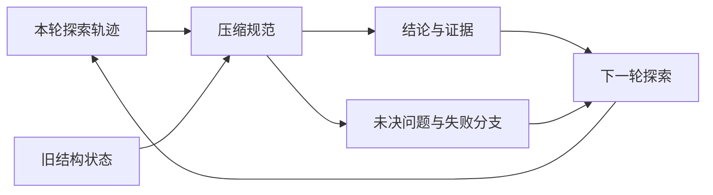
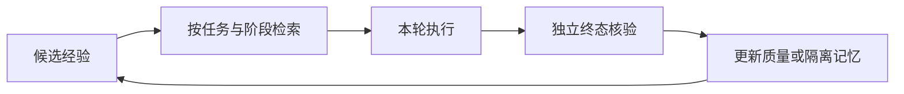

# Harness研究进展

核对截止：2026-10-25。结合[上下文工程](../topics/上下文选择与压缩.md)、[记忆](../topics/Agent记忆与保鲜.md)和[LangGraph](../topics/LangGraph状态图与持久化.md)阅读。Harness的进展不仅是调用更多工具，还包括如何保留未解决的问题、控制经验质量，以及在中断后恢复正确的执行状态。

## RE-TRAC：把一次轨迹变成下一次探索的结构状态

ICML 2026官方目录可确认RE-TRAC的会议归属；本轮实际读取的是arXiv v1的§4.1–4.2。论文将跨轨迹探索组织为递归过程，而非每轮都从原问题重新开始。它保留答案与分析结论、证据与来源核验、未决问题与探索轨迹三个方面。[会议记录](../../sources/library/2026-paper-harness-retrac/README.md) · [实际读取的论文版本](../../sources/library/2026-full-harness-retrac/README.md)

$$
S_t=\operatorname{Compress}(\tau_t,S_{t-1};\mathcal C)
$$

τ_t是本轮轨迹，S_t是压缩后的状态，C是压缩规范。关键不只是缩短token，而是保留什么已经有依据、什么仍是假设，以及哪些方向已经尝试过。下面只演示结构化合并，不实现模型摘要或证据真实性判断。

```python
def merge_research_state(previous, verified, unresolved, failed_paths):
    return {
        "verified": list(dict.fromkeys(previous.get("verified", []) + verified)),
        "unresolved": list(dict.fromkeys(unresolved)),
        "failed_paths": list(dict.fromkeys(previous.get("failed_paths", []) + failed_paths)),
    }

state = merge_research_state(
    {"verified": ["已确认论文版本"]},
    ["已确认论文版本", "已找到源码入口"],
    ["尚未核对实验硬件"], ["旧下载链接已失效"])
print(len(state["verified"]))  # 2
```



图中保留失败分支是为了避免重复无效尝试；保留未决问题则防止摘要把“不知道”改写成“已确认”。上面的字符串去重也不是知识去重算法：同标题不同版本、不同来源的相反结论，仍需要稳定ID与独立记录。

## 经验跟随：记忆越多，不一定越可靠

ACL 2026的《How Memory Management Impacts LLM Agents》研究记忆添加和删除对经验跟随的影响。官方摘要指出，相似输入可能让Agent重复相似输出，因此错误经验会传播，看似成功的经验也可能与当前任务错配。本轮取得了官方摘要，但全文下载未完成，以下不补写其未读取的实验细节。[论文记录与实际范围](../../sources/library/2026-paper-harness-memory/README.md)

可以给记忆增加一个独立的质量反馈通道。下面的平滑成功率是本文的教学评分，不是该论文的原公式：

$$
Q(m)=\frac{s_m+1}{n_m+2}
$$

n_m是记忆被使用且得到可核验反馈的次数，s_m是其中有帮助的次数。平滑避免“一次成功”直接被当作百分之百可靠，但仍不能消除任务选择偏差。

```python
def illustrative_memory_quality(helpful, evaluated_uses):
    if not 0 <= helpful <= evaluated_uses:
        raise ValueError("有效反馈次数不能超过已评估使用次数")
    return (helpful + 1) / (evaluated_uses + 2)

print(illustrative_memory_quality(0, 0))  # 0.5：尚无证据
print(illustrative_memory_quality(3, 4))  # 2/3
```



“模型说完成”不能自动计入helpful；没有真实反馈的使用不进入分母。场景变化、过时版本与错误记忆也不应仅凭相似度获得高优先级。这与本库把来源身份、状态和个人学习记录分开的做法相呼应。

## 当前框架：状态语义与工具调用边界

| 项目 | 版本依据 | 需要检查的语义 |
|---|---|---|
| LangChain维护的LangGraph | 1.2.17，2026-10-24；提交4c52e129… | 发布说明涉及显式recursion_limit与远程子图命名空间；循环预算和状态归属不能只靠默认值理解 |
| Microsoft Agent Framework | 最新发布记录为dotnet-1.26.0，2026-10-23；提交67ba500e… | 发布记录同时涉及.NET和Python改动，应按包分别看版本；包括工具调用数量限制、会话hooks组合和流关闭错误传播等修正 |

[LangGraph发布说明](../../sources/library/2026-release-harness-langgraph/README.md)、[PregelLoop.tick](../../sources/library/2026-code-harness-langgraph/README.md)、[Microsoft发布说明](../../sources/library/2026-release-harness-agentframework/README.md)与[项目说明](../../sources/library/2026-repo-harness-agentframework/README.md)提供确切出处。dotnet标签不能作为Python SDK版本号；检查点可恢复也不能推出外部副作用恰好执行一次。

## 实践任务

准备一次“读取来源失败后换证据”和一次“工具成功但业务终态未达成”的轨迹。设计结构状态字段，使下一轮能准确继续；再给同一任务阶段加入一条错误旧经验，观察它是否被隔离。本文没有运行真实Agent实验，模型压缩质量与任务收益仍需单独验证。

[返回研究进展](README.md) · [返回Harness](../modules/Harness.md)
