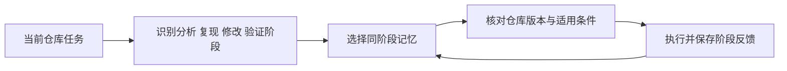
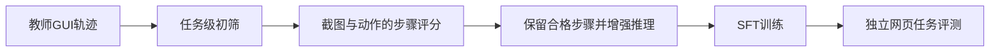

# 业务Agent研究进展

核对截止：2026-10-25。与[编程Agent](../topics/AI代码开发与反馈.md)、[GUI Agent](../topics/GUI定位与执行.md)、[Codex CLI](../topics/CodexCLI架构与执行.md)及[UI-TARS](../topics/UITARS感知与动作执行.md)配合阅读。新的研究与工程工作都在细化“任务”下面的单位：哪个阶段值得复用、哪一步值得学习、哪种状态变化可以提交。

## 软件任务记忆：按子任务阶段对齐

ICML 2026的《Structurally Aligned Subtask-Level Memory for Software Engineering Agents》指出，整次问题解决过程作为一个记忆单元可能太粗：表面相似的问题在复现、修改或验证阶段可能需要不同经验。官方摘要提出让存储、检索和更新与功能阶段对齐。本轮只核验了官方摘要与公开说明，未取得全文。[论文记录](../../sources/library/2026-paper-agents-subtask/README.md)

下面用一个教学检索规则解释阶段约束，不复现论文的完整记忆表示或学习算法：

$$
m^\ast =\arg\max_{m\in M:\thinspace stage(m)=stage(t)}\mathrm{sim}(q,m)
$$

stage(t)是当前阶段。示例以词集合的Jaccard相似度代替真正的语义模型；先过滤阶段，再排序，而不是先挑最相似记录后忽略它属于哪一步。

```python
def stage_memory(memories, stage, query_words):
    query = set(query_words)
    candidates = [m for m in memories if m["stage"] == stage]
    def score(memory):
        words = set(memory["words"])
        return len(query & words) / len(query | words) if query | words else 0.0
    return max(candidates, key=score) if candidates else None

memories = [
    {"id": "edit-1", "stage": "edit", "words": ["cache", "bug"]},
    {"id": "verify-1", "stage": "verify", "words": ["cache", "regression"]},
]
print(stage_memory(memories, "verify", ["cache", "bug"])["id"])  # verify-1
```



阶段对齐仍不足以保证经验适用：还要核对仓库版本、工具权限和输入条件。没有同阶段记忆时，返回空结果比强行套用其他阶段的高相似记录更清楚。图中的版本核对是本库的工程阅读建议，不宣称是已验证的论文收益来源。

## WebSTAR：成功轨迹中也可能含有错误步骤

WebSTAR是ACL 2026主会长文。本轮读取§2–3：先对教师轨迹做任务级筛选，再评价成功轨迹内部每个动作的正确性与相对有效性；步骤评分使用0到10的整数，并结合截图、动作与备选动作分析。论文还介绍WebSCORE与StepRM用于步骤评价。[会议记录](../../sources/library/2026-paper-agents-webstar/README.md) · [论文正文](../../sources/library/2026-full-agents-webstar/README.md)

不要把这项工作简化为“只要最终成功，所有动作都是好样本”。下面的掩码损失说明只对已选中步骤施加监督的概念；论文还包含轨迹筛选、推理增强等过程。

$$
L=-\frac{\sum_t m_t\log p_t}{\sum_t m_t},\qquad m_t\in\lbrace 0,1\rbrace
$$

p_t是目标思考—动作对的示意概率，m_t由外部步骤质量判断给定。此处没有实现评分模型，更没有用模型自报成功替代环境终态。

```python
from math import log

def masked_step_loss(probabilities, keep):
    if len(probabilities) != len(keep) or any(m not in (0, 1) for m in keep):
        raise ValueError("步骤与掩码不匹配")
    if any(not 0 < p <= 1 for p in probabilities):
        raise ValueError("概率必须位于(0,1]")
    if not sum(keep):
        return None  # 没有可训练步骤，不能假造零损失样本
    return -sum(m * log(p) for p, m in zip(probabilities, keep)) / sum(keep)

print(masked_step_loss([0.5, 0.01, 0.5], [1, 0, 1]))  # log(2)
```



将被过滤步骤的损失设为零和保留它作为正确动作是不同操作。真实训练还需明确上下文是否保留、图像窗口如何截断、评分器偏差如何传播，以及训练和评测任务是否隔离。论文报告的收益不能直接外推到Android应用、不同设备或不同动作空间。

## Codex与UI-TARS相关工程更新

| 项目 | 本轮版本 | 可直接联系到基础知识的问题 |
|---|---|---|
| OpenAI Codex CLI | rust-v0.164.0，2026-10-23；提交970111f6… | 发布说明修复压缩失败留下部分摘要、恢复压缩历史与会话设置等问题；上下文压缩需要正确的失败与提交语义 |
| ByteDance UI-TARS-desktop / Agent TARS | v0.3.1，2026-10-08；提交3ac2cb8d… | 发布说明收紧Agent TARS CLI服务器的默认监听、远程访问鉴权、Host/Origin与CSRF处理；执行面必须和模型能力分开管理 |

[Codex发布说明](../../sources/library/2026-release-agents-codex/README.md)、[压缩入口源码](../../sources/library/2026-code-agents-codex/README.md)、[UI-TARS-desktop发布说明](../../sources/library/2026-release-agents-uitars/README.md)与[项目说明](../../sources/library/2026-repo-agents-uitars/README.md)提供完整版本和范围。UI-TARS条目中这些变更针对相关CLI服务器，不代表模型权重本身的变化；本文没有运行这些产品的真实任务或复现漏洞。

## 实践任务

给一个软件任务拆出分析、复现、修改和验证四阶段，并为每阶段指定输入、输出和终态证据。给一个GUI成功轨迹找出可以删去的误点或重复动作，解释为何最终成功仍不足以为每步打满分。最后把这两类反馈与[Agent评测](../topics/Agent评测与失败归因.md)的分母、重试和权限边界连接起来。

[返回研究进展](README.md) · [返回业务Agent](../modules/业务Agent.md)
