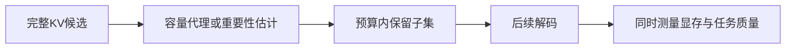
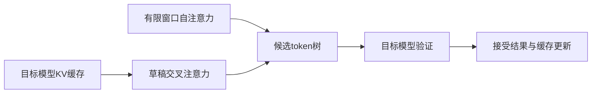

# 推理研究进展

核对截止：2026-10-25。先连接[KV缓存估算](../topics/KV缓存原理与显存估算.md)与[缓存和调度](../topics/缓存分页与连续批处理.md)。本页讨论“哪些信息值得保留”和“生成一个已接受token到底付出多少额外工作”，避免只比较单一吞吐数字。

## CapKV：缓存预算也可以从信息保留来理解

ICML 2026官方记录中的《Rethinking KV Cache Eviction via a Unified Information-Theoretic Objective》用线性高斯注意力代理讨论KV子集的信息容量，并提出通过log-determinant近似与统计杠杆分数进行选择的CapKV。当前核验范围是会议摘要与公开说明，未取得全文；本页不补写其完整推导或未经读取的超参数。[论文记录与范围](../../sources/library/2026-paper-inference-eviction/README.md)

可以先用一个二维教学模型理解“两个大向量未必比两个互补方向更有信息”。令k_i为二维特征，单位矩阵代表固定的各向同性基线：

$$
C(S)=\log\det\left(I+\sum_{i\in S}k_i k_i^\top\right)
$$

这是说明log-det行为的教学代理，不是CapKV实现，也不保证它等于真实注意力的互信息。

```python
from math import log

def logdet_capacity_2d(vectors):
    a = 1 + sum(x * x for x, y in vectors)
    b = sum(x * y for x, y in vectors)
    c = 1 + sum(y * y for x, y in vectors)
    return log(a * c - b * b)

print(logdet_capacity_2d([(1, 0), (1, 0)]))  # log(3)
print(logdet_capacity_2d([(1, 0), (0, 1)]))  # log(4)
```



预算相同，重复方向与互补方向的结果不同。迁移到实际模型前还要考虑头、层、价值向量、位置和动态查询。更要区分两种“淘汰”：为正在生成的请求删掉历史KV会改变模型可用信息；释放不再被活跃请求引用的前缀缓存，首先是服务的资源管理问题。

## LongSpec：额外草稿缓存有界，总缓存仍随上下文增长

LongSpec是ACL 2026主会长文。本轮读到§3：草稿模型用滑动窗口自注意力捕获局部信息，用交叉注意力利用目标模型已有KV；还通过Anchor-Offset位置索引处理短上下文训练与长上下文推理的差异，并组合前缀计算与树注意力。[会议记录](../../sources/library/2026-paper-inference-longspec/README.md) · [论文正文](../../sources/library/2026-full-inference-longspec/README.md)

“草稿模型的额外KV有界”不表示整个推理系统只用常数内存。用每token缓存标量数c_T、c_D描述一个简化预算：

$$
M(T)=T c_T+\min(T,W)c_D
$$

T是上下文长度，W是草稿局部窗口。共享目标KV减少额外存储，但目标模型的缓存本身依然存在；这里也没有计入权重、临时激活或分页浪费。

```python
def shared_draft_cache_scalars(length, window, target_per_token, draft_per_token):
    if min(length, window, target_per_token, draft_per_token) < 0:
        raise ValueError("预算参数不能为负")
    return length * target_per_token + min(length, window) * draft_per_token

print(shared_draft_cache_scalars(100, 10, 4, 2))  # 420个标量
print(100 * (4 + 2))  # 独立完整草稿缓存的简化对照：600个标量
```



草稿快不等于整轮快：还要测接受长度、目标验证成本、候选树大小与拒绝后的状态处理。“无损”也依赖正确的验证/采样协议，不是任意草稿输出都可直接替代目标分布。论文的窗口、索引与注意力实现属于相互配合的设计，不能只拿其中一项推断同样收益。

## 工程进展：把缓存身份和状态一致性放进评测

| 项目 | 当前可核查版本 | 阅读重点 |
|---|---|---|
| SGLang，社区项目并有多家公司参与 | v0.5.22，2026-10-19；提交d558ac2f… | 发布说明覆盖PD分离、投机解码和多类缓存/状态组合，并记录混合线性模型在特定组合下恢复错误状态的修复 |
| NVIDIA TensorRT-LLM | 最新稳定发布v1.2.1，2026-04-20；当前分支提交fe180a95…为2026-10-24 | 稳定版与新分支分开记录；稳定版发布说明包含KV缓存损坏修复，不能用主分支能力代替稳定版行为 |

[SGLang发布记录](../../sources/library/2026-release-inference-sglang/README.md)、[RadixCache淘汰与锁引用源码](../../sources/library/2026-code-inference-sglang/README.md)、[TensorRT-LLM发布记录](../../sources/library/2026-release-inference-tensorrt/README.md)和[固定提交项目说明](../../sources/library/2026-repo-inference-tensorrt/README.md)提供入口。论文的CapKV信息选择与RadixCache的前缀树资源淘汰解决的问题不同，应分别设计实验。

## 下一步如何验证

固定模型、精度、输入/输出长度、并发、硬件和是否命中缓存；同时记录TTFT、TPOT、吞吐、峰值显存、接受长度以及任务质量。增加一次“缓存失效/中断后继续”的用例，观察状态身份是否正确。本文没有执行GPU实验，也不把发布说明中的特定机器收益转化为普遍加速承诺。

[返回研究进展](README.md) · [返回推理模块](../modules/推理.md)
