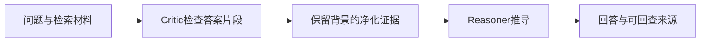
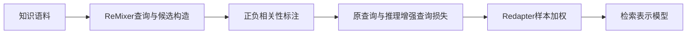

# 知识库研究进展

核对截止：2026-10-25。结合[RAG](../topics/RAG与引用回答.md)、[混合检索](../topics/混合检索与重排.md)和[来源接入](../topics/来源接入与版本管理.md)阅读。2026年的两条研究线分别追问：相关材料中有错误答案时如何使用它；正确材料需要推理才能识别时，检索表示该如何训练？

## Critic-Reasoner：保留背景，隔离误导答案片段

ICML 2026论文《From Extraction to Deduction》把检索与生成之间的功能错配作为问题：检索器可能找到背景相关、答案片段却错误的材料，生成器又倾向于直接采用该答案。官方摘要提出串行的Critic与Reasoner，并以SFT和路径感知DPO进行协同训练。本轮核对范围为会议摘要，尚未取得全文。[论文记录与范围](../../sources/library/2026-paper-knowledge-crag/README.md)

用一个接口式表达来理解职责分离：

$$
E^\prime=C(q,E),\qquad P(y\mid q,E^\prime)=P_R(y\mid q,C(q,E))
$$

q是问题，E是检索证据，C是证据净化组件，R是推理组件。这是结构表示，不是论文的训练损失。下面仅在已知哪些位置需要遮蔽时执行替换；它没有自动识别错误事实的能力。

```python
def mask_reviewed_spans(tokens, rejected_positions):
    if any(i < 0 or i >= len(tokens) for i in rejected_positions):
        raise ValueError("遮蔽位置越界")
    rejected = set(rejected_positions)
    return ["[MASK]" if i in rejected else token for i, token in enumerate(tokens)]

print(mask_reviewed_spans(["项目", "发布于", "错误年份", "，作者为A"], [2]))
# ['项目', '发布于', '[MASK]', '，作者为A']
```



净化器也可能判断错误，或把唯一关键证据遮掉。因此需要单独评估证据处理和最终回答，不能把“用了两个Agent”当作正确性保证。原文、净化结果与回答应分开保存，使读者能够回查改动过哪些信息。

## ReasonEmbed：学习需要推理才能识别的相关性

ReasonEmbed是ACL 2026主会长文。论文的ReMixer按查询生成、候选挖掘、相关性标注组织数据，Redapter则利用推理增强查询对比原查询的损失，估计训练样本的推理强度。本轮读取了§3的数据构造与§4的训练目标。[会议记录](../../sources/library/2026-paper-knowledge-reasonembed/README.md) · [论文正文](../../sources/library/2026-full-knowledge-reasonembed/README.md)

论文先使用InfoNCE损失L，再定义截断的推理强度并在批次内归一化：

$$
RI_\theta(s)=\min\left(\frac{L_{q,D}}{L_{q^\prime,D}},\kappa\right),\qquad
w_s=\frac{RI_\theta(s)}{\sum_{u\in B}RI_\theta(u)},\qquad
L_{RI}=\sum_{s\in B}w_sL_{q,D}
$$

q'是推理增强查询，D含正例与负例，κ限制极大的比率。查询改写后损失下降更多，意味着推理对识别相关材料更有帮助。下面只计算权重，输入损失需为可比较的同一目标；零分母在本教学函数中被显式拒绝，不推测训练实现的数值策略。

```python
def reasoning_intensity_weights(raw_losses, rewritten_losses, cap):
    if not raw_losses or len(raw_losses) != len(rewritten_losses) or cap <= 0:
        raise ValueError("批次、长度或截断参数无效")
    if any(a < 0 or b <= 0 for a, b in zip(raw_losses, rewritten_losses)):
        raise ValueError("原损失非负，改写损失为正")
    intensity = [min(a / b, cap) for a, b in zip(raw_losses, rewritten_losses)]
    if sum(intensity) == 0:
        raise ValueError("批次没有可归一化的推理强度")
    return [value / sum(intensity) for value in intensity]

print(reasoning_intensity_weights([2, 4], [1, 1], 3))  # [0.4, 0.6]
```



本轮正文中可核对作者对评测泄漏的处理：数据构造排除了评测查询的正例文档。这个做法不自动证明整个流程无污染，仍需保存语料版本、划分与生成链。重排也无法找回从未进入候选集的文档，因此第一阶段检索表示和后续证据推理应分别分析。

## 当前开源系统：数据管道与Agentic检索

| 项目 | 版本依据 | 本轮变化与使用边界 |
|---|---|---|
| Microsoft GraphRAG | v3.3.0，2026-10-08；提交c600ff80… | 发布说明主要记录SQLite性能修复；不能把维护版本描述成一次新的图检索算法突破 |
| InfiniFlow RAGFlow | v1.0.0-rc2，2026-10-16；提交e5a5060c… | 引入Agentic聊天模式、统一内置解析器与Pipeline解析器，并扩展部署支持；这是候选发布版，需保留rc身份 |

[GraphRAG发布说明](../../sources/library/2026-release-knowledge-graphrag/README.md)、[项目说明](../../sources/library/2026-repo-knowledge-graphrag/README.md)、[RAGFlow发布说明](../../sources/library/2026-release-knowledge-ragflow/README.md)与[项目说明](../../sources/library/2026-repo-knowledge-ragflow/README.md)均保留本轮快照。这些系统与上述论文处于不同层次：数据接入、图/索引管理、检索训练和证据推理需要分别验证，不能因为名称都含RAG就认为实现等价。

## 本库如何吸收这些经验

来源目录保留原文身份，知识正文保留解释，声明记录条件；新材料不能静默覆盖旧版本。可设计一个小型练习：让两份来源在年份上矛盾，但都包含有用背景，分别评估检索是否找全、矛盾是否被保留、最终解释是否有依据。真实检索模型训练与Agent任务尚未执行。

[返回研究进展](README.md) · [返回知识库模块](../modules/知识库.md)
