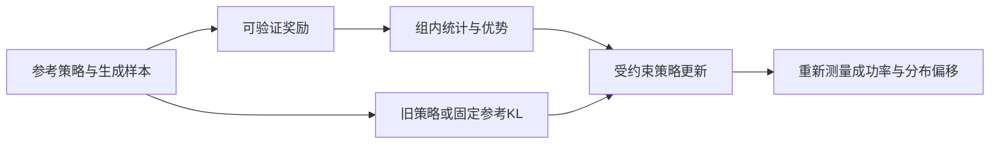
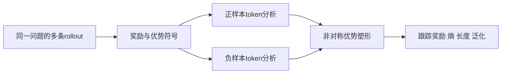

# 训练研究进展

核对截止：2026-10-25。结合[偏好学习](../topics/偏好学习与DPO.md)和[策略优化](../topics/策略优化与GRPO.md)阅读。本页区分三个层次：奖励如何改变分布、正负样本如何影响探索、异步系统如何正确处理这些训练样本。

## 从“GRPO有效”转向分析它的更新动力学

ICML 2026论文《Reinforcement Learning with Verifiable Rewards: GRPO’s Loss, Dynamics, and Success Amplification》研究二值奖励下的GRPO变体，比较奖励归一化以及相对旧策略、固定参考策略的KL约束。官方摘要给出了成功概率递推与固定点的分析方向。本轮没有取得其全文，因此不把摘要外的定理条件或实现细节写成已核验事实。[官方论文记录与读取边界](../../sources/library/2026-paper-training-grpo/README.md)

为了理解“奖励推动成功概率、KL限制偏移”这两个作用，可以先推导一个更小的教学问题：将成功/失败两类事件按奖励指数倾斜。它不是完整GRPO的复现。

$$
p'=\frac{p\exp(\beta)}{1-p+p\exp(\beta)}
$$

p是参考分布的成功概率；成功奖励取1，失败奖励取0；β是本教学模型中的奖励权重。该式来自对参考概率乘以指数权重后重新归一化，不包含GRPO的裁剪、分组采样或token级损失。

```python
from math import exp, log

def tilted_success_probability(p, beta):
    if not 0 <= p <= 1:
        raise ValueError("概率必须位于[0,1]")
    weight = exp(beta)
    return p * weight / (1 - p + p * weight)

print(tilted_success_probability(0.2, log(4)))  # 0.5
```



这个例子还暴露一个边界：p为0时，单纯重加权不能凭空创造成功路径。真实RLVR还涉及探索、奖励噪声、组内全对/全错以及训练分布变化，不能把这个单步式子当作所有GRPO训练的收敛保证。

## A3PO：正负样本的影响需要分别研究

ACL 2026长文《Rethinking Sample Polarity in Reinforcement Learning with Verifiable Rewards》比较了正样本强化与负样本强化。作者在其模型和任务设置中观察到，正样本更倾向于强化已有正确路径，负样本有助于保持探索；仅使用一种极性的效果不能普遍推广。论文进一步研究token级优势塑形，并提出A3PO。[会议记录](../../sources/library/2026-paper-training-polarity/README.md) · [正文与实验条件](../../sources/library/2026-full-training-polarity/README.md)

不要把“负样本有用”理解成直接模仿错误答案。负优势用于降低相应动作的概率，而不是把错误轨迹当成正标签。下面用一个明确标注的教学权重说明非对称塑形的含义；它不等于论文完整的自适应公式。

$$
\widetilde A_{i,t}=A_i w_{i,t},\qquad
w_{i,t}=\begin{cases}1-p_{i,t},& A_i>0\\p_{i,t},& A_i<0\\0,& A_i=0\end{cases}
$$

A_i是序列优势，p_{i,t}是该token在策略下的概率。该教学模型突出“正样本中的低概率token”和“负样本中的高概率token”，不实现论文中的自适应调度与全部归一化过程。

```python
def illustrative_token_advantage(advantage, token_probability):
    if not 0 <= token_probability <= 1:
        raise ValueError("token概率必须位于[0,1]")
    if advantage > 0:
        return advantage * (1 - token_probability)
    if advantage < 0:
        return advantage * token_probability
    return 0.0

print(illustrative_token_advantage(1.0, 0.2))   # 0.8
print(illustrative_token_advantage(-1.0, 0.8))  # -0.8
```



需要联合观察训练奖励、验证正确率、响应长度与熵。训练奖励涨得更快不必然表示探索边界更好；论文的模型、数据集和消融范围才是判断其结论能否迁移的依据，本文未独立复现这些结果。

## 从论文目标到当前训练框架

| 项目 | 核对到的版本 | 与学习内容的连接 |
|---|---|---|
| ByteDance/火山引擎维护的verl | v0.9.1，2026-09-20；当前提交3c6d9b43… | 发布说明区分异步训练、版本阈值、动态采样与token打包，并明确多项开关默认不启用 |
| Hugging Face TRL | v1.16.0，2026-10-15；当前提交1117c3b9… | 发布说明加入Trainium支持与AsyncGRPO的前缀树打包，说明目标函数之外还有形状编译和重复前缀成本 |

[verl发布说明](../../sources/library/2026-release-training-verl/README.md)、[GRPO优势计算源码](../../sources/library/2026-code-training-verl/README.md)可以对照分组、std归一化开关和response mask。[TRL发布说明](../../sources/library/2026-release-training-trl/README.md)与[项目说明](../../sources/library/2026-repo-training-trl/README.md)记录本轮实际读到的范围；没有将这些工程能力视为A3PO已经被默认集成。

## 一个可复查的学习任务

为同一组二值奖励分别计算均值归一化与均值加标准差归一化的优势，再说明把序列优势分配到token时还缺什么信息。随后画出异步rollout的策略版本流，记录样本产生版本与更新版本。真实训练需固定奖励器、分组规则、KL参考、版本滞后阈值和计算预算；本文仅完成理论与源码阅读。

[返回研究进展](README.md) · [返回训练模块](../modules/训练.md)
