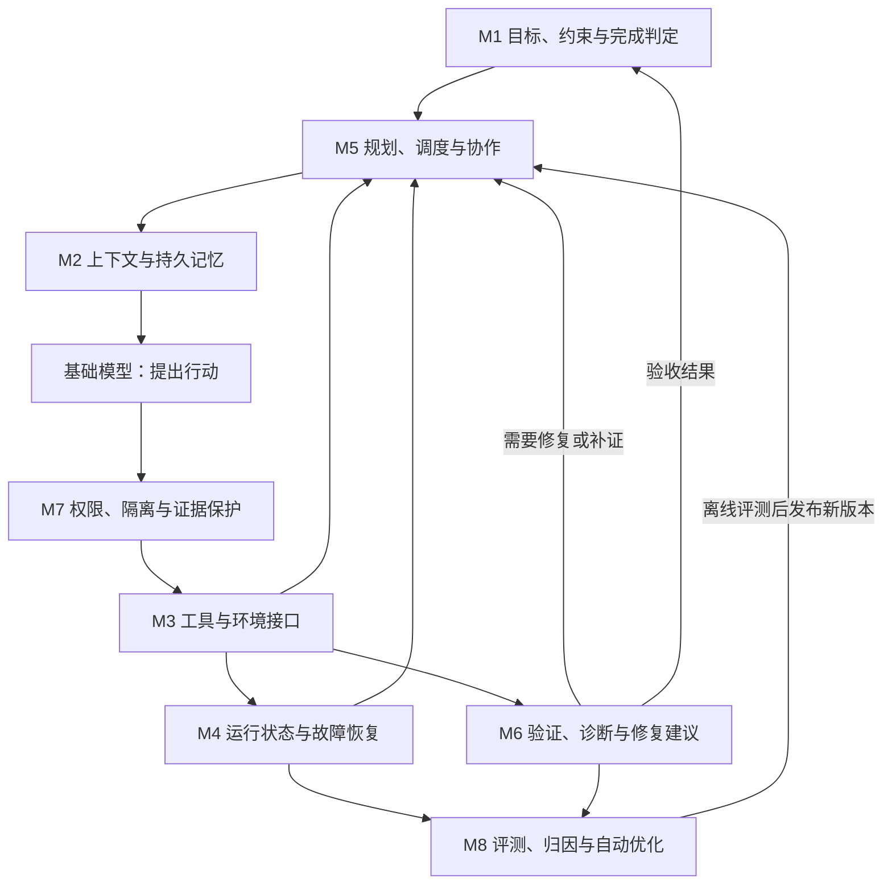

# Harness

## 系统架构

## 系统说明

Harness 是模型外围的运行系统：决定模型看见什么、能够做什么、行动如何执行、状态怎样保存，以及何时结束。上图是本库用于组织研究的参考架构，不是某个闭源产品的内部实现，也不要求部署八个独立服务。

先区分三个层次：运行 Harness 管执行闭环；工程环境提供仓库说明、测试和依赖；评测 Harness 初始化任务并判断结果。改善仓库环境不能直接当作模型变强，被测智能体也不能通过修改最终评分器获得成功。

一次任务先由 M1 固定目标与验收条件，M5 调度工作，M2 提供上下文，模型提出的行动经 M7 授权后由 M3 执行。M6 对当前产物和原始证据作检查，未通过则返回修复；M4 保留执行事实以便恢复，M8 通过离线对照决定下一版本是否值得发布。不是每次只读工具调用都需要额外评估智能体。

### 八个职责模块与主题入口

| 职责模块 | 具体介绍与输入输出 | 细化阅读 |
|---|---|---|
| M1 目标、约束与完成判定 | 把需求写成版本化验收条件；区分完成、失败和证据不足。接收 M6 的证据，不以模型总结替代完成判定。 | [任务循环](../topics/Harness任务循环.md) |
| M2 上下文与持久记忆 | 选择、压缩、回查信息；经验必须有来源与适用范围。长期知识不替代本次执行记录。 | [上下文](../topics/上下文选择与压缩.md)、[记忆](../topics/Agent记忆与保鲜.md) |
| M3 工具与环境接口 | 发现能力、校验参数、执行并保留原始结果；请求受理不等于副作用完成。 | [MCP 与 Skill](../topics/工具协议与MCP及Skill.md) |
| M4 运行状态与故障恢复 | 保存事件与检查点，重建任务现场；超时先核对外部状态，不盲目重放写操作。 | [LangGraph 持久化](../topics/LangGraph状态图与持久化.md) |
| M5 规划、调度与协作 | 管依赖、预算、模型调用和异步协作；增加智能体数量并不自动缩短关键路径。 | [AutoGen 团队](../topics/AutoGen对话团队与终止.md) |
| M6 验证、修复与知识补充 | 独立核对当前版本的产物与证据；区分缺知识、缺观察和策略失败，修复仍由调度器执行。 | [代码与反馈](../topics/AI代码开发与反馈.md)、[失败归因](../topics/Agent评测与失败归因.md) |
| M7 权限、隔离与证据保护 | 在真实行动路径上检查授权，保护验证器、证据与隔离边界；提示词不是强制权限控制。 | [工具安全评测](../topics/稳健性与工具安全评测.md) |
| M8 评测、归因与自动优化 | 固定版本、预算及测试集合，分析轨迹并筛选候选；不允许通过降低当前验收标准制造成功。 | [评测协议](../topics/评测协议与可复现性.md)、[RSI](RSI.md) |

### 六类交接记录

至少分开保存：目标合同、任务与动作状态、原始执行记录、绑定产物版本的验收结果、可复用经验、运行配置与评测结果。M4 回答“实际发生了什么”，M2 回答“今后可能复用什么”；两者不能被同一段会话摘要替代。新版本产物不能沿用旧版本的通过结论。

建议先打通 M1—M4—M6—M8 的完成、恢复与测量主线，同时具备上下文、工具和权限基础，再增加复杂并行与自改进。这是研究顺序建议，不是已验证的性能结论。机制依据见[ReAct](https://arxiv.org/html/2210.03629v3)、[LangGraph 持久化](https://docs.langchain.com/oss/python/langgraph/persistence)，各主题保留固定版本源码与条件。

本模块包含6个主题、18个知识点。每个知识点都有公式、Python教学实现、结构图与固定版本来源。先选择希望获得的能力，再按前置关系进入主题；主题提供具体示例与实践设计，未完成实验不会标记为已验证。

## 核心知识单元

| 主题 | 学习目标 | 教学代码 |
|---|---|---|
| [Harness任务循环](../topics/Harness任务循环.md) | 画出可恢复状态机；区分模型与宿主责任；定义停止和重试条件 | [示例](../../examples/harness/agent-loop.py) |
| [上下文选择与压缩](../topics/上下文选择与压缩.md) | 按任务选择上下文；设计压缩检查点；检测信息丢失 | [示例](../../examples/harness/context.py) |
| [Agent记忆与保鲜](../topics/Agent记忆与保鲜.md) | 定义记忆写入与失效条件；区分个人偏好和公共事实；验证召回适用性 | [示例](../../examples/harness/memory.py) |
| [工具协议与MCP及Skill](../topics/工具协议与MCP及Skill.md) | 区分工具Schema与任务方法；设计协议错误处理；验证副作用边界 | [示例](../../examples/harness/tools-skills.py) |
| [LangGraph状态图与持久化](../topics/LangGraph状态图与持久化.md) | 解释超步写入与状态归并；按线程和检查点恢复任务写入；识别interrupt节点重跑和顺序绑定 | [示例](../../examples/harness/langgraph.py) |
| [AutoGen对话团队与终止](../topics/AutoGen对话团队与终止.md) | 追踪轮询团队的调度与消息流；区分状态化终止条件及其组合；恢复参与者与管理器的一致状态 | [示例](../../examples/harness/autogen.py) |

## 四层能力与产物

- 解释模型、工具、上下文和宿主责任；产物：概念关系说明与反例。
- 推演状态转移、预算与恢复条件；产物：可复核的手算或状态推演。
- 设计有回读能力的任务执行循环；产物：带输入、步骤和预期的实践设计。
- 评估恢复、记忆有效性与边界失效；产物：协议、失败分析与结论限制。

完整对应关系见[能力地图](../../docs/能力地图.md)。模块内次序是阅读建议，正式先修以关系清单为准。

## 系统学习入口

[Hugging Face Agents Course](https://huggingface.co/learn/agents-course/unit0/introduction)；[LangGraph 官方文档](https://docs.langchain.com/oss/python/langgraph/overview)；[Full Stack LLM Bootcamp](https://fullstackdeeplearning.com/llm-bootcamp/spring-2023/)。

材料类型、适用基础、归档年份和维护状态见[系统学习资源指南](../../docs/系统学习资源指南.md)。公开入口可读不代表本库已完成整门课程。

## 模块实践与自测

选一个主题，先独立完成推导或状态推演，再设计最小实践；提交时写明条件、预期、判据和结果。解释一个失败样例通常比只展示成功输出更能检查理解。评价模板见[评测协议模板](../../templates/评测协议模板.md)。

## 后续缺口

真实框架检查点与并发恢复实验、长期记忆保鲜实验与工具边界回归。本版已补齐逐点公式、教学代码与结构图，真实规模实验仍待执行，不宣称覆盖本领域全部知识。后续按[研究队列](../../docs/研究队列.md)和证据质量推进。

返回[知识地图](../../docs/大模型持续学习知识库.md)。

## 2026研究进展

让跨轨迹压缩、经验质量与可恢复的运行状态一起工作。 阅读[Harness研究进展](../frontiers/Harness研究进展.md)，对照会议论文、作者版本与当前开源实现。来源及本地保存情况见[来源资料库](../../sources/README.md)。
