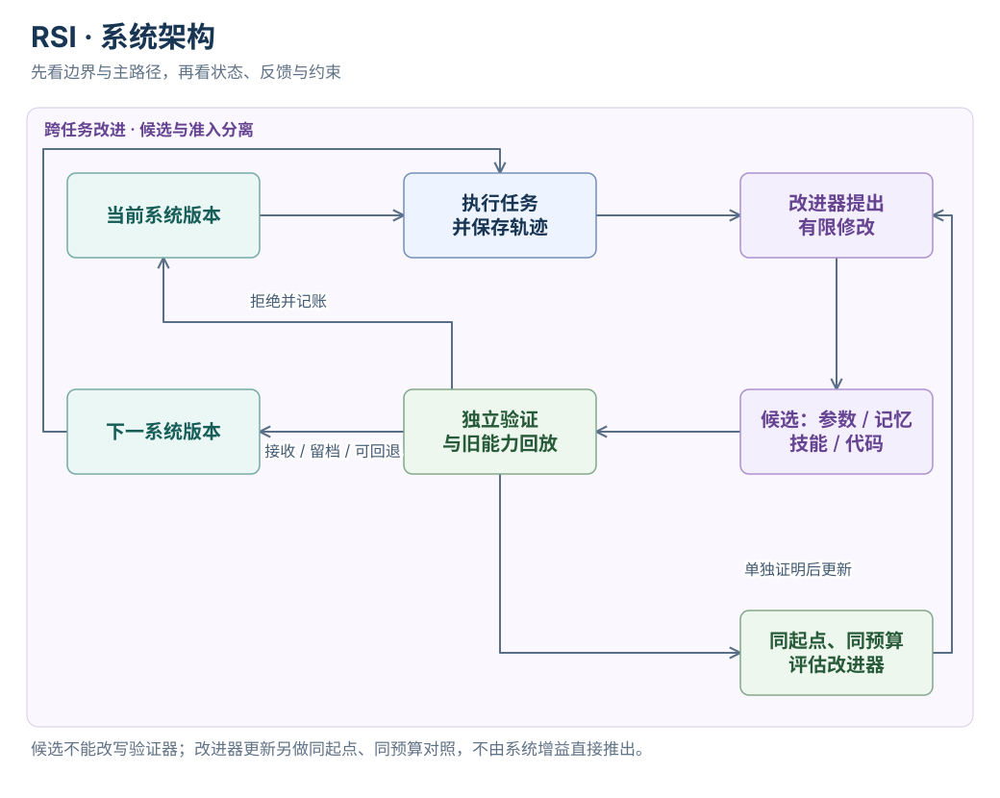
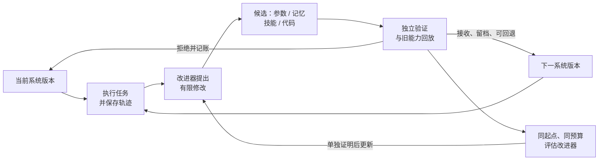

# RSI

## 系统架构

[查看完整架构图](../../assets/architecture-rsi.svg)。系统改进与改进器改进分开归因；验证器不能由候选任意改写。

查看架构图权威源码（Mermaid）

## 系统说明

RSI（Recursive Self-Improvement，递归自我改进）研究系统如何从执行经验中保留修改，并让后续任务实际使用这些修改。一次回答里的重试没有留下可复用状态，不等于跨任务改进；最终系统更强，也不能单独证明改进器更强或改进会持续加速。

这里将任务系统、改进器和独立验证器分开。可修改对象包括模型参数、上下文与记忆、技能、工具和 Harness 代码；联合修改需要交叉对照，环境模拟产生的反馈需要真实任务校准。验证器和最终测试集不应成为候选可任意改写的部分。

### 方法地图

| 修改对象 | 机制与风险 | 主题入口 |
|---|---|---|
| 参数 | 将经验写入权重；需测训练成本、遗忘与新旧框架适配 | [系统演化](../topics/RSI系统与改进器演化.md) |
| 上下文、记忆 | 保存有来源的经验，再在适用条件下检索；警惕错误经验累积 | [记忆与技能](../topics/RSI记忆与技能更新.md) |
| 技能 | 把经验转为可复用步骤；限制每次改动范围，验证实际被采用 | [记忆与技能](../topics/RSI记忆与技能更新.md) |
| 工具、Harness 代码 | 候选必须通过接口、安全边界、回放和留出检查 | [系统演化](../topics/RSI系统与改进器演化.md) |
| 改进器自身 | 比较早晚改进器从同一系统出发、用同预算产生的增益 | [评测与归因](../topics/RSI评测与归因.md) |

先明确修改范围、固定起点和预算，再运行无更新、简单笔记、固定改进器与待研究方法四组对照。训练集产生经验，验证集选择候选，冻结后才使用独立测试集；另留旧任务回放集检查退化。拒绝候选、检查、回滚与部署也必须记入成本。

公开证据入口：[分类综述摘要](https://arxiv.org/abs/2610.14625)、[RRSI 摘要](https://arxiv.org/abs/2609.24972)、[Hyperagents 摘要](https://arxiv.org/abs/2603.19461)、[RSI 评测审计摘要](https://arxiv.org/abs/2610.27610)。本轮核对了摘要与版本记录，未阅读这些论文的全部正文，也未复现其实验；以下公式与代码是本库显式标注的教学模型，不是论文性能结论。

## 核心知识单元

| 主题 | 整体问题 | 教学代码 |
|---|---|---|
| [RSI改进闭环与版本准入](../topics/RSI改进闭环与版本准入.md) | 什么变化算跨任务改进，候选何时进入下一轮 | [loop.py](../../examples/rsi/loop.py) |
| [RSI记忆与技能更新](../topics/RSI记忆与技能更新.md) | 怎样限制修改、保留证据并测量经验是否真正使用 | [memory.py](../../examples/rsi/memory.py) |
| [RSI系统与改进器演化](../topics/RSI系统与改进器演化.md) | 怎样隔离参数、框架与改进器的贡献 | [evolution.py](../../examples/rsi/evolution.py) |
| [RSI评测与归因](../topics/RSI评测与归因.md) | 怎样测量保留能力、改进效率和过程收益 | [evaluation.py](../../examples/rsi/evaluation.py) |

## 模块实践与边界

从固定模型的离线技能更新开始，提交任务拆分、版本快照、修改证据、接收/拒绝原因、分项成本、旧能力变化及冻结后的测试。用不同任务顺序与随机种子重复完整循环，而不只是重复评测最终产物。没有执行真实模型训练或开放式代码自改写；教学示例不赋予网络、文件写入或生产发布权限。

RSI 与 Harness 同属周四学习组，按周交替，模块内主题按各自出现次数轮换；周日仍保留 Benchmark 复习。参见[持续更新指南](../../docs/持续更新指南.md)。
