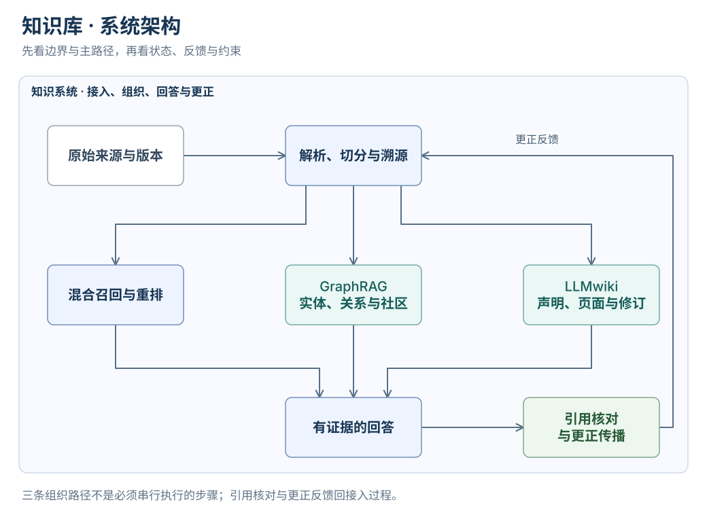
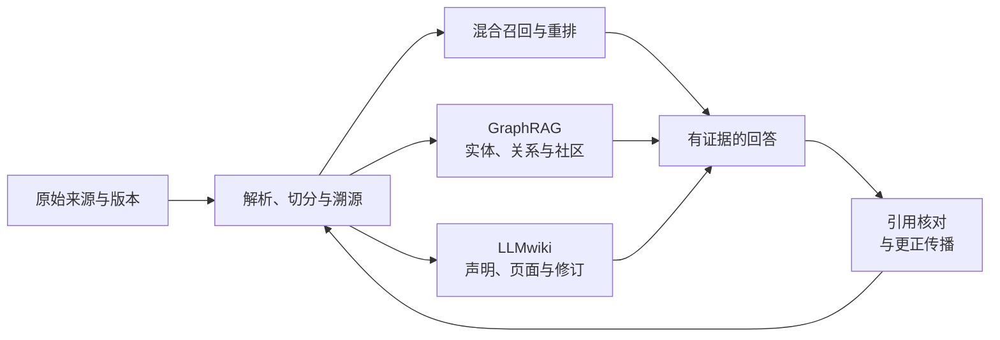

# 知识库

## 系统架构

[查看完整架构图](../../assets/architecture-knowledge.svg)。检索、GraphRAG、LLMwiki 是不同组织路径，不是三个必经的串行阶段。

查看架构图权威源码（Mermaid）

## 系统说明

知识系统首先保存来源身份，再建立可检索或可编纂的派生产物。普通 RAG 以查询时召回为主，GraphRAG增加实体关系和社区层次，LLMwiki维护可阅读、可修订的知识页。三者可以共享来源，但图相邻、页面互链和事实支持不是同一种关系。

阅读顺序是来源接入、检索、引用回答，再分别进入 GraphRAG 与 LLMwiki。前者解释如何组织查询上下文，后者解释如何维护持久知识及更新影响；两个主题独立展示，保留互相引用。

本模块包含5个主题、15个知识点。每个知识点都有公式、Python教学实现、结构图与固定版本来源。先选择希望获得的能力，再按前置关系进入主题；主题提供具体示例与实践设计，未完成实验不会标记为已验证。

## 核心知识单元

| 主题 | 学习目标 | 教学代码 |
|---|---|---|
| [RAG与引用回答](../topics/RAG与引用回答.md) | 拆分检索和回答误差；建立可回查引用；设计无答案场景 | [示例](../../examples/knowledge/rag.py) |
| [来源接入与版本管理](../topics/来源接入与版本管理.md) | 保存来源身份和读取范围；设计版本更正传播；保持解析质量 | [示例](../../examples/knowledge/ingestion.py) |
| [混合检索与重排](../topics/混合检索与重排.md) | 识别不同召回器的优劣；理解排序融合；分阶段定位检索失败 | [示例](../../examples/knowledge/hybrid-search.py) |
| [GraphRAG](../topics/GraphRAG与LLMWiki.md) | 局部实体查询；社区全局查询；来源覆盖检查 | [示例](../../examples/knowledge/graph-wiki.py) |
| [LLMwiki](../topics/LLMwiki知识编纂与更新.md) | 来源与声明分层；版本准入；类型化更新传播 | [示例](../../examples/knowledge/llm_wiki.py) |

## 四层能力与产物

- 解释来源、索引、声明和Wiki职责；产物：概念关系说明与反例。
- 计算检索指标并推演更新影响链；产物：可复核的手算或状态推演。
- 设计可追溯的小型RAG或Wiki实验；产物：带输入、步骤和预期的实践设计。
- 评估引用支持、更新一致性与维护成本；产物：协议、失败分析与结论限制。

完整对应关系见[能力地图](../../docs/能力地图.md)。模块内次序是阅读建议，正式先修以关系清单为准。

## 系统学习入口

[LLM Systems](https://llmsystem.github.io/llmsystem2025spring/)；[Full Stack LLM Bootcamp](https://fullstackdeeplearning.com/llm-bootcamp/spring-2023/)；[Hugging Face RAG 实践](https://huggingface.co/learn/cookbook/en/advanced_rag)；[Ragas 评测指标](https://docs.ragas.io/en/stable/concepts/metrics/overview/)。

材料类型、适用基础、归档年份和维护状态见[系统学习资源指南](../../docs/系统学习资源指南.md)。公开入口可读不代表本库已完成整门课程。

## 模块实践与自测

选一个主题，先独立完成推导或状态推演，再设计最小实践；提交时写明条件、预期、判据和结果。解释一个失败样例通常比只展示成功输出更能检查理解。评价模板见[评测协议模板](../../templates/评测协议模板.md)。

## 后续缺口

全文归档、失效传播、检索数据集、原子索引发布和维护成本实验。本版已补齐逐点公式、教学代码与结构图，真实规模实验仍待执行，不宣称覆盖本领域全部知识。后续按[研究队列](../../docs/研究队列.md)和证据质量推进。

返回[知识地图](../../docs/大模型持续学习知识库.md)。

## 2026研究进展

从语义相似检索，走向需要推理且能处理冲突的证据链。 阅读[知识库研究进展](../frontiers/知识库研究进展.md)，对照会议论文、作者版本与当前开源实现。来源及本地保存情况见[来源资料库](../../sources/README.md)。
