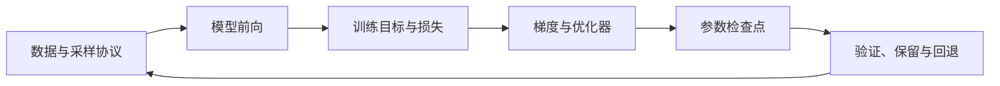

# 训练

## 系统架构

## 系统说明

训练是把数据、目标函数、优化算法和评估协议连接起来的参数更新系统。预训练学习条件分布，SFT学习给定示范，偏好优化利用相对选择，策略优化根据奖励修正行为。它们共享“计算损失—更新参数—验证”的骨架，但数据来源、监督语义和稳定性条件不同。

系统输入包括数据版本、初始权重与预算，输出不仅是权重，还应有采样配置、检查点及验证记录。先看预训练总体闭环，再进入 SFT、偏好与策略优化；一次教学损失计算不能等同于真实大模型训练收益。

本模块包含4个主题、12个知识点。每个知识点都有公式、Python教学实现、结构图与固定版本来源。先选择希望获得的能力，再按前置关系进入主题；主题提供具体示例与实践设计，未完成实验不会标记为已验证。

## 核心知识单元

| 主题 | 学习目标 | 教学代码 |
|---|---|---|
| [预训练目标与数据](../topics/预训练目标与数据.md) | 定位目标错位和mask；计算CE梯度与有效token加权；审计文档级重复和打包边界 | [示例](../../examples/training/pretraining.py) |
| [监督微调与LoRA](../topics/监督微调与LoRA.md) | 核验模板mask和监督目标；推导LoRA参数梯度；验证合并与未合并前向等价 | [示例](../../examples/training/sft.py) |
| [偏好学习与DPO](../topics/偏好学习与DPO.md) | 推导KL重参数化；核算DPO稳定损失和梯度；识别序列mask及长度权重变化 | [示例](../../examples/training/preference.py) |
| [策略优化与GRPO](../topics/策略优化与GRPO.md) | 计算组优势及缺失奖励边界；推导裁剪梯度与old冻结作用；区分KL期望条件和损失归约 | [示例](../../examples/training/policy-optimization.py) |

## 四层能力与产物

- 区分预训练、SFT、偏好与策略优化；产物：概念关系说明与反例。
- 计算损失、低秩参数与相对优势；产物：可复核的手算或状态推演。
- 设计数据切分、模板与奖励检查；产物：带输入、步骤和预期的实践设计。
- 以独立任务和污染分析判断训练效果；产物：协议、失败分析与结论限制。

完整对应关系见[能力地图](../../docs/能力地图.md)。模块内次序是阅读建议，正式先修以关系清单为准。

## 系统学习入口

[动手学深度学习](https://zh.d2l.ai/)；[Stanford CS336](https://cs336.stanford.edu/spring2025/)；[Hugging Face LLM Course](https://huggingface.co/learn/llm-course/chapter1/1)；[PyTorch 基础教程](https://docs.pytorch.org/tutorials/beginner/basics/intro.html)；[LLM Systems](https://llmsystem.github.io/llmsystem2025spring/)；[LM Evaluation Harness](https://raw.githubusercontent.com/EleutherAI/lm-evaluation-harness/main/README.md)。

材料类型、适用基础、归档年份和维护状态见[系统学习资源指南](../../docs/系统学习资源指南.md)。公开入口可读不代表本库已完成整门课程。

## 模块实践与自测

选一个主题，先独立完成推导或状态推演，再设计最小实践；提交时写明条件、预期、判据和结果。解释一个失败样例通常比只展示成功输出更能检查理解。评价模板见[评测协议模板](../../templates/评测协议模板.md)。

## 后续缺口

分布式训练、数据治理、蒸馏与On-policy方法、训练稳定性实测。本版已补齐逐点公式、教学代码与结构图，真实规模实验仍待执行，不宣称覆盖本领域全部知识。后续按[研究队列](../../docs/研究队列.md)和证据质量推进。

返回[知识地图](../../docs/大模型持续学习知识库.md)。

## 2026研究进展

把奖励归一化、正负样本与异步训练中的版本差异连起来。 阅读[训练研究进展](../frontiers/训练研究进展.md)，对照会议论文、作者版本与当前开源实现。来源及本地保存情况见[来源资料库](../../sources/README.md)。
