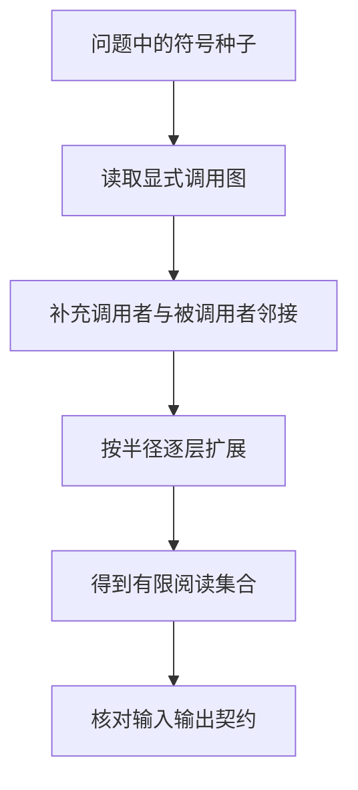
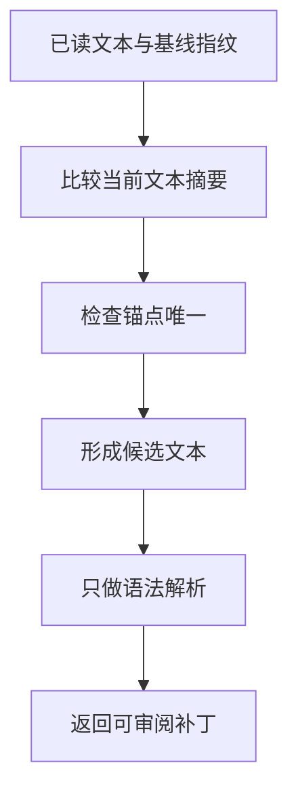
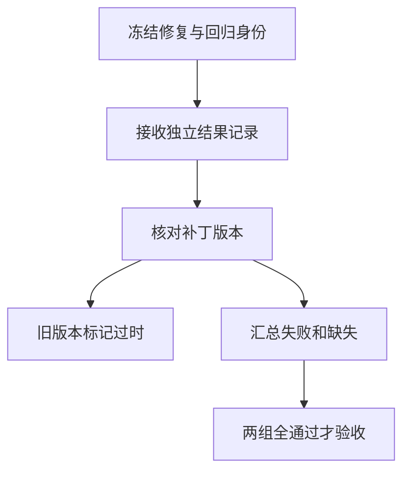

# AI代码开发与反馈

> 代码Agent围绕仓库问题形成可审阅补丁，并让独立行为证据反馈下一轮。找到文件、生成可解析代码、通过若干检查和真正满足用户契约是递进但不等价的判断；有效反馈还必须绑定被验证的那一版补丁。

## 学习目标

- 按契约形成补丁
- 区分测试缺口与修复
- 记录可复查证据

## 前置知识

先读[业务Agent任务闭环](业务Agent任务闭环.md)，并理解版本控制、调用关系与测试结果。这里讨论通用机制，不介绍特定闭源编程产品内部实现；所有代码都处理模拟文本或结果记录，不启动构建、测试或模型服务。

## 基本机制

SWE-agent论文把Agent-Computer Interface分为搜索导航、文件查看、编辑和上下文管理，并强调反馈的有效信息与错误恢复。固定源码DefaultAgent.step将动作结果加入历史和轨迹，run循环保存轨迹；这说明反馈不仅是一段聊天文本，还对应实际执行和补丁状态。[SWE-agent: Agent-Computer Interfaces Enable Automated Software Engineering](https://arxiv.org/html/2405.15793v3)；[SWE-agent DefaultAgent 动作与轨迹](https://github.com/SWE-agent/SWE-agent/blob/3ea751c087f32b16e039a2233dd6eefecef325d5/sweagent/agent/agents.py#L936)。

本页串起三段职责：先找能解释问题的仓库邻域，再对已读基线生成有限补丁，最后从冻结的修复与回归要求汇总证据。补丁正确性的依据应来自用户契约、调用方与独立验收，不能由刚生成的实现反过来决定全部检查。

完整教学实现：[运行机制示例](../../examples/agents/coding-agent.py)。示例仅使用 Python 标准库，对传入的模拟数据计算结果；本页没有执行模型、外部工具或真实业务实验。

## 推导或示例

### 知识点一：仓库理解应沿调用关系扩展问题上下文

搜索命中一行代码只是定位起点。一个参数在调用方被约束、在适配层被转换、在底层被消费，直接改命中行可能违背另一层契约。令调用图为 $G=(V,E)$，问题中明确出现的符号为种子集S。本页为阅读用途把边视为无向邻接，定义

$$
C_0=S,\qquad C_{k+1}=C_k\cup\{v\mid\exists u\in C_k:(u,v)\in E\lor(v,u)\in E\}.
$$

这是**仓库上下文教学模型**，不是完美程序切片。给定entry → parse → normalize，种子parse、半径1会包含三个节点；另一个unrelated模块不会进入。半径0只保留种子，半径增加得到包含关系 $C_k\subseteq C_{k+1}$，但内容更多不自动意味着更好。

SWE-agent论文的搜索命令返回文件或字符串位置，文件查看器显示当前窗口及行号；固定源码WindowedFile.get_window_text也按窗口组织文本。本文将“按需定位、有限阅读”的思路扩展为一个显式图练习，源码并没有实现这里的调用图遍历算法。

对“空输入异常”，阅读范围至少要回答：调用者是否允许空输入、返回值由谁消费、异常是否是接口的一部分。若现有测试未定义空输入，不能仅凭当前函数抛异常就认为异常是正确契约，也不能凭直觉把它吞掉。

```python
def repository_slice(calls: dict[str, set[str]], seeds: set[str], radius: int) -> list[str]:
    """在显式调用图上取种子周围的调用者和被调用者，不解析真实仓库。"""
    if type(radius) is not int or radius < 0:
        raise ValueError('半径须为非负整数')
    graph = {node: set(children) for node, children in calls.items()}
    for node, children in calls.items():
        for child in children:
            graph.setdefault(child, set()).add(node)
    if not seeds <= graph.keys():
        raise ValueError('种子不在调用图中')
    visited, frontier = set(seeds), set(seeds)
    for _ in range(radius):
        frontier = {v for u in frontier for v in graph[u]} - visited
        visited |= frontier
    return sorted(visited)
```

calls是已知的调用邻接表，函数建立双向邻接，从种子向外做有限层扩展，输出稳定排序后的符号身份。它不解析仓库源码；动态分派、配置选择和数据流需要额外分析。半径只限制阅读邻域，不授权修改所有命中节点。



源码与原文：[SWE-agent WindowedFile 定位与替换](https://github.com/SWE-agent/SWE-agent/blob/3ea751c087f32b16e039a2233dd6eefecef325d5/tools/windowed/lib/windowed_file.py#L190)；[SWE-agent LastNObservations 历史处理](https://github.com/SWE-agent/SWE-agent/blob/3ea751c087f32b16e039a2233dd6eefecef325d5/sweagent/agent/history_processors.py#L147)；[SWE-agent: Agent-Computer Interfaces Enable Automated Software Engineering](https://arxiv.org/html/2405.15793v3)。

可验证性质是半径0等于种子、范围随半径单调、孤立无关节点不进入。反例是插件动态调用不在图里，图函数会遗漏真正受影响文件；真实Agent必须结合搜索、配置与运行证据，而不能把静态图当成全部事实。

### 知识点二：文本补丁必须绑定基线并维护编辑不变量

长任务中读到的文件可能已经被其他步骤改变。仍按旧行号编辑会把正确意图应用到错误位置。设已读文本为x、记录指纹为h、旧锚点为a、新文本为b，本文的**补丁准入条件**是

$$
H(x)=h,\quad count_x(a)=1,\quad a\ne\epsilon,\quad parse(x[a\mapsto b])\text{ 成功}.
$$

H是UTF-8文本的SHA-256，单位为固定长度摘要；它用于检验“是否同一基线”，不是鉴别代码善恶。count唯一防止一个模糊字符串替换到多个位置；parse只是Python语法解析，不运行代码，也不保证可导入、类型正确或业务行为正确。

该版本WindowedFile.replace_in_window在当前窗口内调用字符串replace，replace则在完整文件文本中替换所有匹配；找不到内容会报错。这两条路径没有本文的唯一锚点保护，所以教学示例更严格，不能把其约束归给上游实现。论文中编辑接口带错误反馈，并用lint阻止部分无效编辑。本文把这种保护缩成可手算的内存函数，没有声称复刻其完整编辑器。

手算文本中只有一次“return items[0]”，可以用更完整的逻辑替换并检查语法；若两处都出现同一锚点，应扩大上下文而非随机改第一处。若基线已有新改动，即使锚点仍存在也应重新读取，确认新改动与当前修复兼容。

```python
import ast
from hashlib import sha256

def guarded_replace(source: str, old: str, new: str, expected_sha: str) -> str:
    """对内存Python文本做基线与唯一锚点校验，再返回语法可解析的候选补丁。"""
    if sha256(source.encode()).hexdigest() != expected_sha:
        raise ValueError('补丁基线已变化')
    if not old or source.count(old) != 1:
        raise ValueError('替换锚点必须唯一且非空')
    candidate = source.replace(old, new, 1)
    ast.parse(candidate)
    return candidate
```

函数先比较摘要再检查唯一锚点，最后用ast.parse验证候选并返回新文本。失败时原字符串天然不变。代码不写文件、不执行候选，也不做真实git patch；生产还需处理编码、换行、文件移动、多文件一致性和并发提交。



源码与原文：[SWE-agent WindowedFile 定位与替换](https://github.com/SWE-agent/SWE-agent/blob/3ea751c087f32b16e039a2233dd6eefecef325d5/tools/windowed/lib/windowed_file.py#L190)；[SWE-agent: Agent-Computer Interfaces Enable Automated Software Engineering](https://arxiv.org/html/2405.15793v3)；[SWE-bench: Can Language Models Resolve Real-World GitHub Issues?](https://arxiv.org/html/2310.06770v3)。

可验证性质是旧基线拒绝、零匹配和多匹配拒绝、语法错误不返回候选、输入字符串不变。反例是把return x改成return 0，语法和锚点检查都通过但业务全错；需要第三点的独立验收。

### 知识点三：修复与回归证据要绑定同一补丁版本

只看原来失败的样例变绿，会漏掉已正常功能被破坏。SWE-bench使用FAIL_TO_PASS与PASS_TO_PASS区分修复与维护；论文附录A.4描述以固定基线应用预测补丁并比较测试状态。本文采用更保守的**教学证据契约**：

$$
accept=matchVersion\land\bigwedge_{t\in F}passed(t)\land\bigwedge_{t\in P}passed(t),\quad F\ne\varnothing,P\ne\varnothing.
$$

F为修复测试身份，P为回归测试身份。集合在补丁生成前冻结。结果未知或未出现时不能补成通过；记录指向另一版补丁则先标stale，不对当前补丁下结论。真正执行环境还应绑定依赖、测试集版本和运行配置，示例只演示补丁身份这一维。

手算F={empty_input}、P={normal_input}，前者passed后者failed，总状态failed；只提供empty_input结果则unknown；两者passed但证据属于p1、当前补丁为p2，则stale。这样可以防止“修完又改了几行，沿用上次绿灯”的常见误判。

当前读取的SWE-bench源码对空分组返回1，并在P2P维护判断中接受SKIPPED；论文附录A.4描述的是所有目标测试找到且通过。不同版本与状态语义应明确区分。本文主动采用非空且显式passed的简化规则，不冒充当前完整评分器。

```python
def grade_patch(repair: set[str], regression: set[str], outcomes: dict[str, str],
                patch_id: str, evidence_patch_id: str) -> dict:
    """用冻结测试身份审阅结果记录；只汇总数据，不运行测试。"""
    if not patch_id or not evidence_patch_id:
        raise ValueError('补丁和证据必须具有版本身份')
    if repair & regression:
        raise ValueError('修复与回归集合不可重叠')
    if any(v not in {'passed', 'failed', 'unknown'} for v in outcomes.values()):
        raise ValueError('结果状态不合法')
    if patch_id != evidence_patch_id:
        return {'status': 'stale', 'missing': [], 'failed': []}
    required = repair | regression
    missing = sorted(t for t in required if outcomes.get(t, 'unknown') == 'unknown')
    failed = sorted(t for t in required if outcomes.get(t) == 'failed')
    if failed:
        status = 'failed'
    elif missing or not repair or not regression:
        status = 'unknown'
    else:
        status = 'succeeded'
    return {'status': status, 'missing': missing, 'failed': failed}
```

grade_patch只汇总传入的结果字典，没有执行任何测试。它首先拒绝修复与回归身份重叠和未知状态值，再检查补丁身份，最后保留missing与failed清单。若失败与缺失同时出现，整体失败但仍保留缺失证据，供后续修复与复核。



源码与原文：[SWE-bench 测试分组与解决状态](https://github.com/SWE-bench/SWE-bench/blob/02e7a74ffd0b707aab73d203fe87bdc7c76afc8e/swebench/harness/grading.py#L179)；[SWE-bench: Can Language Models Resolve Real-World GitHub Issues?](https://arxiv.org/html/2310.06770v3)；[SWE-agent DefaultAgent 动作与轨迹](https://github.com/SWE-agent/SWE-agent/blob/3ea751c087f32b16e039a2233dd6eefecef325d5/sweagent/agent/agents.py#L936)。

可验证性质是旧证据拒绝、缺失不当通过、回归失败阻止成功、空分组保持未知。反例是测试契约本身漏掉业务条件，即使全部通过仍不证明所有缺陷消失；验收应结合需求、调用方与人工审阅，不由实现自行定义断言。

## 适用条件与限制

此页未运行仓库测试，也未声称复现SWE-agent或SWE-bench。教学代码只处理图、文本和模拟结果。真实编程任务还涉及依赖安装、构建环境、资源预算、补丁冲突与多文件语义，不应把语法成功误写为开发完成。

错误归因应区分环境无法启动、补丁无法应用、测试断言失败和任务契约不足。生成行数、提交数或删除失败检查都不是修复质量证据；有效反馈必须能指向具体行为和版本。

## 实践任务

为自建空输入函数写独立契约，再给出包含调用者与被调用者的三节点图。设计两个同名锚点和一次基线改变，说明编辑保护为何拒绝。最后制作修复通过、回归失败、结果缺失、旧补丁证据四份记录，手算验收结论并指出需要补充的证据。

实践状态保持 `designed`。教学函数的测试由统一 UT 流程负责，本页不把手算预期写成已运行结果，也不把示例性质外推为真实模型成功率。

## 掌握标准

- 能从症状扩展到调用方契约，并区分阅读范围与修改范围。
- 能说明指纹、唯一锚点和语法检查各防住什么。
- 能识别“语法通过但行为错误”的补丁反例。
- 能区分修复、回归、缺失和过时证据，不沿用旧版本绿灯。

## 源码导读与模型边界

阅读WindowedFile的get_window_text与replace_in_window，再读DefaultAgent.step如何记历史和轨迹，最后读SWE-bench的分组评分与解决状态。正文所有策略都是通用原理；不对任何闭源工具的内部实现作未核实推断。

### 连贯案例复盘

以空输入问题为例，先在独立契约中写清空输入是返回空结果还是抛出特定异常，再看调用方是否依赖该行为。只有契约明确后，补丁与验证才有共同参照；“当前不再崩溃”不是普遍适用的修复目标。

| 候选补丁或记录 | 能通过哪层 | 仍有哪些缺口 |
|---|---|---|
| 吞掉所有异常 | 可能语法通过 | 可能隐藏真实失败 |
| 修改唯一锚点但基线已变 | 意图可能合理 | 必须重新读取基线 |
| 修复测试通过、回归失败 | 局部修复成立 | 整体不可验收 |
| 两组通过但证据属于旧补丁 | 旧版本有证据 | 当前版本未被验证 |

补丁范围也不是越小越好或越大越完整。只改底层可能遗漏调用方约束，顺手重构整个模块又增加无关风险。合理范围应能逐个说明与需求的关系，并把必要修改和纯风格整理区分清楚。调用图阅读集合帮助理解影响，但它不是允许修改文件的自动白名单。

语法解析不执行代码，因此可以用于早期保护，却无法发现依赖缺失、导入副作用或业务类型错误。完整验证由统一执行方在固定环境进行，本组示例只消费结果记录。报告中应写清验证的是哪一版补丁、用了哪些独立契约，以及哪些范围尚无证据。

如果测试集本身有问题，需要独立说明更正理由和行为契约，不能为了让当前实现通过而删除失败断言。把实现输出复制成期望值会丢失反例能力；有效测试必须能区分当前错误实现与至少一种满足契约的实现。

本文源码链接均锁定实际读取的提交；论文锁定 arXiv 版本，在线官方文档记录读取日和正文指纹。公式中标为“教学模型”的预算、阈值和状态集合是本页设计，不是论文测得的效果。第三方文件只作为阅读依据，教学实现为独立简化。

---

[返回模块](../modules/业务Agent.md) · [知识点索引](../../docs/知识点索引.md) · [完整教学代码](../../examples/agents/coding-agent.py) · [提出更正](https://github.com/yanbozhang/llm-systems-wiki/issues/new?template=knowledge.yml)

觉得这篇推导有帮助，可以在 [GitHub](https://github.com/yanbozhang/llm-systems-wiki) 点 Star 收藏更新；分享时欢迎链接到具体知识点，便于读者复核公式、代码与来源。
