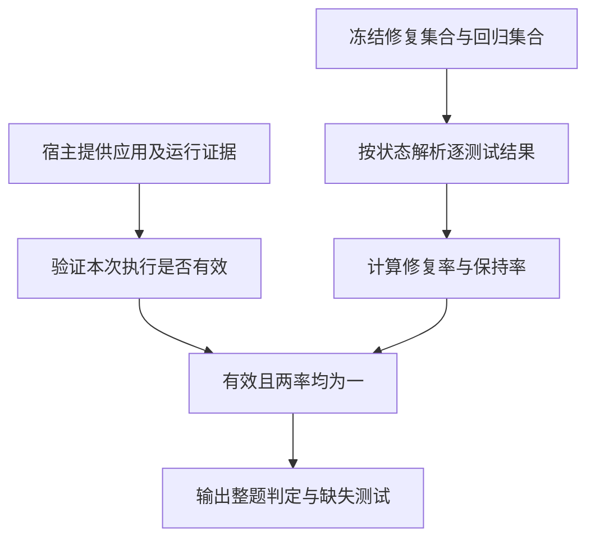
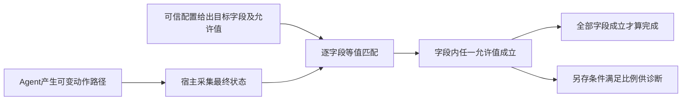
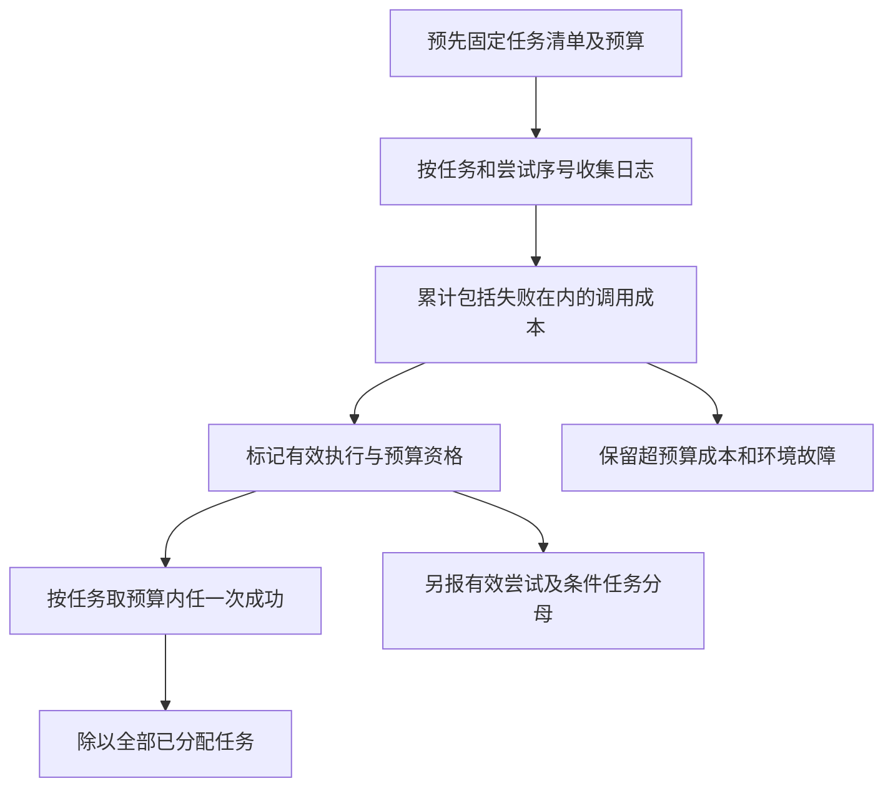

# Agent任务基准与执行评估

Agent 基准测量的是在指定环境、工具与预算下完成任务的系统。模型输出“已完成”只是一条被评输出，最终分数还依赖宿主是否真正执行、评估器检查什么，以及统计时哪些任务留在分母中。本页以 SWE-bench 的补丁验收、WebArena 的终态检查和 HumanEval 的采样口径建立三个可核算的边界。

## 学习目标

- 把任务成功拆成有效执行、目标满足与回归保持，并定位造成失败的证据。
- 写出能接受多条正确行动路径的终态判据，解释部分满足与整题成功的区别。
- 同时报首尝试、预算内最终成功与环境故障，识别按任务和按尝试平均的差异。

## 前置知识

先掌握[评测协议与可复现性](评测协议与可复现性.md)中的冻结协议，并了解[业务Agent任务闭环](业务Agent任务闭环.md)。以下指标都是无量纲比率；调用预算单位为“次”，尝试是从初始状态开始的一轮协议执行，不能把一次工具调用当成一次完整任务。

## 基本机制

一次可复核记录至少是 `(task_id, 初始状态版本, 被评系统版本, 尝试序号, 执行证据, 终态, 成本, 判定)`。同一基准名称不足以标识这些条件：数据子集、评估器提交、容器或网站快照、可见测试、反馈权限都可能改变结果。

| 责任方 | 提供的内容 | 不应越界的地方 |
| --- | --- | --- |
| 被评系统 | 补丁、动作和停止决定 | 不能自写最终成功标签或修改验收条件 |
| 执行宿主 | 状态初始化、实际执行、日志与预算 | 不能把未启动的测试记成无失败，也不能偷偷追加重试 |
| 评估器 | 冻结的测试或终态谓词、结构化判定 | 检查通过只覆盖既定性质，不能推断未检查的副作用不存在 |
| 汇总协议 | 任务清单、失效分类、分母和聚合 | 不能按成绩事后剔除任务或扩大成功的资源预算 |

这里读到的实现分别固定为 SWE-bench `02e7a74ffd0b707aab73d203fe87bdc7c76afc8e`、WebArena `dce04686a56253aefba7b18a4fa0937cf1dc987b`、HumanEval `b9453e8f1865df0a0057a1383767caa400acfbcf`。它们是三个独立基准，下面的教学函数只是抽取相应机制，没有拼成一个官方统一评测器。

## 推导或示例

### 知识点一：修复成功是有效运行、修复测试与回归保持的交集

SWE-bench 的修复测试集合 $F$ 包含修复前失败、参考修复后通过的测试；回归集合 $P$ 包含应继续保持通过的测试。[SWE-bench 论文的构建与评估说明](https://arxiv.org/html/2310.06770v1#S2)要求任务包含至少一个 fail-to-pass 测试，并通过应用候选补丁后运行测试判断实例是否解决。论文的“解决”不能缩成“存在一个新测试通过”。

令 $z_j$ 是可信日志解析出的测试状态， $I$ 表示补丁应用和测试运行证据有效。所读源码的 `PASS_AND_FAIL` 分支采用：

$$
f=\frac{\sum_{j\in F}\mathbf1[z_j\in\lbrace \mathrm{PASSED},\mathrm{XFAIL}\rbrace ]}{|F|},\qquad
p=\frac{\sum_{j\in P}\mathbf1[z_j\in\lbrace \mathrm{PASSED},\mathrm{XFAIL},\mathrm{SKIPPED}\rbrace ]}{|P|}.
$$

当 $P$ 为空时，该版本令 $p=1$ ；这只是聚合约定，报告仍应显示回归测试数为零。教学函数拒绝空 $F$ ，避免空目标产生平凡通过。整题成功为 $R=I\land(f=1)\land(p=1)$ 。若所有回归保持且仅部分修复通过，才是 `PARTIAL`；回归一旦失败，不能用其他修复通过的比例抵消。

例如 $F=\lbrace \text{fix}\rbrace$ 、 $P=\lbrace \text{keep}\rbrace$ ，状态分别是 `PASSED`、`FAILED`： $f=1,p=0,R=0$ 。若 `fix` 被跳过，则 $f=0$ ；若只有 `keep` 被跳过，所读实现把它视作保持。这个处理体现评估政策，不代表被跳过的功能已验证。`XFAIL` 被接受同样是特定实现语义，不是对所有测试框架的统一结论。

```python
def grade_patch(fail_to_pass, pass_to_pass, status_map, patch_applied=True, suite_ran=True):
    """模拟明确状态模式下的修复/回归判据；要求至少一个修复测试。"""
    f2p, p2p = list(fail_to_pass), list(pass_to_pass)
    if not f2p or len(set(f2p)) != len(f2p) or len(set(p2p)) != len(p2p) or set(f2p) & set(p2p):
        raise ValueError("修复测试须非空，测试ID须唯一且两组不重叠")
    if type(patch_applied) is not bool or type(suite_ran) is not bool:
        raise ValueError("运行前提须为明确布尔值")
    supported = {'PASSED', 'XFAIL', 'FAILED', 'ERROR', 'SKIPPED'}
    if any(status not in supported for status in status_map.values()):
        raise ValueError("未知测试状态须先由可信解析器处理")
    passed = {'PASSED', 'XFAIL'}
    f2p_ok = [case for case in f2p if status_map.get(case) in passed]
    p2p_ok = [case for case in p2p if status_map.get(case) in passed | {'SKIPPED'}]
    f2p_rate = len(f2p_ok) / len(f2p)
    p2p_rate = len(p2p_ok) / len(p2p) if p2p else 1.0
    valid = patch_applied and suite_ran
    status = 'INVALID' if not valid else ('FULL' if f2p_rate == p2p_rate == 1 else
                                         'PARTIAL' if 0 < f2p_rate < 1 and p2p_rate == 1 else 'NO')
    return {'status': status, 'resolved': status == 'FULL', 'f2p_rate': f2p_rate, 'p2p_rate': p2p_rate,
            'f2p_failed': [case for case in f2p if case not in f2p_ok],
            'p2p_failed': [case for case in p2p if case not in p2p_ok],
            'missing': sorted((set(f2p) | set(p2p)) - set(status_map)),
            'regression_tests': len(p2p)}
```

输入先固定两组唯一测试 ID，再用允许状态集合计算成功数。`missing` 显式列出应出现而缺失的测试；函数没有用“日志里没失败”推断通过。`patch_applied`、`suite_ran` 是由宿主提供的布尔证据摘要，本函数本身不会证明它们真实。任一前提不满足时输出教学状态 `INVALID`，即使输入伪称所有测试通过也不能令 `resolved=True`。



**固定源码导读。** [test_passed、test_maintained、test_failed](https://github.com/SWE-bench/SWE-bench/blob/02e7a74ffd0b707aab73d203fe87bdc7c76afc8e/swebench/harness/grading.py#L85-L109)明确区分缺失、失败和跳过；[get_eval_tests_report 与 get_resolution_status](https://github.com/SWE-bench/SWE-bench/blob/02e7a74ffd0b707aab73d203fe87bdc7c76afc8e/swebench/harness/grading.py#L179-L326)形成 F2P/P2P 报告并判 `FULL`。[get_logs_eval](https://github.com/SWE-bench/SWE-bench/blob/02e7a74ffd0b707aab73d203fe87bdc7c76afc8e/swebench/harness/grading.py#L113-L176)先检查输出标记、运行痕迹，再交叉核对日志与测试退出码；[get_eval_report](https://github.com/SWE-bench/SWE-bench/blob/02e7a74ffd0b707aab73d203fe87bdc7c76afc8e/swebench/harness/grading.py#L329-L393)在环境异常分支保留 `resolved=False`。函数链是 `get_eval_report → get_logs_eval → get_eval_tests_report → get_resolution_status`。

生产代码还处理测试名称解析、不同 runner 和 `FAIL_ONLY` 模式；后者允许未报告为失败的测试按其约定成功，不能拿本例的显式状态逻辑解释所有配置。本例也未实现源码的名称归一化。适用条件是测试 ID 已规范化、状态来自可信执行通道。反例是候选补丁只改变被检查测试而破坏了未纳入 $P$ 的功能：评估器仍可能通过，因此“基准解决”具有覆盖边界。

### 知识点二：终态谓词允许多种路径，部分满足不等于任务成功

网页任务通常允许不同但等效的操作顺序。[WebArena 的功能正确性评估](https://arxiv.org/html/2307.13854v1#S3.SS3)讨论检查页面内容、后端状态或执行效果，以避免只有一条标准轨迹的限制。路径可变不代表目标可含糊：创建记录必须确认记录落在正确位置且已保存，而不能只看到输入框中出现了文字。

对任务 $i$ ，冻结 $m$ 个谓词 $g_{ij}(s_i^\mathrm{final})\in\lbrace 0,1\rbrace$ 。本例字段 $j$ 的允许值集合为 $V_j$ ，缺失字段判不满足：

$$
g_{ij}=\mathbf1[j\text{存在于终态}]\mathbf1[s_i^\mathrm{final}[j]\in V_j],\quad
R_i=\prod_{j=1}^{m}g_{ij},\quad D_i=\frac1m\sum_{j=1}^{m}g_{ij}.
$$

$R_i$ 是整题成功； $D_i$ 是定位差错的条件满足比例，二者不是同一指标。集合 $V_j$ 内是 OR，各字段之间是 AND。例如 `record=R1`、`title=示例`、`saved=False`，前三者对应条件为 $1,1,0$ ：诊断分 $D=2/3$ ，整题分 $R=0$ 。若有两个允许标题，仅需匹配其中之一，不应把允许别名的个数增加到任务分母。

```python
def state_acceptance(final_state, requirements):
    """各字段内允许多个等价值，字段之间须全部满足；不执行页面或表达式。"""
    if not requirements:
        raise ValueError("不能用空验收条件宣称任务完成")
    if any(not isinstance(choices, (list, tuple)) or not choices for choices in requirements.values()):
        raise ValueError("每个字段必须给出非空的允许值列表")
    checks = {field: field in final_state and final_state[field] in choices
              for field, choices in requirements.items()}
    return {'checks': checks, 'resolved': all(checks.values()),
            'fraction_met': sum(checks.values()) / len(checks),
            'missing': [field for field in requirements if field not in final_state]}
```

`requirements` 是可信评估配置，`final_state` 是宿主采集的终态摘要，不能直接采用 Agent 自述。代码拒绝空条件和空允许值，避免空集合的 `all` 产生平凡成功；随后为每字段生成布尔判据，再分别输出整题与诊断结果。示例采用 Python 相等性，实际系统需要先规范字段类型，例如避免整数 `1` 与布尔 `True` 的隐式等价造成歧义。



**固定源码导读。** [evaluator_router 与 EvaluatorComb](https://github.com/web-arena-x/webarena/blob/dce04686a56253aefba7b18a4fa0937cf1dc987b/evaluation_harness/evaluators.py#L336-L374)根据 `eval_types` 选择字符串、URL 或 HTML 评估器，并将分数相乘。[HTMLContentEvaluator.__call__](https://github.com/web-arena-x/webarena/blob/dce04686a56253aefba7b18a4fa0937cf1dc987b/evaluation_harness/evaluators.py#L244-L333)读取 `program_html`，查找指定内容，`must_include` 条件中用 ` |OR| ` 表示可替代项，条件之间继续乘积。调用链是 `evaluator_router → EvaluatorComb.__call__ → HTMLContentEvaluator.__call__ → 页面或辅助函数取证 → 内容检查`。

本例只示意 AND/OR 组合，使用结构化字段精确比较；源码对内容有字符串包含、清洗等规则，对 URL 有自己的匹配约定，不能声称它对任意网站都验证了严格数据库等价。源码还会执行配置指定的页面脚本或辅助表达式，因此评估配置本身位于信任边界内，不应从被评网页生成。这不是建议在教学例子中使用动态 `eval`，例子没有任何网页或表达式执行能力。

终态充分性必须由任务作者审查。若目标只检查“新记录存在”，却没检查旧记录是否被误改， $R=1$ 仍可能伴随副作用；需要补充保持性谓词、操作审计或可信状态差异。反过来，强制每一步都等于参考轨迹会误伤合法捷径。二者应按需要分别作为结果与过程约束。

### 知识点三：任务分母、尝试分母与预算内成功回答不同问题

设预先分配 $N$ 个任务； $y_{ir}$ 表示任务 $i$ 的第 $r$ 次尝试确已解决； $c_{ir}$ 是该尝试消耗的调用数。约定每任务至多 $K$ 次尝试、累计至多 $B$ 次调用，失败与环境故障尝试的调用也计入成本。定义资格与任务成功：

$$
e_{ir}=\mathbf1[r\le K]\mathbf1[\sum_{q\le r}c_{iq}\le B],\qquad
Y_i^{B,K}=\max_r(e_{ir}y_{ir}),\qquad
S_{B,K}=\frac{\sum_{i=1}^N Y_i^{B,K}}{N}.
$$

没有尝试的任务约定最大值为零。首尝试率是 $S_1=N^{-1}\sum_i e_{i1}y_{i1}$ ；它和最终成功率共同展示从反馈与预算中获得的提升。若 $E$ 是至少发生过一次非基础设施故障执行的任务集合，可另报条件率 $\sum_{i\in E}Y_i^{B,K}/|E|$ ，但必须同时披露 $|E|$ 与 $N$ 。本页主率仍以全部已分配任务为分母，避免事后筛选。

```python
def budget_report(task_ids, attempts, max_attempts=3, max_calls=5):
    """按预先分配的任务计分，失败尝试也消耗每任务调用预算；保留次级分母。"""
    if not task_ids or len(set(task_ids)) != len(task_ids):
        raise ValueError("分配任务须非空且ID唯一")
    if any(type(x) is not int or x <= 0 for x in (max_attempts, max_calls)):
        raise ValueError("尝试和调用预算须为正整数")
    grouped = {task: [] for task in task_ids}
    for row in attempts:
        if row['task_id'] not in grouped or row['result'] not in ('resolved', 'failed', 'infra_error'):
            raise ValueError("未知任务或结果类型")
        if type(row['attempt']) is not int or row['attempt'] <= 0 or type(row['calls']) is not int or row['calls'] < 0:
            raise ValueError("尝试序号须为正整数，调用数须非负整数")
        grouped[row['task_id']].append(row)
    first, final, executable = set(), set(), set()
    valid_attempts = successful_attempts = infra_errors = over_budget = observed_calls = 0
    for task, rows in grouped.items():
        rows = sorted(rows, key=lambda row: row['attempt'])
        if [row['attempt'] for row in rows] != list(range(1, len(rows) + 1)):
            raise ValueError("每任务尝试序号必须从1连续且不重复")
        calls = 0
        for row in rows:
            calls += row['calls']; observed_calls += row['calls']
            infra_errors += row['result'] == 'infra_error'
            if row['result'] != 'infra_error':
                executable.add(task)
            eligible = row['attempt'] <= max_attempts and calls <= max_calls
            over_budget += not eligible
            if eligible and row['result'] != 'infra_error':
                valid_attempts += 1
                if row['result'] == 'resolved':
                    successful_attempts += 1; final.add(task)
                    if row['attempt'] == 1:
                        first.add(task)
    n = len(task_ids)
    return {'assigned_tasks': n, 'first_successes': len(first), 'budget_successes': len(final),
            'first_rate': len(first) / n, 'budget_rate': len(final) / n,
            'executable_tasks': len(executable),
            'conditional_budget_rate': len(final) / len(executable) if executable else None,
            'valid_attempts': valid_attempts, 'attempt_success_rate': successful_attempts / valid_attempts if valid_attempts else None,
            'infra_errors': infra_errors, 'over_budget_attempts': over_budget,
            'unattempted_tasks': [task for task, rows in grouped.items() if not rows], 'observed_calls': observed_calls}
```

函数验证任务 ID、连续的尝试序号和非负调用成本，再按每任务累计成本。超预算事件仍保留在观测成本及异常数里，只有其成功不计入预算内成绩。`executable_tasks` 的定义是所有记录中至少一次有效执行，包含预算外的执行；若报告希望采用“预算内至少有效执行”的分母，应另立字段，不能静默换掉本函数的含义。`valid_attempts` 则只包含预算内、非环境故障的尝试。

手算 `demo()` 中三项任务：A 第一次失败花 2 次调用，第二次成功再花 2 次；B 一次失败花 3 次；C 环境故障花 0 次。预算 $K=3,B=5$ 。最终任务成功率 $1/3$ ，首尝试率 $0/3$ ；有效执行过的任务只有 A、B，条件成功率为 $1/2$ ；预算内有效尝试是 A 两次加 B 一次，尝试成功率为 $1/3$ 。总成本 7 次调用。若把 A 第二次改为 4 次调用，累计为 6，成功不再计入预算内分子。



**与 pass@k 的区别。** [HumanEval 的功能正确性与 pass@k 估计](https://arxiv.org/html/2107.03374)讨论一题生成 $n$ 个候选、其中 $c$ 个正确，从这些候选均匀取 $k\le n$ 个至少一个通过的估计：

$$
\widehat{\mathrm{pass@}k}=1-\frac{\binom{n-c}{k}}{\binom{n}{k}}.
$$

推导是“所有 $k$ 个均来自失败集合”的组合概率取补集；例如 $n=5,c=2,k=2$ ，得到 $1-3/10=0.7$ 。[estimate_pass_at_k](https://github.com/openai/human-eval/blob/b9453e8f1865df0a0057a1383767caa400acfbcf/human_eval/evaluation.py#L13-L36)用等价乘积避免直接计算大组合数；[evaluate_functional_correctness 的逐任务聚合](https://github.com/openai/human-eval/blob/b9453e8f1865df0a0057a1383767caa400acfbcf/human_eval/evaluation.py#L70-L90)先按任务计算 $n,c$ ，只有全部任务满足 $n\ge k$ 才报告该 $k$ 。这不同于把所有候选混合成一个通过比例。

顺序重试会利用前次反馈，候选不再来自同一冻结提示下的独立采样协议；把实际重试成功率叫作同口径的 HumanEval `pass@k` 会误导。主函数计算的是已观测预算策略的任务成功率，没有估计未运行的 $k$ 次机会。SWE-bench 的[环境故障标注分支](https://github.com/SWE-bench/SWE-bench/blob/02e7a74ffd0b707aab73d203fe87bdc7c76afc8e/swebench/harness/grading.py#L357-L372)同样没有将故障直接改成解决，这支持将环境故障作为单独可追查标签的做法；是否从某个辅助统计中排除应由协议预先决定。

## 适用条件与限制

这些算式适用于任务清单和验收谓词已冻结的离线比较。它们无法弥补测试覆盖不足、网站快照污染、初始状态不一致或裁判标签错误。工具调用数也不能完整表示成本：真实研究还应单独记录 token、时间、设备占用与外部服务费用，不能用一条查询等价替代所有调用。

同一题多次执行具有相关性。给整体成功率估计不确定性时，应保持任务层级，必要时按仓库或网站聚类；不能把几十次工具调用当成几十个独立样本。改变工具权限或重试反馈后，结论对象变成新的系统协议，不能只归因于基础模型。

## 实践任务

完整标准库教学实现见[benchmark-agents.py](../../examples/benchmark/benchmark-agents.py)。本页代码块与该文件函数一致；`demo()` 仅设计结构化结果，本次没有执行它，也没有启动官方测试环境。

为一个代码修复任务和一个界面任务分别填写[评测协议模板](../../templates/评测协议模板.md)，冻结初始化、隐藏判据、尝试预算和失败分类。交付逐任务表，至少包含成功、回归破坏、未保存、未运行、超预算成功和未尝试六类记录；用[实验记录模板](../../templates/实验记录模板.md)分别保存人工核算与将来的实际执行证据。

交给主 agent 常驻 UT 的性质包括：修复测试缺失或跳过不能成功；回归失败覆盖掉修复成功；无效运行必不解决；空条件被拒绝；条件排列不改变终态分；增加失败或未尝试任务不能提高主成功率；超预算成功不进入分子；尝试重复或不连续被拒绝。校验代码只能验证本例的聚合规则，不能替代真实任务重放。

## 掌握标准

能从一条 `resolved` 倒查运行证据、目标测试和回归测试；能用 $2/3$ 条件满足但整题失败的例子解释 AND；能手算 A/B/C 的四种分母并说明资源增加改变了什么；能解释 pass@k 的组合估计为何不直接代表带反馈重试。

本页实际阅读的是上述论文相关章节与固定提交的维护者源码；未独立复现 SWE-bench、WebArena 或 HumanEval 的模型成绩，也未重建容器或浏览器环境。返回[Benchmark模块](../modules/Benchmark.md)，继续阅读[模型裁判与人工校准](模型裁判与人工校准.md)与[稳健性与工具安全评测](稳健性与工具安全评测.md)。

---

[返回模块](../modules/Benchmark.md) · [知识点索引](../../docs/知识点索引.md) · [完整教学代码](../../examples/benchmark/benchmark-agents.py) · [提出更正](https://github.com/yanbozhang/llm-systems-wiki/issues/new?template=knowledge.yml)

觉得这篇推导有帮助，可以在 [GitHub](https://github.com/yanbozhang/llm-systems-wiki) 点 Star 收藏更新；分享时欢迎链接到具体知识点，便于读者复核公式、代码与来源。
