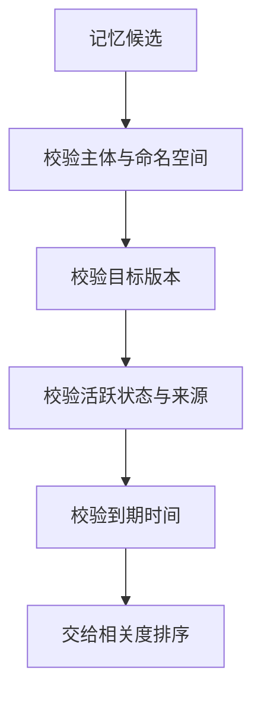
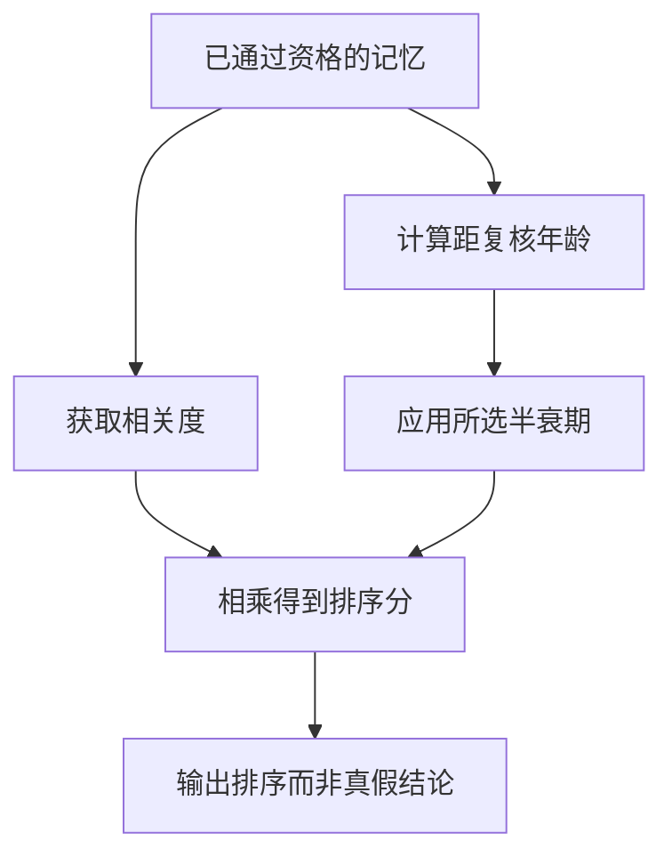
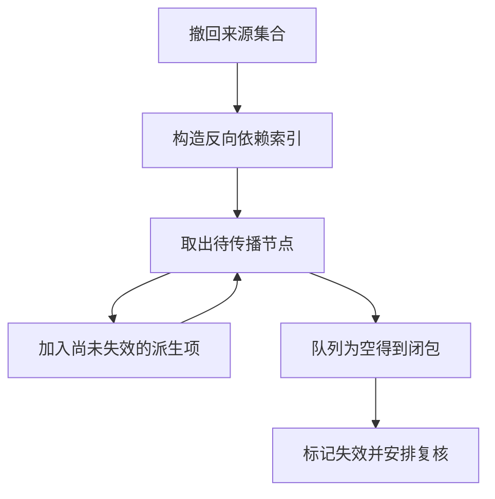

# Agent记忆与保鲜

> Agent记忆是跨步骤或跨任务保存并再次使用的信息。保存成功、检索命中和当前有效是三个判断；保鲜的核心是让来源、范围、版本与撤回状态参与召回，而不是给旧内容不断增加相似度。

## 学习目标

- 定义记忆写入与失效条件
- 区分个人偏好和公共事实
- 验证召回适用性

## 前置知识

先读[上下文选择与压缩](上下文选择与压缩.md)。需要键值存储、命名空间和依赖图基础。区分当前任务检查点、一次事件记录、跨任务偏好和外部事实：它们可以共用存储，但不应共用相同的有效期和证明标准。

## 基本机制

LangGraph官方文档将线程内状态交给checkpointer，将跨线程应用数据交给Store；记忆范围由命名空间组织。源码InMemoryStore先按命名空间与字段过滤候选，再在有向量时做相似度排序。这给出“筛适用性再排相关度”的工程入口，具体哪些字段表示事实有效仍由应用定义。[LangGraph Persistence 官方文档](https://docs.langchain.com/oss/python/langgraph/persistence)；[LangGraph InMemoryStore 过滤与删除](https://github.com/langchain-ai/langgraph/blob/4c52e129eb1ab69a3da58b799f67929f77d81149/libs/checkpoint/langgraph/store/memory/__init__.py#L238)。

结构化笔记有助于跨上下文继续任务，但笔记只是已保存信息，不自动成为新事实证据。个人偏好应绑定人和场景，公共事实应绑定来源版本，失败经验应保留触发条件。把一次临时网络失败记成“该工具永远不可用”，就是将事件错误升级成长期规则。[Effective context engineering for AI agents](https://www.anthropic.com/engineering/effective-context-engineering-for-ai-agents)。

完整教学实现：[运行机制示例](../../examples/harness/memory.py)。示例仅使用 Python 标准库，对传入的模拟数据计算结果；本页没有执行模型、外部工具或真实业务实验。

## 推导或示例

### 知识点一：召回适用性先于语义相似度

最相似的旧记忆可能恰好最危险：它与当前问题同名，却属于旧版本、另一用户或另一环境。令条目 $m$ 包含命名空间 $N_m$、版本 $V_m$、到期时间 $e_m$、活跃位 $a_m$ 和来源 $s_m$。针对查询条件 $(N,V,t)$，本页的**召回资格谓词**为

$$
E(m)=\mathbf1[N_m=N]\mathbf1[V_m=V]\mathbf1[a_m=1]\mathbf1[s_m\ne\varnothing]\mathbf1[e_m=\varnothing\lor t<e_m].
$$

所有项都是无量纲布尔值；时间使用同一时间尺度。先筛出 $E=1$ 的集合，再做语义排序。教学函数使用命名空间精确相等，避免父命名空间无意覆盖其他主体；生产如果采用前缀权限，需要显式定义继承规则，而不能把“存储前缀匹配”当成授权实现。

手算两条记忆：A为project/x、v1、未过期，相似度0.99；B为project/x、v2、未过期，相似度0.7。当前任务为v2，A必须先排除，再考虑B。到期边界采用 $t=e_m$ 即失效；若业务采用宽限期，应修改契约并在边界测试中说明。

```python
from math import isfinite

def eligible_memories(records: list[dict], namespace: tuple[str, ...],
                      version: str, now: float) -> list[str]:
    """仅召回当前命名空间、版本、有效期内且可追溯的活跃记忆。"""
    if not isfinite(now):
        raise ValueError('当前时间必须有限')
    result = []
    for row in records:
        expiry = row.get('expires_at')
        if expiry is not None and not isfinite(expiry):
            raise ValueError('失效时间必须有限')
        if (tuple(row['namespace']) == namespace and row['version'] == version
                and row['active'] is True and bool(row['source'])
                and (expiry is None or now < expiry)):
            result.append(row['id'])
    return sorted(set(result))
```

函数读取结构化条目，只输出符合条件的稳定去重ID。active必须是真布尔True，避免字符串“false”被误当真值；source非空只表示有定位入口，尚不证明来源可靠。version使用精确字符串比较，不推断语义版本兼容。



源码与原文：[LangGraph InMemoryStore 过滤与删除](https://github.com/langchain-ai/langgraph/blob/4c52e129eb1ab69a3da58b799f67929f77d81149/libs/checkpoint/langgraph/store/memory/__init__.py#L238)；[LangGraph Memory overview 官方文档](https://docs.langchain.com/oss/python/langgraph/memory)；[LangGraph Persistence 官方文档](https://docs.langchain.com/oss/python/langgraph/persistence)。

该版本_filter_items支持命名空间前缀和字段条件，本文额外把资格规则写成纯函数。可验证性质是跨范围、错版本、已撤回与刚到期条目均不可注入。反例是没有版本语义的阅读偏好；应使用其自己的版本约定，而不是强行按软件版本过期。

### 知识点二：时间衰减是排序策略而非真假概率

给旧记忆降权并不意味着它更可能是假的，给新记忆高权也不意味着它是真的。为演示保鲜排序，本页自行定义

$$
score(m)=r_m2^{-\Delta t_m/h},\qquad 0\le r_m\le1,\ \Delta t_m\ge0,\ h>0.
$$

$r_m$ 是归一化相关度，$\Delta t_m$ 是距复核的年龄，$h$ 是应用选择的半衰期，二者可统一用天。指数部分无量纲。相关度0.8、年龄0得到0.8；年龄达到一个半衰期得到0.4；两个半衰期得到0.2。由 $2^{-x}$ 单调递减可知年龄增长分数不增加，由指数非正可知分数位于 $[0,r_m]$。

这是一种**教学排序函数**，不是LangGraph内置算法，也不是文献估计的事实正确概率。该版本InMemoryStore在有查询向量时使用余弦相似度，并按条目身份去重；源码未在该路径自动验证事实真伪。本文借助单独函数把可选时间策略与存储能力分清。

半衰期应由信息类型决定：临时资源状态可能很短，数学定义可能不适合衰减。高风险配置发生版本变更时应直接失效或复核，不能靠分数慢慢下降。硬资格判断与软排序的组合是：先 $E(m)=1$，再在通过项里比较score，不能用高score“补偿”错误命名空间。

```python
from math import isfinite

def freshness_score(relevance: float, age: float, half_life: float) -> float:
    """计算自定义半衰期排序分；不是事实为真的概率。"""
    if not all(isfinite(x) for x in (relevance, age, half_life)):
        raise ValueError('参数必须有限')
    if not 0 <= relevance <= 1 or age < 0 or half_life <= 0:
        raise ValueError('相关度、年龄或半衰期不合法')
    return relevance * 2 ** (-age / half_life)
```

函数检查有限值、相关度范围、非负年龄和正半衰期，然后只做指数计算。很大年龄可能在浮点下溢为0，这是排序近似而不是删除命令。对新写入但未核实条目，应在资格环节拦下，不能把age=0误解成“刚确认正确”。



源码与原文：[LangGraph InMemoryStore 过滤与删除](https://github.com/langchain-ai/langgraph/blob/4c52e129eb1ab69a3da58b799f67929f77d81149/libs/checkpoint/langgraph/store/memory/__init__.py#L238)；[Effective context engineering for AI agents](https://www.anthropic.com/engineering/effective-context-engineering-for-ai-agents)；[LangGraph Memory overview 官方文档](https://docs.langchain.com/oss/python/langgraph/memory)。

可验证性质为年龄单调性、半衰期减半、零相关度恒为0和非法参数拒绝。反例是某条陈旧但仍有效的标准定义，较新且不相关笔记不应仅靠时间优势覆盖它；生产必须明确召回目标，不以新鲜度替代权威性。

### 知识点三：撤回要传播到派生索引与答案

一条来源更正后，旧笔记、向量索引和缓存答案仍可能继续传播旧结论。把“B由A派生”记作边 $A\to B$，初始撤回集合为 $I_0$。本页用最小闭包传播：

$$
I_{k+1}=I_k\cup\{v\mid\exists u\in I_k,(u,v)\in E\},\qquad I^*=\bigcup_k I_k.
$$

有限图中每个节点最多新加入一次，所以队列传播终止；加入依赖环也不会无限循环。若source → note → index → answer，撤回source后四者都进入集合，另一个无依赖的笔记保留。代码返回待失效身份，不直接执行物理删除，便于业务选择标记无效、回填重算或清理副本。

该版本InMemoryStore._apply_put_ops在value为None时，同时删除对应数据项和其向量项，处理的是同一Store里的直接索引一致性。它不会知道外部答案缓存引用了哪条记忆；跨组件撤回需要另外维护血缘关系。

这里故意采取保守的“任一来源撤回就暂时失效”。若一个结论同时有两个真正独立来源，其中一个撤回，另一个仍足以支持结论，则可以重新准入而非永远删除。两个重复摘要不是独立来源，必须回溯到原始依据后再决定。

```python
def invalidation_closure(seeds: set[str], depends_on: dict[str, set[str]]) -> set[str]:
    """从撤回来源传播到所有依赖它的派生条目，支持依赖环。"""
    reverse = {}
    for derived, parents in depends_on.items():
        for parent in parents:
            reverse.setdefault(parent, set()).add(derived)
    invalid = set(seeds)
    pending = list(seeds)
    while pending:
        current = pending.pop()
        for child in reverse.get(current, set()) - invalid:
            invalid.add(child)
            pending.append(child)
    return invalid
```

depends_on将派生节点映射到其父来源集合；函数先反向建索引，再用pending队列访问每个受影响节点。invalid同时承担结果集和访问标记，从而保证环安全。输入集合不被修改，重复执行同一撤回得到相同集合。



源码与原文：[LangGraph InMemoryStore 过滤与删除](https://github.com/langchain-ai/langgraph/blob/4c52e129eb1ab69a3da58b799f67929f77d81149/libs/checkpoint/langgraph/store/memory/__init__.py#L238)；[LangGraph Persistence 官方文档](https://docs.langchain.com/oss/python/langgraph/persistence)；[Effective context engineering for AI agents](https://www.anthropic.com/engineering/effective-context-engineering-for-ai-agents)。

可验证性质为种子包含、幂等、单调、环终止以及无依赖节点不受影响。反例是依赖记录缺失：算法再正确也找不到未登记缓存。生产还要处理外部索引更新失败与删除传播重试，不能把内存闭包视为分布式删除已经完成。

## 适用条件与限制

记忆策略适合能表达范围、来源和生命周期的任务。任何学习到的通用规则都需要保留触发条件；一次失败经验仅代表那次环境和输入。向量命中、最近写入和多次复述都不能提升证据等级。

个人偏好与公共事实应分域保存，撤回既可能来自事实更正，也可能来自用户删除要求；二者后续审计保留策略可能不同。本页不实现实际存储、权限控制、嵌入模型或真实个人数据处理。

## 实践任务

设计四条模拟记录：项目v1配置、v2配置、个人阅读偏好、一次工具失败。为每条给出命名空间、复核时间、失效规则与来源。再构建包含一个环和一个独立分支的派生图，手算撤回闭包；为仍有独立来源的结论写出重新准入条件。

实践状态保持 `designed`。教学函数的测试由统一 UT 流程负责，本页不把手算预期写成已运行结果，也不把示例性质外推为真实模型成功率。

## 掌握标准

- 能区分“保存了”“命中了”“能采用”三个判断。
- 能证明半衰期函数单调，但明确它不是正确概率。
- 能解释Store直接删除数据和向量后，答案缓存为什么仍可能过期。
- 能给出依赖环下终止性与血缘缺失的反例。

## 源码导读与模型边界

依次阅读_filter_items、_batch_search与_apply_put_ops。它们对应候选筛选、相似度排序和直接删除；教学实现额外引入版本资格、时间策略和跨派生闭包。检查点是当前线程状态，Store是应用数据，两者可以结合，但没有自动获得事实保鲜能力。

### 连贯案例复盘

考虑“服务默认开启选项A”这条项目事实。第一次写入时应绑定服务版本和原始来源；第二次在新版本任务里召回时先检查适用性。命名空间相同只能说明条目属于这个项目，不说明同一项目所有版本都能使用同一默认值。

| 条目种类 | 需要固定的条件 | 典型失效触发 |
|---|---|---|
| 版本配置事实 | 项目、版本、来源 | 版本变更或来源更正 |
| 个人阅读偏好 | 主体、使用场景 | 用户修改或撤回偏好 |
| 失败经验 | 输入、环境与错误 | 条件已变化或新证据出现 |
| 派生摘要 | 原始来源与派生链 | 任一关键来源撤回后复核 |

假设旧事实被写成笔记，再进入索引，最后出现在缓存答案。仅删除笔记正文，索引和答案仍可能携带旧内容。闭包算法回答“哪些身份需要重新审视”，真正失效还要由各存储层确认完成。若外部索引更新失败，应保留待传播状态与重试记录，不能先对上层声称全部删除成功。

还应避免把记忆的重复出现当成交叉验证。同一来源经三次摘要生成三条相似记录，依然只有一个事实根；它们一起出现在召回结果里不会增加独立证据。相反，重复记录会挤占有限上下文，使较少重复但更相关的资料看不见。

最后问清有效期代表什么：来源尚未更正、最近一次人工复核、缓存允许驻留时间是不同概念。时间衰减处理排序，硬失效处理资格，用户删除处理持有权；将三者混成一个更新时间字段，会导致到期误用或删除传播缺失。

本文源码链接均锁定实际读取的提交；论文锁定 arXiv 版本，在线官方文档记录读取日和正文指纹。公式中标为“教学模型”的预算、阈值和状态集合是本页设计，不是论文测得的效果。第三方文件只作为阅读依据，教学实现为独立简化。

## 2026研究进展

ACL 2026的经验跟随研究提醒读者，相似输入检索到的记忆可能传播错误或产生错配。记忆数量、相似度与经验质量应分别记录；本轮只核验该论文官方摘要，因此没有将未读取的实验过程当作已复现依据。 [会议来源与读取范围](../../sources/library/2026-paper-harness-memory/README.md)

更多公式、代码示例、结构图及当前开源版本见[Harness研究进展](../frontiers/Harness研究进展.md)。新内容未执行真实模型实验。

---

[返回模块](../modules/Harness.md) · [知识点索引](../../docs/知识点索引.md) · [完整教学代码](../../examples/harness/memory.py) · [提出更正](https://github.com/yanbozhang/llm-systems-wiki/issues/new?template=knowledge.yml)

觉得这篇推导有帮助，可以在 [GitHub](https://github.com/yanbozhang/llm-systems-wiki) 点 Star 收藏更新；分享时欢迎链接到具体知识点，便于读者复核公式、代码与来源。
