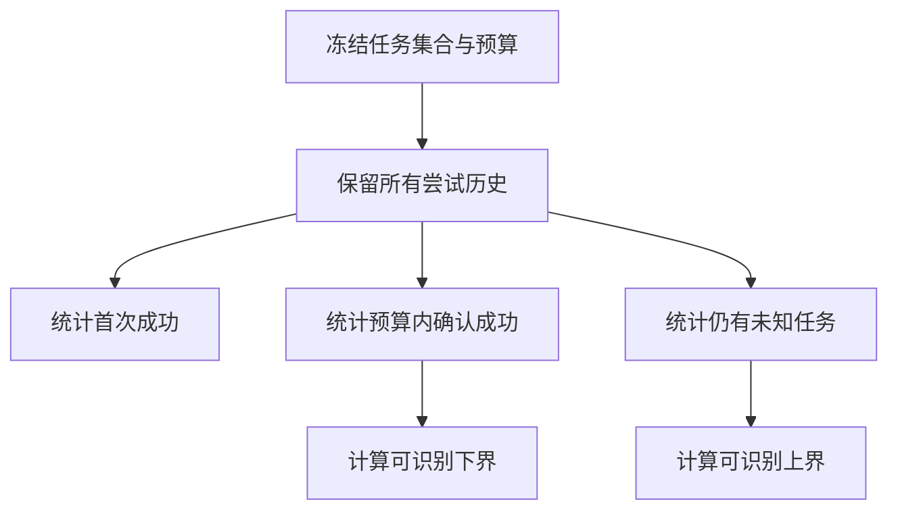
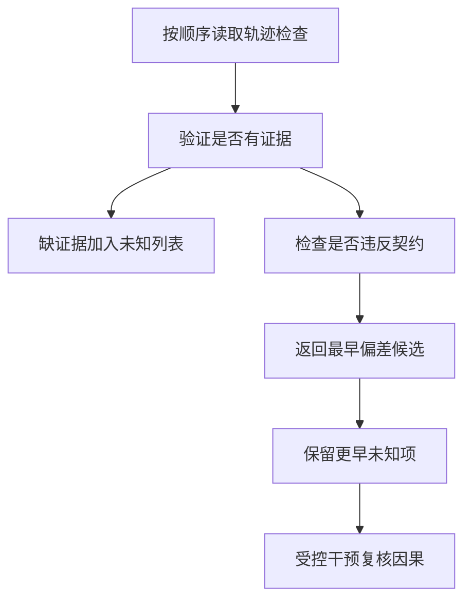
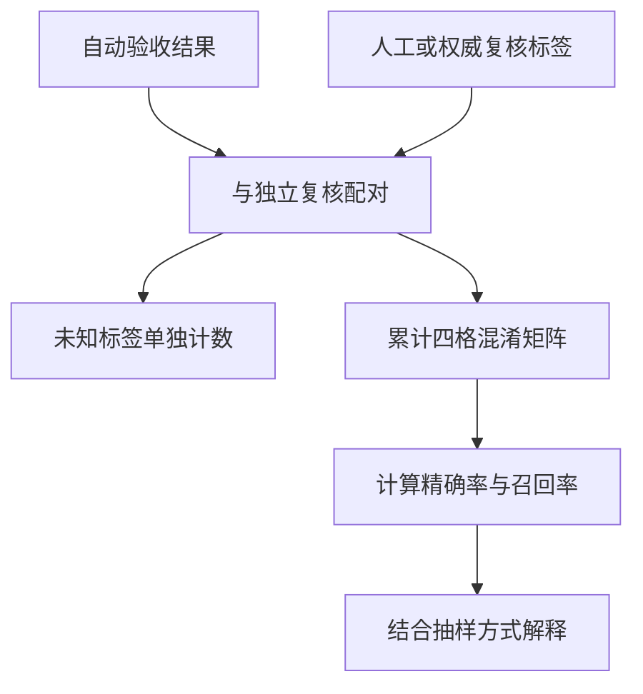

# Agent评测与失败归因

> Agent评测要同时观察任务结果、运行过程和评估器自身。固定任务分母与重试预算，保留未知结果，再用轨迹定位最早有证据的偏差；失败阶段只是归因候选，不能凭最后一条报错直接宣布根因。

## 学习目标

- 建立分层评测
- 按轨迹归因
- 衔接Benchmark模块

## 前置知识

先读[业务Agent任务闭环](业务Agent任务闭环.md)。需要比例、条件概率、布尔判据和事件顺序。本页面向业务Agent的结果记录与诊断，完整Benchmark数据集设计、统计推断和排行榜协议见[Benchmark](../modules/Benchmark.md)。

## 基本机制

OSWorld按任务读取环境数据并执行验收，SWE-bench按修复与维护测试分组生成报告；两者都把评估定义放在生成结果之外。SWE-agent的step和run又保留动作、观测与轨迹，给事后分析提供证据。任务成败、工具异常和环境不可用应在记录中保持区别。[OSWorld: Benchmarking Multimodal Agents for Open-Ended Tasks in Real Computer Environments](https://arxiv.org/html/2404.07972v1)；[SWE-bench 测试分组与解决状态](https://github.com/SWE-bench/SWE-bench/blob/02e7a74ffd0b707aab73d203fe87bdc7c76afc8e/swebench/harness/grading.py#L179)。

有效实验记录至少包含任务身份、初始条件、模型与执行器版本、预算、每次尝试、工具回报、产物身份和验收版本。本文不给不同基准分数混排，也不引用历史模型成绩作为当前能力结论；全部数字是为检查口径而构造的小样本。

完整教学实现：[运行机制示例](../../examples/agents/agent-evaluation.py)。示例仅使用 Python 标准库，对传入的模拟数据计算结果；本页没有执行模型、外部工具或真实业务实验。

## 推导或示例

### 知识点一：固定分母并分开首次成功与重试成功

五个任务三项首次成功、一项第二次成功、一项结果未知，不能只收集四条成功轨迹报告100%。令N为预先选定任务数，$y_{i1}$表示第i个任务首次成功，$z_i$表示预算内至少一次已确认成功，则

$$
S_1=\frac{\sum_i y_{i1}}{N},\qquad S_B^{obs}=\frac{\sum_i z_i}{N}.
$$

若U个任务没有确认成功但仍有未知尝试，保守可识别区间为

$$
S_B^{\star}\in[S/N,(S+U)/N].
$$

这里S为已有确认成功任务数，带星号的量表示未知结果最终查明后的真实“至少一次成功”比例；上式依赖已确认标签可信。区间只反映缺失结果，不是统计置信区间，也没有覆盖抽样误差。上述例子首轮3/5，重试后下界4/5，上界5/5；“未知=失败”可以作为保守计分政策，但诊断数据中仍应单独保留未知状态。

独立同分布且每次成功概率为p时，最多k次尝试至少一次成功为 $1-(1-p)^k$；真实Agent重试会读取前次错误并改变策略，通常不能假定独立。为了比较两个Harness，必须冻结最大尝试数或总成本，并同时报告实际尝试数，避免把更多预算误称为更强推理。

源码DefaultAgent.run每步保存轨迹，SWE-bench评分器则汇总某个预测的执行结果。本文的跨尝试汇总是在这些单次证据之上新增的教学口径，不声称上游默认输出本函数字段。

```python
def success_summary(histories: dict[str, list[str]]) -> dict:
    """保留每个任务全部尝试，汇总首次与允许重试后的成功及未知边界。"""
    if not histories or any(not attempts for attempts in histories.values()):
        raise ValueError('任务集与每条尝试历史必须非空')
    if any(s not in {'success', 'failure', 'unknown'}
           for attempts in histories.values() for s in attempts):
        raise ValueError('结果状态不合法')
    n = len(histories)
    first = sum(a[0] == 'success' for a in histories.values())
    eventual = sum('success' in a for a in histories.values())
    unresolved = sum('success' not in a and 'unknown' in a for a in histories.values())
    return {'tasks': n, 'attempts': sum(map(len, histories.values())),
            'first_rate': first / n, 'eventual_lower': eventual / n,
            'eventual_upper': (eventual + unresolved) / n,
            'unresolved_tasks': unresolved}
```

histories按任务身份保存有序尝试结果；函数不删失败记录，分别统计首次、至少一次成功和仍未确认任务。若某任务已有明确成功，其其他未知尝试不再扩大“至少一次成功”的上界；但这些尝试仍应保留作副作用与成本审计。



源码与原文：[SWE-agent DefaultAgent 动作与轨迹](https://github.com/SWE-agent/SWE-agent/blob/3ea751c087f32b16e039a2233dd6eefecef325d5/sweagent/agent/agents.py#L936)；[SWE-bench 测试分组与解决状态](https://github.com/SWE-bench/SWE-bench/blob/02e7a74ffd0b707aab73d203fe87bdc7c76afc8e/swebench/harness/grading.py#L179)；[SWE-bench: Can Language Models Resolve Real-World GitHub Issues?](https://arxiv.org/html/2310.06770v3)；[OSWorld: Benchmarking Multimodal Agents for Open-Ended Tasks in Real Computer Environments](https://arxiv.org/html/2404.07972v1)。

可验证性质是首次率不超过重试后下界、上下界有序且位于0至1、增加失败尝试不改变任务分母、未知不被悄悄丢掉。反例是不同版本只在各自成功任务上汇总，此时即使公式相同也存在选择偏差。

### 知识点二：最早证据偏差只产生归因候选

最终“任务失败”可能来自输入缺失、上下文漏约束、目标选择错、定位错、执行失败、环境不可用或验收器误判。按最后异常字符串分组会把这些机制混在一起。设事件顺序为 $e_1,\ldots,e_T$，$b_t\in\{T,F,U\}$为该阶段契约是否满足，$q_t$表示有可回查证据，本文定义

$$
k=\min\{t\mid b_t=F\land q_t=1\}.
$$

k只是“最早已证实偏差”，不是根因。若k之前有未知项，真实偏差可能更早；如果多个阶段共享一个环境故障，早发生的观测也不意味着它导致了后面的故障。函数始终把causality标为unproven，要求后续复核。

手算read阶段True且有来源、plan阶段None、execute阶段False且有工具回执，候选是execute，但earlier_unknown中必须保留plan。下一步可以先核对计划是否选对工具，再在固定环境下替换工具响应或重放参数，观察终态是否改变。只有受控干预和重复证据才能支持更强因果解释。

SWE-agent.handle_action分别处理动作阻断、命令超时和环境状态，并将反馈加入step历史；OSWorld又区分step与evaluate。它们提供不同层的观测入口，而不是一个自动识别所有根因的函数。

```python
def first_divergence(trace: list[dict]) -> dict:
    """查找最早有证据的契约违反，输出归因候选而不宣称因果根因。"""
    unknown = []
    for event in trace:
        value = event['passed']
        if value is not None and type(value) is not bool:
            raise ValueError('检查结果类型不合法')
        if value is None or not event.get('evidence'):
            unknown.append(event['stage'])
            continue
        if value is False:
            return {'candidate': event['stage'], 'evidence': event['evidence'],
                    'earlier_unknown': unknown, 'causality': 'unproven'}
    return {'candidate': None, 'evidence': None, 'earlier_unknown': unknown,
            'causality': 'unproven'}
```

trace中的每项含stage、passed和evidence。没有证据的True或False都被当作未确认，防止模型自称或标签猜测进入归因。函数找到第一条可验证失败就返回，同时带上此前未知阶段；如果没有失败则candidate为None，不能因此宣称整个任务成功。



源码与原文：[SWE-agent DefaultAgent 动作与轨迹](https://github.com/SWE-agent/SWE-agent/blob/3ea751c087f32b16e039a2233dd6eefecef325d5/sweagent/agent/agents.py#L936)；[OSWorld DesktopEnv 观测、步骤与验收](https://github.com/xlang-ai/OSWorld/blob/04718eab9327856efe8192cc58161acc7a7627e2/desktop_env/desktop_env.py#L433)；[ReAct: Synergizing Reasoning and Acting in Language Models](https://arxiv.org/html/2210.03629v3)；[SWE-agent: Agent-Computer Interfaces Enable Automated Software Engineering](https://arxiv.org/html/2405.15793v3)。

可验证性质是无证据失败不被确认为候选、最早已证实失败优先、更早未知不丢失。反例是并行工具事件仅按墙上时间排序，时间先后未必是因果先后；应先按父子调用与依赖关系整理，不能直接把数组位置当根因顺序。

### 知识点三：评估器也需要假阳性与假阴性审计

Agent生成了错误产物，而评估器误判成功，会使整个闭环看起来很可靠。令自动判定为 $\hat y\in\{0,1\}$，独立复核为 $y\in\{0,1,U\}$。在有标签样本上定义TP、FP、TN、FN，并计算

$$
Precision=\frac{TP}{TP+FP},\qquad Recall=\frac{TP}{TP+FN}.
$$

Precision回答“报成功的里面多少真的成功”，Recall回答“实际成功的里面多少被认出”。分母为0时输出None表示未定义。U样本单独计数，不混入TN，也不静默从报告消失。这是标准混淆矩阵定义的**教学应用**，不是任何一篇Agent论文新增指标。

构造四个自动结果True、True、False、False，复核True、False、True、U，得到TP=1、FP=1、FN=1、TN=0、未标注1；有标签部分precision=1/2、recall=1/2。不能据此声称总体精确率50%，因为样本极小且可能只挑了可疑样本。若专门抽查失败，统计还受到抽样机制影响。

OSWorld的evaluate依赖getter、指标函数和组合逻辑；SWE-bench的状态解析与测试身份匹配同样会影响结果。检查产物身份、解析器缺失、跳过测试和版本差异，都是评估器审计的一部分。不能使用同一条错误规则同时生成自动结果与“人工金标”，那只会重复自证。

```python
def audit_evaluator(predictions: list[bool], labels: list[bool | None]) -> dict:
    """对独立复核标签统计混淆矩阵，标签缺失单独计数。"""
    if len(predictions) != len(labels):
        raise ValueError('预测与标签长度不同')
    if any(type(p) is not bool for p in predictions):
        raise ValueError('预测必须为布尔值')
    if any(y is not None and type(y) is not bool for y in labels):
        raise ValueError('复核标签必须为布尔值或None')
    counts = {'tp': 0, 'fp': 0, 'tn': 0, 'fn': 0, 'unlabeled': 0}
    for predicted, actual in zip(predictions, labels):
        if actual is None:
            counts['unlabeled'] += 1
        elif predicted and actual:
            counts['tp'] += 1
        elif predicted:
            counts['fp'] += 1
        elif actual:
            counts['fn'] += 1
        else:
            counts['tn'] += 1
    precision_n = counts['tp'] + counts['fp']
    recall_n = counts['tp'] + counts['fn']
    return {**counts,
            'precision': counts['tp'] / precision_n if precision_n else None,
            'recall': counts['tp'] / recall_n if recall_n else None}
```

函数只对明确布尔标签累加四格计数，None进入unlabeled。它校验长度和类型，避免zip静默丢尾或数字1冒充未经确认标签。空数据可返回全零与未定义比率；数据量和抽样说明必须与结果一起交付。



源码与原文：[SWE-bench 测试分组与解决状态](https://github.com/SWE-bench/SWE-bench/blob/02e7a74ffd0b707aab73d203fe87bdc7c76afc8e/swebench/harness/grading.py#L179)；[SWE-bench: Can Language Models Resolve Real-World GitHub Issues?](https://arxiv.org/html/2310.06770v3)；[OSWorld DesktopEnv 观测、步骤与验收](https://github.com/xlang-ai/OSWorld/blob/04718eab9327856efe8192cc58161acc7a7627e2/desktop_env/desktop_env.py#L433)；[OSWorld: Benchmarking Multimodal Agents for Open-Ended Tasks in Real Computer Environments](https://arxiv.org/html/2404.07972v1)。

可验证性质是有标签四格加未标注等于总样本、分母0返回None、交换预测和标签会交换FP/FN。反例是复核者也缺少真实业务状态，所谓标签仍是猜测，应保留U并继续找证据，不能为了计算指标强行二分。

## 适用条件与限制

本页仅建立业务评测记录和诊断口径，不替代大样本统计或正式Benchmark复现。环境版本、任务选择、预算、重试策略和评估器版本都会影响比较。单次成功不能外推稳定能力，单个错误标签也不能确证根因。

常见误区包括只保留最好轨迹、把结果未知删除出分母、把重试成功覆盖首次失败、把工具错误全部归模型、让模型评价自己的答案后宣称闭环。应将结果、过程、成本与评估器质量并列保存。

## 实践任务

为五个模拟任务填写全部尝试历史，至少包含一次未知、一次重试成功和一次评估器假阳性。先手算首次率与重试后界，再给失败轨迹标记最早有证据偏差。为其中一个候选设计控制变量的复核方案，并说明哪些结论在没有独立标签时仍然不能得出。

实践状态保持 `designed`。教学函数的测试由统一 UT 流程负责，本页不把手算预期写成已运行结果，也不把示例性质外推为真实模型成功率。

## 掌握标准

- 能维持固定任务分母并报告全部尝试成本。
- 能解释缺失结果区间与统计置信区间的区别。
- 能把最早偏差与因果根因分开，并保留更早未知。
- 能用独立标签检查评估器，正确处理零分母与未标注样本。

## 源码导读与模型边界

阅读DefaultAgent.handle_action与step理解轨迹来源，阅读DesktopEnv.evaluate理解业务验收入口，最后核对SWE-bench分组与状态处理。三个函数分别对应结果汇总、诊断候选、评估器审计；它们处理模拟记录，不对任何模型产生真实评测成绩。

### 连贯案例复盘

假设五个业务任务中三个首次成功，一个重试后成功，一个仍未拿到结果。先把五个任务都放进分母，再报告尝试总数和未知任务；这一步可以阻止“只看留下来的成功轨迹”造成的虚高结果，但尚未解决任务抽样代表性。

| 记录问题 | 对指标的影响 | 需要补充的证据 |
|---|---|---|
| 丢掉首次失败 | 高估一次完成能力 | 完整尝试历史 |
| 删除结果未知任务 | 改变分母 | 原始任务清单 |
| 用更多预算比较新版 | 混入成本收益 | 相同预算的对照 |
| 评估器读取错误对象 | 产生假阳性或假阴性 | 产物身份与独立复核 |

归因时还要检查记录顺序是否可信。并行工具的日志可能晚到，网络时间戳也可能不一致；应优先用调用身份和父子依赖组织轨迹。缺失事件要保留为缺口，不应按最像的失败类型自动补齐。最早偏差能指导排查，但控制变量的干预才可能进一步区分原因与伴随症状。

评估器复核样本应说明如何抽取。只检查模型自称失败的案例，会漏掉最危险的假阳性；只检查成功案例又无法估计召回。可分层抽取自动成功、自动失败和未知样本，同时保留抽样比例，正式总体估计还要考虑相应权重和不确定性。

最后把过程质量与终态质量并列看待。任务可能在多次危险重试后终于成功，也可能以合理成本明确报告信息不足。仅按一个最终成功位排序无法解释这些差别，需要保留恢复次数、耗时和副作用记录；但这些指标的权重必须来自业务目标，不能事后选择最有利的口径。

本文源码链接均锁定实际读取的提交；论文锁定 arXiv 版本，在线官方文档记录读取日和正文指纹。公式中标为“教学模型”的预算、阈值和状态集合是本页设计，不是论文测得的效果。第三方文件只作为阅读依据，教学实现为独立简化。

---

[返回模块](../modules/业务Agent.md) · [知识点索引](../../docs/知识点索引.md) · [完整教学代码](../../examples/agents/agent-evaluation.py) · [提出更正](https://github.com/yanbozhang/llm-systems-wiki/issues/new?template=knowledge.yml)

觉得这篇推导有帮助，可以在 [GitHub](https://github.com/yanbozhang/llm-systems-wiki) 点 Star 收藏更新；分享时欢迎链接到具体知识点，便于读者复核公式、代码与来源。
