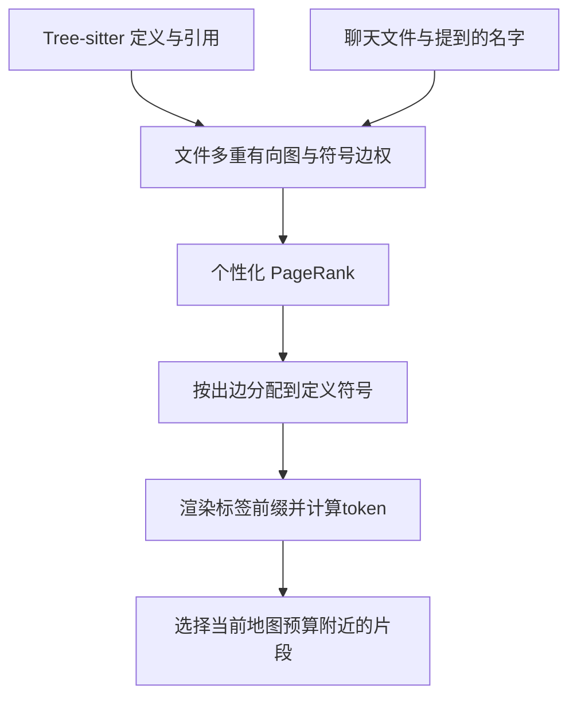
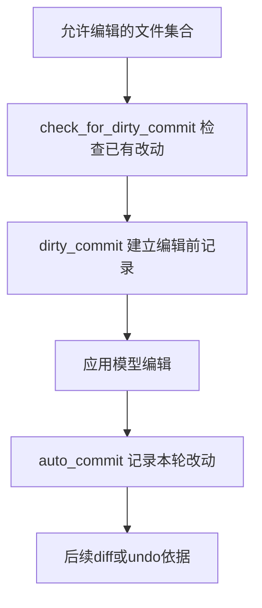

# Aider仓库地图与编辑协议

Aider通过仓库地图选择上下文，以显式编辑协议表达修改，并利用Git记录编辑边界。三者分别解决“读哪些代码”“怎样定位替换”“如何保留改动历史”。本页沿固定提交阅读真实调用路径，区分算法教学、编辑应用与任务验证。

## 学习目标

- 推导RepoMap图排序与token预算选择
- 解释SEARCH/REPLACE匹配和失败反馈
- 区分用户未提交改动、工具编辑与版本控制边界

## 前置知识

需理解[AI代码开发与反馈](AI代码开发与反馈.md)、有向图、概率分布、token预算及Git工作区/索引/提交。仓库地图排名是上下文选择策略，不是代码重要性的客观真值。

## 基本机制

固定提交为 `5dc9490bb35f9729ef2c95d00a19ccd30c26339c`。RepoMap提取定义与引用，并以聊天上下文影响图排序；EditBlockCoder处理SEARCH/REPLACE；Coder与GitRepo管理允许编辑的范围和检查点。[Repository map](https://github.com/Aider-AI/aider/blob/5dc9490bb35f9729ef2c95d00a19ccd30c26339c/aider/website/docs/repomap.md)；[Edit formats](https://github.com/Aider-AI/aider/blob/5dc9490bb35f9729ef2c95d00a19ccd30c26339c/aider/website/docs/more/edit-formats.md)；[Git integration](https://github.com/Aider-AI/aider/blob/5dc9490bb35f9729ef2c95d00a19ccd30c26339c/aider/website/docs/git.md).

Aider没有在本页被包装为某个未核验论文算法的严格复现：公式是根据维护者源码与官方技术文档推导的教学模型，实际权重启发式、渲染和回退以所读版本为准。

## 推导或示例

完整教学文件：[aider.py](../../examples/agents/aider.py)。每个函数对应下列一个知识点，只使用标准库与小型合成输入；教学计算不代表模型或服务实验。

### 知识点一：引用图的个性化排名如何变成预算内仓库地图

RepoMap不是目录树，也不是每个文件各生成一份自然语言摘要。Aider从语法树提取定义与引用标签，构造“引用文件→定义文件”的带符号多重边，再给当前聊天相关文件和提到的标识符增加权重。该版引用次数经过平方根缩放，避免高频但低价值名字完全主导；提到的名字、下划线开头和定义过多的通用名字还存在不同权重修正。

令 $w_{uv}$ 为边权， $P_{uv}=w_{uv}/\sum_jw_{uj}$ ，个性化分布为 $p$ ，阻尼 $\alpha\in(0,1)$ 。PageRank迭代为：

$$
r_{t+1}(v)=(1-\alpha)p(v)+\alpha\sum_{u:out(u)\gt 0}r_t(u)P_{uv}+\alpha d_t p(v),
$$

其中 $d_t$ 是无出边节点的概率质量。最后一项将悬空节点质量送回个性化分布，否则每轮总质量会流失。文件排名得到后，该版把 $r(u)$ 按出边权重再分配，累加到 `(定义文件,符号)`，所以符号排序不简单等于其文件的PageRank。

```python
def repo_map(files, edges, personalization, symbol_costs, budget, damping=0.85, iterations=50):
    """对预提取引用图做个性化PageRank，再按符号贡献选严格预算内的排序前缀。"""
    nodes = sorted(set(files))
    edges = list(edges)  # 每项：(引用文件, 定义文件, 符号, 已计算边权)
    if not nodes or type(budget) is not int or budget < 0 or type(iterations) is not int or iterations < 1 or not 0 < damping < 1:
        raise ValueError("需要非空图、有效预算、迭代数与阻尼")
    if not set(personalization) <= set(nodes) or any(not math.isfinite(v) or v < 0 for v in personalization.values()):
        raise ValueError("个性化权重必须有限、非负并位于图内")
    total = sum(personalization.values())
    if total <= 0:
        raise ValueError("个性化权重和须为正")
    prior = {n: personalization.get(n, 0.0) / total for n in nodes}
    outgoing = dict.fromkeys(nodes, 0.0)
    for src, dst, symbol, weight in edges:
        if src not in outgoing or dst not in outgoing or not math.isfinite(weight) or weight <= 0:
            raise ValueError("边须连接图内节点且权重为正")
        outgoing[src] += weight
    rank = dict(prior)
    residual = 0.0
    for _ in range(iterations):
        dangling = sum(rank[n] for n in nodes if outgoing[n] == 0)
        nxt = {n: (1 - damping) * prior[n] + damping * dangling * prior[n] for n in nodes}
        for src, dst, _, weight in edges:
            nxt[dst] += damping * rank[src] * weight / outgoing[src]
        residual = sum(abs(nxt[n] - rank[n]) for n in nodes)
        rank = nxt
    importance = defaultdict(float)
    for src, dst, symbol, weight in edges:
        importance[(dst, symbol)] += rank[src] * weight / outgoing[src]
    ranked = sorted(importance, key=lambda k: (-importance[k], k))
    selected, remaining = [], budget
    for key in ranked:
        cost = symbol_costs[key]
        if type(cost) is not int or cost < 1:
            raise ValueError("符号渲染成本须为正整数")
        if cost > remaining:
            break
        selected.append(key)
        remaining -= cost
    return {"file_rank": rank, "symbol_rank": [(k, importance[k]) for k in ranked],
            "selected": selected, "remaining_tokens": remaining, "residual_l1": residual}
```

函数对给定图迭代 $I$ 轮，核心成本 $O(I(|V|+|E|))$ ，再按符号得分排序。两节点A→B、个性化全在A且B悬空，取 $\alpha=0.85$ ，稳定方程为 $r_A=0.15+0.85r_B,r_B=0.85r_A$ ，得到约0.5405和0.4595，总和1。示例返回残差说明只是有限迭代，不假装得到精确解析值。



教学把每个符号成本视为独立可加，并严格停止于预算；生产 `to_tree`会合并代码上下文，成本未必简单相加。`get_ranked_tags_map_uncached`通过二分式搜索试渲染，且相对误差小于0.15时可提前接受，即1000token目标可能接受略高于1000的地图。因此map-tokens通常是目标而非严格上限，还可能随聊天状态扩大。地图只帮助选文件和理解接口，不能替代阅读实现，更不保证所有语义依赖都被静态引用捕获。

[RepoMap.get_ranked_tags](https://github.com/Aider-AI/aider/blob/5dc9490bb35f9729ef2c95d00a19ccd30c26339c/aider/repomap.py#L365)；[预算搜索与容差](https://github.com/Aider-AI/aider/blob/5dc9490bb35f9729ef2c95d00a19ccd30c26339c/aider/repomap.py#L629)；[Aider Repository map](https://github.com/Aider-AI/aider/blob/5dc9490bb35f9729ef2c95d00a19ccd30c26339c/aider/website/docs/repomap.md).

### 知识点二：SEARCH/REPLACE是有匹配策略的编辑协议

Aider的diff格式要求模型给文件路径和SEARCH/REPLACE块，用局部旧文本说明要替换哪里。协议与Git unified diff不同：没有必要靠行号定位，但必须找到当前文件中的旧行块。令原文行列为 $L$ ，搜索块为 $S$ ，长度 $m$ ，精确匹配集合为 $M=\lbrace i:L[i:i+m]=S\rbrace$ 。该版 `perfect_replace`从前向后扫描，找到第一项即返回；它不会像前一篇SWE-agent工具一样在 $|M|\gt 1$ 时拒绝。

将上述计算或状态约束集中写为：

$$
M=\lbrace i:L[i:i+m]=S\rbrace ,\qquad i_{replace}=\min M\quad (M\ne\varnothing).
$$

```python
def search_replace(text, search, replacement):
    """演示首个精确行块匹配及统一缺失缩进回退；不执行其他生产回退或写文件。"""
    if not all(isinstance(v, str) for v in (text, search, replacement)) or not search.strip():
        raise ValueError("需要非空SEARCH行块")
    def lines(value):
        return (value + ("\n" if value and not value.endswith("\n") else "")).splitlines(keepends=True)
    whole, part, after = lines(text), lines(search), lines(replacement)
    matches = [i for i in range(len(whole) - len(part) + 1) if whole[i:i + len(part)] == part]
    if matches:
        start = matches[0]
        return {"text": "".join(whole[:start] + after + whole[start + len(part):]),
                "mode": "exact", "match_count": len(matches), "start_line": start + 1}
    for start in range(len(whole) - len(part) + 1):
        prefixes = set()
        valid = True
        for actual, expected in zip(whole[start:start + len(part)], part):
            if not expected.strip():
                valid = valid and not actual.strip()
                continue
            if not actual.endswith(expected):
                valid = False
                break
            prefix = actual[:len(actual) - len(expected)]
            if prefix.strip():
                valid = False
                break
            prefixes.add(prefix)
        if valid and len(prefixes) == 1:
            prefix = prefixes.pop()
            shifted = [prefix + line if line.strip() else line for line in after]
            return {"text": "".join(whole[:start] + shifted + whole[start + len(part):]),
                    "mode": "indent", "match_count": None, "start_line": start + 1}
    return {"text": text, "mode": "no_match", "match_count": 0, "start_line": None}
```

`x = 1`出现两次时，exact模式只改首个，示例额外返回match_count让歧义可见。若文件为四空格缩进而SEARCH缺少统一外层缩进，回退可恢复该缩进再写REPLACE；若各行缩进差不一致或内容不同，则no_match并保留原文。代码为纯字符串模型，行数 $n$ 、搜索长 $m$ 时朴素扫描约 $O(nm)$ ，没有真实文件副作用。


生产匹配还尝试去掉多余首空行、特定省略号分段；本函数不模拟全部回退。尤其该版 `replace_most_similar_chunk`在调用编辑距离函数前已经return，虽然文件里存在 `replace_closest_edit_distance`，这条路径不会执行。仅搜索到函数名或注释“fuzzy matching”就声称当前支持通用模糊修改，是没有跟踪控制流造成的错误。

`apply_edits`允许部分块成功后其他块失败，反馈明确要求不要重发已成功块；也存在在其他聊天文件中尝试匹配的回退。这说明一批SEARCH/REPLACE不是原子事务，模型要依据实际成功清单修正余下块。示例不执行跨文件回退，以便让编辑范围和匹配结果可检查；不能把样例成功当成整个项目修改正确。

[perfect_replace与回退控制流](https://github.com/Aider-AI/aider/blob/5dc9490bb35f9729ef2c95d00a19ccd30c26339c/aider/coders/editblock_coder.py#L146)；[部分成功与错误反馈](https://github.com/Aider-AI/aider/blob/5dc9490bb35f9729ef2c95d00a19ccd30c26339c/aider/coders/editblock_coder.py#L41)；[Aider diff协议](https://github.com/Aider-AI/aider/blob/5dc9490bb35f9729ef2c95d00a19ccd30c26339c/aider/website/docs/more/edit-formats.md#L40).

### 知识点三：文件级检查点将用户改动与智能体改动分开

编辑器需要知道哪些改动在智能体开始前就存在。设用户已有未提交改动文件集为 $D$ ，本轮允许编辑的文件集为 $E$ 。在启用相关选项时，编辑前检查点涉及 $D\cap E$ ；与本轮无关的dirty文件 $D\setminus E$ 不应被这个计划顺手纳入。编辑后才为本轮 $E$ 的实际改动形成后续记录。

将上述计算或状态约束集中写为：

$$
D_{checkpoint}=D\cap E,\qquad D_{unrelated}=D\setminus E,\qquad D_{checkpoint}\cap D_{unrelated}=\varnothing.
$$

```python
def commit_plan(dirty_files, edited_files, auto_commits=True, dirty_commits=True, git_enabled=True, dry_run=False):
    """返回文件级提交计划，不读取仓库、不提交；假定edited_files已经获准编辑。"""
    dirty, edited = set(dirty_files), set(edited_files)
    enabled = bool(git_enabled and auto_commits and not dry_run)
    before = dirty & edited if enabled and dirty_commits else set()
    return {"before_edit": sorted(before), "after_edit": sorted(edited) if enabled else [],
            "unrelated_dirty": sorted(dirty - edited),
            "overlap_without_checkpoint": sorted((dirty & edited) - before),
            "executes_git": False}
```

用户改动在app.py和notes.md，本轮编辑app.py与new.py，则before_edit只有app.py，after_edit为app.py/new.py，notes.md保持无关。关闭auto_commits后示例两类提交计划都为空，同时列出没有检查点保护的重叠文件。这个列表是协议解释，不会请求、执行或模拟真正git commit。



该版 `prepare_to_edit`逐文件检查是否允许修改，收集need_commit_before_edits，然后调用dirty_commit。`auto_commit`还检查repo、auto_commits与dry_run；构造时关闭auto_commits会同时关闭dirty_commits。`GitRepo.commit(fnames=...)`按传入路径暂存并提交，没有路径参数时则是更广的dirty范围，不能混淆两种调用。

这仍是文件级边界，同一文件中用户和工具修改不同hunk，不会因此自动变成内容级独立事务。提交失败后真实文件也可能已经改变，后续应按工作区与Git状态处理，而不是凭计划返回值认定已保存。官方文档的默认commit hook设置也表明“提交了”不能当“测试了”；本页既不执行Git也不运行任何代码任务测试。

[check_for_dirty_commit](https://github.com/Aider-AI/aider/blob/5dc9490bb35f9729ef2c95d00a19ccd30c26339c/aider/coders/base_coder.py#L2175)；[prepare_to_edit](https://github.com/Aider-AI/aider/blob/5dc9490bb35f9729ef2c95d00a19ccd30c26339c/aider/coders/base_coder.py#L2269)；[auto_commit与dirty_commit](https://github.com/Aider-AI/aider/blob/5dc9490bb35f9729ef2c95d00a19ccd30c26339c/aider/coders/base_coder.py#L2375)；[GitRepo.commit路径范围](https://github.com/Aider-AI/aider/blob/5dc9490bb35f9729ef2c95d00a19ccd30c26339c/aider/repo.py#L270)；[Aider Git integration](https://github.com/Aider-AI/aider/blob/5dc9490bb35f9729ef2c95d00a19ccd30c26339c/aider/website/docs/git.md).

## 适用条件与限制

静态引用可能遗漏动态导入、反射和运行时注册；地图预算不足可能省略关键定义；匹配成功也可能改错业务位置。Git提供历史与回退依据，不能代替测试、审阅或任务评测。

示例只处理给定图、字符串和文件名集合，不扫描用户仓库，不启动Tree-sitter，不执行真实编辑、Git或模型调用。

## 实践任务

手算A→B含悬空节点的PageRank，并检查概率和。给三个符号不同token成本，记录排序前缀与剩余预算；另说明生产15%容差与教学硬预算的区别。构造重复SEARCH和统一/非统一缩进反例，再给D与E集合计算编辑前后提交计划，确认无关用户文件未被纳入。

本页完整实践保持 `designed`。示例测试由统一 UT 流程记录，本页不宣称已测试或论文复现。

## 掌握标准

能区分文件PageRank与符号贡献；能解释悬空质量和个性化分布；能跟踪真正可达的编辑回退路径；能区分部分应用、工作区变化和提交成功。真实代码任务评测需另行保存任务、补丁及验证记录，教学算法计算不能替代这一证据。

## 源码导读与边界推演

仓库地图中的“重要”是相对于当前问题的。一个被多处引用的公共函数可能占有较高排名，但用户正在修改的入口文件还需要通过personalization影响重启概率。源码又把聊天文件发出的引用乘额外权重，因此同一仓库在不同聊天状态下可产生不同地图。为了复算，应保存聊天文件集合、提到的标识符、解析版本和边权规则，而不只保存最后一段文本地图。

预算搜索还包含渲染成本。两个符号位于同一个类时，树式渲染可能共用路径和上下文；追加一个符号不一定增加同样多token。教学用固定加性成本得到严格预算前缀，适合检验边界，但生产的试渲染与容差是另一种策略。读到map-tokens默认值不能推导任意时刻输入总长，因为聊天消息、完整文件和系统提示也占上下文。

编辑协议强调最新原文。用户在模型响应期间修改了文件，或前一个编辑块已经改变了后续SEARCH区域，都会导致原先准确的SEARCH变得过时。模型应读取实际失败反馈，再修正剩余块；重复提交全部编辑可能把已经成功的修改再次应用。对于只有一个相似函数名但具体实现不同的文件，盲目模糊匹配尤其难以解释，因此必须跟踪这个版本真正启用的匹配规则。

版本控制同样有配置与失败边界。关闭自动提交并不阻止编辑文件，只是改变历史记录策略；dry_run对Git计划和实际编辑器的行为也需要分别核对。教学commit_plan明确只是集合计划，真实实现还包括路径范围、暂存、提交信息和错误处理。本轮不执行这些操作，保留用户对真实仓库变更的边界。
[个性化与边权](https://github.com/Aider-AI/aider/blob/5dc9490bb35f9729ef2c95d00a19ccd30c26339c/aider/repomap.py#L422)；[实际渲染预算](https://github.com/Aider-AI/aider/blob/5dc9490bb35f9729ef2c95d00a19ccd30c26339c/aider/repomap.py#L676)；[失败反馈与部分应用](https://github.com/Aider-AI/aider/blob/5dc9490bb35f9729ef2c95d00a19ccd30c26339c/aider/coders/editblock_coder.py#L84)；[自动提交条件](https://github.com/Aider-AI/aider/blob/5dc9490bb35f9729ef2c95d00a19ccd30c26339c/aider/coders/base_coder.py#L2375).

---

[返回模块](../modules/业务Agent.md) · [知识点索引](../../docs/知识点索引.md) · [完整教学代码](../../examples/agents/aider.py) · [提出更正](https://github.com/yanbozhang/llm-systems-wiki/issues/new?template=knowledge.yml)

觉得这篇推导有帮助，可以在 [GitHub](https://github.com/yanbozhang/llm-systems-wiki) 点 Star 收藏更新；分享时欢迎链接到具体知识点，便于读者复核公式、代码与来源。
