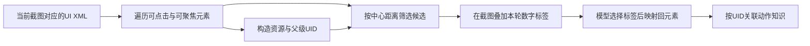
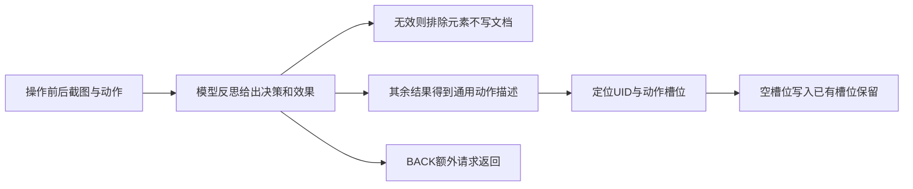
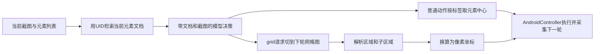

# AppAgent探索与技能学习

本文以官方仓库 **TencentQQGYLab/AppAgent** 的提交 `2c1900422caf6f9e94e96d5dd984b530e5a5fbf8` 为准，对照论文 `2312.13771v1`。它把“学习应用”落实为探索或观察演示后生成元素动作文档，再在部署时检索当前界面的相关文档；这里的技能学习主要是外部知识积累，不是一次模型权重微调。[AppAgent 探索与部署方法](https://arxiv.org/html/2312.13771v1#S3)

完整标准库示例：[app-agent.py](../../examples/agents/app-agent.py)。示例不调用ADB、不会点击应用，也不请求模型；展示的是元素键、文档槽位和动作坐标的可核算变化。

## 学习目标

- 区分截图中的临时数字标签与用于保存知识的元素 UID，解释何时 UID 会失配。
- 根据探索反思结果决定记录、回退或排除，并区分自主文档与演示文档的更新规则。
- 沿当前元素检索、提示、解析、坐标转换到控制器的路径追踪部署决策，解释网格回退的边界。

## 前置知识

需要了解截图、Android UI XML、边界框和字典索引。记当前元素集合为 $E_t$、元素身份函数为 $u(e)$，文档库为 $D[u,a]$，a 为动作类型。截图上数字 j 仅标识本轮列表中的第 j 个元素；它不是 App 永久提供的业务 ID。教学示例用已解析字典替代 XML，保留与源码相同的身份组成逻辑。

## 基本机制

自主探索链为 `self_explorer.py → AndroidController截图/XML → traverse_tree → 数字标注 → 模型与parse_explore_rsp → 控制器 → 前后截图反思 → auto_docs`。人工演示则由记录步骤与相邻截图交给 `document_generation.py` 形成 `demo_docs`。部署脚本选择其中一个文档库，按当前元素 UID 取文档，连同标注截图生成下一步动作。这里没有向量数据库，也没有把整个应用的全部文档做语义检索。[自主探索与auto_docs写入](https://github.com/TencentQQGYLab/AppAgent/blob/2c1900422caf6f9e94e96d5dd984b530e5a5fbf8/scripts/self_explorer.py#L90-L249) [部署时选择文档库](https://github.com/TencentQQGYLab/AppAgent/blob/2c1900422caf6f9e94e96d5dd984b530e5a5fbf8/scripts/task_executor.py#L49-L87)

## 推导或示例

### 知识点一：元素身份把视觉标签连接到探索知识

**问题与机制。** 为什么同一个按钮在截图里编号变化后，文档仍可能被找到？论文提出从 XML 资源ID或元素属性构造身份，并在截图上叠加数字以便模型选择。源码的基础键可概括为

$$
b(e)=\begin{cases}sanitize(resourceId),&resourceId\ne\varnothing\\class\_width\_height,&\text{否则}\end{cases},
$$

再附加长度小于20的 content-desc、直接父元素基础键和可选 index。临时标签映射是 $j\mapsto E_t[j-1]\mapsto u(e)$；前者依赖当前列表顺序，后者尝试依赖界面结构。两者只在当前截图和 XML 对应时一致。[AppAgent 环境与动作空间](https://arxiv.org/html/2312.13771v1#S3.SS1) [元素UID与树遍历](https://github.com/TencentQQGYLab/AppAgent/blob/2c1900422caf6f9e94e96d5dd984b530e5a5fbf8/scripts/and_controller.py#L41-L83)

```python
def element_identity(attributes, parent=None, add_index=True):
    """用资源ID或类名尺寸、短描述、父元素与index构造教学UID。"""
    def base_id(attrs):
        x1, y1, x2, y2 = attrs['bounds']
        if x2 <= x1 or y2 <= y1:
            raise ValueError("边界框须有正宽高")
        resource = attrs.get('resource-id', '')
        name = resource.replace(':', '.').replace('/', '_') if resource else f"{attrs['class']}_{x2 - x1}_{y2 - y1}"
        description = attrs.get('content-desc', '')
        if description and len(description) < 20:
            name += '_' + description.replace('/', '_').replace(' ', '').replace(':', '_')
        return name
    uid = base_id(attributes)
    if parent is not None:
        uid = base_id(parent) + '_' + uid
    if add_index:
        uid += '_' + str(attributes['index'])
    return uid
```

例如 resource-id 为 `demo:id/send`、index为0时，基础标识被标准化为 `demo.id_send_0`。同一元素若有短描述“发送”，会再加入描述；无 resource-id 时则依赖类名及宽高。如果字体缩放改变控件尺寸，或者列表插入元素改变 index，重建的键可能不同，旧文档不一定命中。因此 UID 是启发式关联键，不是跨版本不变的语义主键。

探索还需要筛选候选：源码遍历 clickable 和 focusable 元素，并以中心间距离 $d(c_i,c_j)=\sqrt{(x_i-x_j)^2+(y_i-y_j)^2}$ 和 `MIN_DIST` 去掉接近项，再排除 `useless_list` 中的身份。它减少重叠控件重复尝试，但也可能把功能不同、位置很近的元素合并掉。选中临时标签后再取边界框中心调用控制器，模型无需直接输出像素坐标。



**源码定位。** `get_id_from_element` 的 resource-id 标准化、短描述阈值和无ID回退可逐行查看；`traverse_tree` 再加父级和 index。[AppAgent 身份构造细节](https://github.com/TencentQQGYLab/AppAgent/blob/2c1900422caf6f9e94e96d5dd984b530e5a5fbf8/scripts/and_controller.py#L41-L86) 自主探索对无用元素过滤，以及 focusable/clickable 中心距离比较位于主循环。[探索候选构造](https://github.com/TencentQQGYLab/AppAgent/blob/2c1900422caf6f9e94e96d5dd984b530e5a5fbf8/scripts/self_explorer.py#L93-L121)

**条件与反例。** 同样的资源ID可能在多个列表项复用，父级与 index 也不能保证语义唯一；如果保存的是“第三个联系人”而不是控件通用功能，文档会在列表变化后误导决策。截图和 XML 分别采集还可能跨越页面变化。模板提示要求文档不写临时数字编号，正是为了避免把本轮标签当成可复用知识。[反思文档不应包含临时数字标签](https://github.com/TencentQQGYLab/AppAgent/blob/2c1900422caf6f9e94e96d5dd984b530e5a5fbf8/scripts/prompts.py#L189-L218)

### 知识点二：探索反思怎样进入动作文档槽位

**问题与机制。** 一次点击没有推进任务，是否就毫无学习价值？AppAgent 的反思区分 INEFFECTIVE、BACK、CONTINUE、SUCCESS。INEFFECTIVE 表示没有有效变化，不产生新文档；BACK/CONTINUE 虽未推进当前任务，仍可能揭示这个元素的通用功能，因此可以保存动作效果描述。SUCCESS 表示推进了一步，源码提示明确说它不一定完成整个任务。[AppAgent 四类探索反思](https://github.com/TencentQQGYLab/AppAgent/blob/2c1900422caf6f9e94e96d5dd984b530e5a5fbf8/scripts/prompts.py#L184-L222)

令无用元素集合为 U，动作槽位为 $D[u,a]$。自主路径的转移为

$$
U'=U\cup\{u\}\quad\text{当结果为INEFFECTIVE、BACK或CONTINUE},
$$

$$
D'[u,a]=\begin{cases}description,&result\ne INEFFECTIVE\land D[u,a]=\varnothing\\D[u,a],&\text{其他}\end{cases}.
$$

BACK 还产生返回动作。这里“无用”是该轮探索任务的筛选结果，不是证明控件对所有任务都无功能。

```python
def learn_action_document(store, blocked, uid, action, decision, description=''):
    """模拟自主探索的文档槽位更新及无用元素集合；不覆盖已有非空槽位。"""
    actions = ('tap', 'text', 'v_swipe', 'h_swipe', 'long_press')
    if action not in actions or decision not in ('INEFFECTIVE', 'BACK', 'CONTINUE', 'SUCCESS'):
        raise ValueError("动作或反思结果不受支持")
    result, excluded = deepcopy(store), set(blocked)
    if decision in ('INEFFECTIVE', 'BACK', 'CONTINUE'):
        excluded.add(uid)
    written = False
    if decision != 'INEFFECTIVE':
        if not description:
            raise ValueError("可记录的反思必须带动作效果文档")
        entry = result.setdefault(uid, {name: '' for name in actions})
        if not entry.get(action):
            entry[action] = description
            written = True
    return {'documents': result, 'blocked': sorted(excluded), 'written': written,
            'control': 'BACK' if decision == 'BACK' else 'CONTINUE'}
```

字典按 `tap/text/v_swipe/h_swipe/long_press` 五类槽位存放描述。假设点击某元素打开广告页：反思 BACK，先把身份列入排除集合，再可记下“打开推广详情”，后续其他任务仍可读这个知识。若判 INEFFECTIVE，仅排除、不记录。再次探索同一身份同一动作且已有非空文档时，教学函数保持原文；这是所读自主脚本的行为，不是自动融合冲突知识。



**源码定位。** 自主脚本读取 `parse_reflect_rsp` 的结果，更新 `useless_list`，按资源身份构造 `.txt` 文件，并在槽位已存在时跳过。[自主反思到文档写入](https://github.com/TencentQQGYLab/AppAgent/blob/2c1900422caf6f9e94e96d5dd984b530e5a5fbf8/scripts/self_explorer.py#L206-L249) [反思响应解析](https://github.com/TencentQQGYLab/AppAgent/blob/2c1900422caf6f9e94e96d5dd984b530e5a5fbf8/scripts/model.py#L190-L211) 文档是可供人检查的文本描述，和“训练出一个专属动作模型”不同。

**两个学习入口不能混用。** `document_generation.py` 对演示记录逐步读取动作、资源身份、前后截图；已有文档时由 `DOC_REFINE` 决定是否拼旧文档后再生成新描述。论文讨论反复观察改进文档，但当前自主脚本的已有槽位直接跳过，演示路径才有显式 refine 条件。两套目录在部署时还需选择，不能说源码总会自动合并自主与人类知识。[演示文档生成及DOC_REFINE](https://github.com/TencentQQGYLab/AppAgent/blob/2c1900422caf6f9e94e96d5dd984b530e5a5fbf8/scripts/document_generation.py#L60-L127)

**条件与反例。** 函数中的描述由调用者给定，不判断模型描述是否正确。图像有变化可能只是键盘弹出或动画，并不证明业务提交成功；反思误判会把错误规则写入文档。黑名单以元素身份为粒度，可能排除同一元素的另一种有效动作。自主路径遇到 text 动作会跳过后续反思文档步骤，因此不能把示例的五个槽位理解成每次探索都能同样完整填充。

### 知识点三：部署按当前界面检索，并在网格模式重新定位

**问题与机制。** 保存的知识如何参与下一步决策？普通元素模式构造

$$
D_t=\{(j,u(e_j),D[u(e_j),\cdot]):e_j\in E_t\land u(e_j)\in D\},
$$

并把其中非空动作描述拼进当前提示。模型选择本轮标签 j 后，执行器把它变成元素中心。若目标没有数字标签，模型可请求 grid；下一轮叠加网格，响应由专门解析器转换为 `tap_grid`、`long_press_grid` 或 `swipe_grid`。这是一种切换动作定位表示的策略，不是知识库自动找到了新的控件。[可见元素文档检索与网格切换](https://github.com/TencentQQGYLab/AppAgent/blob/2c1900422caf6f9e94e96d5dd984b530e5a5fbf8/scripts/task_executor.py#L175-L217)

对 r行c列、从1开始的区域 a，行列索引为 $i=\lfloor(a-1)/c\rfloor,j=(a-1)\bmod c$。设单元宽 $w=\lfloor W/c\rfloor$、高 $h=\lfloor H/r\rfloor$，子区域偏移 $(\alpha,\beta)$ 取1/4、1/2或3/4，则

$$
x=jw+\lfloor\alpha w\rfloor,\qquad y=ih+\lfloor\beta h\rfloor.
$$

```python
def deployment_context(elements, documents, selection, width, height, grid_shape=None):
    """检索当前元素文档，并把明确给定的元素或网格选择编译成点击点。"""
    if width <= 0 or height <= 0:
        raise ValueError("屏幕宽高须为正")
    docs = [{'tag': i + 1, 'uid': element['uid'], 'actions': deepcopy(documents[element['uid']])}
            for i, element in enumerate(elements) if element['uid'] in documents]
    tag = selection['area']
    if not isinstance(tag, int):
        raise ValueError("区域标签须为整数")
    if grid_shape is None:
        if not 1 <= tag <= len(elements):
            raise ValueError("当前元素标签越界")
        x1, y1, x2, y2 = elements[tag - 1]['box']
        if not (0 <= x1 < x2 <= width and 0 <= y1 < y2 <= height):
            raise ValueError("元素框无效")
        point = [(x1 + x2) // 2, (y1 + y2) // 2]
    else:
        rows, cols = grid_shape
        if not isinstance(rows, int) or not isinstance(cols, int) or rows <= 0 or cols <= 0 or not 1 <= tag <= rows * cols:
            raise ValueError("网格和区域标签无效")
        offsets = {'center': (2, 2), 'top-left': (1, 1), 'top': (2, 1), 'top-right': (3, 1),
                   'left': (1, 2), 'right': (3, 2), 'bottom-left': (1, 3), 'bottom': (2, 3), 'bottom-right': (3, 3)}
        subarea = selection.get('subarea', 'center')
        if subarea not in offsets:
            raise ValueError("未知网格子区域")
        cell_w, cell_h = width // cols, height // rows
        if not cell_w or not cell_h:
            raise ValueError("网格单元过小")
        row, col = divmod(tag - 1, cols)
        dx, dy = offsets[subarea]
        point = [col * cell_w + cell_w * dx // 4, row * cell_h + cell_h * dy // 4]
        docs = []  # 该版本网格提示不拼接UI文档
    return {'visible_documentation': docs, 'action': {'kind': 'tap', 'point': point}}
```

示例在300×240屏幕、2行3列网格选择区域5的 top-left：区域5是第二行第二列，单元100×120，坐标为 `[125,150]`。元素模式则按本轮标签映射到当前框；函数返回可见文档与结构化点击意图，不执行动作，也不自行决定点哪一个对象。



**源码定位。** `task_executor.py` 以 `elem.uid` 找同名文档，并重新标注对应本轮数字；`area_to_xy` 换算区域坐标，非grid动作后把 `grid_on` 复位。[AppAgent area_to_xy](https://github.com/TencentQQGYLab/AppAgent/blob/2c1900422caf6f9e94e96d5dd984b530e5a5fbf8/scripts/task_executor.py#L117-L139) [网格动作执行与模式复位](https://github.com/TencentQQGYLab/AppAgent/blob/2c1900422caf6f9e94e96d5dd984b530e5a5fbf8/scripts/task_executor.py#L256-L280) 该版本网格分支使用独立 `task_template_grid`，没有在此分支拼接元素文档；教学函数也返回空的可见文档列表，避免暗示网格模式仍以相同方式检索。

**边界与反例。** 网格绘制优先找120至180像素内能整除截图尺寸的单元；找不到时回退120，最后不足一个单元的边缘可能没有完整覆盖。`area_to_xy` 又使用整除后的行列宽高，非整除截图应核对绘图与定位一致性，不能仅凭“区域5”判断真实点击位置。[AppAgent 网格绘制及尺寸回退](https://github.com/TencentQQGYLab/AppAgent/blob/2c1900422caf6f9e94e96d5dd984b530e5a5fbf8/scripts/utils.py#L63-L95) 本例选用可整除尺寸，只验证清晰的公共路径。

当前图里缺失文档不应自动加载另一个页面同编号文档；临时标签变化后必须重新映射。模型响应解析使用文本字段与正则，不是执行任意生成代码；原函数解析异常返回 ERROR。教学通过显式输入及范围检查模拟协议边界，不复刻所有字符串容错行为。[AppAgent 元素与网格动作解析](https://github.com/TencentQQGYLab/AppAgent/blob/2c1900422caf6f9e94e96d5dd984b530e5a5fbf8/scripts/model.py#L101-L187)

## 适用条件与限制

论文将应用知识积累与任务执行分开，这有助于复用相同界面上的经验，但版本、语言、账号状态、权限弹窗与布局变化都可能使文档失配。部署脚本的 FINISH 来自模型判断，控制器返回成功表示 ADB 命令返回正常，不自动验证远端业务状态。实际实验应记录应用版本、屏幕/XML、元素键、文档版本和终态依据。[ADB返回与控制器调用](https://github.com/TencentQQGYLab/AppAgent/blob/2c1900422caf6f9e94e96d5dd984b530e5a5fbf8/scripts/and_controller.py#L19-L26)

## 协议、依赖与许可边界

官方仓库根LICENSE与README所指 assets/license.txt 均为 MIT，内容指纹一致；模型API、Android设备和第三方应用的使用条件独立。requirements列出DashScope、OpenCV、PyYAML、requests等但没有锁定版本，不能把固定源码提交说成完整环境锁定。本文未安装这些依赖、运行AppAgent脚本或接入任何API；示例仅用Python标准库。[AppAgent MIT许可](https://github.com/TencentQQGYLab/AppAgent/blob/2c1900422caf6f9e94e96d5dd984b530e5a5fbf8/LICENSE) [AppAgent依赖清单](https://github.com/TencentQQGYLab/AppAgent/blob/2c1900422caf6f9e94e96d5dd984b530e5a5fbf8/requirements.txt)

## 文档覆盖率与探索记忆的边界

可以用一个明确标为教学统计的量衡量文档填充程度：对已登记的元素集合 E，统计五种动作槽位中的非空数量 K，令覆盖率为 K 除以五倍元素数。这个数只说明表格填了多少格，不说明描述正确，也不表示这些动作都适用于每个元素；例如普通按钮没有文本输入能力，空槽位可能恰好正确。比较两个探索策略时，应按实际适用动作集合重新定义分母，并保留错误描述比例。[AppAgent动作文档槽位](https://github.com/TencentQQGYLab/AppAgent/blob/2c1900422caf6f9e94e96d5dd984b530e5a5fbf8/scripts/self_explorer.py#L230-L248)

自主探索的无用元素集合在这次脚本启动时创建，文档则写到应用目录持久保存。两者生命周期不同：重新启动并不必然继承上一次的探索排除集合。一次运行中排除过广告入口，不代表系统拥有跨会话的永久风险规则；部署实际读取的是选中的动作文档库。本组只分析这条公开路径，没有假设外部系统会补上额外记忆能力。

## 实践任务

交付三组产物：同元素属性变化前后的UID对照、四类反思的文档/排除集合变化、元素与网格选择的坐标表。另设计“有文档/无文档/过期文档”的同任务对照，固定应用版本与步骤预算。教学计算与真机实验分别验收；自主探索、录制演示、实际文档质量及部署真机完成率均未独立复现。

## 掌握标准

能从临时标签追溯到当前元素身份，而非跨截图复用数字；能指出SUCCESS只是一步推进，BACK也能产生知识；能区分自主槽位保留与演示refine；能手算网格区域5并说明非整除风险。说明学习成果时应附动作前后证据与版本，不能只提供项目链接或声称模型已经学会整个应用。

---

[返回模块](../modules/业务Agent.md) · [知识点索引](../../docs/知识点索引.md) · [完整教学代码](../../examples/agents/app-agent.py) · [提出更正](https://github.com/yanbozhang/llm-systems-wiki/issues/new?template=knowledge.yml)

觉得这篇推导有帮助，可以在 [GitHub](https://github.com/yanbozhang/llm-systems-wiki) 点 Star 收藏更新；分享时欢迎链接到具体知识点，便于读者复核公式、代码与来源。
