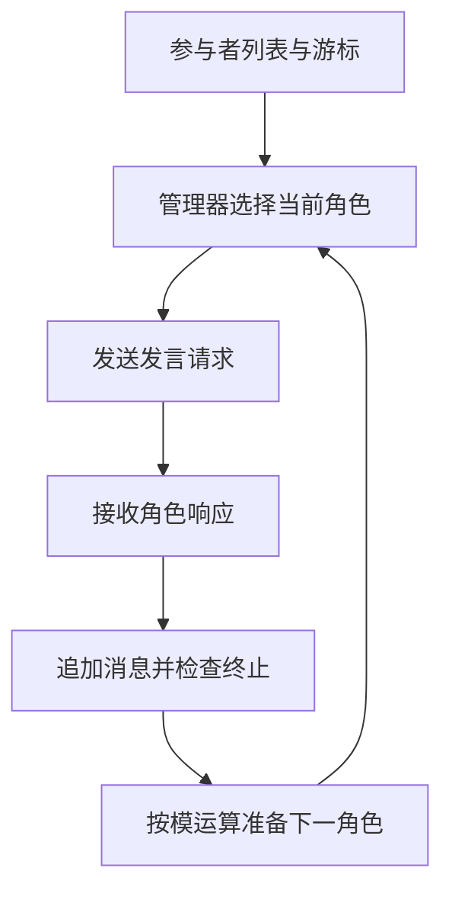
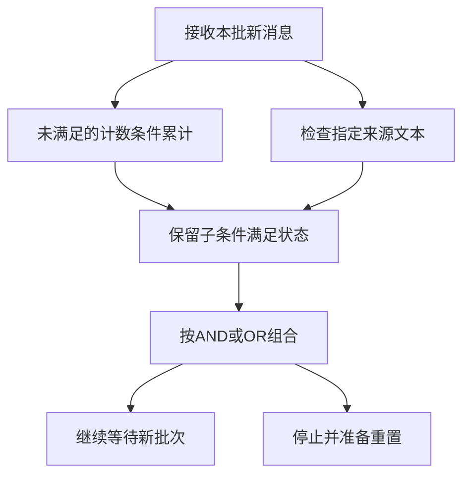
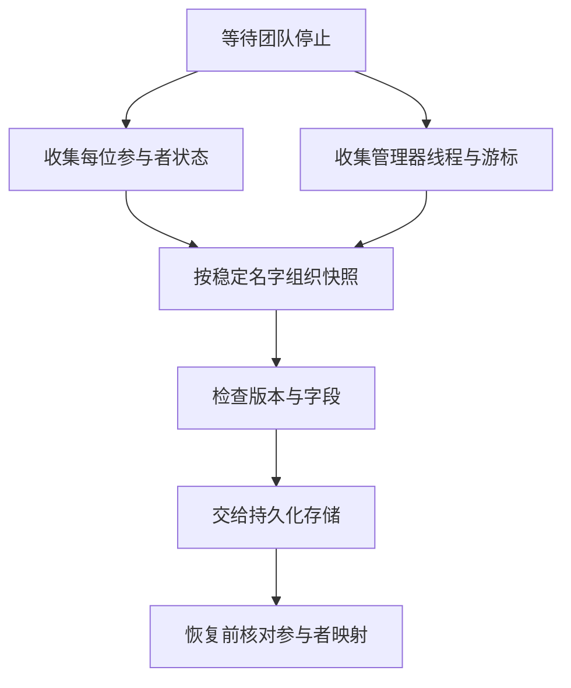

# AutoGen对话团队与终止

> AutoGen AgentChat把参与者、团队管理器、消息运行时和终止条件分开。本文固定源码说明轮询团队如何推进、终止条件如何累计新消息，以及保存状态需要覆盖哪些角色；不以角色数量推断智能程度或当前市场使用率。

## 学习目标

- 追踪轮询团队的调度与消息流
- 区分状态化终止条件及其组合
- 恢复参与者与管理器的一致状态

## 前置知识

先读[Harness任务循环](Harness任务循环.md)和[业务Agent任务闭环](业务Agent任务闭环.md)。需要异步消息、状态化计数器和快照概念。本文具体分析AgentChat的RoundRobinGroupChat路径，不把这一模式推广成所有AutoGen团队。

## 基本机制

固定提交为 `004749e6b7102c8fd317b9b1499ce5807223c278`。本次README顶部明确写项目已归档、微软不再维护并推荐Microsoft Agent Framework；后文仍保留maintenance mode和community-managed措辞。这里记录该版本的顶部公告与文本差异，不自行推断最新下载量、活跃度或迁移比例。[AutoGen 官方仓库说明](https://github.com/microsoft/autogen/blob/004749e6b7102c8fd317b9b1499ce5807223c278/README.md#L1)。

源码层面，BaseGroupChat向运行时发送开始事件，管理器选择发言者并转发消息，参与者响应再进入线程与终止判断；最终run_stream输出TaskResult及stop_reason。停止原因描述运行为何结束，并不是业务成果已通过独立验收。[AutoGen BaseGroupChatManager](https://github.com/microsoft/autogen/blob/004749e6b7102c8fd317b9b1499ce5807223c278/python/packages/autogen-agentchat/src/autogen_agentchat/teams/_group_chat/_base_group_chat_manager.py#L135)；[AutoGen BaseGroupChat 运行和存档](https://github.com/microsoft/autogen/blob/004749e6b7102c8fd317b9b1499ce5807223c278/python/packages/autogen-agentchat/src/autogen_agentchat/teams/_group_chat/_base_group_chat.py#L748)。

完整标准库示例：[教学实现](../../examples/harness/autogen.py)。以下代码只处理模拟状态与记录，不启动产品、模型、工具或外部进程。

## 推导或示例

### 知识点一：轮询团队推进的是发言游标，不是隐式集体推理

RoundRobinGroupChatManager.select_speaker返回当前游标对应的参与者，并令下一个游标对参与者数量取模。它不是让所有模型同时回答、再神秘地汇总“共识”。BaseGroupChatManager负责向被选中的参与者发送发布请求，并在响应回来后把新消息追加到线程、检查终止条件，再选择下一位。

设参与者数为N、当前游标为i，本页直接写出源码对应的**调度状态模型**：

$$
speaker=P_i,\qquad i^\prime=(i+1)\bmod N.
$$

每次选择恰好一个人；在没有跳过、失败和提前终止的连续N次选择中，每位参与者恰好被选一次。这个性质是轮询公平性，不是任务分工有效性，更不是成功概率。不同角色提示词是否带来收益仍需独立评估。

手算writer、critic两人，初始游标0，顺序为writer、critic、writer。如果critic的反馈需要额外资料，轮询本身不会自动给它新工具或改变任务边界；这些能力属于参与者配置和业务设计。为同一模型起多个角色名，也不能单凭命名证明获得独立判断。

源码基类还允许某些选择器返回多个发言者，并管理active_speakers；本文不把那条路径套入轮询公式。尤其不能据轮询的单发言者过程推断所有团队都串行，或据基类存在多发言者支持推断RoundRobin默认并发。

```python
def select_round_robin(participants: list[str], next_index: int) -> tuple[str, int]:
    """选择单个发言者并推进游标，不调用模型或调度真实agent。"""
    if not participants or len(set(participants)) != len(participants):
        raise ValueError('参与者必须非空且不重复')
    if any(type(name) is not str or not name for name in participants):
        raise ValueError('参与者名称必须是非空字符串')
    if type(next_index) is not int or not 0 <= next_index < len(participants):
        raise ValueError('游标超出参与者范围')
    return participants[next_index], (next_index + 1) % len(participants)
```

函数只返回人名与新游标，没有消息发送或模型调用。名称必须唯一，便于状态按参与者身份恢复。调用者若改变参与者顺序，应先处理已有游标的含义，不能把旧整数游标直接解释成原来的角色。



源码及官方依据：[AutoGen RoundRobinGroupChatManager](https://github.com/microsoft/autogen/blob/004749e6b7102c8fd317b9b1499ce5807223c278/python/packages/autogen-agentchat/src/autogen_agentchat/teams/_group_chat/_round_robin_group_chat.py#L58)；[AutoGen BaseGroupChatManager](https://github.com/microsoft/autogen/blob/004749e6b7102c8fd317b9b1499ce5807223c278/python/packages/autogen-agentchat/src/autogen_agentchat/teams/_group_chat/_base_group_chat_manager.py#L135)；[AutoGen 官方仓库说明](https://github.com/microsoft/autogen/blob/004749e6b7102c8fd317b9b1499ce5807223c278/README.md#L1)。

可验证性质是循环覆盖与游标边界。反例是保存状态后调换参与者顺序，next_speaker_index数值仍合法但角色语义已变；需要冻结身份映射。轮询只解决发言顺序，不解决权限、任务验收和信息重复问题。

### 知识点二：终止条件消费增量消息，并可跨批次锁存组合

MaxMessageTermination内部保存_message_count，每次只累计传入的新消息；TextMentionTermination检查消息文本是否含目标子串，并可限定来源。TerminationCondition接口明确输入应是上次检查之后的消息。如果把完整历史每轮都传一遍，早期消息会被反复计数，停止时间就被人为提前。

用c表示计数、h表示文本条件是否曾命中、M表示消息门槛，教学模型为

$$
c^\prime=c+\sum_{m\in\Delta}\mathbf1[eligible(m)]\quad(c\lt M),\qquad h^\prime=h\lor match(\Delta).
$$

计数条件已满足后在AND组合里不再调用它，因此c保持锁存；组合OR为 $(c^\prime\ge M)\lor h^\prime$ ，AND为 $(c^\prime\ge M)\land h^\prime$ 。这里的AND不是“两个条件必须在同一条消息出现”，而是状态化子条件都曾达到终止。源码AndTerminationCondition只调用尚未终止的子条件，并收集已产生的StopMessage。

手算M=3，第一批两条普通消息且未命中，状态(2,False)；第二批一条来自critic的APPROVE，变为(3,True)，AND与OR都结束。若第二批只命中文本但没有可计数chat，AND仍等计数门槛，而OR已停止。一次delta可能包含多条消息，所以计数可能越过M，这不是执行前的硬预算限额。

TextMention是子串匹配，“NOT APPROVE”也可能命中APPROVE。限定source可避免用户任务文本意外触发，但不能消除语义误判。需要严格业务终态时，应采用结构化状态或独立谓词，而不把文本口令当充分验收证据。

```python
def termination_step(state: tuple[int, bool], delta: list[dict], limit: int,
                     marker: str, source: str, mode: str = 'or',
                     include_events: bool = False) -> tuple[tuple[int, bool], bool]:
    """组合消息数和指定来源的文本终止，输入仅为新消息；满足的子条件保持锁存。"""
    count, hit = state
    if type(count) is not int or count < 0 or type(hit) is not bool:
        raise ValueError('终止状态不合法')
    if type(limit) is not int or limit <= 0 or not marker or mode not in {'or', 'and'}:
        raise ValueError('终止配置不合法')
    if type(include_events) is not bool:
        raise ValueError('事件开关须为布尔值')
    combine = any if mode == 'or' else all
    if combine((count >= limit, hit)):
        raise ValueError('已终止条件必须先重置')
    for item in delta:
        if item['kind'] not in {'chat', 'event'} or type(item['text']) is not str:
            raise ValueError('消息格式不合法')
    if count < limit:
        count += sum(include_events or item['kind'] == 'chat' for item in delta)
    if not hit:
        hit = any(item['source'] == source and marker in item['text'] for item in delta)
    return (count, hit), combine((count >= limit, hit))
```

state是计数与文本锁存位，delta为本批新消息。include_events决定事件是否计入消息上限，source约束文本来源。返回新状态与停止位，已停止再调用会报错，明确要求reset。代码中的重置可通过重新提供(0,False)演示，不执行真实团队操作。



源码及官方依据：[AutoGen 消息数与文本终止](https://github.com/microsoft/autogen/blob/004749e6b7102c8fd317b9b1499ce5807223c278/python/packages/autogen-agentchat/src/autogen_agentchat/conditions/_terminations.py#L83)；[AutoGen AND与OR终止组合](https://github.com/microsoft/autogen/blob/004749e6b7102c8fd317b9b1499ce5807223c278/python/packages/autogen-agentchat/src/autogen_agentchat/base/_termination.py#L15)；[AutoGen BaseGroupChatManager](https://github.com/microsoft/autogen/blob/004749e6b7102c8fd317b9b1499ce5807223c278/python/packages/autogen-agentchat/src/autogen_agentchat/teams/_group_chat/_base_group_chat_manager.py#L135)；[AutoGen Termination 官方教程](https://microsoft.github.io/autogen/stable/user-guide/agentchat-user-guide/tutorial/termination.html)。

可验证性质是增量累计、跨批次锁存与已停止拒绝。反例是将model token增量和消息数混用，两者单位不同；文本条件也不是正确性证明。官方教程中的自动reset对应正常团队结束路径，异常或外部取消后仍需检查真实状态，不能假定所有退出路径完全一致。

### 知识点三：团队存档必须同时覆盖参与者与管理器

只保存最后一句聊天文本不足以恢复团队。BaseGroupChat.save_state逐个调用参与者的agent_save_state，再保存管理器；使用agent名字作为键。RoundRobinManagerState明确包括message_thread、current_turn、next_speaker_index。参与者自己的模型上下文等状态则由各参与者保存，不能由管理器线程文本自动替代。

将整体快照抽象为

$$
S=(A_1,\ldots,A_N,M),\qquad M=(history,turn,index).
$$

一致性要求这些分量对应同一个逻辑边界。如果保存A1后团队继续执行，再保存A2和M，就可能得到不存在于任何真实时刻的组合。源码save_state文档提示运行中保存可能不一致，推荐停止后操作；load_state会拒绝在运行时加载。教学函数比save_state更严格，直接拒绝running=True。

手算writer状态停在第二次草稿，critic状态停在第一次审阅，管理器游标又指向writer，这一组合不一定正确；需要确认它们来自同一停止边界。深拷贝只能防止调用方后续修改已返回字典，不能把不同时间取得的数据变成一致快照。

另一个边界是终止条件状态。RoundRobin管理器的上述保存字段并未包含任意终止条件内部计数；正常终止路径会重置条件和current_turn，但保留对话线程与轮询游标。不能把“再次run”称为从全空状态开始，也不能把已保存团队状态当成任意时刻的终止条件全量检查点。

```python
from copy import deepcopy

def snapshot_team(agent_states: dict[str, dict], manager_name: str,
                  manager_state: dict, running: bool) -> dict:
    """只在团队静止时复制参与者和管理器状态；比上游save_state提示更严格。"""
    if type(running) is not bool or running:
        raise ValueError('须在停止后获取教学一致快照')
    if not agent_states or not manager_name or manager_name in agent_states:
        raise ValueError('参与者或管理器身份冲突')
    required = {'message_thread', 'current_turn', 'next_speaker_index'}
    if not required <= manager_state.keys():
        raise ValueError('管理器恢复字段不完整')
    states = deepcopy(agent_states)
    states[manager_name] = deepcopy(manager_state)
    return {'agent_states': states}
```

函数构造与上游形状相近的agent_states嵌套结构，复制全部参与者并加入管理器。它要求三个关键管理器字段齐全，但不验证每个参与者私有Schema，也不实现磁盘保存。真实load_state逐个加载，失败时不应自动假定跨参与者原子回滚。



源码及官方依据：[AutoGen BaseGroupChat 运行和存档](https://github.com/microsoft/autogen/blob/004749e6b7102c8fd317b9b1499ce5807223c278/python/packages/autogen-agentchat/src/autogen_agentchat/teams/_group_chat/_base_group_chat.py#L748)；[AutoGen RoundRobinGroupChatManager](https://github.com/microsoft/autogen/blob/004749e6b7102c8fd317b9b1499ce5807223c278/python/packages/autogen-agentchat/src/autogen_agentchat/teams/_group_chat/_round_robin_group_chat.py#L58)；[AutoGen BaseGroupChatManager](https://github.com/microsoft/autogen/blob/004749e6b7102c8fd317b9b1499ce5807223c278/python/packages/autogen-agentchat/src/autogen_agentchat/teams/_group_chat/_base_group_chat_manager.py#L135)；[AutoGen Termination 官方教程](https://microsoft.github.io/autogen/stable/user-guide/agentchat-user-guide/tutorial/termination.html)。

可验证性质是状态覆盖完整、深拷贝隔离、活动团队拒绝。反例是更换参与者名称或模型上下文结构后直接加载旧状态；名字缺失或Schema变化会使恢复失败。存档不包含所有外部工具副作用，仍需要业务层身份与回查。

## 适用条件与限制

本文为固定提交的源码教学，不是当前生产选型推荐。README顶部归档公告应与历史教程一起阅读，代码存在与维护承诺是两个事实；本文没有收集使用率、迁移率或性能对比数据。

轮询团队、状态化终止与团队存档分别解决顺序、停止和恢复问题。它们不会自动证明协作质量、避免重复工具副作用或保证业务验收。消息计数是批后检查，不是每次模型或工具调用前的硬资源预算。

## 实践任务

构造writer与critic两角色的六次轮询序列，手算游标。用不同delta批次分别满足计数与文本条件，比较AND和OR停止时机；加入用户文本含APPROVE的反例。最后构造完整团队快照，并说明为什么更改参与者顺序或运行中保存会破坏恢复语义。

实践状态为 `designed`。教学函数的小规模验证与真实产品实验分别记录；本版没有复现完整产品或论文实验。

## 掌握标准

- 能定位select_speaker并解释轮询公平性的有限前提。
- 能区分增量输入、全历史输入与不同计数单位。
- 能解释AND锁存和正常终止后的reset。
- 能列出恢复必须保存的角色状态，并说明快照一致性限制。

## 版本、开放性与源码导读

代码版本 `004749e6b7102c8fd317b9b1499ce5807223c278`；代码MIT许可见[AutoGen 代码MIT许可](https://github.com/microsoft/autogen/blob/004749e6b7102c8fd317b9b1499ce5807223c278/LICENSE-CODE#L1)，README另将文档内容列为CC BY 4.0。许可允许的使用与上游是否继续维护并非同一判断。

源码导读从RoundRobinGroupChatManager.select_speaker开始，接着看BaseGroupChatManager.handle_agent_response如何构造delta、检查active_speakers和应用终止条件。然后对照MaxMessageTermination、TextMentionTermination及AND/OR组合。最后比较BaseGroupChat.run_stream的TaskResult与save_state/load_state。

连贯案例中，writer产出草稿、critic给出反馈，团队因文本口令停止；这只能说明停止规则触发，不能说明草稿正确。若业务要求引用齐全，应由额外验收器检查。下次继续团队时，历史和轮询游标可能保留，终止条件却已经重置；因此应把“新的运行调用”与“新的独立任务”区分开。

本组没有启动任何AutoGen agent或子进程。所有示例只处理名字、消息记录与状态字典，适合验证机制性质；真实团队表现仍受模型、工具、角色分工、任务选择与总预算影响。

本页的状态、预算和指标公式均是有明确适用条件的教学建模，除明确标出的源码行为外，不宣称为产品内部算法或实验效果。源码链接固定实际commit；可取得原文的资料记录正文指纹，仅有观察摘要的资料使用observed版本。

---

[返回模块](../modules/Harness.md) · [知识点索引](../../docs/知识点索引.md) · [完整教学代码](../../examples/harness/autogen.py) · [提出更正](https://github.com/yanbozhang/llm-systems-wiki/issues/new?template=knowledge.yml)

觉得这篇推导有帮助，可以在 [GitHub](https://github.com/yanbozhang/llm-systems-wiki) 点 Star 收藏更新；分享时欢迎链接到具体知识点，便于读者复核公式、代码与来源。
