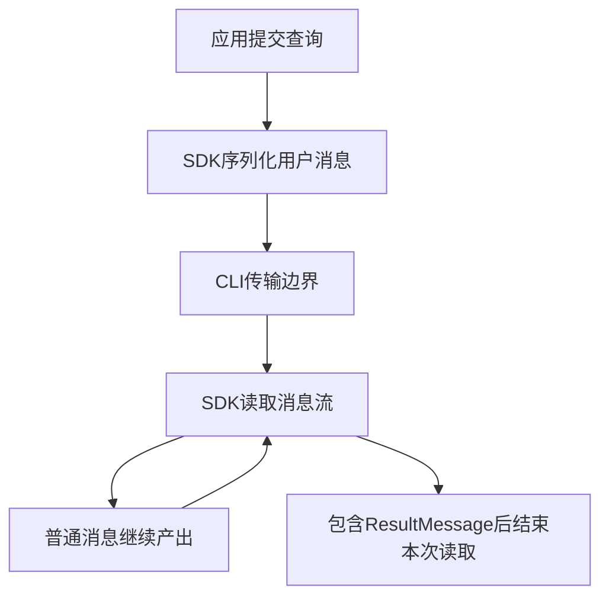
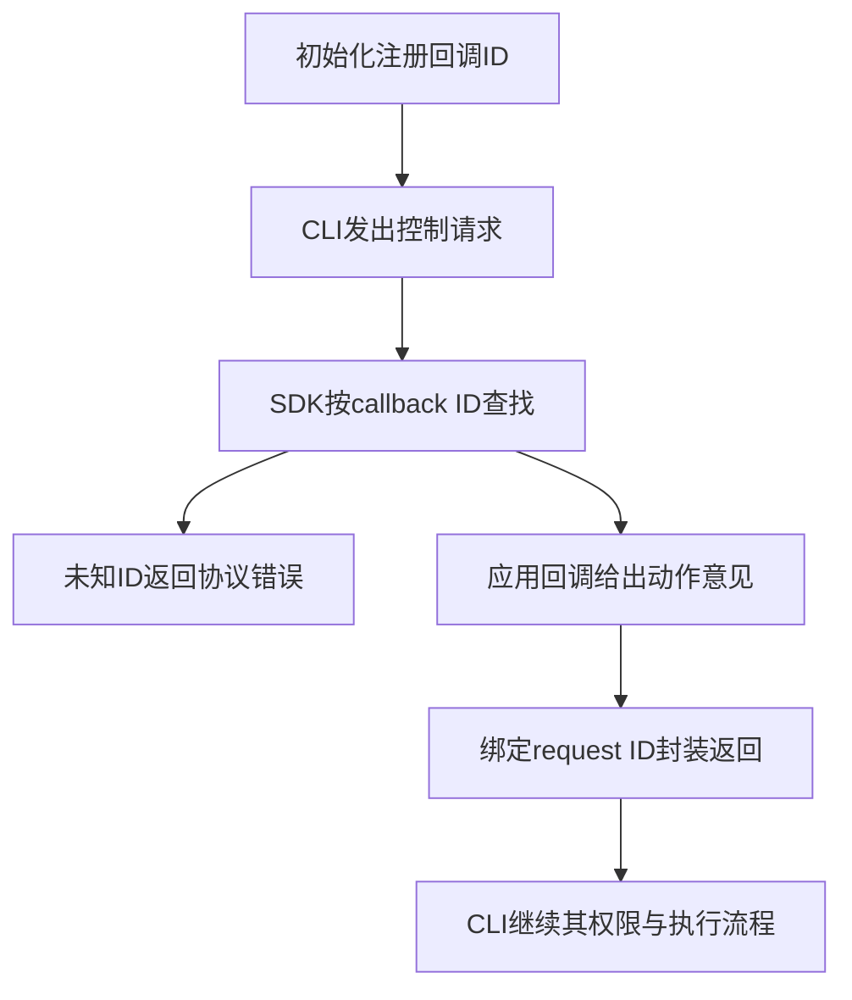
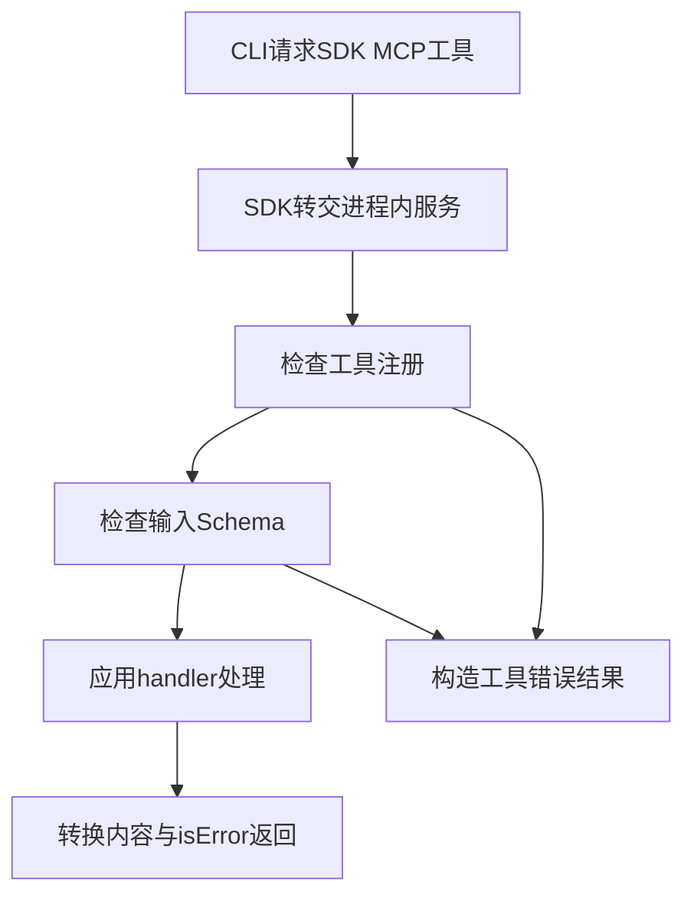

# ClaudeCode工作流与扩展边界

> Claude Code的公开产品说明可以解释工作循环，公开Python SDK可以解释连接、控制回调和工具扩展；这些证据不足以重建未公开客户端核心。本文明确分开官方描述、SDK源码事实和本库教学抽象。

## 学习目标

- 区分产品说明、公开SDK与未公开实现
- 解释回调控制协议与进程边界
- 设计工具扩展及其错误处理

## 前置知识

先读[AI代码开发与反馈](AI代码开发与反馈.md)和[工具协议与MCP及Skill](工具协议与MCP及Skill.md)。需要异步消息流、进程间通信与hook概念。SDK、随包分发的CLI二进制和产品内部源码是不同对象，包里有可执行文件不意味着它的实现已按SDK许可公开。

## 基本机制

截至2026-10-24，公开工作机制文档说明：循环包括收集上下文、采取行动和验证结果，用户可以中途打断或补充方向；模型与工具分工，上下文含对话、文件、命令输出和持续指令。本条保留阅读摘要，未归档网页正文，来源版本记为 `observed:2026-10-24`，不伪造网页原文哈希。[How Claude Code works](https://code.claude.com/docs/en/how-claude-code-works)。

anthropics/claude-code提交 `318b7e6ac4e726e88a4ad326214866a93c373b1b` 的README提供产品和插件入口，LICENSE.md写明保留所有权利、使用受Commercial Terms约束。Python SDK提交 `0e89b298e771259378a6cd3734e00d323dff5703` 则为MIT许可。公开产品仓库不能据此称核心完全开源，SDK许可也不能扩展到CLI核心。[Claude Code 仓库许可](https://github.com/anthropics/claude-code/blob/318b7e6ac4e726e88a4ad326214866a93c373b1b/LICENSE.md#L1)；[Claude Agent SDK Python MIT许可](https://github.com/anthropics/claude-agent-sdk-python/blob/0e89b298e771259378a6cd3734e00d323dff5703/LICENSE#L1)。

完整标准库示例：[教学实现](../../examples/agents/claude-code.py)。以下代码只处理模拟状态与记录，不启动产品、模型、工具或外部进程。

## 推导或示例

### 知识点一：SDK响应边界不等于客户端内部工作循环

官方描述回答“产品如何工作”，SDK源码回答“外部应用如何接入”。SubprocessCLITransport._build_command构造CLI参数，包含stream-json输出；connect负责启动子进程。ClaudeSDKClient.query向传输写入用户消息，receive_response逐条产出消息，遇到ResultMessage后返回。这些都是公开SDK代码，不是客户端核心模型循环的源码。

将一次响应的消息序列记为 $e_1,\ldots,e_n$，首个result的位置为 $k=\min\{i:type(e_i)=result\}$，本页的**读取窗口模型**为

$$
W(e)=e_{1:k},\qquad responseComplete=\mathbf1[k\text{存在}].
$$

不存在k时保留当前所有已知消息并标未完成；这不表示未来永远不会返回result。业务验收是独立变量，教学函数始终保留为None。一个错误结果同样可以结束协议响应，不能将“迭代器结束”解释成“代码已正确修改”。

手算assistant、tool、result、assistant四条消息，窗口只包含前三条。最后一条可能属于另一次响应，不能被混入前一次结果。实际SDK的消息类型和流控更丰富，列表扫描只演示边界；断流、取消和后台活动仍需真实传输层处理。

官方核验记录还指出上下文接近容量时会先清理旧工具输出，再按需压缩，且早期细节可能丢失。这是公开描述，不可据此编造客户端压缩函数名、精确阈值或数据结构。源码页只定位SDK中确实公开的函数。

```python
def response_window(events: list[dict]) -> dict:
    """收集至第一条result并包含它；响应完成不代表业务验收通过。"""
    collected = []
    for event in events:
        if not isinstance(event, dict) or 'type' not in event:
            raise ValueError('消息必须具有类型')
        collected.append(dict(event))
        if event['type'] == 'result':
            return {'messages': collected, 'response_complete': True,
                    'business_verified': None}
    return {'messages': collected, 'response_complete': False,
            'business_verified': None}
```

函数接收已取得的模拟事件，复制每条消息后遇result停止。它不连接CLI，也不把消息中的“完成”文字当成result类型。SDK源码未给本函数这种有限列表模型提供终端业务保证；这里增加business_verified字段正是为标出未观察的那一层。



源码及官方依据：[ClaudeSDKClient 查询与响应流](https://github.com/anthropics/claude-agent-sdk-python/blob/0e89b298e771259378a6cd3734e00d323dff5703/src/claude_agent_sdk/client.py#L272)；[Claude SDK SubprocessCLITransport](https://github.com/anthropics/claude-agent-sdk-python/blob/0e89b298e771259378a6cd3734e00d323dff5703/src/claude_agent_sdk/_internal/transport/subprocess_cli.py#L570)；[Claude Agent SDK Python 官方说明](https://github.com/anthropics/claude-agent-sdk-python/blob/0e89b298e771259378a6cd3734e00d323dff5703/README.md#L1)；[How Claude Code works](https://code.claude.com/docs/en/how-claude-code-works)。

可验证性质是首个结果边界、无结果保持未完成、业务状态不被自动确认。反例是工具已改坏文件而最终响应正常到达，SDK传输仍可成功；必须用独立契约验收文件。公开SDK不能证明CLI内部如何选择每一步工具。

### 知识点二：Hook通过控制协议回调，不是模型自行执行的提示词

SDK Query.initialize为hook分配callback ID，向CLI发送matcher和回调ID配置；_handle_control_request收到hook_callback时按ID取回调、调用它，再把输出封装成control_response。回调是应用代码运行的扩展点，不能把它说成模型脑内的一段规则。

官方Hooks参考中，PreToolUse发生在工具执行前，可以给出决策。本文将控制返回建模为

$$
reply=(requestId,transportStatus,decision),\quad decision\in\{allow,deny,\varnothing\}.
$$

transportStatus说明回调是否成功处理请求，decision说明对动作的意见，二者正交。一个正常运行的hook返回deny，其控制响应仍为success；如果只读最外层success就执行动作，会把明确拒绝反转。反之，未知callback ID是协议处理错误，不是业务工具已经运行失败。

手算请求r1调用h1，注册表中h1=deny，输出应同时保留request_id=r1、subtype=success、permissionDecision=deny。h2未注册则是error。注册h3但不发表意见时输出空对象，让正常权限流程继续，而不是由本函数擅自转成allow。

本页并不从SDK分发函数推出所有hook事件的全局顺序。某个PostToolUse通知发生在动作以后，即使处理失败也不能自动撤销已产生副作用；停止、重试或补偿仍需要宿主与业务契约共同定义。

```python
def hook_reply(request_id: str, callback_id: str, decisions: dict[str, str | None]) -> dict:
    """用注册的模拟回调决策构造控制响应，不执行脚本或真实hook。"""
    if not request_id or not callback_id:
        raise ValueError('控制请求与回调必须有身份')
    if callback_id not in decisions:
        return {'type': 'control_response', 'response': {
            'subtype': 'error', 'request_id': request_id, 'error': 'unknown callback'}}
    decision = decisions[callback_id]
    if decision not in {None, 'allow', 'deny'}:
        raise ValueError('教学模型只支持允许、拒绝和不表态')
    output = {} if decision is None else {'hookSpecificOutput': {
        'hookEventName': 'PreToolUse', 'permissionDecision': decision}}
    return {'type': 'control_response', 'response': {
        'subtype': 'success', 'request_id': request_id, 'response': output}}
```

decisions是模拟回调结果表，不是可执行函数表，所以示例不会运行脚本。代码只构造控制响应的两层语义；支持的三种值是教学子集，不替代官方所有权限决策。实际SDK还有异常转换、取消、输入字段转换和其他控制请求类型。



源码及官方依据：[Claude SDK 控制请求分发](https://github.com/anthropics/claude-agent-sdk-python/blob/0e89b298e771259378a6cd3734e00d323dff5703/src/claude_agent_sdk/_internal/query.py#L577)；[Claude Agent SDK Python 官方说明](https://github.com/anthropics/claude-agent-sdk-python/blob/0e89b298e771259378a6cd3734e00d323dff5703/README.md#L1)；[Claude Code Hooks 官方参考](https://code.claude.com/docs/en/hooks)。

可验证性质是请求身份一致、协议成功与动作拒绝可并存、空输出不等于批准。反例是将hook当成完整权限系统：回调之外还有工具集合、许可策略和执行环境。SDK公开控制分发不能替代对未公开客户端所有决策优先级的核验。

### 知识点三：进程内MCP工具公开了实现，但不消除CLI边界

create_sdk_mcp_server构造工具名索引与Schema，在内部run_tool中检查未知工具、校验输入、调用handler并转换结果。该提交明确将未知工具、输入错误及handler异常转换为isError结果，使错误进入模型可读反馈，而非统一抛成协议错误。这是SDK该适配器的选择，不是所有MCP服务必须采用同一错误策略。

设N表示工具已注册，J表示输入结构合法，H表示处理成功，教学成功谓词是

$$
toolOK=N\land J\land H.
$$

任何一项失败都生成带isError的工具结果。调用成功仍不自动证明业务终态；工具若只回显数字，工具成功的范围也只到该回显功能为止。示例把真实Schema校验简化为单字段整数，不能用于任意JSON Schema。

手算echo工具输入value=True，Python中布尔值可被当成整数子类，但本例契约要求精确整数，因此返回错误。输入value=3正常返回文本3。另一个模拟handler失败则返回错误结果，调用方应根据错误内容调整，而不能把“收到合法MCP结果”直接计为业务成功。

“进程内”修饰的是自定义工具服务在应用进程内，不表示CLI也被重写为Python。SDK的SubprocessCLITransport仍可启动CLI。README还明确allowed_tools是预批准清单，不是工具可见性的删减；tools、allowed_tools、disallowed_tools被构造成不同参数，应分别解释。

```python
def sdk_tool_route(name: str, arguments: dict, registry: dict[str, dict]) -> dict:
    """模拟SDK进程内工具的发现、输入检查和错误结果；工具逻辑仅回显整数。"""
    def error(message: str) -> dict:
        return {'isError': True, 'content': [{'type': 'text', 'text': message}]}
    if name not in registry:
        return error('unknown tool')
    if type(arguments) is not dict or set(arguments) != {'value'}:
        return error('invalid fields')
    if type(arguments['value']) is not int:
        return error('value must be an integer')
    if registry[name].get('fail', False):
        return error('simulated handler failure')
    return {'isError': False, 'content': [{'type': 'text', 'text': str(arguments['value'])}]}
```

registry只记录模拟工具及其是否失败，函数不执行任何外部handler。返回使用MCP线上的isError命名；SDK中handler字典的is_error字段会被适配为相应线上字段，调用方需要分清边界。错误转换保留了反馈通路，却不修复工具本身。



源码及官方依据：[Claude SDK 进程内MCP工具](https://github.com/anthropics/claude-agent-sdk-python/blob/0e89b298e771259378a6cd3734e00d323dff5703/src/claude_agent_sdk/__init__.py#L620)；[Claude SDK SubprocessCLITransport](https://github.com/anthropics/claude-agent-sdk-python/blob/0e89b298e771259378a6cd3734e00d323dff5703/src/claude_agent_sdk/_internal/transport/subprocess_cli.py#L570)；[Claude Agent SDK Python 官方说明](https://github.com/anthropics/claude-agent-sdk-python/blob/0e89b298e771259378a6cd3734e00d323dff5703/README.md#L1)。

可验证性质是三类错误可读返回、非法输入不产出正常内容。反例是把SDK README的“无单独工具进程”概括成“系统无IPC”，CLI与应用之间仍有传输；不能用扩展的开放实现证明闭源客户端内部架构。

## 适用条件与限制

本页使用三种不同证据：官方工作机制的浏览器核验记录、实际取得正文的Hooks参考、固定提交的SDK源码。第一类没有原文指纹，其观察范围不能扩展到未记录的默认值和内部函数。第二类是产品行为说明，第三类只证明公开SDK所实现的边界。

Claude Code仓库的存在不等于核心完全开源。本文未使用泄露代码，也没有反编译产品二进制。SDK内置CLI的分发事实不改变两者许可范围；使用和分发时仍需分别核对适用条款。

## 实践任务

为“读取文件、生成补丁、等待验收”画出应用、Python SDK、CLI和进程内工具四个边界。构造result已到但业务未验收、hook返回deny却控制响应success、MCP输入非法三个案例。分别说明反馈应到哪一层，以及哪些判断需要真实产品或独立业务证据。

实践状态为 `designed`。教学函数的小规模验证与真实产品实验分别记录；本版没有复现完整产品或论文实验。

## 掌握标准

- 能在每条结论旁标注官方描述、SDK源码事实或教学抽象。
- 能解释ResultMessage与业务成功为何不同。
- 能区分hook协议成功和动作批准。
- 能说明进程内工具、CLI分发和核心开放性互不等价。

## 版本、开放性与源码导读

产品公开仓库版本为 `318b7e6ac4e726e88a4ad326214866a93c373b1b`；Python SDK版本为 `0e89b298e771259378a6cd3734e00d323dff5703`。许可分别见[Claude Code 仓库许可](https://github.com/anthropics/claude-code/blob/318b7e6ac4e726e88a4ad326214866a93c373b1b/LICENSE.md#L1)与[Claude Agent SDK Python MIT许可](https://github.com/anthropics/claude-agent-sdk-python/blob/0e89b298e771259378a6cd3734e00d323dff5703/LICENSE#L1)。

阅读SDK时先看SubprocessCLITransport如何建立传输，再看ClaudeSDKClient.query和receive_response的消息边界；然后沿Query.initialize的回调注册进入_handle_control_request，最后看create_sdk_mcp_server的工具索引、Schema和错误转换。函数都来自公开代码，没有为客户端核心发明同名类。

连贯案例中，SDK发出的用户请求可触发多次工具与hook交互。控制响应success只表示回调返回，工具isError说明工具层结果，ResultMessage说明响应边界；最终文件是否符合用户要求还要另验收。把这几个层次压成一个success字段会丢失恢复依据。

同样，官方描述中的上下文压缩不意味着所有早期细节被完整保存。核验记录建议持续规则放入CLAUDE.md，但本文没有公开核心压缩源码可用，因此只保留“可能丢失早期细节”的产品说明边界，不用教学公式猜阈值或重建算法。

交接验证还应固定SDK与CLI各自的版本。SDK的MIT源码说明某条控制消息怎样序列化，并不证明另一版本CLI一定支持该消息。遇到功能不匹配，应保留版本和协议错误作为证据，不能根据公开函数名推断产品端已经实现全部扩展。

本页的状态、预算和指标公式均是有明确适用条件的教学建模，除明确标出的源码行为外，不宣称为产品内部算法或实验效果。源码链接固定实际commit；可取得原文的资料记录正文指纹，仅有观察摘要的资料使用observed版本。

---

[返回模块](../modules/业务Agent.md) · [知识点索引](../../docs/知识点索引.md) · [完整教学代码](../../examples/agents/claude-code.py) · [提出更正](https://github.com/yanbozhang/llm-systems-wiki/issues/new?template=knowledge.yml)

觉得这篇推导有帮助，可以在 [GitHub](https://github.com/yanbozhang/llm-systems-wiki) 点 Star 收藏更新；分享时欢迎链接到具体知识点，便于读者复核公式、代码与来源。
