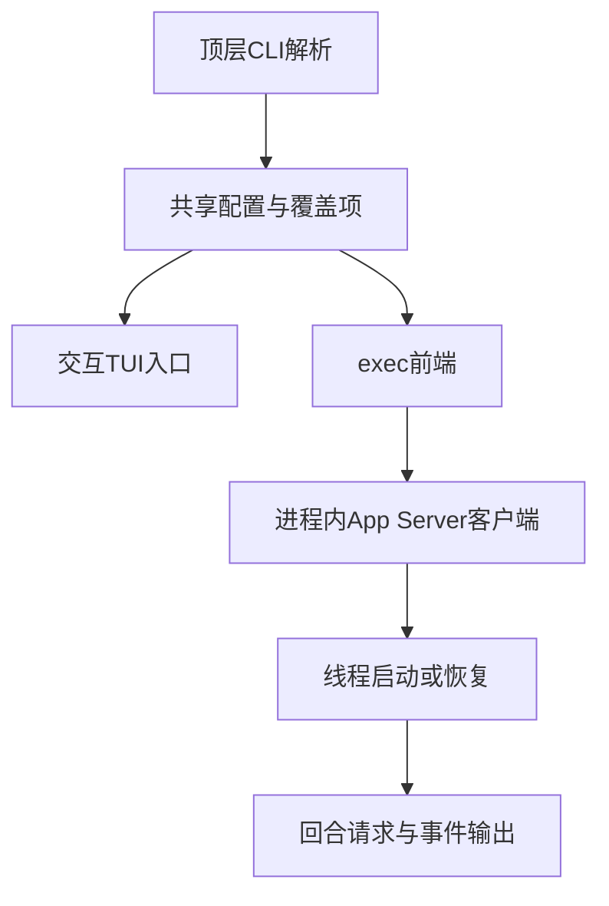
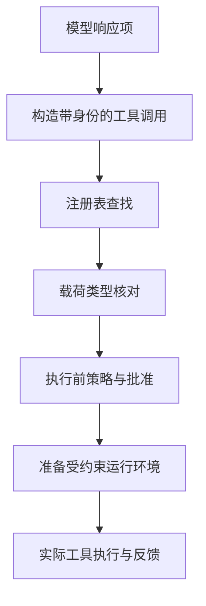
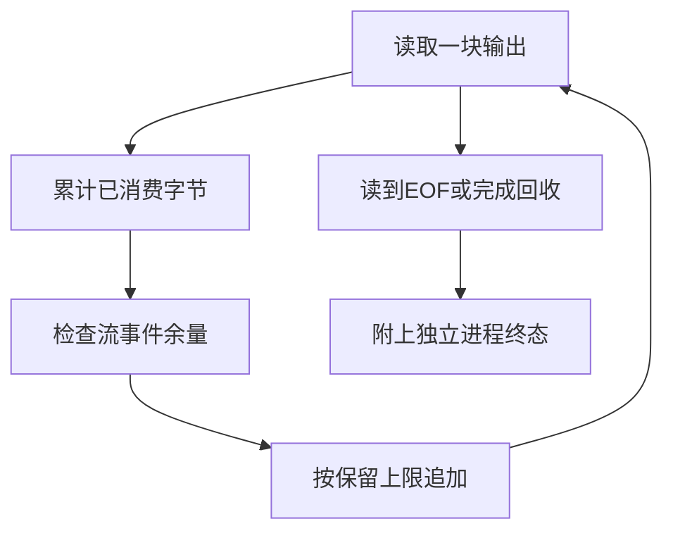

# CodexCLI架构与执行

> 本文解析固定提交的Codex CLI：Rust入口如何选择运行前端、工具调用如何进入核心调度、子进程输出如何受限并回收。Codex在这里是可执行客户端与运行框架，不是旧HumanEval研究中的同名模型；CLI源码和模型效果不能互相替代。

## 学习目标

- 区分CLI入口、执行前端与核心运行层
- 追踪模型工具调用到执行策略
- 区分输出截断、命令停止与业务验收

## 前置知识

先读[Harness任务循环](Harness任务循环.md)、[工具协议与MCP及Skill](工具协议与MCP及Skill.md)和[AI代码开发与反馈](AI代码开发与反馈.md)。需要理解Rust crate、请求/事件接口、操作系统进程与配置覆盖项。本文Python只是机制教学，不是Rust实现的等价移植。

## 基本机制

已读取openai/codex提交 `970111f6cb62cc02fe36a82ea7d71b37a2889c97`。仓库README将其定义为本地运行的coding agent，许可为Apache-2.0；core README说明该crate实现业务逻辑，供不同Rust界面使用。[Codex CLI 仓库说明](https://github.com/openai/codex/blob/970111f6cb62cc02fe36a82ea7d71b37a2889c97/README.md#L1)；[codex-core 开发说明](https://github.com/openai/codex/blob/970111f6cb62cc02fe36a82ea7d71b37a2889c97/codex-rs/core/README.md#L1)。

本版本需区分顶层CLI、交互TUI、exec前端、App Server客户端、core工具运行层。exec源码已使用InProcessAppServerClient，不应照搬旧架构图，把exec画成直接调用某个历史类。工具共享支持crate也没有承接全部核心编排，tools README明确仍将依赖Session和审批流程的逻辑留在core。[Codex run_main 与 run_exec_session](https://github.com/openai/codex/blob/970111f6cb62cc02fe36a82ea7d71b37a2889c97/codex-rs/exec/src/lib.rs#L854)；[codex-tools 开发说明](https://github.com/openai/codex/blob/970111f6cb62cc02fe36a82ea7d71b37a2889c97/codex-rs/tools/README.md#L1)。

本版未核验OpenAI产品文档站的正文。本文只从实际读到的GitHub源代码和仓库开发说明陈述行为，不从文档不可达推断某功能存在或不存在。

完整标准库示例：[教学实现](../../examples/agents/codex-cli.py)。以下代码只处理模拟状态与记录，不启动产品、模型、工具或外部进程。

## 推导或示例

### 知识点一：入口分派、运行组件和配置项是三种对象

顶层cli_main先解析命令行，把特性开关折入覆盖项，再按子命令分支。Exec分支继承共享选项、前置根级覆盖项，然后调用codex_exec::run_main；run_exec_session启动进程内App Server客户端，通过ThreadResume等线程接口与TurnStart开始交互。输出前端又按json_mode选择机器或人类可读事件处理器。

可把这段调用关系写成**入口教学状态机**：

$$
CLI\rightarrow ExecFrontend\rightarrow AppServerClient\rightarrow Thread\rightarrow Turn.
$$

这里的箭头是控制与请求关系，不是五个必然独立的操作系统进程。线程也指产品会话对象，不应与Rust线程混淆。模型名称、cwd和输出格式是状态或配置，不能因为名字重要就画成独立服务。

覆盖项模型只保留顺序 $O=O_{root}\mathbin{+}O_{sub}$，其中加号为有序串接。源码prepend_config_flags调用prepend_root_overrides；本文没有读取全部最终配置解析路径，因此不把这个串接公式宣称为所有层级的“后者覆盖前者”保证。完整配置还可能包含托管约束、配置文件和特定命令限制。

手算根级[(model,A)]、子级[(format,json)]，教学输出保留两个有序键值对。Exec加根级remote标记被拒绝，依据是该版本CLI的reject_remote_mode_for_subcommand；这只说明此入口限制，不说明产品所有功能都不能远程连接。

```python
def launch_plan(mode: str, root_overrides: list[tuple[str, str]],
                sub_overrides: list[tuple[str, str]], remote: bool = False) -> dict:
    """模拟入口分派和覆盖项顺序；不实现完整配置解析器。"""
    if mode not in {'interactive', 'exec'}:
        raise ValueError('教学模型仅支持interactive和exec')
    if type(remote) is not bool:
        raise ValueError('remote必须是布尔值')
    if mode == 'exec' and remote:
        raise ValueError('该源码版本exec入口拒绝根级remote模式')
    path = ['cli_main', 'run_interactive_tui'] if mode == 'interactive' else [
        'cli_main', 'run_main', 'run_exec_session', 'InProcessAppServerClient', 'turn/start']
    return {'path': path, 'overrides': [*root_overrides, *sub_overrides]}
```

函数返回组件路径与待传递覆盖项，不解析真实命令行、不读配置文件。列表复制避免修改调用者输入。interactive路径只展示已读取的TUI入口，后续内部路径未在此模型中展开；exec路径才展开到进程内客户端和回合请求。



源码及官方依据：[Codex cli_main 入口分派](https://github.com/openai/codex/blob/970111f6cb62cc02fe36a82ea7d71b37a2889c97/codex-rs/cli/src/main.rs#L1053)；[Codex run_main 与 run_exec_session](https://github.com/openai/codex/blob/970111f6cb62cc02fe36a82ea7d71b37a2889c97/codex-rs/exec/src/lib.rs#L854)；[codex-core 开发说明](https://github.com/openai/codex/blob/970111f6cb62cc02fe36a82ea7d71b37a2889c97/codex-rs/core/README.md#L1)。

可验证性质是入口分支明确、覆盖项顺序保持、非法入口组合拒绝。反例是把JSON输出模式理解为使用另一套模型，实际在此处选择的是事件输出处理器。源码中的配置字段不等于当前用户实际生效值，本文没有读取任何真实用户配置或凭证。

### 知识点二：模型工具项先规范化，再经过注册表和执行策略

ToolRouter.build_tool_call接收ResponseItem，把FunctionCall和CustomToolCall转换成带call_id、工具名和payload的ToolCall；普通非工具项返回None。随后构建ToolInvocation并交注册表。ToolRegistry找不到工具时返回RespondToModel，而载荷种类不匹配时返回Fatal。二者是该提交的实际分支，不能都归成“模型参数错”。

工具存在并且载荷匹配，仍不意味着立即执行。ToolOrchestrator.run先读取当前step的审批策略和工具要求，处理Skip、Forbidden或NeedsApproval，再准备首次执行的环境约束。即使Skip，在strict_auto_review分支也可能请求审查，因此“skip总是无检查”并不成立。

本文将准入抽象成

$$
ready=registered\land kindMatch\land\neg forbidden\land(\neg needReview\lor approved).
$$

所有项均为布尔值。needReview在教学模型中由显式要求或严格检查开关决定；它不是从用户自然语言猜测出的许可。审批和执行环境也是两件事：一次批准并不自动取消文件系统、网络或平台执行约束。

手算注册表中echo要求function载荷，收到custom_tool_call即使call_id存在也不能执行。另一个工具有forbidden要求，即使外部传approved=True仍应拒绝。保留call_id贯穿反馈，才能把错误返回给正确的模型调用，避免把并行请求串台。

```python
def route_call(item: dict, registry: dict[str, tuple[str, str]],
               approved: bool = False, strict_review: bool = False) -> dict | None:
    """演示载荷规范化、注册表查找与执行前准入，不调用真实工具。"""
    kinds = {'function_call': 'function', 'custom_tool_call': 'custom'}
    kind = kinds.get(item.get('type'))
    if kind is None:
        return None
    if not item.get('call_id') or not item.get('name'):
        raise ValueError('工具调用缺少身份')
    name = item['name']
    if name not in registry:
        return {'status': 'respond_to_model', 'call_id': item['call_id']}
    expected_kind, requirement = registry[name]
    if kind != expected_kind:
        return {'status': 'fatal_payload', 'call_id': item['call_id']}
    if requirement not in {'skip', 'needs_approval', 'forbidden'}:
        raise ValueError('教学策略不合法')
    if type(approved) is not bool or type(strict_review) is not bool:
        raise ValueError('批准标记必须为布尔值')
    if requirement == 'forbidden':
        status = 'rejected'
    elif (requirement == 'needs_approval' or strict_review) and not approved:
        status = 'await_approval'
    else:
        status = 'ready_for_runtime'
    return {'status': status, 'call_id': item['call_id'], 'kind': kind}
```

函数把核心分支压成纯数据分类，不调用handler，也不重新实现完整Schema。返回ready_for_runtime只意味着该教学准入通过，真实运行层仍需参数解析、环境约束与工具执行。源代码还有命名空间、搜索工具、hook和取消等路径，均明确排除在模型之外。



源码及官方依据：[Codex ToolRouter 工具调用构造](https://github.com/openai/codex/blob/970111f6cb62cc02fe36a82ea7d71b37a2889c97/codex-rs/core/src/tools/router.rs#L257)；[Codex ToolRegistry 调度](https://github.com/openai/codex/blob/970111f6cb62cc02fe36a82ea7d71b37a2889c97/codex-rs/core/src/tools/registry.rs#L691)；[Codex ToolOrchestrator 执行前策略](https://github.com/openai/codex/blob/970111f6cb62cc02fe36a82ea7d71b37a2889c97/codex-rs/core/src/tools/orchestrator.rs#L125)；[codex-tools 开发说明](https://github.com/openai/codex/blob/970111f6cb62cc02fe36a82ea7d71b37a2889c97/codex-rs/tools/README.md#L1)。

可验证性质是未知工具与错误载荷分开、Forbidden优先、严格检查不被Skip绕过。反例是工具Schema合法但选择了错误文件，这仍可能经过这些结构判断，必须由业务约束和结果验收发现。本文只说明固定版本代码分支，不外推所有发行版本的默认安全配置。

### 知识点三：输出保留上限、流事件上限和进程终止互不等价

命令输出很多，宿主既不能无限保留，也不能停止读管道后让子进程阻塞。该版本read_output每次读取一块：尚未达到事件数量上限时发出增量事件，然后按保留字节策略追加到缓冲，最后继续读到EOF。consume_output独立等待子进程退出、超时或取消，并处理输出回收；后代进程仍占用管道时还需要回收期限。

对输出块 $c_1,\ldots,c_n$，定义总消费字节 $D=\sum_i|c_i|$、保留上限B和事件上限K，本页验证

$$
|buffer|\le B,\qquad emitted\le K,\qquad consumed=D.
$$

B以字节为单位，K以事件个数为单位；两者都不是token预算。教学实现只保留前缀，旨在验证边界和持续消费，未宣称上游append_capped的具体保留布局。流事件也可能分块不同，因此相同文本不必产生相同事件数。

手算两块abc和def，B=4、K=1，保留abcd，消费6字节，发出1个事件；terminal仍可为exited。截断表示输出证据不完整，不表示命令失败。反过来缓冲未截断，也不能证明命令正常结束或产物满足要求。

ExecExpiration区分TimedOut与Cancelled；TimeoutOrCancellation内部对同时就绪的取消优先，但子进程自然退出和到期的竞争另有选择路径。ShellTool有保留字节上限，而FullBuffer等策略不同，不能把一个分支的限制宣称成所有内部执行都相同。

```python
def capture_output(chunks: list[bytes], byte_cap: int, delta_cap: int,
                   terminal: str) -> dict:
    """模拟持续消费、独立输出限制和终态记录；仅保存前缀是教学选择。"""
    if any(type(x) is not int or x < 0 for x in (byte_cap, delta_cap)):
        raise ValueError('上限必须为非负整数')
    if terminal not in {'running', 'exited', 'timed_out', 'cancelled'}:
        raise ValueError('未知终态')
    if any(type(chunk) is not bytes for chunk in chunks):
        raise ValueError('输出块必须是bytes')
    retained = bytearray()
    consumed = emitted = 0
    for chunk in chunks:
        consumed += len(chunk)
        if chunk and emitted < delta_cap:
            emitted += 1
        retained.extend(chunk[:max(0, byte_cap - len(retained))])
    return {'retained': bytes(retained), 'consumed_bytes': consumed,
            'emitted_deltas': emitted, 'truncated': consumed > byte_cap,
            'terminal': terminal}
```

chunks是已经取得的bytes，函数不创建进程、不计时、不取消任务。terminal由调用方提供，函数只原样保留；它不会从输出内容推断成功。这样可以单独检查缓冲不变量，避免以“输出看起来完整”代替退出码和业务验收。



源码及官方依据：[Codex 进程执行与输出回收](https://github.com/openai/codex/blob/970111f6cb62cc02fe36a82ea7d71b37a2889c97/codex-rs/core/src/exec.rs#L982)；[codex-core 开发说明](https://github.com/openai/codex/blob/970111f6cb62cc02fe36a82ea7d71b37a2889c97/codex-rs/core/README.md#L1)；[codex-tools 开发说明](https://github.com/openai/codex/blob/970111f6cb62cc02fe36a82ea7d71b37a2889c97/codex-rs/tools/README.md#L1)。

可验证性质是两个上限独立、零上限仍消费输入、截断不改终态。反例是直接break停止读管道：虽然缓冲不超限，却可能令子进程因背压无法退出。真实实现还需同时读stdout/stderr、回收进程组和保留错误状态，纯函数没有这些操作系统保证。

## 适用条件与限制

此页描述固定提交，不声称是任何已安装版本或当前账号配置。仓库Apache-2.0许可覆盖其授权代码，不等于模型权重、云服务或产品条款全部采用同一许可。OpenAI产品文档未核验的缺口保留，不能用仓库中的跳转链接冒充已读正文。

三个教学函数分别约束入口、调度准入和输出消费，均不构成可使用的Codex客户端。评估编程能力需要独立任务、模型配置和执行证据，不使用旧Codex模型的HumanEval成绩替代本CLI的实现分析。

## 实践任务

用一份模拟请求画出CLI、exec前端、App Server客户端和核心工具运行层的职责。为未知工具、载荷不匹配、等待批准和输出截断各设计一个输入；手算返回结果。最后说明同一命令为何可能“进程已退出但输出不完整”，列出业务验收还需要的证据。

实践状态为 `designed`。教学函数的小规模验证与真实产品实验分别记录；本版没有复现完整产品或论文实验。

## 掌握标准

- 能区分组件、配置和会话对象，不把每个框都画成进程。
- 能沿固定源码从build_tool_call追到注册表和执行策略。
- 能证明缓冲边界，同时解释持续排空管道的必要性。
- 能指出未核验产品文档与源码分支之间的证据边界。

## 版本、开放性与源码导读

本页版本为 `970111f6cb62cc02fe36a82ea7d71b37a2889c97`，许可依据见[Codex Apache-2.0 许可](https://github.com/openai/codex/blob/970111f6cb62cc02fe36a82ea7d71b37a2889c97/LICENSE#L1)。建议阅读顺序：cli_main的Exec分支 → run_main/run_exec_session → ToolRouter → ToolRegistry → ToolOrchestrator → process_exec_tool_call/consume_output/read_output。

连贯案例中，用户发起一次文件修改目标，CLI只选择前端；exec整理配置并开始回合；模型输出工具项后才进入注册表；批准通过仍需在所选运行环境中执行；进程输出与退出状态再返回上层。任何一层失败都有不同的恢复动作，不能一律增加模型重试次数。

特别检查两种架构误读。第一，把工具注册数量当作模型可见数量：router的指标注释明确注册不代表可见或可达。第二，把codex-tools迁移目标当成当前完成状态：该README将部分内容写为愿景，实际兼容编排仍在core。架构图应展示已读函数的调用，不把计划中的拆分画成现状。

三个函数的不变量只在给定简化输入下成立。完整Rust客户端还含线程恢复、事件关联、插件、取消和平台差异；这些代码没有被教学模型覆盖。源码能够解释实现路径，但无法单独回答特定模型的生成质量、账号权益或云端可用性。

本页的状态、预算和指标公式均是有明确适用条件的教学建模，除明确标出的源码行为外，不宣称为产品内部算法或实验效果。源码链接固定实际commit；可取得原文的资料记录正文指纹，仅有观察摘要的资料使用observed版本。

---

[返回模块](../modules/业务Agent.md) · [知识点索引](../../docs/知识点索引.md) · [完整教学代码](../../examples/agents/codex-cli.py) · [提出更正](https://github.com/yanbozhang/llm-systems-wiki/issues/new?template=knowledge.yml)

觉得这篇推导有帮助，可以在 [GitHub](https://github.com/yanbozhang/llm-systems-wiki) 点 Star 收藏更新；分享时欢迎链接到具体知识点，便于读者复核公式、代码与来源。
