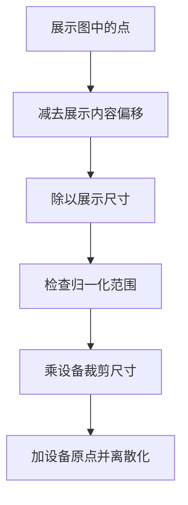
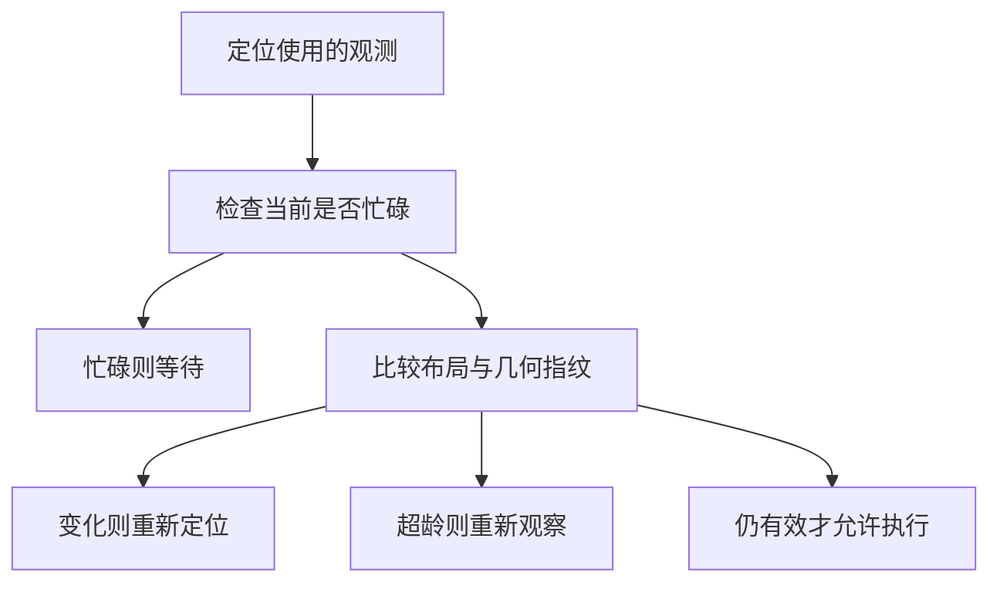
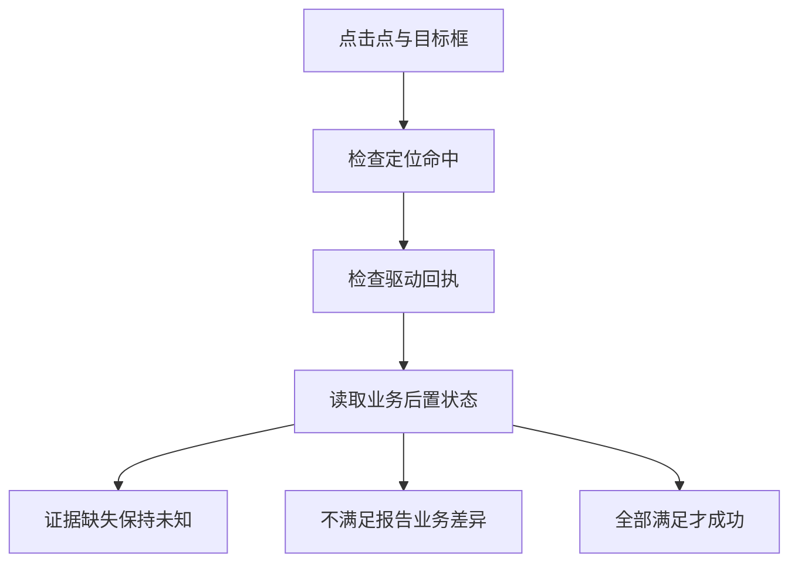

# GUI定位与执行

> GUI Agent把意图映射为当前界面的可操作位置，再执行动作并检查结果。定位坐标必须绑定观测空间与时刻；点击命中只是局部正确，任务成功还要经过驱动执行和业务终态验证。

## 学习目标

- 统一截图与坐标空间
- 区分定位和执行
- 设计视觉状态验证

## 前置知识

先读[业务Agent任务闭环](业务Agent任务闭环.md)。需要像素坐标、矩形、缩放和平移。设备像素、截图像素、展示像素与浏览器CSS像素可能不同；本页使用明确的矩形映射，不把任何一个坐标空间默认当成另一个。

## 基本机制

SeeClick将GUI grounding作为独立能力，ScreenSpot用预测点是否落在目标元素框内度量点击准确率。OSWorld提供截图、可选无障碍树等观测，并用执行式评估判定完整任务。两者观测和评分层级不同，不能把定位准确率直接换算成端到端成功率。[SeeClick: Harnessing GUI Grounding for Advanced Visual GUI Agents](https://arxiv.org/html/2401.10935v1)；[OSWorld: Benchmarking Multimodal Agents for Open-Ended Tasks in Real Computer Environments](https://arxiv.org/html/2404.07972v1)。

实际循环可拆成观测、定位、校验观测有效性、动作下发、等待状态变化和回读验收。OSWorld源码的step在执行后等待并重新_get_obs，独立evaluate获取任务数据；这为教学中的“动作后重新观察”提供具体路径依据。[OSWorld DesktopEnv 观测、步骤与验收](https://github.com/xlang-ai/OSWorld/blob/04718eab9327856efe8192cc58161acc7a7627e2/desktop_env/desktop_env.py#L433)。

完整教学实现：[运行机制示例](../../examples/agents/gui-agent.py)。示例仅使用 Python 标准库，对传入的模拟数据计算结果；本页没有执行模型、外部工具或真实业务实验。

## 推导或示例

### 知识点一：展示坐标到设备坐标需要完整变换

截图可能被缩小显示、居中留白或裁剪。设展示内容矩形左上角为 $(v_x,v_y)$、尺寸 $(v_w,v_h)$；设备对应裁剪区域为 $(d_x,d_y,d_w,d_h)$。对展示点 $(x,y)$，先归一化再映射：

$$
u=(x-v_x)/v_w,\quad v=(y-v_y)/v_h,
$$
$$
x_d=d_x+\min(d_w-1,\lfloor ud_w\rfloor),\quad y_d=d_y+\min(d_h-1,\lfloor vd_h\rfloor).
$$

这是**几何教学推导**。u、v无量纲；其余量以各自空间的像素计。输入允许闭区间0至1，像素输出采用0至宽高减1的整数，因此边界1被夹到最后一个有效像素。若点在留白区，u或v越界，直接拒绝而非偷偷夹到某个按钮附近。

手算展示960×540对应设备1920×1080，点(240,270)变为(480,540)。若展示内容被向右平移100像素，仍用(240,270)就会变成u=(240-100)/960，而不是原先0.25；忽略留白偏移必然产生系统误差。若截图来自设备裁剪区，还需加设备原点d_x、d_y。

该版本PythonController.execute_action的CLICK分支将收到的x/y直接用于pyautogui.click，不在该分支识别截图缩放或留白。因此坐标转换应在发送前完成，不能指望驱动自动理解展示图。

```python
from math import floor, isfinite

def map_point(point: tuple[float, float], view: tuple[float, float, float, float],
              device: tuple[int, int, int, int]) -> tuple[int, int]:
    """把展示内容矩形内的点映射至对应设备裁剪矩形，排除展示留白。"""
    if len(point) != 2 or len(view) != 4 or len(device) != 4:
        raise ValueError('坐标维度不合法')
    if not all(isfinite(v) for v in (*point, *view, *device)):
        raise ValueError('坐标必须有限')
    x, y = point
    vx, vy, vw, vh = view
    dx, dy, dw, dh = device
    if vw <= 0 or vh <= 0 or dw <= 0 or dh <= 0:
        raise ValueError('矩形尺寸必须为正')
    if any(type(v) is not int or v < 0 for v in device):
        raise ValueError('设备矩形必须为非负整数')
    u, v = (x - vx) / vw, (y - vy) / vh
    if not 0 <= u <= 1 or not 0 <= v <= 1:
        raise ValueError('点落在展示内容矩形外')
    return dx + min(dw - 1, floor(u * dw)), dy + min(dh - 1, floor(v * dh))
```

函数输入point、view与device三组几何数据，检查有限性、尺寸与边界后返回整数设备点。它不会读取屏幕或点击。坐标归一化先移除展示偏移，设备偏移最后加回；混淆这两个偏移会让裁剪截图的点击位置错误。



源码与原文：[OSWorld PythonController.execute_action](https://github.com/xlang-ai/OSWorld/blob/04718eab9327856efe8192cc58161acc7a7627e2/desktop_env/controllers/python.py#L413)；[SeeClick: Harnessing GUI Grounding for Advanced Visual GUI Agents](https://arxiv.org/html/2401.10935v1)；[OSWorld: Benchmarking Multimodal Agents for Open-Ended Tasks in Real Computer Environments](https://arxiv.org/html/2404.07972v1)。

可验证性质是映射端点落在合法像素内、尺寸翻倍时中点按比例变化、留白点拒绝。反例是网页响应式重排：元素已移动，不存在单一缩放平移映射，应重新观测定位而非继续换算旧坐标。

### 知识点二：观测有效性是动作执行前的条件

坐标“算得对”不意味着“现在可点”。令观测为 $o_t=(image_t,geometry_t,scroll_t,overlay_t,revision_t,\tau_t)$，其中时间戳 $\tau_t$ 与当前时间单位相同。本文的**保守执行条件**是

$$
valid(o_t,x)=sameLayout\land sameGeometry\land sameScroll\land sameOverlay\land(0\le now-\tau_t<\Delta).
$$

$\Delta$为教学有效期阈值，不是某篇论文估计的通用安全时长。任一布局指纹变化就需要重新定位；仅年龄过大但其他指纹未变时重新观察；界面明确忙碌时先等待。没有可靠指纹的系统只能用新截图等其他证据重新确认，不能因为“过了很短时间”就证明按钮没动。

例如定位时页面滚动偏移为0，执行前变成600，旧按钮点即使仍在屏幕内也不再对应目标。遮挡弹窗则可能让同一坐标命中弹窗确认按钮；这不是缩放误差。保持坐标身份与观测身份绑定，才能把布局变化与模型定位错误分开。

OSWorld的_get_obs会取截图与可选树，step会重新获取观测；ReAct第2节也把新观测加入上下文后决定下一动作。本文在两者之间加显式有效性门，教学上说明重新观察的必要条件，但源码没有提供本函数的layout_revision字段。

```python
from math import floor, isfinite

def observation_gate(observed: dict, current: dict, now: float, max_age: float) -> str:
    """根据布局指纹、界面忙碌与观测年龄决定是否允许使用旧定位。"""
    if not all(isfinite(v) for v in (now, max_age, observed['captured_at'])):
        raise ValueError('时间必须有限')
    if max_age < 0 or now < observed['captured_at']:
        raise ValueError('时间顺序或有效期不合法')
    if type(current['busy']) is not bool:
        raise ValueError('忙碌标记必须为布尔值')
    if current['busy']:
        return 'wait'
    keys = ('layout_revision', 'width', 'height', 'scroll', 'overlay')
    if any(observed[k] != current[k] for k in keys):
        return 'relocalize'
    if now - observed['captured_at'] >= max_age:
        return 'reobserve'
    return 'act'
```

observed是定位使用的快照元数据，current是宿主最新检测到的状态摘要。函数先判断busy，再比较几何与布局，最后判断年龄。act只是允许继续向动作执行层交付，不代表工具一定生效。busy由调用方观测提供，不是函数猜测出来的。



源码与原文：[OSWorld DesktopEnv 观测、步骤与验收](https://github.com/xlang-ai/OSWorld/blob/04718eab9327856efe8192cc58161acc7a7627e2/desktop_env/desktop_env.py#L433)；[OSWorld: Benchmarking Multimodal Agents for Open-Ended Tasks in Real Computer Environments](https://arxiv.org/html/2404.07972v1)；[ReAct: Synergizing Reasoning and Acting in Language Models](https://arxiv.org/html/2210.03629v3)。

可验证性质是忙碌不触发重发、滚动或遮挡变化触发重定位、到期边界触发重观察。反例是检查后到点击前再次弹窗，即检查与执行之间的竞态；需要平台提供原子目标绑定或在动作后验收，单次门检查不能彻底消除它。

### 知识点三：定位、驱动与业务结果必须分层验证

ScreenSpot的点击准确率对应“点是否在目标框内”，并不包含保存、跳转或跨应用结果。设G为定位命中，E为事件正确下发，V为业务后置条件满足。对于要求三者同时成立的一次动作，概率链式法则给出

$$
P(G\cap E\cap V)=P(G)P(E\mid G)P(V\mid G,E).
$$

这是一般概率恒等式，不假定独立，也不是论文报告的新性能公式。若自造示例值为0.9、0.8、0.7，联合值为0.504；不能只凭0.9的定位率宣称90%的业务成功。真实任务可以有冗余动作或恢复路径，本式只描述规定的这一次三阶段事件。

示例按层报告第一个已知不满足条件：框外为grounding_error，命中但未下发为driver_error，下发且后置条件False为business_mismatch，后置条件尚未读取为unknown，全部满足才succeeded。

业务回读必须围绕目标对象，例如读取保存后的文档标题、内容摘要和唯一身份，而不是只检测任意绿色提示。页面保持不变既可能是点击没命中，也可能是请求仍在处理或状态已经保存但界面未刷新。仅靠截图差异不能唯一确定原因。

```python
from math import floor, isfinite

def verify_gui_action(point: tuple[float, float], box: tuple[float, float, float, float],
                      dispatched: bool, postcondition: bool | None) -> str:
    """在给定目标框下区分定位、驱动、业务失败与尚未观测。"""
    if len(point) != 2 or len(box) != 4:
        raise ValueError('坐标维度不合法')
    if not all(isfinite(v) for v in (*point, *box)):
        raise ValueError('坐标必须有限')
    if type(dispatched) is not bool or (postcondition is not None and type(postcondition) is not bool):
        raise ValueError('阶段结果类型不合法')
    x, y = point
    left, top, right, bottom = box
    if left >= right or top >= bottom:
        raise ValueError('目标框为空或倒置')
    if not (left <= x < right and top <= y < bottom):
        return 'grounding_error'
    if not dispatched:
        return 'driver_error'
    if postcondition is None:
        return 'unknown'
    return 'succeeded' if postcondition else 'business_mismatch'
```

box采用左闭右开矩形边界，避免相邻控件共享右边界点。与第一点的连续坐标输入边界不同，这里定义的是离散命中区域。函数接收外部提供的postcondition，没有观测时必须传None；Python的bool(None)会丢失未知状态，因此代码显式分支。



源码与原文：[OSWorld PythonController.execute_action](https://github.com/xlang-ai/OSWorld/blob/04718eab9327856efe8192cc58161acc7a7627e2/desktop_env/controllers/python.py#L413)；[OSWorld DesktopEnv 观测、步骤与验收](https://github.com/xlang-ai/OSWorld/blob/04718eab9327856efe8192cc58161acc7a7627e2/desktop_env/desktop_env.py#L433)；[SeeClick: Harnessing GUI Grounding for Advanced Visual GUI Agents](https://arxiv.org/html/2401.10935v1)；[OSWorld: Benchmarking Multimodal Agents for Open-Ended Tasks in Real Computer Environments](https://arxiv.org/html/2404.07972v1)。

可验证性质是右下边界不算命中、定位错误不被下发成功覆盖、None不被算业务失败、三层全满足才成功。反例是验收读取了另一份同名文档；后置条件本身错误会使分层判断仍产生假阳性，需要将产物身份纳入验收。

## 适用条件与限制

示例只覆盖平面轴对齐坐标和有限元数据，没有实现视觉模型、OCR、DOM或无障碍树解析。布局指纹是教学输入，实际平台未必提供可靠原子版本；UI动画、遮挡、窗口焦点与异步请求都可能造成状态竞态。

应同时记录截图身份、实际像素宽高、裁剪区域、目标框、动作参数和动作后证据。不要在真实账号上用重复有副作用点击替代诊断；失败应先查所在层，再选择等待、重观察、重定位或业务恢复。

## 实践任务

画一张1920×1080的自建示意屏幕，制作缩放展示、带留白展示和裁剪展示三组坐标，手算映射。再分别添加滚动、弹窗和busy状态，填写执行门的结果。最后构造点命中但保存失败、驱动未下发、结果未知三条轨迹，为每条定义下一次观测。

实践状态保持 `designed`。教学函数的测试由统一 UT 流程负责，本页不把手算预期写成已运行结果，也不把示例性质外推为真实模型成功率。

## 掌握标准

- 能写出带裁剪和平移的映射，并说明离散边界约定。
- 能解释同一正确坐标为何会随页面状态失效。
- 能区分局部定位指标与完整任务验收。
- 能指出概率链式法则不要求独立，也不能直接覆盖多步恢复任务。

## 源码导读与模型边界

源码路径为DesktopEnv._get_obs → step → PythonController.execute_action → 新观测，再由evaluate独立验收。三段示例分别映射坐标、拦截过时定位、区分失败层；它们没有执行任何GUI操作，也没有给出特定GUI模型的选型结论。

### 连贯案例复盘

从自建截图开始，先给展示区域画边框，再给设备裁剪区域写原点和尺寸。算出坐标后不要立即套进点击成功率；先问当前截图是否仍代表界面，再问点击后读取什么证据。这个顺序对应三个教学函数的组合边界。

| 扰动 | 几何换算能否解决 | 下一步 |
|---|---|---|
| 等比例缩放且内容未变 | 可以 | 使用正确展示尺寸 |
| 图片展示留白 | 可以 | 扣除内容矩形偏移 |
| 页面滚动或窗口重排 | 通常不能只靠旧图 | 重新观察并定位 |
| 弹窗遮挡目标 | 不能 | 先识别当前可交互层 |

如果截图先裁剪再缩放，设备坐标不仅要乘比例，还要加裁剪原点。如果图像发生旋转，本文轴对齐矩形变换不再成立，需要扩展到旋转矩阵并明确坐标原点。若页面响应式布局重排，即使知道全部缩放参数也不能得到目标新位置，因为内容的位置关系本身已经改变。

动作后页面没有变化的排查也需要分支：若驱动回执失败，先处理事件下发；若驱动正常且页面忙碌，等待新观测；若界面没有提示但目标文件已经生成，应按文件状态验收，而不是继续点击保存。不同分支需要不同证据，同一张截图无法替代所有业务读取。

给每条轨迹记录截图身份和观测时间，还能区分“模型在这张图上定位错误”与“模型定位时正确、执行时界面已变”。这两种错误应分别反馈给定位模型和执行框架，否则通过增加视觉训练未必能改善执行竞态，反过来延长等待也未必能修正真正的定位错误。

本文源码链接均锁定实际读取的提交；论文锁定 arXiv 版本，在线官方文档记录读取日和正文指纹。公式中标为“教学模型”的预算、阈值和状态集合是本页设计，不是论文测得的效果。第三方文件只作为阅读依据，教学实现为独立简化。

---

[返回模块](../modules/业务Agent.md) · [知识点索引](../../docs/知识点索引.md) · [完整教学代码](../../examples/agents/gui-agent.py) · [提出更正](https://github.com/yanbozhang/llm-systems-wiki/issues/new?template=knowledge.yml)

觉得这篇推导有帮助，可以在 [GitHub](https://github.com/yanbozhang/llm-systems-wiki) 点 Star 收藏更新；分享时欢迎链接到具体知识点，便于读者复核公式、代码与来源。
