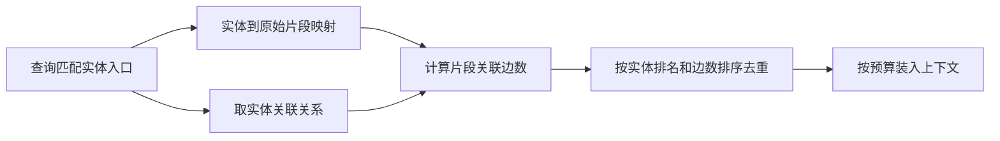
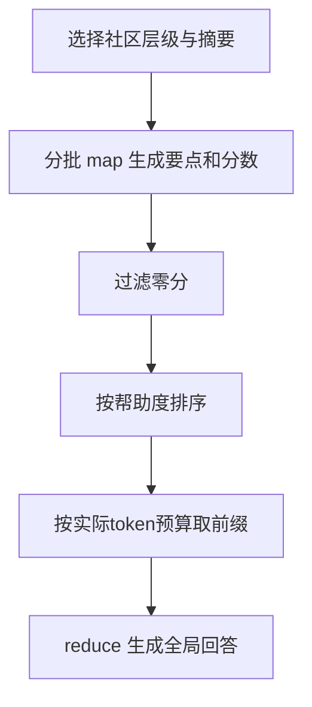
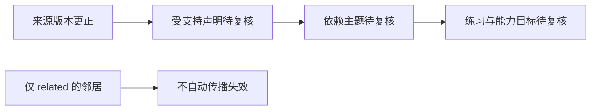

# GraphRAG与LLMWiki

图检索组织实体、关系和社区以选择证据，LLM Wiki组织持久知识页以支持阅读与修订。它们可以组合，但不能把图相邻、页面互链和事实支持视为同一种关系。本页分别展开局部查询、全局社区查询和Wiki影响传播。

## 学习目标

- 区分编纂与检索
- 建立类型化关系
- 设计增量知识更新

## 前置知识

需理解[RAG与引用回答](RAG与引用回答.md)、[来源接入与版本管理](来源接入与版本管理.md)、图邻接、排序与广度优先遍历。实体、声明、片段、社区报告、主题页是不同对象，不应只用标题文本混合寻址。

## 基本机制

GraphRAG论文从chunk提取实体、关系和声明，合并成图，经社区划分与摘要形成多层索引。[GraphRAG §3.1](https://arxiv.org/html/2404.16130v2)解释这一过程。Microsoft LLM Wiki公开实现则把原始来源、持久Markdown和schema分层，并提供反向链接查询；[LLM Wiki Architecture](https://github.com/microsoft/llmwiki/blob/e09126f257c1fcf8e63234382748a51cf6a5df7f/README.md#L19)描述其产品设计，不能把“零维护负担”等自述当作本库已验证效果。

相同术语要按系统定义辨认：GraphRAG global是社区摘要map-reduce，LightRAG high-level偏关系与主题关键词，Wiki依赖图则服务编纂维护。对比应落在索引对象、查询路径、更新对象与可追溯证据上。

## 推导或示例

完整教学文件：[graph-wiki.py](../../examples/knowledge/graph-wiki.py)。每个函数对应下列一个知识点，只使用标准库与小型合成输入；教学计算不代表模型或服务实验。

### 知识点一：实体入口、邻接关系与原始片段排序

GraphRAG局部查询的入口通常是与查询语义相近的实体描述，而非对全图做任意多跳搜索。候选实体连接原始text units、关系、社区报告及其他属性，随后按预算分别构造上下文。该版 `build_context`调用 `map_query_to_entities`，扣除会话历史后，以比例分配社区、原始文本与实体关系预算。

令实体入口排序 $r(e)$ ，片段 $t$ 与实体的相邻关系中有 $n(e,t)$ 条关系也引用 $t$ 。所读 `_build_text_unit_context`对首次命中的实体保存片段，按二元键 $(r(e),-n(e,t))$ 排序。这个键先尊重实体入口，再用结构关联数辅助排序，不是把实体度数直接当概率。

将上述计算或状态约束集中写为：

$$
\mathrm{key}(t)=\big(r(e_{first}(t)),-n(e_{first}(t),t)\big),\qquad \mathrm{order}=\mathrm{sort}_{lex}(\mathrm{key}).
$$

其中 $e_{first}(t)$ 是按实体入口次序首次关联到片段 $t$ 的实体， $\mathrm{sort}_{lex}$ 表示按二元键的字典序排序。

```python
def local_graph_context(entities, entity_chunks, relations):
    """按实体排名、片段关联边数排序，片段重复时归属最早命中的实体。"""
    entities = list(entities)
    relations = list(relations)
    if len(set(entities)) != len(entities):
        raise ValueError("实体入口不得重复")
    seen, candidates = set(), []
    for rank, entity in enumerate(entities):
        incident = [r for r in relations if entity in (r["source"], r["target"])]
        for chunk in entity_chunks.get(entity, []):
            if chunk in seen:
                continue
            seen.add(chunk)
            edge_count = sum(chunk in r["chunks"] for r in incident)
            candidates.append({"chunk": chunk, "entity_rank": rank, "edge_count": edge_count})
    return sorted(candidates, key=lambda c: (c["entity_rank"], -c["edge_count"]))
```

设入口A先于B；A对应a、b，B对应b、c。A-B与A-C两条关系都来自b，B-D来自c，则b以A的关系计数2排在a前，c归B，最终顺序为b、a、c。b不会因为又被B命中而重复占上下文。代码扫描 $s$ 个入口时每次检查 $|E|$ 条关系，另对片段统计邻接支持并排序；这是所示遍历方式的成本，不能宣称图查询总是 $O(1)$ 。生产可借助邻接索引减少全边扫描。



LightRAG的双层检索名称容易混淆：低层关键词查实体向量，再取关联边；高层关键词查关系向量，再取关系端点实体。该版 `_get_node_data`与 `_get_edge_data`体现此区别，其“高层”不等于Microsoft GraphRAG的社区map-reduce。图中的相邻只表示候选相关，不能推出因果、先修或事实支持。错实体消歧、通用枢纽节点和错误抽取边都能让上下文偏离问题；最终仍须回到原chunk验证。

[GraphRAG build_context](https://github.com/microsoft/graphrag/blob/c600ff80b77b9b62c47d539a3ac9569e95d8949b/packages/graphrag/graphrag/query/structured_search/local_search/mixed_context.py#L91)；[GraphRAG _build_text_unit_context](https://github.com/microsoft/graphrag/blob/c600ff80b77b9b62c47d539a3ac9569e95d8949b/packages/graphrag/graphrag/query/structured_search/local_search/mixed_context.py#L316)；[GraphRAG Local Search](https://github.com/microsoft/graphrag/blob/c600ff80b77b9b62c47d539a3ac9569e95d8949b/docs/query/local_search.md)；[LightRAG _get_node_data](https://github.com/HKUDS/LightRAG/blob/aaebfe1bb8d55deb6a4304d357a3bf4c92fcd40a/lightrag/operate.py#L6200)；[LightRAG _get_edge_data](https://github.com/HKUDS/LightRAG/blob/aaebfe1bb8d55deb6a4304d357a3bf4c92fcd40a/lightrag/operate.py#L6529)；[LightRAG §3.2](https://arxiv.org/html/2410.05779v3).

### 知识点二：社区摘要与全局map-reduce的预算路径

“语料主要讨论哪些主题”需要覆盖多个区域，单个top-k相似片段不保证全局覆盖。GraphRAG论文先从文档提取图，对图做层次社区划分，再自底向上生成社区摘要。查询时在选定层级把摘要打乱分批，每批生成回答要点和帮助度分数，最后汇总。

设有 $m$ 批社区上下文，第 $j$ 批产生要点 $a_j$ ，分数 $s_j\in[0,100]$ ，最终包装后成本 $c_j$ token。过滤 $s_j=0$ ，按 $s_j$ 降序选择一个预算内的前缀，使 $\sum c_j\le B$ 。源码到第一个放不下的要点即break；它不是0/1背包最优解，也不是“跳过大项继续塞小项”。

将上述计算或状态约束集中写为：

$$
\pi=\mathrm{argsort}_{s_j\gt 0}(-s_j),\qquad k=\max\left\lbrace r:\sum_{j=1}^{r}c_{\pi_j}\le B\right\rbrace ,\qquad \mathrm{selected}=\lbrace a_{\pi_1},\ldots,a_{\pi_k}\rbrace .
$$

其中 $\pi$ 是正分要点的降序排列， $k$ 为预算允许的最长前缀；相同分数保持输入次序。

```python
def reduce_points(points, budget):
    """模拟全局查询reduce前筛选：去零分、降序排序，首个超预算点处停止。"""
    if type(budget) is not int or budget < 0:
        raise ValueError("预算须为非负整数")
    rows = [dict(p) for p in points]
    for p in rows:
        if not math.isfinite(p["score"]) or not 0 <= p["score"] <= 100 or type(p["tokens"]) is not int or p["tokens"] < 1:
            raise ValueError("分数须在0至100，包装后token数须正")
    ranked = sorted((p for p in rows if p["score"] > 0), key=lambda p: -p["score"])
    if not ranked:
        return {"selected": [], "remaining_tokens": budget, "status": "no_data"}
    selected, used = [], 0
    for p in ranked:
        if used + p["tokens"] > budget:
            break
        selected.append(p)
        used += p["tokens"]
    return {"selected": selected, "remaining_tokens": budget - used,
            "status": "ready" if selected else "budget_exhausted"}
```

分数80/70、成本4/3、预算5时只能选第一项，剩1。若最高分项成本7而次高项成本3，预算仍为5，所示策略在第一项即停止，结果为空。示例将这类情况标为budget_exhausted，以便与所有map分数为0的no_data区分；该额外分类是教学诊断，不声称生产接口返回同名状态。



所读 `GlobalSearch.search`保留map响应、上下文及各阶段LLM调用/输入输出token数；`_reduce_response`在无正分且不允许通用知识时直接返回无数据回答。不能把这个帮助度分数当作校准概率或事实核验。 $m$ 批可能需要 $m$ 次map与一次reduce；若正分要点共 $r$ 个，排序为 $O(r\log r)$ ，总LLM成本还取决于各批token及模型，不能用Python复杂度掩盖生成成本。

社区层级细则会改变覆盖与摘要损失：更细层通常摘要更多，调用与token成本更高；更粗层可能省成本但遗漏少数事实。抽取错误、社区摘要失真和重要性打分偏差都会传播。原论文比较的是特定全局问答设置，不能据此断言GraphRAG对任何精确事实检索都更好。

[GraphRAG GlobalSearch.search](https://github.com/microsoft/graphrag/blob/c600ff80b77b9b62c47d539a3ac9569e95d8949b/packages/graphrag/graphrag/query/structured_search/global_search/search.py#L142)；[GraphRAG _reduce_response](https://github.com/microsoft/graphrag/blob/c600ff80b77b9b62c47d539a3ac9569e95d8949b/packages/graphrag/graphrag/query/structured_search/global_search/search.py#L306)；[GraphRAG Global Search](https://github.com/microsoft/graphrag/blob/c600ff80b77b9b62c47d539a3ac9569e95d8949b/docs/query/global_search.md)；[GraphRAG §3.1.4–3.1.6](https://arxiv.org/html/2404.16130v2).

### 知识点三：Wiki反向链接与类型化知识影响闭包

LLM Wiki关注可阅读、可修订的持久知识页，图检索关注查询时怎样选取上下文；两者可以共用来源与索引。Microsoft LLM Wiki的公开设计分raw、wiki、schema三层，其 `getBacklinks`扫描所有页面，提取Markdown链接并按源页面目录解析相对路径，找出谁链接了目标。这个实现证明的是直接链接关系，不证明链接双方存在语义依赖。

教学上给边显式类型：页面 `p`的 `supported_by`指向证据，`requires`指向其内容依赖对象，`related`只表示关联。来源变更集合为 $C$ ，允许传播的反向邻接为 $R_\Sigma$ ；影响集通过固定点得到：

$$
I_0=C,\qquad I_{k+1}=I_k\cup\lbrace p:\exists v\in I_k,(v,p)\in R_\Sigma\rbrace .
$$

有限图上最多加入 $|V|$ 个新节点后稳定；使用visited避免循环重复入队。它产生待复核对象集合，不自动撤销这些对象的每条结论。多来源支持的页面可能复核后仍然有效。

```python
def wiki_impact(page_links, changed, relation_types=("supported_by", "requires")):
    """对人工核验的类型化依赖建反向索引，求来源变更的传递影响；普通related不传播。"""
    reverse = defaultdict(set)
    allowed = set(relation_types)
    for page, links in page_links.items():
        for target, kind in links:
            if kind in allowed:
                reverse[target].add(page)
    roots = set(changed)
    visited, queue = set(roots), deque(sorted(roots))
    while queue:
        target = queue.popleft()
        for dependent in sorted(reverse.get(target, ())):
            if dependent not in visited:
                visited.add(dependent)
                queue.append(dependent)
    return sorted(visited - roots)
```

例子是source-v1→claim→topic→exercise；另有neighbor与topic仅related。变更source-v1应影响claim、topic、exercise，不能沿related把整个Wiki都标为失效。函数先构建反向索引，再BFS，核心遍历为 $O(|V|+|E_\Sigma|)$ ；为确定性输出对邻接与结果排序，额外有排序成本。输入关系没有语义标签时，不能假装靠算法已经推断出了标签。



本函数是基于反向链接思想的类型化教学扩展；所读 `getBacklinks`本身不做这个闭包，也不验证先修环。正式学习先修关系若出现环，需要另行检查并解释，不能因为BFS能终止就认为关系合理。GraphRAG社区摘要同样是预先生成的持久知识，因此“预先总结”不是Wiki与GraphRAG唯一分界。Wiki还需稳定页面身份、编辑历史和更正记录，图查询还需排名、预算与引用支持；两类机制各自保留审计证据。

[Microsoft LLM Wiki getBacklinks](https://github.com/microsoft/llmwiki/blob/e09126f257c1fcf8e63234382748a51cf6a5df7f/packages/core/src/backlinks.ts#L23)；[Microsoft LLM Wiki 三层设计](https://github.com/microsoft/llmwiki/blob/e09126f257c1fcf8e63234382748a51cf6a5df7f/README.md#L19)；[LLM Wiki Three-Layer Architecture](https://github.com/microsoft/llmwiki/blob/e09126f257c1fcf8e63234382748a51cf6a5df7f/ARCHITECTURE.md#L38)；[GraphRAG §3.1.5 社区摘要](https://arxiv.org/html/2404.16130v2).

## 适用条件与限制

图抽取依赖分块、提示和实体消歧；同名实体误合并可能比漏边更难发现。社区摘要会压缩事实，局部邻居可能被通用枢纽淹没，Wiki页也会积累过时结论。需要独立的来源支持和版本审核。

常见误区：图越密越可靠；节点度数越高越像先修课；Wiki必然不需要检索；或用LightRAG论文对旧GraphRAG的比较推断当前版本所有增量能力。本文仅对固定提交中实际读取路径下结论。

## 实践任务

建立A/B/C/D实体与a/b/c片段，手算局部排序b、a、c。再构造两个社区map要点，分别模拟零分和首项超预算。最后建立来源→声明→主题→能力/练习链，标注supported_by、requires与related，模拟来源更正并列出复核集合；验证普通关联不会扩大正式依赖范围。

本页完整实践保持 `designed`。示例测试由统一 UT 流程记录，本页不宣称已测试或论文复现。

## 掌握标准

能说清三种“图”分别索引什么；能追踪实体到片段的具体排序；能解释全局map帮助度与事实正确率不同；能计算类型化影响闭包而不把待复核等同全部错误。最终应交付查询中间结果和可审核关系表，保留原始来源定位。


## 源码导读与边界推演

图查询的预算分区值得单独手算。若扣除对话历史后剩8000token，社区比例0.25、原始片段比例0.5，则社区预算2000、原始片段4000、实体关系2000。所读 `build_context`先检查两比例之和不超过1，再计算剩余比例；它没有让每部分都各自占满8000。某类上下文实际较短时，是否把余额转移给其他类，要看具体builder，而不能从比例配置自动推断。设计对照时应保存实际构建后的token数。

实体消歧会改变整个检索路径。例如“Apple”可能指公司或水果，若错误映射到公司节点，即使后续邻接查询与排序都无bug，也会得到完全不相关的片段。将公司与水果合成一个节点又会让度数和社区结构失真。GraphRAG论文所用实体匹配策略及领域示例有明确实验条件；工程系统需要保留实体类型、别名和来源证据。关联边的权重若来自多次抽取，也只能表示所采用的重复统计，不能直接表示因果强度或事实置信度。

社区划分是一种组织方式，不是原文的天然真理。新增桥接关系可能改变社区边界，进而影响多个摘要；保持旧社区不动可能降低重建成本，却保留过时聚类结构，重新划分又可能扩大更新范围。与LightRAG直接合并实体关系相比，两者维护的派生产物不同，因此比较增量成本时应同时列出实体、边、社区、摘要和向量分别更新了多少，而不是只报新文档数。

Wiki反向链接扫描也有明确计算边界。`getBacklinks`逐页读取并解析链接，成本随所有页面文本与链接总量增长；维护常驻倒排索引可让单次查询更快，但需要在创建、改名、删除和修改链接时同步更新索引。相对链接的解析必须以源页面目录为基准，简单按文件名匹配会把两个目录里的同名文件混淆。教学 `wiki_impact`已假定身份规范化，不包含这一步文件系统解析。

最后区分图遍历终止与知识合法性。visited保证即使存在A依赖B、B依赖A也能停止，却没有证明这样的先修环合理。普通related环可能正常，正式先修环通常需要重审边语义或学习单元划分。影响闭包的结果只能是待复核列表，实际更新还要阅读来源、检查剩余支持并留下版本记录；不能由BFS直接把所有到达节点判成错误。

[GraphRAG 上下文预算](https://github.com/microsoft/graphrag/blob/c600ff80b77b9b62c47d539a3ac9569e95d8949b/packages/graphrag/graphrag/query/structured_search/local_search/mixed_context.py#L125)；[实体归并与社区层次 §3.1](https://arxiv.org/html/2404.16130v2)；[反向链接路径解析](https://github.com/microsoft/llmwiki/blob/e09126f257c1fcf8e63234382748a51cf6a5df7f/packages/core/src/backlinks.ts#L23)；[Wiki层与schema](https://github.com/microsoft/llmwiki/blob/e09126f257c1fcf8e63234382748a51cf6a5df7f/ARCHITECTURE.md#L38).

---

[返回模块](../modules/知识库.md) · [知识点索引](../../docs/知识点索引.md) · [完整教学代码](../../examples/knowledge/graph-wiki.py) · [提出更正](https://github.com/yanbozhang/llm-systems-wiki/issues/new?template=knowledge.yml)

觉得这篇推导有帮助，可以在 [GitHub](https://github.com/yanbozhang/llm-systems-wiki) 点 Star 收藏更新；分享时欢迎链接到具体知识点，便于读者复核公式、代码与来源。
