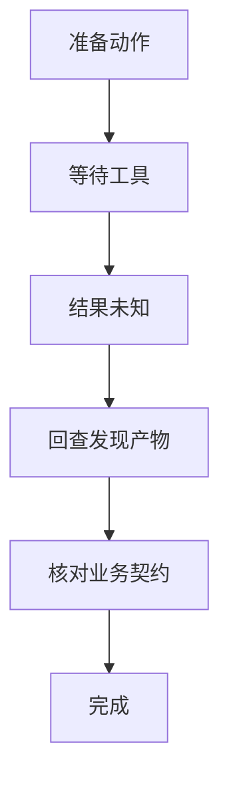
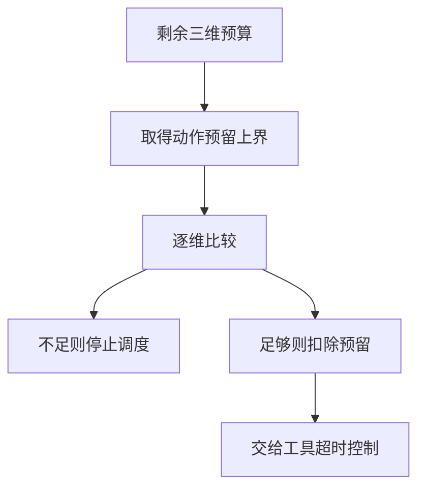
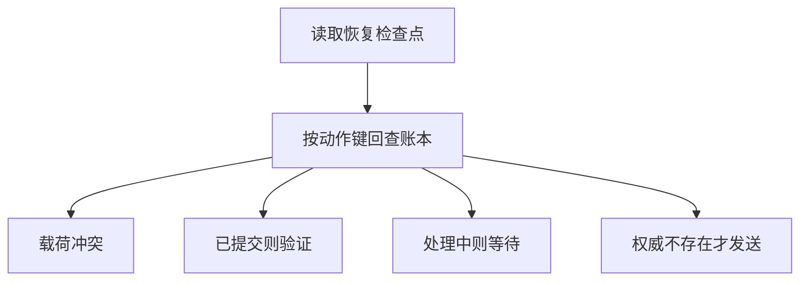

# Harness任务循环

> Harness 是围绕模型组织上下文、工具、状态和验证的执行系统。模型选择下一步并不等于下一步已经发生；可恢复循环需要把建议、发出、结果未知、回读和验收分别记录。

## 学习目标

- 画出可恢复状态机
- 区分模型与宿主责任
- 定义停止和重试条件

## 前置知识

需要理解函数调用、事件日志和状态机。先读[共同基础](../../docs/共同基础.md)。本页的状态描述宿主知道什么，不声称它等于外部世界的完整状态；同一真实写入可能对应客户端的“等待”或“结果未知”。

## 基本机制

ReAct 第2节将上下文写成观测与动作的历史，并区分语言推理动作与改变外部环境的动作。Harness在这之上承担调度、资源限制和恢复。LangGraph 的 PregelLoop.tick 准备下一批任务，after_tick 合并写入后保存检查点；模型生成的文字并没有替代这些宿主步骤。[ReAct: Synergizing Reasoning and Acting in Language Models](https://arxiv.org/html/2210.03629v3)；[LangGraph PregelLoop 状态推进](https://github.com/langchain-ai/langgraph/blob/4c52e129eb1ab69a3da58b799f67929f77d81149/libs/langgraph/langgraph/pregel/_loop.py#L650)。

工程上宜将状态拆成目标版本、执行阶段、当前动作身份、产物证据、剩余预算五部分。检查点保存可恢复信息，事件记录保留发生顺序；二者都不能单凭一段“已完成”摘要推断业务结果。下面使用单任务串行模型解释三个问题，并不实现并行Pregel调度。

完整教学实现：[运行机制示例](../../examples/harness/agent-loop.py)。示例仅使用 Python 标准库，对传入的模拟数据计算结果；本页没有执行模型、外部工具或真实业务实验。

## 推导或示例

### 知识点一：把结果未知作为可恢复状态

为什么不能把所有异常转成重试？因为“没有收到响应”是通信事实，不是业务未发生的证明。设外部状态为 $x_t$ ，宿主知识状态为 $s_t$ ，工具回报为 $o_{t+1}$ 。本页的**教学状态机**是

$$
s_{t+1}=\delta(s_t,o_{t+1}),\qquad x_{t+1}=F(x_t,a_t).
$$

$F$ 是实际副作用， $\delta$ 是宿主更新规则，两者不是同一个函数；超时可能出现在 $F$ 已执行之后。示例将阶段分为 ready、pending、unknown、verifying、done。“unknown → ready”需要回查得到不存在，“unknown → verifying”需要找到产物；只有 verifying 收到 accepted 才能完成。

手算一个保存草稿序列：ready 收到 dispatch 后成为 pending；响应超时成为 unknown；按动作键查到草稿成为 verifying；核对标题和内容后才成为 done。若省掉 unknown，第二次保存可能创建重复草稿；若省掉 verifying，保存到错误目录也会被算成功。保留独立状态让恢复动作有条件可依，而不是从最后一句自然语言猜测。

```python
def transition(state: str, event: str) -> str:
    """根据已观测事件推进阶段；未知写入结果必须先回查。"""
    edges = {
        ('ready', 'dispatch'): 'pending',
        ('pending', 'ok'): 'verifying',
        ('pending', 'timeout'): 'unknown',
        ('pending', 'rejected'): 'ready',
        ('unknown', 'found'): 'verifying',
        ('unknown', 'absent'): 'ready',
        ('verifying', 'accepted'): 'done',
        ('verifying', 'mismatch'): 'ready',
    }
    if state not in {'ready', 'pending', 'unknown', 'verifying', 'done'}:
        raise ValueError('未知状态')
    if state == 'done':
        return 'done'
    if (state, event) not in edges:
        raise ValueError('非法状态转移')
    return edges[state, event]
```

输入是阶段和事件，输出为下一阶段。字典显式枚举允许的边；非法边抛异常，使“未知结果直接再发”暴露出来。done 为吸收态，因此重复投递验收事件不会重新打开同一目标。目标真的改变时应创建新目标版本，不能向旧完成态随意注入新动作。



源码与原文：[LangGraph PregelLoop 状态推进](https://github.com/langchain-ai/langgraph/blob/4c52e129eb1ab69a3da58b799f67929f77d81149/libs/langgraph/langgraph/pregel/_loop.py#L650)；[LangGraph Persistence 官方文档](https://docs.langchain.com/oss/python/langgraph/persistence)；[ReAct: Synergizing Reasoning and Acting in Language Models](https://arxiv.org/html/2210.03629v3)。

该版本 LangGraph 源码的 tick 与 after_tick 展示了调度和检查点边界，但没有定义本页这五个业务状态；Persistence 文档说明检查点面向线程恢复。可验证性质是非法边被拒绝、完成态吸收、超时不直接重发。反例是回读接口最终一致：一次“未找到”不能充当权威不存在。

### 知识点二：把停止条件变成执行前的预算预留

只限制模型轮次会遗漏工具耗时；只在返回后累计token，又可能在最后一次调用越过预算。定义预算向量 $b_t=(n_t,q_t,d_t)$ ，单位分别为步、token和毫秒，动作预留上界为 $\bar c(a_t)$ 。下面是**宿主设计模型**：

$$
\mathrm{admit}(a_t)\iff \bar c(a_t)\preceq b_t,\quad b_{t+1}=b_t-\bar c(a_t).
$$

偏序表示逐维不超过，不能把token与毫秒相加成没有单位的“总成本”。若剩余 $(3,100,500)$ ，预留 $(1,40,100)$ 后得到 $(2,60,400)$ ；下一动作需要70个token就被拒绝，即使还有两步。每个动作至少扣一步，所以在固定起始预算且不补充预算时，最多允许 $n_0$ 次调度。这是有限终止性的证明，不是任务必然成功的证明。

AutoGen 的 TokenUsageTermination.__call__ 在收到消息后累计已有用量，TimeoutTermination 在被调用时检查单调时钟；它们是实际版本的停止检测。预留模型额外强调执行前准入，不能声称AutoGen已经提供严格的费用上界。工具自身还要有超时或取消机制，否则检查器无法中断一个永不返回的调用。

```python
def admit_budget(remaining: tuple[int, int, int],
                 reservation: tuple[int, int, int]) -> tuple[bool, tuple[int, int, int]]:
    """按步数、token、毫秒的上界预留预算；拒绝时预算不变。"""
    if len(remaining) != 3 or len(reservation) != 3:
        raise ValueError('预算必须有三个维度')
    if any(type(x) is not int or x < 0 for x in (*remaining, *reservation)):
        raise ValueError('预算必须是非负整数')
    if reservation[0] < 1:
        raise ValueError('每个调度动作至少消耗一步')
    if any(c > b for b, c in zip(remaining, reservation)):
        return False, remaining
    return True, tuple(b - c for b, c in zip(remaining, reservation))
```

函数先检查三维非负整数，再作逐维比较；拒绝时原样返回预算，接受时逐维扣除。reservation 的第一维不得为0，防止零步重试绕过终止证明。这里没有真实计时器，也没有凭估计值证明硬截止时间；生产系统需要为网络、取消和回查留余量。



源码与原文：[AutoGen token 与超时终止条件](https://github.com/microsoft/autogen/blob/004749e6b7102c8fd317b9b1499ce5807223c278/python/packages/autogen-agentchat/src/autogen_agentchat/conditions/_terminations.py#L275)；[MCP Lifecycle 规范](https://modelcontextprotocol.io/specification/2025-06-18/basic/lifecycle)；[ReAct: Synergizing Reasoning and Acting in Language Models](https://arxiv.org/html/2210.03629v3)。

MCP Lifecycle 的 Timeouts 讨论单请求超时与总超时，未给出本文预算公式。可验证性质是预算永不为负、拒绝不消耗、每次准入减少步数。反例是把历史平均时延当成最大时延：此时公式只能做计划，不能给硬资源保证。

### 知识点三：检查点恢复与外部幂等不能互相替代

假设在保存外部文件后、写本地检查点前崩溃。恢复到旧检查点只证明宿主尚未记账，不证明文件不存在。令业务动作身份为 $k$ 、载荷为 $p$ 、账本为 $L$ ，另以d表示权威确认不存在，本页定义恢复函数：

$$
R(k,p,L,d)=\begin{cases}\text{conflict},&k\in\mathrm{dom}L\land L[k].p\ne p\cr \text{verify},&k\in\mathrm{dom}L\land L[k].p=p\land L[k].status=committed\cr \text{wait},&k\in\mathrm{dom}L\land L[k].p=p\land L[k].status=pending\cr \text{query},&k\notin\mathrm{dom}L\land\neg d\cr \text{dispatch},&k\notin\mathrm{dom}L\land d\end{cases}
$$

这不是MCP原生的通用幂等承诺，而是业务服务可以实现的协议。相同键但不同内容必须冲突，否则用户改了目标却收到旧结果；相同键且已提交时返回核对入口，不再次执行写入。以 draft-1 为键保存正文后丢响应，账本已是committed，恢复应去核对已有草稿。

LangGraph在after_tick应用写入并保存检查点，tick会处理已有pending writes，这支持宿主工作恢复；外部系统不在同一事务内时仍有崩溃窗口。“存在检查点”与“恰好一次业务副作用”之间还差一个原子提交或幂等服务端契约。

```python
def reconcile_outcome(key: str, payload: str, ledger: dict,
                      authoritative_absent: bool = False) -> str:
    """按幂等键回查；只在权威确认不存在时允许发送。"""
    if not key:
        raise ValueError('幂等键不能为空')
    if key in ledger:
        stored_payload, status = ledger[key]
        if stored_payload != payload:
            return 'conflict'
        if status not in {'pending', 'committed'}:
            raise ValueError('账本状态不合法')
        return 'verify' if status == 'committed' else 'wait'
    return 'dispatch' if authoritative_absent else 'query'
```

输入账本仅供读取，函数返回下一步策略而不修改外部世界。缺键默认 query；只有调用方明确给出 authoritative_absent 才允许 dispatch。对payload逐字比较是教学简化；生产可规范化后绑定摘要，但必须规定JSON键序、数字和编码的规范化规则。



源码与原文：[LangGraph PregelLoop 状态推进](https://github.com/langchain-ai/langgraph/blob/4c52e129eb1ab69a3da58b799f67929f77d81149/libs/langgraph/langgraph/pregel/_loop.py#L650)；[LangGraph Persistence 官方文档](https://docs.langchain.com/oss/python/langgraph/persistence)；[MCP Lifecycle 规范](https://modelcontextprotocol.io/specification/2025-06-18/basic/lifecycle)。

可验证性质是已提交同载荷不产生dispatch、同键异载荷返回conflict、未知缺键默认query。反例是客户端先查后写而服务端不原子去重，两个客户端仍可同时写入；纯函数本身不提供并发事务保证。

## 适用条件与限制

适用于具有明确动作边界和可观察结果的工具任务。多任务并行时还要记录依赖、取消传播和事件乱序；不能把本页单链状态机直接套成完整调度器。完成态只对某个冻结的目标版本成立；用户更改目标、权限或输出位置后需要重新判断。

常见误区是把“继续推理”当成恢复、把所有异常当失败、把停止当成功。停止原因应单独记录为已完成、预算耗尽、取消、不可恢复或等待输入，才能把任务质量与运行控制分开。

## 实践任务

设计一个纯模拟的草稿整理任务，列出正常保存、返回丢失、重复触发、目标改变四条轨迹。每条记录状态、事件、动作键、预算和验收条件。手算预算耗尽前最后一次可允许动作，并说明该动作的回查预算从哪里预留。再构造“外部保存成功但检查点仍旧”的恢复案例。

实践状态保持 `designed`。教学函数的测试由统一 UT 流程负责，本页不把手算预期写成已运行结果，也不把示例性质外推为真实模型成功率。

## 掌握标准

- 能解释知识状态与真实业务状态为何会不同。
- 能画出超时后的两条回查路径，并指出各自证据。
- 能证明每次准入扣一步时有限调度，并给出成本低估的反例。
- 能说明幂等账本必须与副作用原子关联，不能靠重放检查点推出恰好一次。

## 源码导读与模型边界

阅读顺序为 PregelLoop.tick → after_tick → _put_checkpoint，再对照 Persistence 的检查点与Store职责。三段教学代码分别覆盖状态转移、预算准入、外部回读；均不包含模型策略、网络取消或数据库事务。上述性质应由独立测试覆盖正常边、非法边和重复事件。

### 连贯案例复盘

下面的复盘只使用本页的模拟草稿，不涉及真实文件系统。第一步固定目标版本与动作身份，第二步为发送、回查和验收预留预算，第三步才允许模型建议进入可执行状态。预算表与状态表应当互相引用：如果剩余预算只能发送，却不能确认结果，就不能把“成功发出”当成一个可完整闭环的计划。

| 观察到的事实 | 宿主阶段 | 后续证据需求 |
|---|---|---|
| 已发请求但没有响应 | 结果未知 | 按相同动作键回查 |
| 回查找到相同键但载荷不同 | 冲突 | 核对目标版本和键复用 |
| 回查找到正确产物 | 待验收 | 核对业务内容和输出位置 |
| 全部验收通过 | 完成 | 保存产物身份与验收版本 |

练习中的关键反例是“动作已经成功，返回报文却丢失”。此时重新开始整个任务可能重复造出产物；恢复旧检查点又可能再次执行同一步。解决它依赖外部回查与幂等，而不是增加一段反思提示。即使服务支持幂等，也要说明键的有效期：账本过期后再次使用旧键，可能不再具有去重效果。

另一个反例是用户在等待期间改变输出位置。旧动作的回执仍应进入旧目标版本的台账，不能把它直接算作新目标完成。宿主需要先厘清旧副作用，再形成新目标的动作计划。这样才能避免在同一自然语言会话里把两个不同任务状态拼成虚假的成功。

复核时逐行问三个问题：这条事件证明了外部什么事实；它只改变宿主知识还是确实改变业务状态；下一步是否有独立预算与结果查询入口。这三个问题比只检查状态名字是否齐全更能发现恢复漏洞。

本文源码链接均锁定实际读取的提交；论文锁定 arXiv 版本，在线官方文档记录读取日和正文指纹。公式中标为“教学模型”的预算、阈值和状态集合是本页设计，不是论文测得的效果。第三方文件只作为阅读依据，教学实现为独立简化。

---

[返回模块](../modules/Harness.md) · [知识点索引](../../docs/知识点索引.md) · [完整教学代码](../../examples/harness/agent-loop.py) · [提出更正](https://github.com/yanbozhang/llm-systems-wiki/issues/new?template=knowledge.yml)

觉得这篇推导有帮助，可以在 [GitHub](https://github.com/yanbozhang/llm-systems-wiki) 点 Star 收藏更新；分享时欢迎链接到具体知识点，便于读者复核公式、代码与来源。
