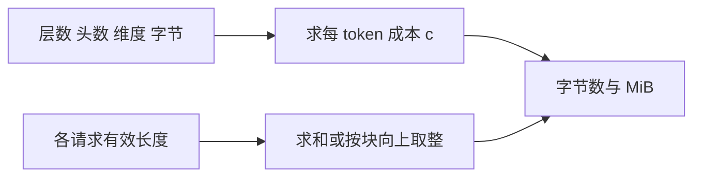
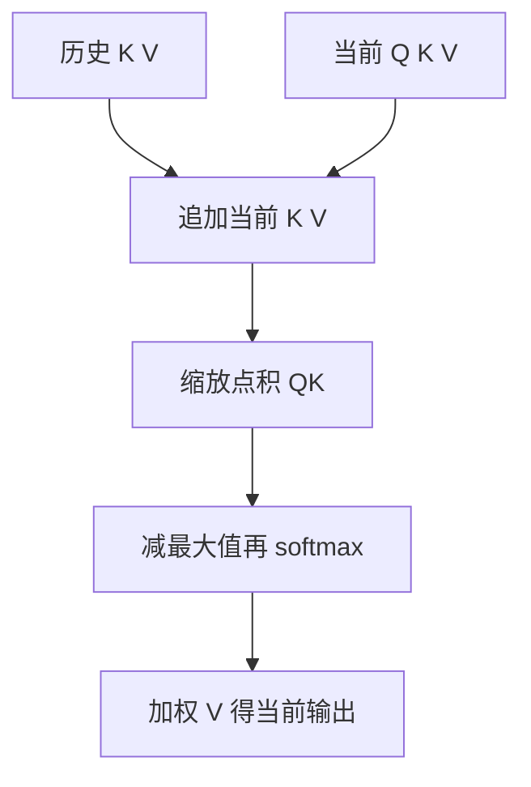
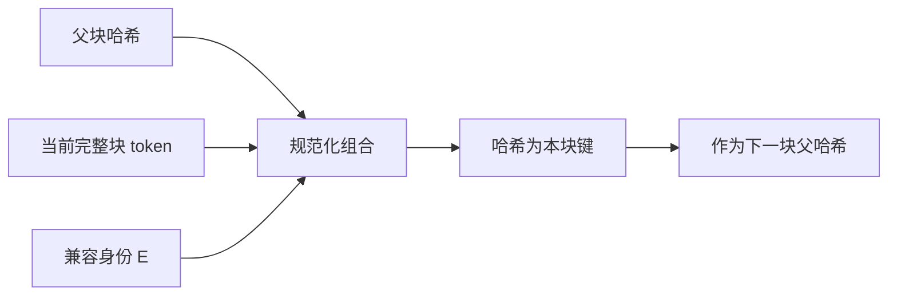

# KV缓存原理与显存估算

KV Cache 保存每层已处理token的K/V，使生成新token时复用历史计算状态。它既不是答案缓存，也不是长期记忆。本页把有效字节、物理容量、注意力访问和跨请求身份分开建模，避免把省计算、省存储和命中率混成同一个数字。

## 学习目标

- 估算不同请求的缓存
- 区分逻辑长度与物理分配
- 验证缓存兼容条件

## 前置知识

需掌握[Prefill与Decode](Prefill与Decode.md)、GQA、softmax及字节单位。缓存长表示已经forward的位置；末次采样token可能还没进入KV。

## 基本机制

标准因果注意力中，未来token不会反过来改变过去位置状态，因此可保留过去K/V。追加新位置后只计算当前查询，但当前查询依然读取可见历史。[Transformers 缓存解释](https://huggingface.co/docs/transformers/en/cache_explanation)说明这一接口；[PagedAttention §4](https://arxiv.org/html/2309.06180v1)进一步把逻辑序列映射到非连续物理块。

有效容量用于解释模型状态量，已分配容量用于判断能否接入请求，设备总显存还需加上权重与运行时开销。容量模型必须说明是否变长、是否共享、是否分片，三项任何一项变化都可能改变估算口径。

## 推导或示例

完整教学文件：[kv-cache.py](../../examples/inference/kv-cache.py)。每个函数对应下列一个知识点，只使用标准库与小型合成输入；教学计算不代表模型或服务实验。

### 知识点一：有效状态、padding与物理分页的三本账

KV张量是各层计算状态，不是权重。对 $L$ 层、 $H_{kv}$ 个KV头、每头维度 $d$ 、每元素 $s$ 字节，两个张量K与V使每token成本为 $c=2LH_{kv}ds$ ，量纲为字节/token。变长请求 $T_1,\ldots,T_B$ 的有效容量为：

$$
M_{\rm useful}=c\sum_i T_i,\quad M_{\rm pad}=cB\max_iT_i,\quad M_{\rm page}=cb\sum_i\lceil T_i/b\rceil.
$$

最后一式只用于每个请求独立分配、块大小 $b$ token 的分页。它计算分配容量而非其中已填入的有效KV。每个非空请求浪费小于 $b$ 个位置，所以浪费上界是 $B(b-1)$ ；如果物理块共享，就应按唯一物理块集合求和，不能仍把各请求块数相加。

```python
def kv_layout(lengths, layers, kv_heads, head_dim, element_bytes, block_size):
    """返回有效、按最长补齐及独立分页的KV字节数，不含共享和临时工作区。"""
    lengths = list(lengths)
    if any(type(x) is not int or x < 0 for x in lengths):
        raise ValueError("长度须为非负整数")
    if any(type(x) is not int or x < 1 for x in
           (layers, kv_heads, head_dim, element_bytes, block_size)):
        raise ValueError("维度、字节数与块大小须为正整数")
    per_token = 2 * layers * kv_heads * head_dim * element_bytes
    effective = sum(lengths)
    padded = len(lengths) * max(lengths, default=0)
    blocks = sum((n + block_size - 1) // block_size for n in lengths)
    return {"bytes_per_token": per_token, "effective_bytes": effective * per_token,
            "padded_bytes": padded * per_token, "paged_bytes": blocks * block_size * per_token,
            "blocks": blocks, "tail_waste_tokens": blocks * block_size - effective}
```

先计算每token字节，再独立统计三种位置数，因此单位转换不会混在取整里。对32层、8个KV头、128维、FP16，每token为131072字节，即128KiB。长度1024与3072时有效与16token分页均为512MiB，padding为768MiB；长度17、31、32时分配96个位置，有效80个，尾部浪费16个位置即2MiB。MiB采用 $2^{20}$ 字节，不是十进制MB。



函数对 $B$ 个请求线性扫描， $O(B)$ 时间；返回汇总而不分配模拟KV，因此不会真的占用估计大小的内存。该版本 `DynamicLayer` 文档给出 `[batch,heads,seq_len,head_dim]` 布局，vLLM manager则将请求需求转换为块申请。GQA应该用KV头数，不用查询头数；张量并行只有在头确实均分且无复制时才能简单除卡数。量化比例尺、混合注意力层、窗口截断、对齐、权重与临时激活都需要另立条目。

[Transformers DynamicLayer](https://github.com/huggingface/transformers/blob/50e35cc0ca18ec19b80653690de553e6decf74f5/src/transformers/cache_utils.py#L103)；[vLLM allocate_slots](https://github.com/vllm-project/vllm/blob/7a64fb8fc9239cb65e0df9313fa759594dfb206a/vllm/v1/core/kv_cache_manager.py#L529)；[Transformers 缓存布局](https://huggingface.co/docs/transformers/en/cache_explanation)；[PagedAttention §4.2](https://arxiv.org/html/2309.06180v1).

### 知识点二：追加KV之后仍然要读取历史

设历史有 $T$ 个键值对，当前查询 $q\in\mathbb R^d$ 、新键 $k\in\mathbb R^d$ 、新值 $v\in\mathbb R^{d_v}$ 。追加之后 $K^\prime\in\mathbb R^{(T+1)\times d}$ 、 $V^\prime\in\mathbb R^{(T+1)\times d_v}$ ，计算为：

$$
z_i=q^\top k_i/\sqrt d,\quad a_i=\frac{e^{z_i-z_{\max}}}{\sum_j e^{z_j-z_{\max}}},\quad o=\sum_i a_i v_i.
$$

减去同一个最大值不改变softmax，却避免指数溢出。单步只有当前查询，因此每个历史位置都在当前的因果可见范围；若同时输入多token，需要显式构建新位置之间的三角mask，不能直接复用这里的单行逻辑。

```python
def cached_attention(query, past_keys, past_values, new_key, new_value):
    """单头单步注意力：追加当前K/V，稳定softmax后返回输出与新缓存。"""
    q = list(query)
    keys = [list(k) for k in past_keys] + [list(new_key)]
    values = [list(v) for v in past_values] + [list(new_value)]
    if not q or len(keys) != len(values) or not values[-1]:
        raise ValueError("需要非空维度及成对K/V")
    if any(len(k) != len(q) for k in keys) or any(len(v) != len(values[-1]) for v in values):
        raise ValueError("K与Q维度、各V维度须分别一致")
    if any(not math.isfinite(x) for row in [q] + keys + values for x in row):
        raise ValueError("向量须为有限数")
    scores = [sum(a * b for a, b in zip(q, k)) / math.sqrt(len(q)) for k in keys]
    peak = max(scores)
    weights = [math.exp(s - peak) for s in scores]
    total = sum(weights)
    weights = [w / total for w in weights]
    output = [sum(w * v[j] for w, v in zip(weights, values)) for j in range(len(values[0]))]
    return {"output": output, "weights": weights, "keys": keys, "values": values}
```

函数复制历史容器以避免修改调用者，再校验K/V长度及维度，追加新位置，计算权重和加权输出。当 $q=[0]$ ，历史值为 `[2]`，新值为 `[4]`，两项分数均为0，权重各1/2，输出 `[3]`。删掉历史会得到 `[4]`；这就是“有缓存所以不用读历史”的反例。交换KV两者配对顺序不影响结果，但只交换K不交换V会改变语义。



查询计算为 $O((T+1)(d+d_v))$ ，缓存空间为同阶；代码为了纯函数复制列表，真实分页实现可原位填槽，不能把Python复制成本归到生产算法。该版本 `LlamaAttention.forward` 先做RoPE再更新cache，`DynamicLayer.update`沿序列轴拼接，`eager_attention_forward`读取全部返回状态。位置编码配置或上下文改变时，旧K/V可能已经失效。双向编码器、训练中的dropout与改变权重后的状态不满足相同复用条件。

[LlamaAttention.forward 与 eager_attention_forward](https://github.com/huggingface/transformers/blob/50e35cc0ca18ec19b80653690de553e6decf74f5/src/transformers/models/llama/modeling_llama.py#L180)；[DynamicLayer.update](https://github.com/huggingface/transformers/blob/50e35cc0ca18ec19b80653690de553e6decf74f5/src/transformers/cache_utils.py#L118)；[Transformers Attention matrices](https://huggingface.co/docs/transformers/en/cache_explanation).

### 知识点三：块哈希必须包含历史和计算身份

相同词出现在不同上下文时，经过多层注意力后的K/V一般不同。因此块号不是缓存内容身份，只哈希本块token也不够。令第 $j$ 块token序列为 $X_j$ ，额外身份为 $E$ ，采用：

$$
h_0=\varnothing,\qquad h_j=H(\mathrm{encode}(h_{j-1},X_j,E)).
$$

父哈希把完整前缀的依赖压缩到当前键中。例子中块大小2，A为 `[1,2,3,4]`，B为 `[9,2,3,4]`：末块都为 `[3,4]`，但父哈希不同，因此第二块不能共享；C为 `[1,2,3,4,5]` 则完整前两块可匹配，尾token没有形成新完整块。

```python
def prefix_block_hashes(tokens, block_size, identity):
    """给完整token块计算链式哈希；identity显式包含模型、adapter等兼容身份。"""
    tokens = list(tokens)
    if type(block_size) is not int or block_size < 1 or any(type(x) is not int or x < 0 for x in tokens):
        raise ValueError("块大小须为正整数，token须为非负整数")
    required = {"model", "adapter", "tokenizer", "position", "dtype", "salt"}
    if not isinstance(identity, dict) or not required <= identity.keys():
        raise ValueError("缓存身份字段不完整")
    if any(not isinstance(v, str) for v in identity.values()):
        raise ValueError("身份值须为字符串")
    parent = ""
    result = []
    for start in range(0, len(tokens) - block_size + 1, block_size):
        payload = [parent, tokens[start:start + block_size], identity]
        canonical = json.dumps(payload, sort_keys=True, separators=(",", ":"), ensure_ascii=False)
        parent = hashlib.sha256(canonical.encode("utf-8")).hexdigest()
        result.append(parent)
    return result
```

序列化固定键顺序与分隔符，使同一教学身份得到确定输入字节。身份中的模型等字段是教学显式兼容域，不能声称生产vLLM逐块序列化了这些完全相同的字段：有些条件由同一引擎实例隐含保证，有些通过extra keys实现。该版本 `hash_block_tokens`实际组合父哈希、token元组与extra keys；`generate_block_hash_extra_keys`可纳入LoRA、图像、prompt embeddings及cache salt。LoRA路径改变也进入该版身份。



对 $T$ 个token和固定大小身份，哈希总输入长度为 $O(T)$ ，返回 $O(T/b)$ 个摘要。它只产生键，不实现命中查找或物理块引用计数。非完整块匹配在新实现中可能另有专门路径，本函数不代表所有cache策略。该版本 `get_computed_blocks`默认最多命中 `num_tokens-1`，因为必须再算最后位置以拿到logits；“全部提示命中”也不意味着零forward。哈希碰撞概率很低不等于逻辑上绝不碰撞，更不能用摘要比较替代身份字段的正确选择。

[vLLM hash_block_tokens](https://github.com/vllm-project/vllm/blob/7a64fb8fc9239cb65e0df9313fa759594dfb206a/vllm/v1/core/kv_cache_utils.py#L707)；[vLLM generate_block_hash_extra_keys](https://github.com/vllm-project/vllm/blob/7a64fb8fc9239cb65e0df9313fa759594dfb206a/vllm/v1/core/kv_cache_utils.py#L637)；[vLLM get_computed_blocks](https://github.com/vllm-project/vllm/blob/7a64fb8fc9239cb65e0df9313fa759594dfb206a/vllm/v1/core/kv_cache_manager.py#L293)；[vLLM 前缀缓存身份](https://github.com/vllm-project/vllm/blob/7a64fb8fc9239cb65e0df9313fa759594dfb206a/docs/design/prefix_caching.md#L5)；[PagedAttention §4.4](https://arxiv.org/html/2309.06180v1).

## 适用条件与限制

以上字节公式面向全注意力且各层KV形状一致。MLA压缩状态、混合Mamba/注意力、窗口缓存和多模态编码器状态不能直接套用。精度降低可能需要量化尺度与额外元数据；跨实例复用还需要布局和通信协议兼容。

常见误区：把同义问题当相同前缀，把相同文本当相同token，或看到128KiB/token就用它覆盖所有模型。必须先解释模型结构与token化规则。

## 实践任务

做一张长度1024/3072与17/31/32的容量表，列出有效、padding、分页、尾部浪费。另做单头注意力手算，对比保留和删除历史的输出。最后构造token相同但adapter改变、末块相同但父前缀改变两个缓存失效反例，并记录旧状态应如何隔离。

本页完整实践保持 `designed`。示例测试由统一 UT 流程记录，本页不宣称已测试或论文复现。

## 掌握标准

能算出FP16示例的512MiB，解释KV头数增加四倍为何有效容量也增加四倍；能证明softmax权重和为1；能解释父哈希传播差异、完整块与最后logits重算。练习答案不能只有最终数字，还需列出遗漏的显存项以及复用前提。


## 源码导读与边界推演

物理共享需要另做一次唯一块计数。假设两请求共享32个提示token，块大小16，各自再缓存1个分叉后的token。每个请求逻辑上需要3块，两个请求块表合计6项；若前两块确实共享，唯一物理块只有2个公共块加2个私有尾块，共4块。按128KiB/token计算，物理容量为 $4\times16\times128$ KiB，即8MiB；将逻辑块项直接相加则会误算成12MiB。有效状态也需按“独特的共享前缀加各分支后缀”计算，不能把有效字节表和物理字节表混用。

引用计数解决“多少使用者持有这个块”，哈希解决“这个块表示哪段计算”。两者不能互相替代。引用从2降为1时，另一个请求仍依赖它；引用降为0时，该块可成为替换候选，却仍可能被新的兼容请求再次命中。只有内容被改写或缓存身份移除后，原哈希才不能继续命中。页面中的哈希示例没有管理块池，不能从返回的摘要数量推断还有多少空闲显存。

显存估算还涉及模型层次。假设总层数32但流水线阶段只持有其中8层，且KV头没有复制，则该阶段每token状态按8层计算；张量并行若把8个KV头均分到4个rank，可按每rank2个KV头计算。若并行规模超过可分的KV头数、实现复制部分头，简单除卡数就失效。KV tensor本身、attention后端临时展开的头、通信缓冲与权重必须分项测量，教学容量函数只覆盖第一项。

缓存命中也有隐含语义。相同文本经不同chat template或tokenizer后可能是不同token序列；同样的token ID在不同模型词表下也未必同义。同一图像占位token若对应不同图像embedding，文本ID相同仍不能复用。所读extra keys路径将多模态和prompt embeddings纳入身份，说明匹配依据是实际计算输入，而不是页面显示的自然语言。

注意力小例子中 $q=0$ 使所有权重相等，但这不是生产模型的常见假设，只是为了使手算可审查。若令查询更偏向某历史键，权重会随点积变化，历史值对输出的影响也改变；因此把缓存看作“只需最新一条”的队列，会在全注意力下改变模型语义。使用滑动窗口时可以丢弃窗口外状态，是因为可见范围的模型定义已经改变，不能把这种策略无条件套到标准全注意力模型。

[块引用与替换](https://github.com/vllm-project/vllm/blob/7a64fb8fc9239cb65e0df9313fa759594dfb206a/vllm/v1/core/block_pool.py#L752)；[多模态与适配器身份](https://github.com/vllm-project/vllm/blob/7a64fb8fc9239cb65e0df9313fa759594dfb206a/vllm/v1/core/kv_cache_utils.py#L637)；[GQA与缓存读取](https://github.com/huggingface/transformers/blob/50e35cc0ca18ec19b80653690de553e6decf74f5/src/transformers/models/llama/modeling_llama.py#L167)；[分布式缓存管理 §4.6](https://arxiv.org/html/2309.06180v1).

## 2026研究进展

CapKV的官方摘要从信息容量角度讨论保留哪些KV。它与本页的容量估算处于不同层次：预算回答能放多少，选择策略还要回答保留哪些信息。缓存缩小后的任务质量需要单独测量，不能只报告显存下降。 [会议来源与读取范围](../../sources/library/2026-paper-inference-eviction/README.md)

更多公式、代码示例、结构图及当前开源版本见[推理研究进展](../frontiers/推理研究进展.md)。新内容未执行真实模型实验。

---

[返回模块](../modules/推理.md) · [知识点索引](../../docs/知识点索引.md) · [完整教学代码](../../examples/inference/kv-cache.py) · [提出更正](https://github.com/yanbozhang/llm-systems-wiki/issues/new?template=knowledge.yml)

觉得这篇推导有帮助，可以在 [GitHub](https://github.com/yanbozhang/llm-systems-wiki) 点 Star 收藏更新；分享时欢迎链接到具体知识点，便于读者复核公式、代码与来源。
