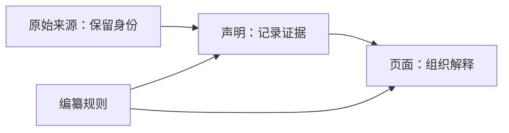
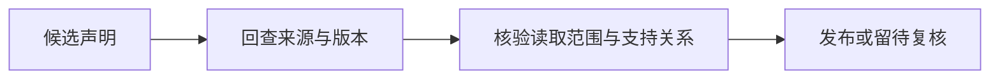
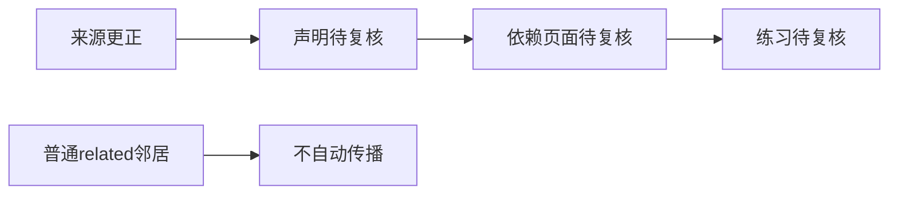

# LLMwiki：知识编纂与更新

LLMwiki 将原始来源编纂为可阅读、可修订、可追溯的持久知识，而不只是每次提问时拼装上下文。整体流程是来源保存、声明核验、页面编纂、版本准入和更正传播。[GraphRAG](GraphRAG与LLMWiki.md) 则单独讨论实体和社区组织下的查询；两者能共用来源，但不是同一个主题。

## 学习目标

区分原始来源、声明、知识页和编纂规则；在发布前检查来源版本与核验状态；沿类型化依赖找出待复核页面，而不把所有普通链接都当作失效传播边。

## 前置知识

先读 [来源接入与版本管理](来源接入与版本管理.md) 和 [RAG与引用回答](RAG与引用回答.md)。需要理解稳定 ID、版本控制、反向索引与广度优先遍历。

## 基本机制

Microsoft LLM Wiki 的公开设计采用 raw、wiki、schema 三层：原文与编纂页分开，schema约束编纂操作。本库在教学中进一步显式登记声明及其证据，方便解释更新影响；这不是声称上游实现了本库完全相同的数据模型。

## 推导或示例

### 知识点一：来源、声明与页面分层

令 $R$ 为原始来源集合， $C$ 为编纂声明， $P$ 为知识页。教学管线写作：

$$
R\xrightarrow{\mathrm{review}}C\xrightarrow{\mathrm{compose}}P.
$$

```python
from examples.knowledge.llm_wiki import source_layers
assert source_layers([{"id": "source-1", "layer": "raw"}])["raw"] == ["source-1"]
```



函数只按显式类型分组，拒绝未知层，不抽取或验证文本。原文不能被模型总结静默替换，页面的编辑历史也不能充当原始证据。[LLM Wiki设计](https://github.com/microsoft/llmwiki/blob/e09126f257c1fcf8e63234382748a51cf6a5df7f/ARCHITECTURE.md)与[公开介绍](https://github.com/microsoft/llmwiki/blob/e09126f257c1fcf8e63234382748a51cf6a5df7f/README.md)提供分层依据。

### 知识点二：来源版本与编纂准入

证据集合 $E$ 必须非空，每条证据 $e$ 都对应当前登记的来源版本并完成核验：

$$
\mathrm{ready}=[|E|\gt0]\land\bigwedge_{e\in E}[v_e=V(s_e)\land\mathrm{reviewed}(e)].
$$

```python
from examples.knowledge.llm_wiki import publication_ready
assert not publication_ready([{"source_id": "s", "source_version": "old", "reviewed": True}], {"s": "new"})
```



这是一项本库教学准入策略，不是上游官方API。版本相同和 `reviewed` 标签本身都不能证明事实正确，需要审阅记录支持。规则背景来自[三层架构](https://github.com/microsoft/llmwiki/blob/e09126f257c1fcf8e63234382748a51cf6a5df7f/ARCHITECTURE.md)与[LLM Wiki模式](https://gist.github.com/karpathy/442a6bf555914893e9891c11519de94f)。

### 知识点三：Wiki反向链接与类型化知识影响闭包

公开实现的 `getBacklinks` 查找直接反向链接，但普通链接不自动具有证据或依赖语义。本库教学上规定 `supported_by` 和 `requires` 参与传播，`related` 不参与。来源变更集合为 $C$ ，允许传播的反向邻接为 $R_\Sigma$ ：

$$
I_0=C,\qquad I_{k+1}=I_k\cup\lbrace p:\exists v\in I_k,(v,p)\in R_\Sigma\rbrace .
$$

```python
from examples.knowledge.llm_wiki import wiki_impact
assert wiki_impact({"claim": [("source", "supported_by")], "neighbor": [("claim", "related")]}, ["source"]) == ["claim"]
```



函数构建反向索引后广度优先遍历，visited防止环导致重复入队。核心遍历为 $O(|V|+|E_\Sigma|)$ ，确定性排序另有成本。结果是待复核对象，不是“全部错误”的结论；正式先修环也不能因为遍历终止就视为合法。参见[getBacklinks](https://github.com/microsoft/llmwiki/blob/e09126f257c1fcf8e63234382748a51cf6a5df7f/packages/core/src/backlinks.ts#L23)及[架构说明](https://github.com/microsoft/llmwiki/blob/e09126f257c1fcf8e63234382748a51cf6a5df7f/ARCHITECTURE.md)。

## 适用条件与限制

输入 ID、版本和关系类型已经人工核对，示例不解析文件路径、不执行LLM，也不实现自动撤回。GraphRAG的社区摘要同样是持久派生产物，因此“是否预先总结”不是二者唯一分界。

## 实践任务

建立来源—声明—主题—练习依赖链，加入一个普通related邻居和一个环。更正来源后列出待复核集合，再说明多来源支持下哪些声明可能仍然有效。

## 掌握标准

能画清分层和更新路径，拒绝过期版本证据，区分直接反向链接与类型化传递依赖。能解释为什么页面互链、来源可访问和结论可信是不同判断。
