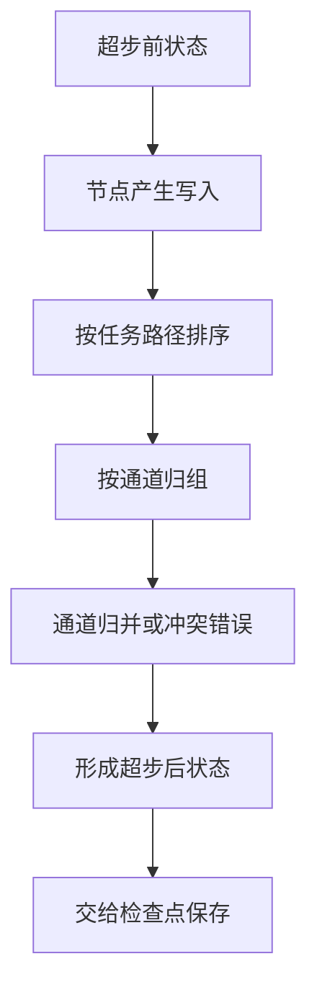
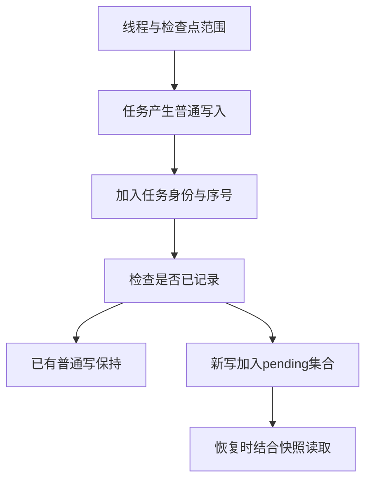
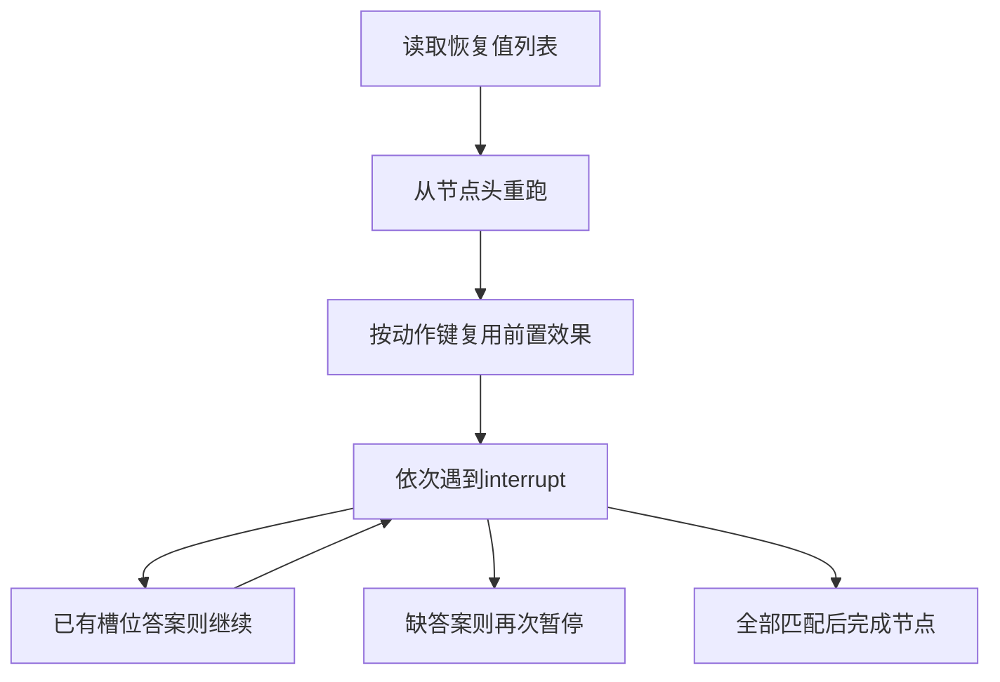

# LangGraph状态图与持久化

> LangGraph把有状态任务组织为图与超步，通过通道归并更新状态，再由检查点保存恢复所需信息。interrupt是一种可恢复的节点中断机制；恢复会从节点头重新执行，不能理解成在原Python调用栈的下一行继续。

## 学习目标

- 解释超步写入与状态归并
- 按线程和检查点恢复任务写入
- 识别interrupt节点重跑和顺序绑定

## 前置知识

先读[Harness任务循环](Harness任务循环.md)、[Agent记忆与保鲜](Agent记忆与保鲜.md)。需要有向图、状态归并、幂等和持久化身份概念。图节点不是必然独立的模型或进程，thread_id也不是操作系统线程ID。

## 基本机制

本页固定提交 `4c52e129eb1ab69a3da58b799f67929f77d81149`，代码采用MIT许可。README把LangGraph定位为低层有状态编排框架；Persistence文档区分线程状态checkpointer与跨线程应用数据Store。本文聚焦执行与恢复，不把图状态持久化等同于语义长期记忆。[LangGraph 官方仓库说明](https://github.com/langchain-ai/langgraph/blob/4c52e129eb1ab69a3da58b799f67929f77d81149/README.md#L1)；[LangGraph Persistence 官方文档](https://docs.langchain.com/oss/python/langgraph/persistence)。

源码中PregelLoop.tick准备任务，after_tick收集写入并调用apply_writes，再保存检查点。apply_writes把任务按路径排序、按通道归组，并交给各通道update。检查点、pending writes、恢复输入分别承载不同内容，混成一个“历史消息列表”会丢失调度信息。[LangGraph PregelLoop](https://github.com/langchain-ai/langgraph/blob/4c52e129eb1ab69a3da58b799f67929f77d81149/libs/langgraph/langgraph/pregel/_loop.py#L650)；[LangGraph apply_writes](https://github.com/langchain-ai/langgraph/blob/4c52e129eb1ab69a3da58b799f67929f77d81149/libs/langgraph/langgraph/pregel/_algo.py#L233)。

完整标准库示例：[教学实现](../../examples/harness/langgraph.py)。以下代码只处理模拟状态与记录，不启动产品、模型、工具或外部进程。

## 推导或示例

### 知识点一：超步边界让并行写入进入显式归并器

两个节点同时返回某字段时，不能默认“谁最后结束谁赢”。apply_writes明确先按任务路径排序，再把值聚合到通道。LastValue.update要求本步只有一个值，否则抛InvalidUpdateError；BinaryOperatorAggregate则使用operator归并，还包含Overwrite的特殊路径。

设超步前通道值为 $x_c^{(t)}$，本步写集合按规定顺序成为 $w_{c,1},\ldots,w_{c,n}$。教学归并为

$$
x_c^{(t+1)}=R_c(x_c^{(t)},w_{c,1},\ldots,w_{c,n}).
$$

对sum，$R_c=x+\sum_iw_i$；对普通last，本页定义n=0保持原值、n=1赋新值、n>1报错。这与“任意取最后一个写入”完全不同。把冲突显式暴露，可以促使开发者选择符合业务含义的归并器。

手算total初值1，节点a写2、b写3，sum得到6；last则拒绝。加法在此整数域满足结合与交换，输入完成顺序不影响结果。但列表拼接不交换，A后B和B后A不同；即使源码固定顺序，也应理解它是确定性规则，不是证明任意归并器都与顺序无关。

这里的Python按简单字符串任务路径排序，只模拟“先确定顺序再归并”。源码使用writes_sort_key与更丰富任务路径，不能把教学排序作为其精确序列化协议。图中其他节点何时读取新值还依赖超步与通道可用性，不是任意共享字典写入。

```python
def merge_superstep(state: dict[str, int], writes: list[tuple[str, str, int]],
                    reducers: dict[str, str]) -> dict[str, int]:
    """按教学任务路径排序后归并整数通道；普通last通道拒绝同一步多写。"""
    if any(type(value) is not int for value in state.values()):
        raise ValueError('初始通道值必须为整数')
    pending = {}
    for path, channel, value in sorted(writes, key=lambda row: row[0]):
        if channel not in state or type(value) is not int:
            raise ValueError('通道不存在或写入值类型不合法')
        pending.setdefault(channel, []).append(value)
    result = dict(state)
    for channel, values in pending.items():
        reducer = reducers.get(channel, 'last')
        if reducer == 'sum':
            result[channel] += sum(values)
        elif reducer == 'last' and len(values) == 1:
            result[channel] = values[0]
        elif reducer == 'last':
            raise ValueError('last通道在同一超步只能接收一个值')
        else:
            raise ValueError('不支持的教学归并器')
    return result
```

函数把所有写入归组后才更新新状态，避免边读边改原字典。它只接受已存在整数通道，sum累加，last检查单写。源实现还处理控制通道、版本更新、通道消费和完成通知；这些未进入教学函数，不能据此声称实现了完整Pregel。



源码及官方依据：[LangGraph apply_writes](https://github.com/langchain-ai/langgraph/blob/4c52e129eb1ab69a3da58b799f67929f77d81149/libs/langgraph/langgraph/pregel/_algo.py#L233)；[LangGraph LastValue.update](https://github.com/langchain-ai/langgraph/blob/4c52e129eb1ab69a3da58b799f67929f77d81149/libs/langgraph/langgraph/channels/last_value.py#L56)；[LangGraph BinaryOperatorAggregate.update](https://github.com/langchain-ai/langgraph/blob/4c52e129eb1ab69a3da58b799f67929f77d81149/libs/langgraph/langgraph/channels/binop.py#L127)；[LangGraph 官方仓库说明](https://github.com/langchain-ai/langgraph/blob/4c52e129eb1ab69a3da58b799f67929f77d81149/README.md#L1)。

可验证性质是sum的排列不变、last多写拒绝、未写通道不变。反例是直接覆盖余额字段：两个并行消费各返回余额，last冲突不是框架故障，而是业务更新缺少可合并语义。浮点加法还受舍入影响，本文整数不变量不能原样外推。

### 知识点二：检查点身份与pending writes记录不同恢复事实

完成超步前某个任务已经成功、另一个任务失败时，只有完整超步快照可能丢掉前者的工作信息。源码分别提供put和put_writes：put存储检查点及父检查点，并按通道版本存储值；put_writes保存当前检查点下各任务的中间写入。get_tuple会返回恢复所需的channel_values与pending_writes。

本页用以下**身份模型**解释作用域：

$$
K_{checkpoint}=(thread,namespace,checkpoint),
$$
$$
K_{write}=(thread,namespace,checkpoint,task,index).
$$

身份是元组而非把字符串随意拼接，避免分隔符歧义。对普通非负序号写，源码若已有同一任务/序号记录会跳过；部分控制通道使用特殊索引，更新行为不同。教学函数只支持普通通道，不能把所有控制信息都当作“第一次写赢”。

手算线程t、空间n、检查点c下，task-a写两条记录。重试再提交相同序号时不新增；task-b的序号0则是另一条记录。切换到新检查点c2后，task-a的序号0也不会覆盖c中的历史。相同序号却载荷改变时，本模型仍保留旧值，这要求恢复逻辑理解幂等身份，而非偷偷用新值覆盖已确认事实。

这些机制解决的是图执行状态恢复。若节点已经在外部创建文件，持久化该写入之前崩溃，外部副作用与检查点仍可能不一致。正确处理需要业务幂等或回查，不能从“有checkpointer”推出跨系统恰好一次。

```python
from copy import deepcopy

def checkpoint_writes(previous: dict, scope: tuple[str, str, str],
                      task_id: str, writes: list[tuple[str, str]]) -> dict:
    """模拟普通pending writes按线程、命名空间、检查点、任务和序号去重。"""
    if len(scope) != 3 or any(type(x) is not str for x in scope):
        raise ValueError('检查点范围必须为三个字符串')
    if not scope[0] or not scope[2] or not task_id:
        raise ValueError('线程、检查点和任务身份不能为空')
    result = deepcopy(previous)
    for index, (channel, value) in enumerate(writes):
        if not channel or channel.startswith('__'):
            raise ValueError('教学模型只接受普通命名通道')
        key = (*scope, task_id, index)
        result.setdefault(key, (channel, value))
    return result
```

函数用deepcopy复制账本，构造五元组键，再对普通写使用setdefault。它没有实现checkpoint快照、父版本或通道blob，仅展示pending writes的身份和重复规则。真正的InMemorySaver同样是内存实现，进程结束后不会因此获得磁盘持久性。



源码及官方依据：[LangGraph InMemorySaver](https://github.com/langchain-ai/langgraph/blob/4c52e129eb1ab69a3da58b799f67929f77d81149/libs/checkpoint/langgraph/checkpoint/memory/__init__.py#L430)；[LangGraph PregelLoop](https://github.com/langchain-ai/langgraph/blob/4c52e129eb1ab69a3da58b799f67929f77d81149/libs/langgraph/langgraph/pregel/_loop.py#L650)；[LangGraph Persistence 官方文档](https://docs.langchain.com/oss/python/langgraph/persistence)。

可验证性质是作用域隔离、幂等和原账本不变。反例是重启后只保留一个内存对象名称，数据并不会自动回来；需要适合的持久化checkpointer。线程恢复状态也不替代跨线程Store，二者职责在官方Persistence文档中明确分开。

### 知识点三：interrupt恢复重跑节点，并按调用顺序绑定答案

暂停不是保存Python函数调用栈。types.interrupt首次找不到恢复值时抛出GraphInterrupt；恢复后整个节点从头执行，scratchpad用interrupt_counter取得序号，先查此前的resume列表，再接收当前恢复值。官方Interrupts文档也明确警告不要更改节点内interrupt顺序。

对固定问题序列 $q_0,\ldots,q_{m-1}$ 和已有答案 $a_0,\ldots,a_{k-1}$，本文的**恢复槽位模型**为

$$
resume(q_i)=a_i\ (i<k),\qquad pause=q_k\ (k<m).
$$

完成条件k=m，单位为interrupt次数。顺序改变会让同一个答案绑定到另一个问题；即使答案类型都是字符串，也可能静默变成业务错误。该提交的typed response_schema可以校验某些类型，但字典Schema路径不构造同样的TypeAdapter，不能笼统说任何Schema都自动验证恢复值。

假设节点先创建草稿，再问“批准吗”和“保存到哪”。首次暂停前前缀执行一次；恢复一个答案后又从头运行并停在第二问；再恢复后前缀第三次运行。没有幂等保护会创建三份草稿。示例用外部模拟账本中的action_key表示已发生影响，使前缀虽重跑、模拟新影响只发生一次。

这不证明把动作放在interrupt之后就永远只执行一次：后续中断或崩溃仍可能导致重跑。关键是按真实恢复边界设计幂等、拆分节点与检查点，而不是凭代码行的位置推断可靠性。

```python
def replay_interrupt_node(questions: list[str], answers: list[str],
                          ledger: set[str], action_key: str) -> dict:
    """从节点头重跑，按interrupt次序消费答案；用外部模拟账本去重前置效果。"""
    if (not questions or any(type(q) is not str or not q for q in questions)
            or len(set(questions)) != len(questions) or not action_key):
        raise ValueError('问题身份须非空且唯一，动作身份不能为空')
    if len(answers) > len(questions):
        raise ValueError('答案数量超过interrupt槽位')
    new_effect = action_key not in ledger
    next_ledger = set(ledger) | {action_key}
    consumed = list(zip(questions, answers))
    index = len(answers)
    return {'prefix_reexecuted': True, 'new_effect': new_effect,
            'ledger': next_ledger, 'consumed': consumed,
            'interrupt': questions[index] if index < len(questions) else None,
            'complete': index == len(questions)}
```

函数每次都返回prefix_reexecuted=True，以提醒节点从头开始。ledger由调用方跨次保存，questions与answers按顺序配对，未满时返回下一问题。这里没有异常暂停或真实检查点，只用纯数据展示恢复语义；真实系统的恢复值必须属于正确thread_id和任务。



源码及官方依据：[LangGraph interrupt](https://github.com/langchain-ai/langgraph/blob/4c52e129eb1ab69a3da58b799f67929f77d81149/libs/langgraph/langgraph/types.py#L903)；[LangGraph InMemorySaver](https://github.com/langchain-ai/langgraph/blob/4c52e129eb1ab69a3da58b799f67929f77d81149/libs/checkpoint/langgraph/checkpoint/memory/__init__.py#L430)；[LangGraph Interrupts 官方文档](https://docs.langchain.com/oss/python/langgraph/interrupts)。

可验证性质是槽位推进、无答案先暂停、重复动作键去重。反例是根据当前时间决定是否跳过第二问，恢复时序号会改变；应保持顺序或将分支拆到图层。示例账本只演示集合幂等，不提供数据库原子写、崩溃恢复或外部事务保证。

## 适用条件与限制

本页只深入一个固定实现，不列通用框架排行。归并、检查点和interrupt各有自己的状态域与约束；不能把某一机制的保证扩展成整个业务系统可靠。完整运行还涉及重试、缓存、流式事件、动态调度与并行节点失败。

InMemorySaver适合展示结构，不等于生产持久化服务。普通写去重不涵盖所有控制写，整数sum也不涵盖所有归并器。业务文件、网络调用和数据库事务不自动包含在图检查点中。

## 实践任务

构造两个节点同时写total的超步，比较sum与last；为两个thread_id各写同序号pending记录并手算隔离结果。再设计含两个interrupt的节点，演示无答案、一个答案、两个答案的三次重跑，解释前置动作怎样避免重复影响。

实践状态为 `designed`。教学函数的小规模验证与真实产品实验分别记录；本版没有复现完整产品或论文实验。

## 掌握标准

- 能从apply_writes追到通道update并解释冲突。
- 能写出快照键和任务写键，区分作用域。
- 能说明interrupt恢复从哪里重跑、答案如何配对。
- 能区分图恢复与外部业务副作用保证。

## 版本、开放性与源码导读

固定版本 `4c52e129eb1ab69a3da58b799f67929f77d81149`，MIT许可见[LangGraph MIT许可](https://github.com/langchain-ai/langgraph/blob/4c52e129eb1ab69a3da58b799f67929f77d81149/LICENSE#L1)。阅读顺序为PregelLoop.after_tick → apply_writes → LastValue或BinaryOperatorAggregate → InMemorySaver.put/put_writes/get_tuple，再读types.interrupt与官方恢复限制。

连贯案例中，两个检索节点各产出若干证据条目，归并器决定怎样合并；检查点记录已完成图状态；人工检查节点用interrupt暂停。检索节点输出有了快照，不代表人工审批前的外部文件创建已和检查点原子提交。每一个副作用都需要明确自己的身份与恢复条件。

源码阅读还要区分描述性文档与具体分支。README的“从中断处继续”是使用层概括，interrupt实现则明确节点内会从头重跑。解释到函数粒度后，才能知道哪些局部变量会重新计算、哪些副作用可能重复、哪些恢复答案依赖调用顺序。

本页没有运行LangGraph，也没有创建数据库。教学示例只验证可用纯数据表达的性质；真正的故障恢复还需要在对应持久化后端、节点代码和外部服务条件下做独立实验。

本页的状态、预算和指标公式均是有明确适用条件的教学建模，除明确标出的源码行为外，不宣称为产品内部算法或实验效果。源码链接固定实际commit；可取得原文的资料记录正文指纹，仅有观察摘要的资料使用observed版本。

---

[返回模块](../modules/Harness.md) · [知识点索引](../../docs/知识点索引.md) · [完整教学代码](../../examples/harness/langgraph.py) · [提出更正](https://github.com/yanbozhang/llm-systems-wiki/issues/new?template=knowledge.yml)

觉得这篇推导有帮助，可以在 [GitHub](https://github.com/yanbozhang/llm-systems-wiki) 点 Star 收藏更新；分享时欢迎链接到具体知识点，便于读者复核公式、代码与来源。
