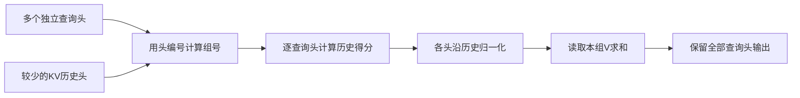
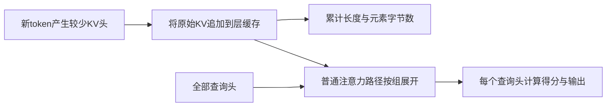
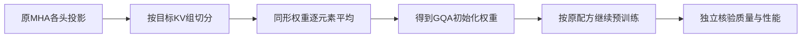

# MHA与MQA及GQA

MHA、MQA、GQA 改变的是查询头与 K/V 表示的共享关系。减少 KV 头能够减少理想缓存张量，但查询头数、注意力权重的形状、模型质量和实际服务速度必须分别分析。本文从“如何索引”“节省了什么”“转换丢失了什么”三个层次展开。[GQA 论文方法与实验设置](https://arxiv.org/html/2305.13245v3#S2)

前置学习：[Transformer与自回归生成](Transformer与自回归生成.md)。完整示例：[attention-heads.py](../../examples/network/attention-heads.py)。

## 学习目标

- 对任意合法头数写出 Q 到 K/V 的映射，并证明共享 K/V 不等于共享权重分布。
- 用完整单位核算缓存预算，区分持久张量与临时计算。
- 推导均值合并的最小二乘意义，并构造不保持注意力输出的反例。

## 前置知识

需要理解多头注意力与解码缓存。记 $H_q$ 为查询头数、 $H_{kv}$ 为键和值的头数， $d_h$ 为单头宽度， $S$ 为历史长度。以下是常见的均匀分组，要求 $H_q\bmod H_{kv}=0$ ；K 与 V 的头数相同。这个整除关系也是所读 SDPA 文档的 GQA 约束，不代表所有研究中的非均匀共享方案都只能如此设计。[PyTorch SDPA 的 GQA 约束](https://docs.pytorch.org/docs/2.14/generated/torch.nn.functional.scaled_dot_product_attention.html)

## 基本机制

MHA 取 $H_{kv}=H_q$ ，MQA 取 $H_{kv}=1$ ，GQA 在其间共享。查询投影仍输出 $H_qd_h$ 个通道，K/V 各输出 $H_{kv}d_h$ 个通道。该版本 Llama 的 `q_proj`、`k_proj`、`v_proj` 和 `o_proj` 明确区分两种宽度，因此仅修改配置而继续加载原 MHA 权重可能产生形状不匹配，也可能因错误转换而改变模型含义。[LlamaAttention 的投影层构造](https://github.com/huggingface/transformers/blob/50e35cc0ca18ec19b80653690de553e6decf74f5/src/transformers/models/llama/modeling_llama.py#L209-L230)

## 推导或示例

### 知识点一：共享键值并不共享查询分布

**问题与机制。** 如果四个 Q 头读取同一个 K/V 头，它们是不是只重复了一次计算？令组大小 $g=H_q/H_{kv}$ ，按零起始连续分组，查询头 $h$ 使用

$$
u(h)=\lfloor h/g\rfloor,\qquad
A_{h,t,s}=\mathrm{softmax}_{s}\negthinspace \left(\frac{Q_{h,t,:}K_{\nu(h),s,:}^T}{\sqrt{d_h}}+M_{t,s}\right),
\quad O_{h,t,:}=\sum_s A_{h,t,s}V_{\nu(h),s,:}.
$$

不同 $Q_h$ 仍可产生不同 $A_h$ 。对 $H_q=16,H_{kv}=4$ ，头0–3读组0，头4–7读组1，之后类推；MHA 是 $\nu(h)=h$ ，MQA 是全部映射到0。分组是 K/V 的共享，softmax 仍沿历史位置，而不是沿头编号。[GQA 分组定义](https://arxiv.org/html/2305.13245v3#S2.SS2)

```python
def grouped_attention(queries, keys, values):
    """每个Q头给一个查询；K/V按KV头与历史位置组织，返回映射和输出。"""
    hq, hkv = len(queries), len(keys)
    if not hq or not hkv or hq % hkv or len(values) != hkv:
        raise ValueError("Q头数须为KV头数的正整数倍")
    d = len(queries[0])
    if not d or any(len(q) != d for q in queries):
        raise ValueError("查询宽度须一致且非空")
    if any(not head for head in keys + values):
        raise ValueError("历史不可为空")
    length, dv = len(keys[0]), len(values[0][0])
    if not dv or any(len(head) != length for head in keys + values):
        raise ValueError("所有头历史须等长")
    if any(len(row) != d for head in keys for row in head):
        raise ValueError("键宽度不匹配")
    if any(len(row) != dv for head in values for row in head):
        raise ValueError("值宽度不匹配")
    if any(not math.isfinite(x) for row in queries for x in row) or any(
        not math.isfinite(x) for head in keys + values for row in head for x in row
    ):
        raise ValueError("输入须有限")
    group_size = hq // hkv
    mapping, weights, output = [], [], []
    for h, query in enumerate(queries):
        group = h // group_size
        scores = [sum(a * b for a, b in zip(query, key)) / math.sqrt(d) for key in keys[group]]
        e = [math.exp(s - max(scores)) for s in scores]
        w = [x / sum(e) for x in e]
        mapping.append(group)
        weights.append(w)
        output.append([sum(w[t] * values[group][t][c] for t in range(length)) for c in range(dv)])
    return {"mapping": mapping, "weights": weights, "output": output}
```

输入 `queries=[[1],[-1]]`，共享键为 `[1,-1]`、值为 `[0,10]`。第一个 Q 头得到 `[0.880797,0.119203]`，输出约1.19203；第二头得到相反权重，输出约8.80797。这是完全共享 K/V 仍有不同输出的直接反例。函数对每头只算一个 query，假设所有历史均可见；它适合解释无 padding 的单步解码，不包含多 query 的因果掩码构造。



**源码定位。** 该版本 `repeat_kv` 将 `[B,Hkv,S,dh]` 在组内展开到 `[B,Hq,S,dh]`；`eager_attention_forward` 随后与查询相乘。这个 `expand`/`reshape` 是普通路径的组织方式，融合 GQA 内核可以直接消费共享布局。[Llama repeat_kv 与 eager_attention_forward](https://github.com/huggingface/transformers/blob/50e35cc0ca18ec19b80653690de553e6decf74f5/src/transformers/models/llama/modeling_llama.py#L168-L202) [SDPA enable_gqa 参数及等价伪代码](https://docs.pytorch.org/docs/2.14/generated/torch.nn.functional.scaled_dot_product_attention.html)

**条件与反例。** 整除与宽度校验不可省略。 $H_q=6,H_{kv}=4$ 在这个接口下无合法均匀组映射。两个查询向量恰好相同时可以得到相同分布，但这是输入相同的结果，不是共享 K/V 的必然性质；如果把 Q 也平均，就进一步改变了模型结构。

### 知识点二：从持久缓存推导字节数与计算边界

**问题与机制。** 头数减少四倍，为何不应直接承诺延迟降低四倍？设批量 $B$ 、层数 $L$ 、历史长度 $S$ 、每元素 $b$ 字节；K 与 V 各存一个张量，因此

$$
M_{KV}=2BLSH_{kv}d_hb\quad\text{字节},\qquad
\frac{M_{GQA}}{M_{MHA}}=\frac{H_{kv}}{H_q}.
$$

相比之下单步解码的得分元素仍是 $BH_qS$ ；若 Q 长度为 $T_q$ ，就是 $BH_qT_qS$ 。忽略偏置时，单层 K/V 投影参数从 $2CH_qd_h$ 变为 $2CH_{kv}d_h$ ，Q 与输出投影仍在。GQA 主要降低 KV 表示、相关读取和部分投影成本，并没有消除每个查询头对历史的加权汇聚。[GQA 对缓存和带宽的讨论](https://arxiv.org/html/2305.13245v3#S2.SS2)

```python
def kv_budget(batch, layers, tokens, query_heads, kv_heads, head_dim, bytes_per_element=2):
    """返回理想未分片KV张量字节数；不计权重、碎片或临时展开。"""
    dims = [batch, layers, tokens, query_heads, kv_heads, head_dim, bytes_per_element]
    if any(not isinstance(x, int) or isinstance(x, bool) or x <= 0 for x in dims):
        raise ValueError("预算参数须为正整数")
    if query_heads % kv_heads:
        raise ValueError("Q头数须可被KV头数整除")
    shared = 2 * batch * layers * tokens * kv_heads * head_dim * bytes_per_element
    mha = shared * query_heads // kv_heads
    return {"kv_bytes": shared, "mha_bytes": mha, "ratio": kv_heads / query_heads,
            "mib": shared / 2**20, "decode_score_elements": batch * query_heads * tokens}
```

代入 $B=1,L=32,S=4096,H_q=16,H_{kv}=4,d_h=64,b=2$ ，得到 $134217728$ 字节，即128 MiB；MHA 对照为512 MiB。每 token 每层为 $2\times4\times64\times2=1024$ 字节，与旧页算例一致。MiB 使用 $2^{20}$ ，不能写成十进制 MB 后继续用同一数值。一个解码步骤每层的得分元素数为 $16\times4096=65536$ ，没有因 KV 头变为四而降为16384。



**源码定位。** 该版本 `LlamaAttention.forward` 先对投影后的 K 应用 RoPE，再执行 `past_key_values.update`，之后才进入注意力实现。普通实现中的 `repeat_kv` 位于缓存更新之后，所以预算应依据未重复的 KV 头数。[LlamaAttention.forward 缓存更新顺序](https://github.com/huggingface/transformers/blob/50e35cc0ca18ec19b80653690de553e6decf74f5/src/transformers/models/llama/modeling_llama.py#L240-L269) 实际后端可用性和输入限制需对照 [PyTorch SDPA 的 GQA 支持范围](https://docs.pytorch.org/docs/2.14/generated/torch.nn.functional.scaled_dot_product_attention.html)。

**条件与反例。** 公式假设各层相同头数、长度、精度，没有滑窗淘汰、分页碎片、分片复制或量化元数据。临时展开可能影响峰值，不能只凭缓存大小推断整个进程内存。实际延迟还包含权重读取、MLP、通信和调度；若原本瓶颈在 MLP，节省 KV 带宽的效果不会按缓存比例兑现。这里是预算推导，没有测量硬件速度。

### 知识点三：均值合并只是转换初始化

**问题与机制。** 从 MHA 合并到 GQA 时为何论文用组内均值，为什么仍需继续训练？将同组 K 投影展平为等长向量 $w_1,\ldots,w_g$ ，求一个公共 $u$ 使平方距离最小：

$$
J(u)=\sum_{i=1}^{g}\Vert w_i-u\Vert _2^2,\quad
\nabla_uJ=2gu-2\sum_iw_i=0
\Rightarrow u=\frac1g\sum_iw_i.
$$

这个推导说明均值最小化权重空间的欧氏误差；它并没有最小化真实数据上的输出误差或语言损失。GQA 论文先合并 K/V，再按原预训练配方继续训练；实验涉及 T5.1.1 架构，不能把其中的训练比例当成任意模型无损转换的定理。[GQA checkpoint 转换与继续训练](https://arxiv.org/html/2305.13245v3#S2.SS1)

```python
def mean_pool_heads(head_vectors, kv_heads):
    """把各头同形投影展平为行，按连续分组求均值；不执行继续训练。"""
    count = len(head_vectors)
    if not count or not isinstance(kv_heads, int) or kv_heads <= 0 or count % kv_heads:
        raise ValueError("原头数须可被目标头数整除")
    width = len(head_vectors[0])
    if not width or any(len(row) != width for row in head_vectors):
        raise ValueError("所有投影须同形非空")
    group_size = count // kv_heads
    return [[sum(head_vectors[h][j] for h in range(g * group_size, (g + 1) * group_size)) / group_size
             for j in range(width)] for g in range(kv_heads)]
```

代码将每头同形投影展平，并按相邻头分组。四行 `[[1,0],[-1,0],[2,4],[4,2]]` 合并为两头，得到 `[[0,0],[3,3]]`。前一组发生抵消，这是不可逆的信息损失。若保留原头数，组大小为一，输出回到原投影；这个边界可用于检查分组实现。

为了说明权重均值不保持注意力，考虑两个头、两个位置、 $q=1$ ，两头键分别为 `[a,0]` 与 `[-a,0]`。仅比较第一头，原来对第一个位置的权重是 $\sigma(a)$ ；合并后键为 `[0,0]`，变为 $1/2$ 。取 $a=\ln3$ ，权重从0.75变成0.5。即使 V 保持相同，输出也改变。一般有 $\mathrm{softmax}(\mathrm{mean}S_i)\ne\mathrm{mean}\mathrm{softmax}(S_i)$ ；对称特殊输入可能偶然相等，不能作为无损证明。



**源码定位。** 该版本 Llama 的投影构造和 `view` 指明转换后必须满足的 shape；这里读取到的是加载后执行结构，不是一个已验证的 MHA 转 GQA 工具。本库的均值函数依据论文自写，没有声称 Transformers 会自动执行论文的继续训练。[Llama K/V 投影形状与前向拆头](https://github.com/huggingface/transformers/blob/50e35cc0ca18ec19b80653690de553e6decf74f5/src/transformers/models/llama/modeling_llama.py#L219-L248) [GQA 均值初始化及实验设置](https://arxiv.org/html/2305.13245v3#S2)

**条件与反例。** 同组头必须有相同 $d_h$ 和输入维度，布局与分组需一致。改配置后强制切掉权重不是均值转换；只平均 K 而保留不兼容 V 也不成立。不同模型可能有偏置、分片、量化打包和权重布局差异，本例只处理普通浮点投影的数学初始化。

## 适用条件与限制

本文不是模型改造脚本。实际转换的验收应依次看形状与加载、数值有效性、独立任务质量、目标负载性能；四者不能相互替代。论文的“接近 MHA 质量”有模型、训练预算与评测集条件；PyTorch 文档的 GQA 支持也与后端和版本相关。本页不替任何未执行配置声明可部署性。

## 实践任务

交付16个 Q 头到4个 KV 头的映射、128/512 MiB 的字节预算表、均值合并前后注意力变化表。设计第二个反例：两组 K/V 相同但 Q 相反；再检查非法头数与保持原头数的边界。完整 checkpoint 转换、继续训练和速度测量保持已设计，由主 agent 的常驻 UT 另行核验教学函数。

## 掌握标准

能从组号公式定位任一查询头，说明共享 K/V 仍保留 $H_q$ 个输出；能明确缓存公式中每个因子的单位和固定条件；能推导均值的最小二乘意义并指出非线性注意力破坏无损性。只记住“四分之一显存”而说不清是哪类张量，尚未达到掌握要求。

## 源码与后续阅读

固定版本证据包括 GQA 论文、Transformers Llama 源码和 PyTorch 2.14 SDPA 文档。本页未复现论文训练或硬件性能；下一步可读[KV缓存原理与显存估算](KV缓存原理与显存估算.md)与[位置编码与RoPE](位置编码与RoPE.md)。

## 2026研究进展

RoBSA针对MLA解码，用RoPE部分形成选择代理，再进行块级注意力计算。它连接了缓存压缩、位置分量和稀疏计算三个问题；论文条件不能直接推广到本页所有MHA/MQA/GQA设置。 [会议来源与读取范围](../../sources/library/2026-paper-network-robsa/README.md)

更多公式、代码示例、结构图及当前开源版本见[模型网络研究进展](../frontiers/模型网络研究进展.md)。新内容未执行真实模型实验。

---

[返回模块](../modules/模型网络.md) · [知识点索引](../../docs/知识点索引.md) · [完整教学代码](../../examples/network/attention-heads.py) · [提出更正](https://github.com/yanbozhang/llm-systems-wiki/issues/new?template=knowledge.yml)

觉得这篇推导有帮助，可以在 [GitHub](https://github.com/yanbozhang/llm-systems-wiki) 点 Star 收藏更新；分享时欢迎链接到具体知识点，便于读者复核公式、代码与来源。
