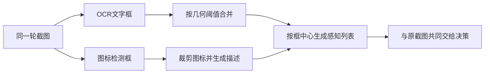
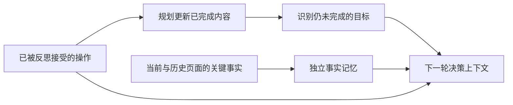
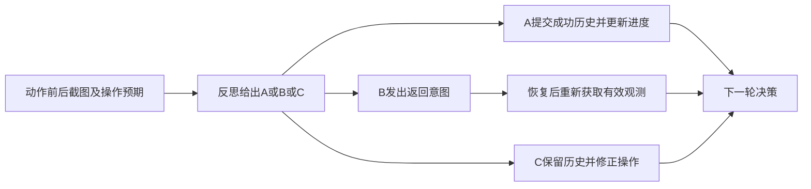

# MobileAgent多智能体协作

本文解析 **X-PLUG/MobileAgent 的 Mobile-Agent-v2 子目录**，固定提交 `11cea575561fb7800b5fb6b6cafa56f7a91de11f`，对应论文 `2406.01014v1`。仓库同时存在 v1、v3、v3.5、Mobile-Agent-E、PC-Agent 等目录，本文不把它们的模型、动作或记忆设计合并进 v2。这里的多智能体是多个有不同职责的提示与调用阶段，不能据此推断存在独立进程或并行策略训练。[Mobile-Agent-v2 架构原文](https://arxiv.org/html/2406.01014v1#S3)

完整教学示例：[mobile-agent.py](../../examples/agents/mobile-agent.py)。它只处理预先给定的框、文字和状态，不调用模型、ADB或真实应用。实践状态为已设计，任何状态转移结果都不是实机成功率。

## 学习目标

- 从截图工具、OCR、图标描述追踪到决策所用中心坐标，并说明感知误差如何传入动作。
- 区分任务进度、历史操作、页面事实记忆与错误标记，解释各自进入哪个提示。
- 根据 A/B/C 反思结果推导历史提交、回退与重试，检查恢复后观测是否仍有效。

## 前置知识

需要像素坐标、有限状态机、条件策略和基本工具调用。记截图为 $S_t$，感知列表为 $P_t$，任务进度为 $TP_t$，页面事实记忆为 $FC_t$，本轮动作 $O_t$，反思结果 $R_t$。这些是显式外部记录；本文不会把未观测的内部模型推理当作可验证事实。截图宽 W、高 H，横轴向右、纵轴向下，坐标单位为截图像素。

## 基本机制

公开执行链为 `run.py → get_perception_infos → get_action_prompt → inference_chat → controller动作 → 再截图 → get_reflect_prompt → 历史/进度更新`。v2 的 OCR 检测与识别由 ModelScope pipeline 提供，图标框来自 GroundingDINO，图标描述可走本地 Qwen-VL 或 DashScope；决策与反思调用和规划调用在主循环中分开。动作落地通过 ADB，而非某个 App 的业务接口。[v2 模型装配与主循环](https://github.com/X-PLUG/MobileAgent/blob/11cea575561fb7800b5fb6b6cafa56f7a91de11f/Mobile-Agent-v2/run.py#L257-L442)

角色边界是具体的数据依赖：决策需要当前屏幕、感知列表、历史、进度、记忆和上次错误；反思看动作前后两张图及动作预期；规划更新已完成内容。论文先描述规划为下一决策准备进度，代码则在本轮成功反思后更新，供下一轮使用。解释时应按轮次索引对应，不能仅按文字顺序判断执行矛盾。[v2 规划、决策和反思](https://arxiv.org/html/2406.01014v1#S3)

## 推导或示例

### 知识点一：感知框如何变成动作可用的坐标索引

**问题与机制。** OCR 给出的文字框和模型看到的截图如何对齐？论文定义 $P_t=VPM(S_t)$；该版本实现先 OCR 合并文本块，再检测图标、裁剪并描述，最后将边界框转为中心点。对框 $b=(x_1,y_1,x_2,y_2)$，

$$
c_x=\left\lfloor\frac{x_1+x_2}{2}\right\rfloor,\quad
c_y=\left\lfloor\frac{y_1+y_2}{2}\right\rfloor,\quad
0\le x_1<x_2\le W,\quad0\le y_1<y_2\le H.
$$

对非负坐标，Python `int` 与这里向下取整一致。文本合并并非语义模型：源码按 y/x 排序，对连续候选要求左边界差小于10像素、竖直间隔在[-10,30)像素、框高度差小于10像素。教学实现保留这些不对称边界，额外拒绝越界框。[文本框合并与感知信息构造](https://github.com/X-PLUG/MobileAgent/blob/11cea575561fb7800b5fb6b6cafa56f7a91de11f/Mobile-Agent-v2/run.py#L129-L232) [v2 视觉感知模块](https://arxiv.org/html/2406.01014v1#S3.SS1)

```python
def perception_index(text_boxes, icon_boxes, width, height):
    """按v2的几何阈值合并文本框，再把文本和图标描述转为中心坐标记录。"""
    if width <= 0 or height <= 0:
        raise ValueError("截图尺寸须为正")
    records = list(text_boxes) + list(icon_boxes)
    for item in records:
        x1, y1, x2, y2 = item['box']
        if not (0 <= x1 < x2 <= width and 0 <= y1 < y2 <= height):
            raise ValueError("边界框无效或越界")
    ordered = sorted(text_boxes, key=lambda item: (item['box'][1], item['box'][0]))
    used, merged = set(), []
    for i, first in enumerate(ordered):
        if i in used:
            continue
        chain, anchor = [first], first['box']
        for j in range(i + 1, len(ordered)):
            box = ordered[j]['box']
            if j not in used and abs(anchor[0] - box[0]) < 10 and -10 <= box[1] - anchor[3] < 30 and abs((anchor[3] - anchor[1]) - (box[3] - box[1])) < 10:
                chain.append(ordered[j]); used.add(j); anchor = box
        merged.append({'text': '\n'.join(item['text'] for item in chain),
                       'box': [min(item['box'][0] for item in chain), min(item['box'][1] for item in chain),
                               max(item['box'][2] for item in chain), max(item['box'][3] for item in chain)]})
    output = []
    for kind, items in [('text', merged), ('icon', icon_boxes)]:
        for item in items:
            x1, y1, x2, y2 = item['box']
            output.append({'text': kind + ': ' + item['text'],
                           'coordinates': [int((x1 + x2) / 2), int((y1 + y2) / 2)]})
    return output
```

两行“天气”“晴”的框分别为 `[10,10,50,30]` 与 `[12,35,52,55]`：左差2、竖直间隔5、高差0，满足合并；总框为 `[10,10,52,55]`，中心 `[31,32]`。若第二行 y1 改为60且高度仍20，间隔恰为30，不应合并。这种边界值能检验实际阈值，不能只用完全重合的框验证代码。

图标描述要与检测框通过稳定索引对应。源码用临时文件名中的索引恢复裁剪结果；教学函数直接接收已关联的 `icon_boxes`，省去图像识别和异步返回。感知文本为 `text:` 或 `icon:` 前缀加内容，最终坐标是绝对像素，不是归一化到1000的模型动作空间。把其他代际或 UI-TARS 的坐标协议直接拿来替换会产生尺度错配。



**源码定位与条件。** `get_perception_infos` 返回列表及截图尺寸；`get_action_prompt` 明确说明坐标方向，并提示感知信息不一定准确，要结合截图。[决策提示的坐标与感知约定](https://github.com/X-PLUG/MobileAgent/blob/11cea575561fb7800b5fb6b6cafa56f7a91de11f/Mobile-Agent-v2/MobileAgent/prompt.py#L1-L15) 这意味着感知列表不是可靠的控件树，也不能将所有文字都当作可点击控件。

**反例与限制。** 两列排版可能因左边界接近被误合并；文字框中心可能位于不可点击区域；图标裁剪内容也可能不足以识别功能。只保证框内中心不越界，并不能证明该点可执行。分辨率改变时固定像素阈值的相对尺度会变，不能将这段阈值算法描述成与设备分辨率无关。

### 知识点二：进度摘要、页面事实和操作历史各管什么

**问题与机制。** 为什么需要规划角色和记忆，不能只把所有截图放进对话？论文用 $TP_t=PA(Ins,O_{t-1},TP_{t-1},FC_{t-1})$ 表示任务进度更新，决策再结合任务进度与记忆选择动作。进度回答“已经完成什么”，事实记忆保存“稍后要用的具体内容”，历史则说明“怎样走到这里”。三种信息不可互相替代。[v2 记忆与规划角色](https://arxiv.org/html/2406.01014v1#S3.SS2)

为做确定性教学，设子目标 ID 集合为 G，人工标注的成功步骤为 H，完成集合为

$$
C(H)=\{g\in G:\exists h\in H, h.goal=g\land h.completes\},\quad U=G\setminus C(H).
$$

这个集合投影只用于检查账目，不是论文中 LLM 自动判断任务完成的算法。真实规划仍可能把一次尝试误总结为完成，必须保留底层证据。

```python
def planning_projection(goals, accepted_steps, memory):
    """用人工标注子目标演示进度与页面事实分离；不模拟LLM语义推理。"""
    if len(set(goals)) != len(goals):
        raise ValueError("子目标ID须唯一")
    completed = []
    for step in accepted_steps:
        goal = step['goal']
        if goal not in goals:
            raise ValueError("步骤关联了未知子目标")
        if step.get('completes_goal', False) and goal not in completed:
            completed.append(goal)
    return {'completed': completed, 'remaining': [g for g in goals if g not in completed],
            'accepted_operations': [s['operation'] for s in accepted_steps],
            'memory': deepcopy(memory)}
```

若任务是“查询天气并填写表单”，成功历史里只有读取天气一步，得到 `completed=[查询]`、`remaining=[填写]`，记忆保留“天气=晴”。仅保留“已查询天气”不足以填写具体内容；仅保留“晴”则不说明查询是否真的完成或来自哪一屏。函数显式要求 `completes_goal=True` 才更新完成集合，并保留全部已接受操作，便于核对错误归因。



**源码定位。** 该版本在成功分支调用 `get_process_prompt` 更新 `completed_requirements`，决策提示分别拼接 History、Progress、Memory 和错误时的 Last operation。[成功分支的进度更新](https://github.com/X-PLUG/MobileAgent/blob/11cea575561fb7800b5fb6b6cafa56f7a91de11f/Mobile-Agent-v2/run.py#L401-L417) [决策提示的四类历史字段](https://github.com/X-PLUG/MobileAgent/blob/11cea575561fb7800b5fb6b6cafa56f7a91de11f/Mobile-Agent-v2/MobileAgent/prompt.py#L33-L53) 值得精确区分的是：论文的规划公式包含记忆，当前 `get_process_prompt` 函数参数并不直接接收 `memory`；记忆在 `get_action_prompt` 进入决策。本文不把论文抽象中的每条边都硬说成该函数的实参。

**预算与反例。** 原代码仍遍历历史操作生成提示，因此有进度摘要不等于历史上下文被裁剪为常数大小。令保留成功步骤数为 n、每步文本平均 l 字，历史开销仍约为 $nl$，再叠加进度和记忆长度。页面事实可能过期，字符串“重复包含”检查也不是具有来源和版本的知识库去重。教学函数用字典便于观察，但原版 `memory` 是持续追加的文本，不要误称它拥有结构化事实冲突解决。

**调用链边界。** `inference_chat` 通过 HTTP messages 适配接口取 `choices[0].message.content`；主循环再按固定文本标记拆动作、操作摘要和完成内容。这不是强类型工具调用协议。模型输出偏离格式时，字符串 split 可能取到意料之外的字段；教学例子不生成自然语言响应，也不承担模型可靠性证明。[v2 inference_chat 接口](https://github.com/X-PLUG/MobileAgent/blob/11cea575561fb7800b5fb6b6cafa56f7a91de11f/Mobile-Agent-v2/MobileAgent/api.py#L9-L40)

### 知识点三：反思结果如何控制历史提交与恢复

**问题与机制。** 设备动作调用完成以后，为什么不能立即把它记成成功？v2 用动作前后屏幕判断预期是否达成，反思提示规定 A=达到预期、B=进入错误页面需回退、C=没有变化。对状态 $X=(H,TP,E)$，教学转移为

$$
F_A(X,O)=(H+[O],TP',false),\quad
F_B(X,O)=(H,TP,true;back),\quad
F_C(X,O)=(H,TP,true;revise).
$$

其中 $TP'$ 是成功后规划给出的新进度；分号后的项是待执行控制意图。B/C 不进入成功历史，避免把失败尝试当成已完成路径。[v2 反思与历史更新](https://arxiv.org/html/2406.01014v1#S3.SS5)

```python
def reflection_transition(state, verdict, operation, updated_progress=None):
    """演示A接受、B回退、C无效的状态更新；只返回待办指令而不操作设备。"""
    if verdict not in ('A', 'B', 'C'):
        raise ValueError("反思结果须为单个A、B或C")
    result = deepcopy(state)
    if verdict == 'A':
        if updated_progress is None:
            raise ValueError("接受操作后需要明确的进度更新结果")
        result['history'] = result.get('history', []) + [operation]
        result['progress'] = updated_progress
        result['error_flag'] = False
        result['next_control'] = 'DECIDE'
    elif verdict == 'B':
        result['error_flag'] = True
        result['next_control'] = 'BACK_THEN_OBSERVE'
    else:
        result['error_flag'] = True
        result['next_control'] = 'REVISE_ACTION'
    return result
```

空历史、进度“尚未完成”，若反思为 B，结果历史仍为空、error_flag为真、返回 `BACK_THEN_OBSERVE`；A 则必须给出新进度才允许提交。函数复制状态，原始输入不会被修改。它不判断截图，也不会按“图像发生变化”机械分类：进入错误联系人聊天页同样有显著变化，却应判B而非A。



**源码定位。** `get_reflect_prompt` 定义三种答案；`run.py` 在A分支追加历史，B分支设置错误标记并调用 `back`，C仅设置错误标记。[反思A/B/C语义](https://github.com/X-PLUG/MobileAgent/blob/11cea575561fb7800b5fb6b6cafa56f7a91de11f/Mobile-Agent-v2/MobileAgent/prompt.py#L110-L127) [反思结果的实际分支](https://github.com/X-PLUG/MobileAgent/blob/11cea575561fb7800b5fb6b6cafa56f7a91de11f/Mobile-Agent-v2/run.py#L388-L425) Android `back` 只是键事件，并不保证应用恢复到同一状态，更不是撤销业务写入的事务。[ADB back 与动作执行](https://github.com/X-PLUG/MobileAgent/blob/11cea575561fb7800b5fb6b6cafa56f7a91de11f/Mobile-Agent-v2/MobileAgent/controller.py#L23-L59)

**源码与教学差异。** 图中的“回退后重新观测”是显式建模的恢复要求：该版本 B 分支只调用 `back`，没有在该分支再次截图；下一轮不能被描述成必然已经拥有回退后的最新感知。教学返回待观测控制意图，正是为了暴露这一接口义务，而不是伪称原版已实现原子回滚。类似地，原代码用字符串包含判断 A/B/C，教学改为严格单值，避免任意说明文字误触发分支。

**停止与误报。** 代码的 Stop 由决策输出触发，在后续反思之前退出；因此“Agent停止”与“独立验证任务完成”是两件事。用户要求发送信息后看见文本留在输入框，不足以证明已发送；错误页上的相似控件也可能误导反思。真正验收要有独立可观察的成功条件，并记录操作是否可重复执行。

## 适用条件与限制

本页限定 v2 的 ADB 设备与截图路径。该目录文档注明支持 Android、Harmony OS不高于4的调试方式，不能据此推断其他目录或 iOS 支持。真实环境还依赖输入法、设备连接、截图尺寸、OCR/图标模型以及模型服务。当前接口实现没有在 HTTP 调用处给出明确超时预算，其重试循环不能被解释成有界任务执行器。[v2 平台和ADB准备说明](https://github.com/X-PLUG/MobileAgent/blob/11cea575561fb7800b5fb6b6cafa56f7a91de11f/Mobile-Agent-v2/README.md) [v2 HTTP请求与重试循环](https://github.com/X-PLUG/MobileAgent/blob/11cea575561fb7800b5fb6b6cafa56f7a91de11f/Mobile-Agent-v2/MobileAgent/api.py#L26-L38)

## 协议、依赖与许可边界

仓库根许可证是 MIT，复制或分发代码需保留相应版权与许可声明；这不自动授予 Qwen-VL、GroundingDINO、OCR权重或外部模型API的相同使用条件。依赖清单混合固定版本与未固定依赖，因此一个源码 SHA 也不等于完整可重现环境。本文没有安装第三方依赖、下载模型权重或连接设备。[MobileAgent MIT许可](https://github.com/X-PLUG/MobileAgent/blob/11cea575561fb7800b5fb6b6cafa56f7a91de11f/LICENSE) [v2 requirements清单](https://github.com/X-PLUG/MobileAgent/blob/11cea575561fb7800b5fb6b6cafa56f7a91de11f/Mobile-Agent-v2/requirements.txt)

## 从现场记录区分感知与决策问题

该版本还用一个具体启发式判断键盘：在屏幕底部约十分之一区域寻找包含“ADB Keyboard”的感知文字，再决定提示里是否允许 Type。它不是操作系统返回的通用键盘状态。输入法换名字、OCR漏字或屏幕旋转都可能改变判断，因此“模型没有选择输入”不能直接归因为规划能力不足；先看本轮传入的 keyboard 标记及其截图依据。[v2键盘判断与动作提示](https://github.com/X-PLUG/MobileAgent/blob/11cea575561fb7800b5fb6b6cafa56f7a91de11f/Mobile-Agent-v2/run.py#L293-L306)

记录设计上应把原图、感知列表、决策动作、控制器调用和反思结果分别保存。若感知正确而像素点击偏移，检查坐标来源；若动作达到局部预期但任务没有推进，检查预期和完成摘要。这样的分层记录是本页提出的排查方法，本组没有实际采集这些设备证据。

## 实践任务

交付几何阈值边界表、进度/事实记忆分离表、A/B/C状态转移表。再为“查询事实→跨应用填写”列出每一步截图、预期、动作、反思、恢复后观测和最终独立证据。教学函数由主 agent 常驻 UT 验证；OCR准确率、模型决策质量、回退后状态及最终真机完成率均尚未执行。

## 掌握标准

能指出中心点坐标来自哪张截图；能说明进度不替代事实、摘要不自动截断历史；能判定哪些反思结果允许追加成功历史；能识别回退后的旧感知和模型Stop的证据缺口。不得把顺利跑完一个模拟状态机报告为论文任务复现。

---

[返回模块](../modules/业务Agent.md) · [知识点索引](../../docs/知识点索引.md) · [完整教学代码](../../examples/agents/mobile-agent.py) · [提出更正](https://github.com/yanbozhang/llm-systems-wiki/issues/new?template=knowledge.yml)

觉得这篇推导有帮助，可以在 [GitHub](https://github.com/yanbozhang/llm-systems-wiki) 点 Star 收藏更新；分享时欢迎链接到具体知识点，便于读者复核公式、代码与来源。
