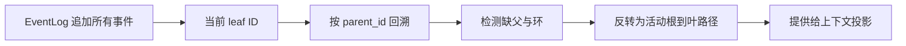
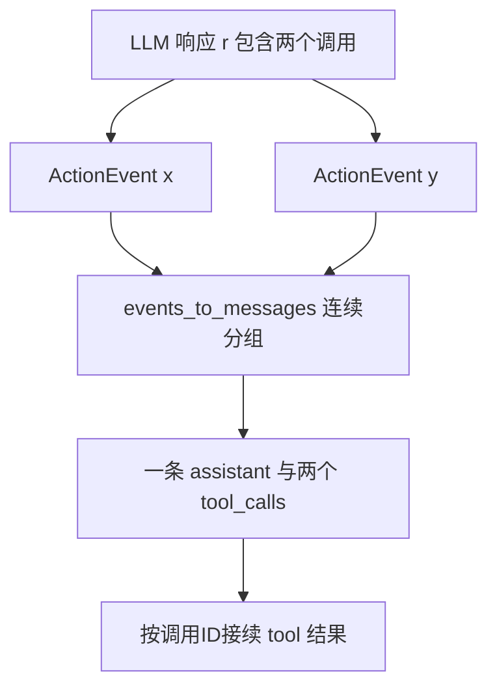
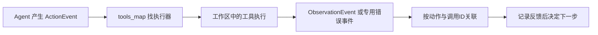

# OpenHands事件流与运行时

OpenHands把模型决策、工具执行、环境反馈和界面展示连接成可追踪事件流程。本页以当前社区代码为准：OpenHands/OpenHands是Agent Canvas，核心会话与事件接口在software-agent-sdk。论文提供设计背景，具体字段、分支与调用行为以固定提交源码为证。

## 学习目标

- 区分Canvas、SDK与托管服务的职责
- 推演事件分支和模型消息投影
- 核对动作与观察的关联契约

## 前置知识

需理解[Harness任务循环](Harness任务循环.md)、[工具协议与MCP及Skill](工具协议与MCP及Skill.md)、事件日志、树与工具调用ID。事件追加顺序、模型消息顺序和工具完成顺序不是同一概念。

## 基本机制

本次读取的Canvas提交为 `fee10e3d2909ebbf9950578575b1ee011492171e`，SDK为 `acd96e6fa424c02432304395b9208f99be24b54d`。Canvas负责界面、后端选择及本地编排；SDK/Agent Server负责agent、工具、workspace、会话和canonical API；托管Cloud是部署与产品层，不能从社区代码反推其全部内部实现。[Canvas Repository boundaries](https://github.com/OpenHands/OpenHands/blob/fee10e3d2909ebbf9950578575b1ee011492171e/README.md#L168)；[SDK Repository boundaries](https://github.com/OpenHands/software-agent-sdk/blob/acd96e6fa424c02432304395b9208f99be24b54d/README.md#L82).

界面读取事件也有专门API层。所读EventService使用typed client查询/统计事件与响应确认，说明UI显示某个事件不等于UI直接执行了工具。论文中的事件流原理延续到了这些接口，但旧目录、动作类名与当前SDK未必逐个相同。[Canvas EventService](https://github.com/OpenHands/OpenHands/blob/fee10e3d2909ebbf9950578575b1ee011492171e/src/api/event-service/event-service.api.ts#L39)

## 推导或示例

完整教学文件：[openhands.py](../../examples/agents/openhands.py)。每个函数对应下列一个知识点，只使用标准库与小型合成输入；教学计算不代表模型或服务实验。

### 知识点一：追加日志与活动会话分支是两种顺序

论文把历史描述为动作与观察的事件流；本次SDK源码已经支持带parent_id的事件树。必须同时区分持久化追加序号、事件唯一ID和当前分支。假设追加日志依次为root、a、old、new，而old与new的父节点都是a：选择new为活动叶子时，模型历史应为root→a→new，不能把old也拼入，否则旧分支的反馈会混入新尝试。

令父映射为 $p:E\to E\cup\{\varnothing\}$，当前头为 $h$，活动路径为反转后的 $[h,p(h),p^2(h),\ldots]$。遍历时维护visited，若再次遇到同一ID则父链有环；若父ID不存在则轨迹缺失。时间戳不参与父链判定，因为不同事件可能同时间、客户端时钟不一致或历史来自回放。

将上述计算或状态约束集中写为：

$$
\operatorname{path}(h)=\operatorname{reverse}\big(h,p(h),p^2(h),\ldots,p^k(h)\big),\quad p^{k+1}(h)=\varnothing.
$$

```python
def conversation_path(events, head_id):
    """沿显式parent_id回溯活动分支；教学中None代表根，不模拟旧日志回退。"""
    rows = list(events)
    index = {e["id"]: e for e in rows}
    if len(index) != len(rows):
        raise ValueError("事件ID必须唯一")
    chain, seen = [], set()
    current = head_id
    while current is not None:
        if current in seen:
            raise ValueError("事件父链有环")
        if current not in index:
            raise KeyError(current)
        seen.add(current)
        event = index[current]
        chain.append(deepcopy(event))
        current = event.get("parent_id")
    return list(reversed(chain))
```

建立字典需 $O(n)$，回溯分支长度 $d$需 $O(d)$，返回深拷贝避免修改原始事件。实际SDK `EventLog.path_to_root`已有ID索引，还可用limit只取末尾窗口；`append`在文件锁内检查重复ID和显式父存在，再写payload、索引和长度标记。纯函数只检查给定快照，不能替代跨线程/跨进程写入协议。



该版本还有历史兼容规则：旧事件parent为空时默认接到上一追加事件，显式根标记则表示真正的新根。教学中None一律当根，故不能不经适配地重放任意旧SDK日志。这种差别说明“字段为空”有版本语义，不应从通用树算法倒推生产迁移规则。事件模型冻结也不意味着所有嵌套对象天然深度不可变；读投影应避免改写来源对象。

[EventLog.path_to_root](https://github.com/OpenHands/software-agent-sdk/blob/acd96e6fa424c02432304395b9208f99be24b54d/openhands-sdk/openhands/sdk/conversation/event_store.py#L95)；[EventLog.append](https://github.com/OpenHands/software-agent-sdk/blob/acd96e6fa424c02432304395b9208f99be24b54d/openhands-sdk/openhands/sdk/conversation/event_store.py#L188)；[Event冻结字段](https://github.com/OpenHands/software-agent-sdk/blob/acd96e6fa424c02432304395b9208f99be24b54d/openhands-sdk/openhands/sdk/event/base.py#L20)；[OpenHands §2.1](https://arxiv.org/html/2407.16741v2).

### 知识点二：同一模型响应的多动作要还原成同一消息

事件粒度与模型API消息粒度不同。一次模型响应可能产生两个工具调用；运行时便于管理时把它们存成两个ActionEvent，但下一次调用模型时应还原成一个assistant消息中的两项tool_calls。否则把一个响应拆成两个独立assistant轮次，会改变原始交互协议。

设活动事件流为 $E$，投影为 $P(E)$。对同一响应 $r$的连续动作块 $A_r=[a_1,\ldots,a_k]$，投影保留一份共享文本与 $k$ 个工具调用：$P(A_r)=(\text{assistant},[call(a_1),\ldots,call(a_k)])$。动作事件数从 $k$变成一条模型消息，但调用数必须仍为 $k$，即工具调用计数守恒。

将上述计算或状态约束集中写为：

$$
P(A_r)=\big(\mathrm{assistant},[\operatorname{call}(a_1),\ldots,\operatorname{call}(a_k)]\big),\quad |\operatorname{tool\_calls}(P(A_r))|=k.
$$

```python
def project_action_batches(events):
    """仅将连续且同llm_response_id的动作合并成一个assistant工具调用消息。"""
    rows, messages = list(events), []
    i = 0
    while i < len(rows):
        event = rows[i]
        if event["kind"] != "action":
            messages.append(deepcopy(event))
            i += 1
            continue
        batch, j = [event], i + 1
        while j < len(rows) and rows[j]["kind"] == "action" and rows[j]["llm_response_id"] == event["llm_response_id"]:
            batch.append(rows[j])
            j += 1
        if any(e.get("text", "") for e in batch[1:]):
            raise ValueError("同响应批次只有首动作携带共享文本")
        call_ids = [e["tool_call_id"] for e in batch]
        if len(set(call_ids)) != len(call_ids):
            raise ValueError("同批工具调用ID不得重复")
        messages.append({"role": "assistant", "text": event.get("text", ""),
                         "action_ids": [e["id"] for e in batch], "tool_call_ids": call_ids})
        i = j
    return messages
```

demo的x/y共用响应r，输出一个assistant消息与调用cx/cy。若两个动作之间插入一次用户消息，函数不会跨过它合并，即便response_id相同；生产源码同样按连续块向前看。若后来动作也携带共享文本，示例报错，防止同一段内容被重复加入。时间 $O(n)$，返回空间与消息及调用数线性相关，原事件保持不变。



该版本 `events_to_messages`执行连续分组，`_combine_action_events`只取首动作的共享内容；普通用户消息还存在有限条件的合并，但工具结果带tool_call_id，不能按“都是文本”随意拼接。我们的非action事件直接拷贝，只是演示批次规则，不是完整LLM序列化器。多模态、工具拒绝、错误、上下文压缩等事件应由各自转换接口处理；完整事件日志也不等于每次都要送给模型的全部上下文。

[LLMConvertibleEvent.events_to_messages](https://github.com/OpenHands/software-agent-sdk/blob/acd96e6fa424c02432304395b9208f99be24b54d/openhands-sdk/openhands/sdk/event/base.py#L107)；[_combine_action_events](https://github.com/OpenHands/software-agent-sdk/blob/acd96e6fa424c02432304395b9208f99be24b54d/openhands-sdk/openhands/sdk/event/base.py#L176)；[ActionEvent调用身份](https://github.com/OpenHands/software-agent-sdk/blob/acd96e6fa424c02432304395b9208f99be24b54d/openhands-sdk/openhands/sdk/event/llm_convertible/action.py#L40)；[SDK接口边界](https://github.com/OpenHands/software-agent-sdk/blob/acd96e6fa424c02432304395b9208f99be24b54d/README.md#L82)；[OpenHands §2.1](https://arxiv.org/html/2407.16741v2).

### 知识点三：动作、执行与观察靠三项身份连接

ActionEvent保存模型提出的结构化动作，执行器执行后产生ObservationEvent。动作本身既不是成功证明，也不保证已经执行；例如等待确认时动作已经出现，但尚无工具结果。普通观察同时携带action_id指向事件、tool_call_id连接模型调用、tool_name说明执行器。

对普通观察 $o$，约束为存在唯一动作 $a$，满足 $o.action\_id=a.id$、$o.tool\_call\_id=a.tool\_call\_id$和工具名相同。记动作集合为 $A$、已收到正常观察的动作ID集合为 $O$，待结果集合是 $A\setminus O$。结果可以乱序到达，关联按ID完成，不能把第一个观察机械配给第一个动作。

将上述计算或状态约束集中写为：

$$
\forall o,\ \exists! a:\ (o.\mathrm{action\_id},o.\mathrm{tool\_call\_id},o.\mathrm{tool\_name})=(a.\mathrm{id},a.\mathrm{tool\_call\_id},a.\mathrm{tool\_name}),\quad A_{pending}=A\setminus O.
$$

```python
def observation_links(actions, observations):
    """验证普通ObservationEvent三项关联，返回仍待结果的动作；配对不等于业务成功。"""
    rows = list(actions)
    index = {a["id"]: a for a in rows}
    if len(index) != len(rows) or len({a["tool_call_id"] for a in rows}) != len(rows):
        raise ValueError("动作ID和调用ID必须唯一")
    observed = set()
    for obs in observations:
        action_id = obs["action_id"]
        if action_id not in index:
            raise ValueError("观察引用不存在的动作")
        action = index[action_id]
        if obs["tool_call_id"] != action["tool_call_id"] or obs["tool_name"] != action["tool_name"]:
            raise ValueError("观察与动作的工具或调用ID不一致")
        if action_id in observed:
            raise ValueError("教学轨迹每个动作只允许一个最终观察")
        observed.add(action_id)
    return {"observed": sorted(observed), "pending": sorted(index.keys() - observed)}
```

demo先收到y的结果，则pending应只有x。未知action、错调用ID、错工具名或重复最终观察都会被拒绝。预索引与扫描期望为 $O(|A|+|O|)$，输出排序另计。示例把每个动作限制为一个最终普通观察，实际系统可有流式事件、错误事件或拒绝事件，不能用这一函数把它们全部判为无效。



该版 `_execute_action_event`从tools_map取执行器，要求返回Observation，再封装三项身份；ValueError会转为AgentErrorEvent，供智能体纠正参数。它说明错误也是反馈，但并未把所有异常都统一吞掉。工具运行在线程中时，事件由调用者按序发出，工具自身的共享文件安全仍需工具实现负责。

`LocalConversation.run`区分RUNNING、WAITING_FOR_CONFIRMATION、PAUSED、FINISHED等状态；有观察也不能自动将任务设为FINISHED，因为编辑成功可能仍需验证结果。当前SDK可用本地或远端workspace，早期论文描述的逐任务Docker运行时不构成今天所有入口的隔离保证。教学只审计数据，不执行真实shell、文件编辑或模型调用。

[Agent._execute_action_event](https://github.com/OpenHands/software-agent-sdk/blob/acd96e6fa424c02432304395b9208f99be24b54d/openhands-sdk/openhands/sdk/agent/agent.py#L1495)；[ObservationEvent](https://github.com/OpenHands/software-agent-sdk/blob/acd96e6fa424c02432304395b9208f99be24b54d/openhands-sdk/openhands/sdk/event/llm_convertible/observation.py#L32)；[LocalConversation.run](https://github.com/OpenHands/software-agent-sdk/blob/acd96e6fa424c02432304395b9208f99be24b54d/openhands-sdk/openhands/sdk/conversation/impl/local_conversation.py#L1959)；[workspace与Agent Server](https://github.com/OpenHands/software-agent-sdk/blob/acd96e6fa424c02432304395b9208f99be24b54d/README.md#L28)；[OpenHands §2.2](https://arxiv.org/html/2407.16741v2).

## 适用条件与限制

示例只处理合成字典，不实现完整SDKschema、存储锁、状态持久化、分支导航的文件快照或远程重连。事件回放复原决策输入，也不保证重放工具具有幂等副作用；同一shell动作重放可能第二次产生不同结果。

常见误区是用聊天显示文本代替原事件，按时间戳猜父子关系，或把“支持Docker”说成所有入口天然隔离。应逐层核对真实workspace与运行模式。

## 实践任务

构造一段含两个分支的事件日志、同响应两个工具调用与乱序观察。计算活动路径和消息投影，确认调用数守恒；再注入缺父、循环、重复调用和错action_id，说明各自违反哪个契约。最后写一张Canvas→typed client→Agent Server→SDK工具→workspace的职责表。

本页完整实践保持 `designed`。示例测试由统一 UT 流程记录，本页不宣称已测试或论文复现。

## 掌握标准

能用父链排除非活动分支；能解释两个ActionEvent为何可对应一条assistant消息；能从ID检查观察与动作配对，同时明确配对不是任务成功。完整代码任务评测还需要冻结任务、补丁、环境和验证结果，本页未运行模型或真实任务。

## 源码导读与失效边界

分支事件并不是文件系统快照。若从旧事件fork继续，工作区是否恢复到对应文件状态需要另外的workspace或版本控制机制；仅把模型历史切回旧分支，不会自动撤销已经落盘的文件改动。这个区别可用一个反例说明：旧分支把变量改名，新分支的模型上下文仍以旧变量名为准，但真实文件已是新名字，随后SEARCH匹配就可能失败。事件闭包完整并不意味着环境状态一致。

多动作批次也不是事务。两个工具即使源自同一模型响应，一个成功、另一个失败时，不能默认第一个动作被回滚。轨迹应保留各自观察，并让下一步根据实际环境继续。多个工具并行修改同一文件时，ID关联只能告诉我们谁返回了什么，不能修复写冲突。代码中执行函数将共享会话状态转移留给调用者，也明确把工具内部线程安全留给工具实现。

当前事件基类拒绝额外字段并使用冻结模型，但历史兼容、插件和新增事件类型仍可能改变序列化。应记录来源提交及读取schema，不能把本页简化字典当作SDK兼容库。所有示例刻意不包含真实凭证、用户文件操作或网络请求；它们验证的是算法与事件契约，不能作为OpenHands在真实仓库任务上的成功率证据。
[日志与活动父链](https://github.com/OpenHands/software-agent-sdk/blob/acd96e6fa424c02432304395b9208f99be24b54d/openhands-sdk/openhands/sdk/conversation/event_store.py#L95)；[执行器职责说明](https://github.com/OpenHands/software-agent-sdk/blob/acd96e6fa424c02432304395b9208f99be24b54d/openhands-sdk/openhands/sdk/agent/agent.py#L1495)；[Canvas部署入口与职责](https://github.com/OpenHands/OpenHands/blob/fee10e3d2909ebbf9950578575b1ee011492171e/README.md).

---

[返回模块](../modules/业务Agent.md) · [知识点索引](../../docs/知识点索引.md) · [完整教学代码](../../examples/agents/openhands.py) · [提出更正](https://github.com/yanbozhang/llm-systems-wiki/issues/new?template=knowledge.yml)

觉得这篇推导有帮助，可以在 [GitHub](https://github.com/yanbozhang/llm-systems-wiki) 点 Star 收藏更新；分享时欢迎链接到具体知识点，便于读者复核公式、代码与来源。
