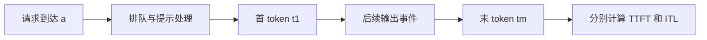
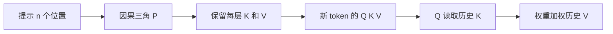
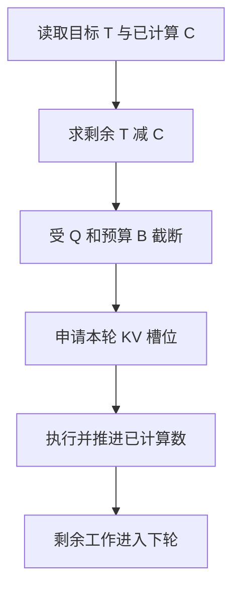

# Prefill与Decode

同一个生成请求通常包含处理提示的 Prefill 与逐 token 推进的 Decode。本页把两者落到三组可检查对象：客户端时间戳、注意力位置对和调度器计数。理解它们如何对应，才能解释首 token 等待、持续输出速度与系统吞吐为何可能朝不同方向变化。

## 学习目标

- 分解请求时间线
- 计算TTFT和逐token延迟
- 定位吞吐与长尾矛盾

## 前置知识

需理解自回归生成、因果 mask 与 KV 缓存。时间均用秒，长度用 token，FLOP 是运算量而不是秒。前置阅读：[Transformer与自回归生成](Transformer与自回归生成.md)。

## 基本机制

Prefill 同时处理多个提示位置并建立各层缓存，最后位置的 logits 可用于产生首个输出；Decode 输入刚产生但尚未 forward 的 token，追加其 K/V 并预测下一个。前端看的是输出事件，缓存管理看的是已完成计算的位置，两者自然相差一步。[Transformers 缓存文档](https://huggingface.co/docs/transformers/en/cache_explanation)与[PagedAttention §4.3](https://arxiv.org/html/2309.06180v1)共同给出这一数据流。

吞吐需要另选观测窗口：窗口内输出 token 数除以秒是输出吞吐，完成请求数除以秒是请求吞吐。长提示短输出和短提示长输出在这两个指标上可有相同平均值，却给缓存、排队和计算带来完全不同的压力。

## 推导或示例

完整教学文件：[prefill-decode.py](../../examples/inference/prefill-decode.py)。每个函数对应下列一个知识点，只使用标准库与小型合成输入；教学计算不代表模型或服务实验。

### 知识点一：首 token、逐 token 与请求计时边界

请求到达、进入计算、提示处理完成、首 token 传回、末 token 传回不是同一事件。设到达时刻为 $a$，第 $j$ 个输出的客户端时刻为 $t_j$，总输出数为 $m$，所有时间单位为秒：

$$\mathrm{TTFT}=t_1-a,\quad \mathrm{E2E}=t_m-a,\quad \mathrm{ITL}_j=t_j-t_{j-1},\quad \mathrm{TPOT}=\frac{t_m-t_1}{m-1}\;(m>1).$$

TTFT 可分成排队、提示计算和传输等可观测部分，但跨进程时钟未同步时，不能直接拿服务端绝对时间减客户端绝对时间。末 token 的到达也不等于连接关闭时间。上式分母是 $m-1$，因为首 token 已经在 Prefill 末端产生；把它再平均一次会系统性压低后续间隔。

输入 `[0.8,0.9,1.0,1.1,1.2]` 和 $a=0$，得到 TTFT=0.8秒、E2E=1.2秒、TPOT=0.1秒。把中间时间改成 `[0.8,0.81,0.82,0.83,1.2]`，TPOT不变，最长 ITL 却由0.1秒增到0.37秒。这解释了均值相同而体验不同的情况。计算是教学算例，不是引擎实测。

```python
def request_metrics(arrival, token_times):
    """输入秒级到达时间和逐 token 时间，返回延迟与间隔；单 token 的 TPOT 为 None。"""
    times = list(token_times)
    if not math.isfinite(arrival) or not times:
        raise ValueError("需要有限的到达时间和至少一个输出事件")
    if any(not math.isfinite(t) for t in times) or times[0] < arrival:
        raise ValueError("时间无效或输出早于到达")
    if any(b < a for a, b in zip(times, times[1:])):
        raise ValueError("输出事件必须按时间排列")
    intervals = [b - a for a, b in zip(times, times[1:])]
    return {"ttft_s": times[0] - arrival, "e2e_s": times[-1] - arrival,
            "itl_s": intervals,
            "tpot_s": sum(intervals) / len(intervals) if intervals else None}
```

函数先校验事件的有限性和顺序，再相邻相减，时间与空间复杂度均为 $O(m)$。输出保留所有 ITL，便于后续统计分位数；单 token 输出 `None` 表示没有间隔，空输出则属于失败或尚未结束，需要上层分类。



该版本源码显示，`calculate_metrics` 对 $m>1$ 使用上述公式；对 $m\le1$ 不加入 TPOT 分布，却为 goodput 判定填入0。这是评测程序的约定，不能解读成物理上存在“零延迟解码”。如果流协议把多个 token 合为一个块，块间隔也不能直接充当 ITL。

[vLLM calculate_metrics](https://github.com/vllm-project/vllm/blob/7a64fb8fc9239cb65e0df9313fa759594dfb206a/vllm/benchmarks/serve.py#L602)；[PagedAttention §4.3](https://arxiv.org/html/2309.06180v1)；[vLLM 分块 Prefill 文档](https://github.com/vllm-project/vllm/blob/7a64fb8fc9239cb65e0df9313fa759594dfb206a/docs/configuration/optimization.md#L49).

### 知识点二：缓存改变了每步要计算哪些位置

设提示长 $n$，已有提示的 K/V 均缓存。一次 Prefill 中第 $i$ 个位置只允许看前 $i$ 个位置，所以有效因果位置对数为 $P=n(n+1)/2$。Prefill 预测首个输出之后，再处理 $k$ 个新 token，需要访问的历史位置数为 $n+1,n+2,\ldots,n+k$，总数为：

$$D=\sum_{j=1}^{k}(n+j)=kn+\frac{k(k+1)}2.$$

这里 $k$ 是实际额外 forward 步数；如果总共只想输出 $m$ 个 token，且 Prefill 已给出第一个，普通单步解码通常取 $k=m-1$。不能把提示长、已输出长和已缓存长混成一个计数。缓存避免重算过去位置的投影及隐藏状态，但新 Q 仍须读取历史 K，并用注意力权重加权历史 V。

设查询头数为 $H_q$，每头维度 $d$，乘加计2 FLOP，QK和AV各贡献约 $2H_qd$ FLOP/位置对，因此理想有效注意力工作量为 $4H_qd(P+D)$。这是带因果三角裁剪的算法量；某个 eager 内核仍可能做被 mask 的方阵乘法，FlashAttention 也有分块填充，不能拿有效位置对推断精确GPU指令数。

```python
def attention_work(prompt_tokens, decode_steps, heads=1, head_dim=1):
    """统计有效因果位置对与 QK/AV 理想 FLOP，不把它当作硬件耗时。"""
    if any(not isinstance(x, int) or isinstance(x, bool) for x in
           (prompt_tokens, decode_steps, heads, head_dim)):
        raise ValueError("长度和维度必须是整数")
    if prompt_tokens < 1 or decode_steps < 0 or heads < 1 or head_dim < 1:
        raise ValueError("提示和维度须为正，解码步数须非负")
    prefill = prompt_tokens * (prompt_tokens + 1) // 2
    decode = decode_steps * prompt_tokens + decode_steps * (decode_steps + 1) // 2
    return {"prefill_pairs": prefill, "decode_pairs": decode,
            "attention_flops": 4 * heads * head_dim * (prefill + decode)}
```

当 $n=4,k=2,H_q=2,d=8$，Prefill有10对，Decode有5+6=11对，理想注意力总量1344 FLOP。函数只做闭式计数，时间和空间是 $O(1)$；它没有执行 attention，也没有模拟设备吞吐。生产实现还包含投影、MLP、通信、权重读取及采样。尤其小 batch Decode 常受带宽约束，FLOP下降比例不等于延迟下降比例。



该版本 `LlamaAttention.forward` 先投影与应用位置编码，再调用 `past_key_values.update`，随后交给 attention 后端；`eager_attention_forward` 明确执行 QK、softmax、AV。GQA的缓存头数是 $H_{kv}$，但参与点积的查询头数仍是 $H_q$，不能把二者都替换为同一个较小头数。滑动窗口或稀疏注意力会改变可见位置集合，需重新计数。

[Transformers LlamaAttention.forward](https://github.com/huggingface/transformers/blob/50e35cc0ca18ec19b80653690de553e6decf74f5/src/transformers/models/llama/modeling_llama.py#L232)；[Transformers 缓存机制](https://huggingface.co/docs/transformers/en/cache_explanation)；[PagedAttention 背景与解码流程](https://arxiv.org/html/2309.06180v1).

### 知识点三：分块 Prefill 是受预算约束的状态推进

只有区分“想计算多少”和“本轮能计算多少”，才能解释长提示为何跨多个迭代。教学模型为请求 $i$ 保存目标数 $T_i$、已计算数 $C_i$、分块上限 $Q$，调度器维护本轮剩余 token 预算 $B$：

$$\Delta_i=\min(T_i-C_i,Q,B),\qquad C_i'=C_i+\Delta_i,\quad B'=B-\Delta_i.$$

不变量是 $0\le C_i'\le T_i$、$B'\ge0$，且一轮所有 $\Delta_i$ 之和不超过初始预算。Decode 已缓存100个位置但还有1个已采样 token 未 forward 时，可写成 $(T,C)=(101,100)$；新提示12个 token 则是 $(12,0)$。按前者优先、预算5、分块4，本轮分配1与4，提示还剩8个位置，下轮继续。

```python
def schedule_tokens(requests, budget, chunk_limit):
    """按传入顺序分配一轮 token 预算；每项为 (请求ID, 目标数, 已计算数)。"""
    if not isinstance(budget, int) or not isinstance(chunk_limit, int) or budget < 0 or chunk_limit < 1:
        raise ValueError("预算须非负，分块上限须为正整数")
    rows = list(requests)
    if len({r[0] for r in rows}) != len(rows):
        raise ValueError("请求ID必须唯一")
    for _, target, computed in rows:
        if not isinstance(target, int) or not isinstance(computed, int) or not 0 <= computed <= target:
            raise ValueError("需满足 0 <= 已计算数 <= 目标数")
    result = []
    for rid, target, computed in rows:
        assigned = min(target - computed, chunk_limit, budget)
        result.append({"id": rid, "scheduled": assigned, "computed_after": computed + assigned})
        budget -= assigned
    return {"requests": result, "remaining_budget": budget}
```

先校验全部请求，再按显式传入顺序分配，避免半途报错时混淆有效状态；函数返回新计数而不修改输入。这里的列表顺序就是策略，没有声称实现自动公平调度。扫描 $r$ 个请求需要 $O(r)$ 时间和返回空间。若持续到达的 Decode 已耗完预算，Prefill 可长期得不到服务；要改善公平性，还需等待年龄、配额或准入策略。



图中的 KV 申请是生产必需步骤，教学函数假设它总能成功。该版本源码显示 `Scheduler.schedule` 统一用 `num_tokens_with_spec` 与 `num_computed_tokens` 的差值推进；真实逻辑还计入输出占位、推测解码、模型最大长和编码器预算。因而“先 Decode 后 Prefill”适合解释常见策略，不能取代具体源码路径。官方分块文档说明其延迟/吞吐取舍，论文则提供按迭代调度的背景；不能把某一预算值写成所有硬件的最优配置。

[vLLM Scheduler.schedule](https://github.com/vllm-project/vllm/blob/7a64fb8fc9239cb65e0df9313fa759594dfb206a/vllm/v1/core/sched/scheduler.py#L677)；[vLLM Chunked Prefill](https://github.com/vllm-project/vllm/blob/7a64fb8fc9239cb65e0df9313fa759594dfb206a/docs/configuration/optimization.md#L49)；[PagedAttention §4.3、§4.5](https://arxiv.org/html/2309.06180v1).

## 适用条件与限制

这三种教学模型均假定标准因果生成。分离 Prefill/Decode 的部署还引入KV传输；推测解码可能一次处理多个候选token；客户端缓冲会改变可观察事件粒度。计算瓶颈必须在固定模型、长度分布和硬件下定位，不从“Prefill算力密集、Decode带宽密集”的常用近似直接推导普遍结论。

常见误区是把每轮批量token数当作请求数，或将前缀缓存命中后的TTFT与冷缓存请求混报。前者掩盖工作量，后者把状态差异当成引擎收益。

## 实践任务

为两个请求记录到达、首token、后续token与完成时间，手算TTFT、ITL及两种吞吐。再用预算5、分块4推演长提示12与正在Decode的请求至少五轮，并在每轮补上新采样token。分别构造单token输出、块级流式输出和持续Decode挤占Prefill三个反例，注明哪项观测或假设失效。

本页完整实践保持 `designed`。示例测试由统一 UT 流程记录，本页不宣称已测试或论文复现。

## 掌握标准

能解释首token来自哪个forward；能在有效位置对与实际内核计算量之间划清边界；能从目标/已计算计数推演调度，而不把输出数直接当缓存长。答案应明确 $m=1$ 时TPOT未定义、预算守恒、缓存节省不等于无历史读取。

进阶练习：两系统平均TPOT都是0.1秒，为什么聊天体验仍不同？答案要点：检查最长间隔与p95、TTFT、错误率、实际流式缓冲、冷暖缓存，以及是否在相同到达率下测量。


## 源码导读与边界推演

再做一个跨请求手算，检验“平均”究竟平均了什么。请求A在0秒到达，0.8秒首token、1.2秒末token，共5个输出；请求B在0.2秒到达，1秒首token、1.5秒末token，共3个输出。两者TTFT都是0.8秒，但A的TPOT为0.1秒、B为0.25秒。以请求为单位的平均TPOT为0.175秒；把全部后续间隔合在一起，则是 $(0.4+0.5)/(4+2)=0.15$ 秒。后者给予输出更长的请求更大权重，不能以为两种平均互相矛盾。

若观察窗口固定为0至1.5秒，完整计入这两请求，则输出吞吐为 $8/1.5$ token/秒，完成请求吞吐为 $2/1.5$ 请求/秒。把窗口改为仅观察A活跃期间而仍把B全部输出计入，会造成边界不一致。实际统计需在窗口内按事件计数，或明确按某批请求从开始到排空计数。客户端有重试时，还要说明分母是逻辑请求还是实际尝试，否则重试可能把负载放大却被隐藏。

算法工作量也不能独自决定运行时间。可用教学下界 $t\ge\max(F/P,M/\beta)$ 理解瓶颈：$F$是FLOP，$P$是有效FLOP/秒，$M$是需要移动的字节，$\beta$是有效字节/秒。Prefill把多位置组织成矩阵计算，可能更充分利用算力；Decode即使只有少量FLOP，仍可能读取大批权重与KV。这个式子忽略通信、启动和排队，只是下界，不是对真实GPU时间的预测器。batch扩大还会同时改变有效算力和每请求分摊的权重读取，不能保持两个参数不变外推。

最后回看调度器计数。提示长度12、分块4时，已计算计数从0到4到8到12。在最后提示块执行完并采样后，目标数才可能增加到13；随后Decode把刚采样位置写入KV。若测试仅重复调用同一组目标与计数而不注入采样事件，最终停止是合理的，不能据此判定调度器丢失请求。反过来，异步模式若把尚在飞行的输出提前计为完成，就可能重复调度或越过最大长度；生产代码中的placeholder与stale output状态正是这种并发边界的额外账本。

[计时与聚合实现](https://github.com/vllm-project/vllm/blob/7a64fb8fc9239cb65e0df9313fa759594dfb206a/vllm/benchmarks/serve.py#L602)；[目标计数与占位状态](https://github.com/vllm-project/vllm/blob/7a64fb8fc9239cb65e0df9313fa759594dfb206a/vllm/v1/core/sched/scheduler.py#L817)；[算法与批处理背景](https://arxiv.org/html/2309.06180v1).

---

[返回模块](../modules/推理.md) · [知识点索引](../../docs/知识点索引.md) · [完整教学代码](../../examples/inference/prefill-decode.py) · [提出更正](https://github.com/yanbozhang/llm-systems-wiki/issues/new?template=knowledge.yml)

觉得这篇推导有帮助，可以在 [GitHub](https://github.com/yanbozhang/llm-systems-wiki) 点 Star 收藏更新；分享时欢迎链接到具体知识点，便于读者复核公式、代码与来源。
