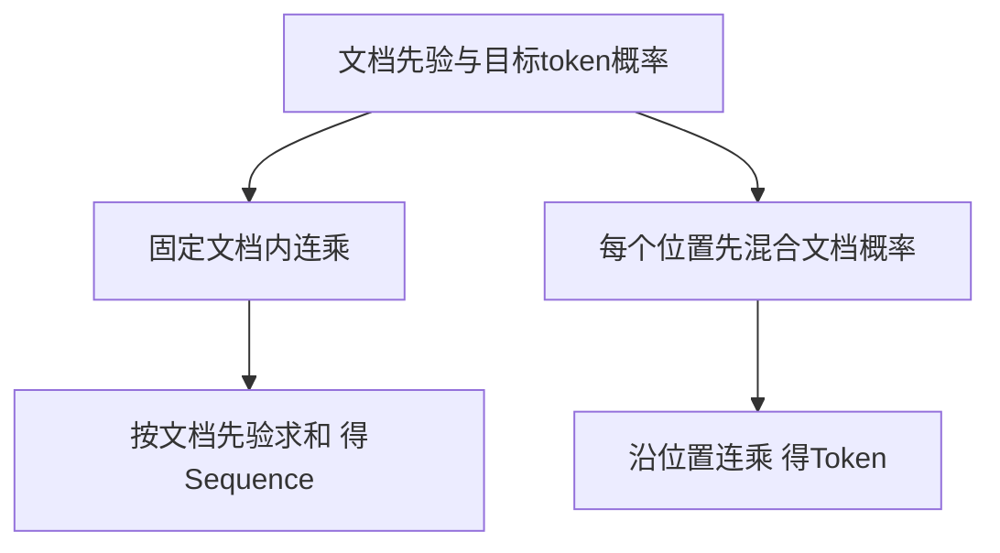
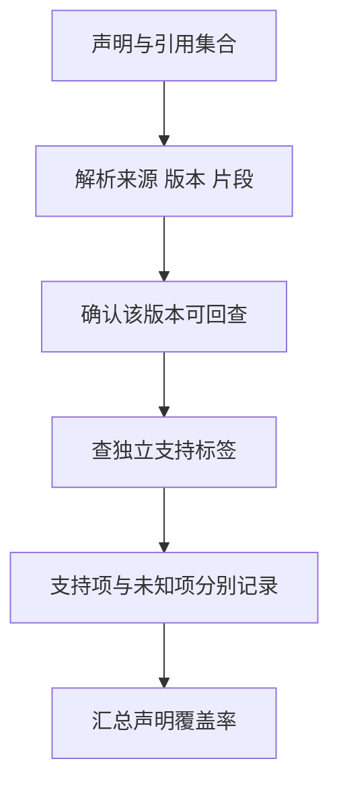

# RAG与引用回答

RAG把外部资料引入生成过程，但检索到相关文本、把文本放进上下文、生成有证据支持的回答是三件事。本页从原论文概率模型出发，逐层建立候选、预算和引用的可回查边界。

## 学习目标

- 拆分检索和回答误差
- 建立可回查引用
- 设计无答案场景

## 前置知识

需理解概率连乘/求和、向量检索及[上下文选择与压缩](上下文选择与压缩.md)。来源URL、来源版本和片段位置是不同标识。

## 基本机制

原RAG通过检索分布和条件生成分布对潜在文档边缘化；工程RAG还常使用召回、重排、上下文拼接及引用回查流水线。[RAG Methods](https://arxiv.org/html/2005.11401v4)给出前者，[GraphRAG Local Search](https://github.com/microsoft/graphrag/blob/c600ff80b77b9b62c47d539a3ac9569e95d8949b/docs/query/local_search.md)展示后者的结构化上下文组织。

逐阶段保留查询、候选ID、版本、分数、实际选中片段和声明引用映射，才能区分没检到、检到没放入、放入却解释错误。Recall只衡量候选集合覆盖，不能替代最终答案判断。

## 推导或示例

完整教学文件：[rag.py](../../examples/knowledge/rag.py)。每个函数对应下列一个知识点，只使用标准库与小型合成输入；教学计算不代表模型或服务实验。

### 知识点一：检索文档是潜变量，求和与求积不能交换

原论文中的RAG不是仅把搜索结果复制到prompt。令查询为 $x$，候选文档为 $z$，目标序列为 $y_1,\ldots,y_m$；检索器给文档先验 $p_\eta(z\mid x)$，生成器给条件概率 $p_\theta(y_j\mid x,z,y_{<j})$。论文用top-k文档近似边缘化：

$$P_{seq}(y\mid x)\approx\sum_z p_\eta(z\mid x)\prod_jp_\theta(y_j\mid x,z,y_{<j}),$$
$$P_{tok}(y\mid x)\approx\prod_j\sum_zp_\eta(z\mid x)p_\theta(y_j\mid x,z,y_{<j}).$$

Sequence为完整序列共享同一个潜在文档；Token允许每个位置从不同潜在文档得到贡献。检索先验来自查询/文档表示的点积softmax，分数是模型分布，不等于证据可靠性。本例在已选文档上要求先验归一，明确采用截断后归一化的教学约定。

```python
def rag_marginals(doc_probs, token_probs):
    """小规模已知目标序列概率：对比先乘后和的Sequence与先和后乘的Token。"""
    priors = list(doc_probs)
    rows = [list(r) for r in token_probs]
    if not priors or len(priors) != len(rows) or not rows[0] or any(len(r) != len(rows[0]) for r in rows):
        raise ValueError("每份文档须有相同长度的非空token概率")
    if any(not math.isfinite(p) or not 0 <= p <= 1 for p in priors + [p for r in rows for p in r]):
        raise ValueError("概率须在 [0,1] 内")
    if not math.isclose(sum(priors), 1.0):
        raise ValueError("文档先验之和须为1")
    sequence = sum(p * math.prod(r) for p, r in zip(priors, rows))
    per_token = [sum(p * r[j] for p, r in zip(priors, rows)) for j in range(len(rows[0]))]
    return {"sequence_probability": sequence, "token_probability": math.prod(per_token),
            "per_token_probabilities": per_token}
```

两文档先验 `[0.6,0.4]`，对两个目标token的条件概率分别 `[0.9,0.1]` 与 `[0.2,0.8]`：Sequence为 $0.6\times0.9\times0.1+0.4\times0.2\times0.8=0.118$；Token为 $(0.54+0.08)(0.06+0.32)=0.2356$。第二式包含跨文档贡献，不能把两者混称同一个概率。长度1时两式相等，提供边界检查。



复杂度 $O(km)$，空间由输入概率表与 $m$ 个中间值决定。长序列直接连乘会下溢，真实实现用log-softmax与logsumexp；该版本 `get_nll`在token维累加后对文档logsumexp，`marginalize`则先沿文档维logsumexp。现代检索上下文拼接方案未必训练这一潜变量模型，引用原RAG论文时要说明借用了哪层思想，而非把所有工程RAG写成同一目标函数。

[Transformers RAG-Sequence get_nll](https://github.com/huggingface/transformers/blob/50e35cc0ca18ec19b80653690de553e6decf74f5/src/transformers/models/rag/modeling_rag.py#L1028)；[RAG-Token marginalize](https://github.com/huggingface/transformers/blob/50e35cc0ca18ec19b80653690de553e6decf74f5/src/transformers/models/rag/modeling_rag.py#L1216)；[RAG §2.1–2.2](https://arxiv.org/html/2005.11401v4).

### 知识点二：召回集合不等于实际进入上下文的证据

设上下文窗口 $W$ token，固定模板与查询开销 $F$，预留输出 $O$，证据预算 $B=W-F-O$。候选片段 $i$ 的最终序列化成本为 $c_i$，选择变量 $s_i\in\{0,1\}$，必须满足 $\sum_i s_ic_i\le B$。相关性排序只确定考虑顺序，不能让预算约束消失。

教学窗口10、固定2、输出2，证据预算6。片段A成本4、B成本3，按A优先只能放A；如果问题必须同时依赖A与B，虽然Recall@2=1，实际回答证据仍不完整。直接把原文截成剩余2token可能删掉否定条件或单位，因此这里选择整段放入或跳过。

将上述计算或状态约束集中写为：

$$
B=W-F-O,\qquad s_i\in\{0,1\},\qquad \sum_i s_ic_i\le B.
$$

```python
def select_context(chunks, window_tokens, fixed_tokens, output_reserve):
    """按既定相关性顺序选完整片段，跳过过长项；身份含source/version/chunk。"""
    if any(type(x) is not int or x < 0 for x in (window_tokens, fixed_tokens, output_reserve)):
        raise ValueError("预算须为非负整数")
    budget = window_tokens - fixed_tokens - output_reserve
    if budget < 0:
        raise ValueError("固定开销和输出预算已超过窗口")
    picked, skipped, seen = [], [], set()
    for chunk in chunks:
        key = (chunk["source"], chunk["version"], chunk["chunk"])
        if key in seen:
            continue
        seen.add(key)
        cost = chunk["tokens"]
        if type(cost) is not int or cost < 1:
            raise ValueError("片段含包装后的token数须为正整数")
        if cost <= budget:
            picked.append(dict(chunk))
            budget -= cost
        else:
            skipped.append(key)
    return {"selected": picked, "skipped": skipped, "remaining_tokens": budget}
```

函数先扣除全局开销，再按 `(source,version,chunk)` 去重并保留输入顺序。过长片段被记录为skipped，后续较短片段仍有机会进入；这是明确的教学策略，不保证最大相关性总和，更不保证满足所有论证依赖。遍历 $n$ 个候选是期望 $O(n)$ 时间、$O(n)$额外空间，set身份比较按固定长度处理。


该版本LightRAG `_build_context_str`先计系统模板、图上下文和query，再扣reference buffer；随后调用片段处理器并生成引用。`render_chunks_context_text`把引用标识也序列化进模型输入，说明只统计正文字符串会低估成本。代码中的输出预留属于本页对完整模型窗口的预算扩展，不能误称LightRAG的 `max_total_tokens`必然包含相同输出定义。官方GraphRAG局部查询同样强调候选要排序过滤以适配有限上下文。反例是更换长模板却沿用旧预算，检索排名未变也会导致关键证据被挤掉。

[LightRAG _build_context_str](https://github.com/HKUDS/LightRAG/blob/aaebfe1bb8d55deb6a4304d357a3bf4c92fcd40a/lightrag/operate.py#L5873)；[LightRAG 引用与实际序列化](https://github.com/HKUDS/LightRAG/blob/aaebfe1bb8d55deb6a4304d357a3bf4c92fcd40a/lightrag/utils.py#L7801)；[GraphRAG Local Search Methodology](https://github.com/microsoft/graphrag/blob/c600ff80b77b9b62c47d539a3ac9569e95d8949b/docs/query/local_search.md).

### 知识点三：引用格式有效不等于声明得到支持

引用首先解决定位，然后才解决支持。给每条声明 $c$ 一组引用 $R_c$，证据键包含来源ID、版本和片段ID。定义人工核验的支持关系 $E\models c$，声明覆盖率为：

$$\mathrm{Coverage}=\frac{\sum_c\mathbf1[\exists e\in R_c:\ e\text{可回查且}\ e\models c]}{|C|}.$$

这是本页的教学审计口径，不是原RAG训练损失。它只检查是否至少有一条已标注支持的证据；多源论证、相互矛盾与引用精确率仍需另查。原论文FEVER任务明确区分支持、反驳与信息不足，说明相关性和事实验证必须分开。

```python
def audit_citations(claim_citations, evidence_support):
    """用人工冻结的支持关系审计引用；证据键是(source, version, chunk)。"""
    result = []
    for claim, refs in claim_citations.items():
        refs = list(dict.fromkeys(tuple(ref) for ref in refs))
        if any(len(ref) != 3 for ref in refs):
            raise ValueError("证据身份必须是三元组")
        unknown = [ref for ref in refs if ref not in evidence_support]
        supporting = [ref for ref in refs if claim in evidence_support.get(ref, set())]
        result.append({"claim": claim, "supporting": supporting, "unknown": unknown,
                       "supported": bool(supporting)})
    count = sum(r["supported"] for r in result)
    return {"claims": result, "supported_claims": count,
            "coverage": count / len(result) if result else None}
```

函数不让模型自己宣布“引用支持”，而查预先冻结的支持表。证据表只有 `(A,v1,a)` 时，引用 `(A,v2,a)`会列为unknown，哪怕来源链接与片段名字相同。一个真实但不支持的片段同样不能计入覆盖。重复引用去重避免堆数量；空声明集合返回None，避免无内容回答被评为100%。按总引用数 $r$，哈希查询期望 $O(r)$。



该版本LightRAG `generate_reference_list_from_chunks`按file_path出现次数及首次位置给引用编号，再将编号写回片段；这是一次查询中的呈现身份，不是持久SourceVersion。查询候选改变，编号就可能改变。正文采用具名链接，但同样需要在后台保留稳定证据映射，不能用显示文字代替身份。若来源更正或权限变更，必须重新验证旧引用。无答案时应报告资料不足；将检索分数高、链接多或模型回答流畅当作支持证据，都会绕过本点真正要检查的关系。

[LightRAG generate_reference_list_from_chunks](https://github.com/HKUDS/LightRAG/blob/aaebfe1bb8d55deb6a4304d357a3bf4c92fcd40a/lightrag/utils.py#L7735)；[LightRAG 生成上下文与引用](https://github.com/HKUDS/LightRAG/blob/aaebfe1bb8d55deb6a4304d357a3bf4c92fcd40a/lightrag/operate.py#L5993)；[RAG §3.4 Fact Verification](https://arxiv.org/html/2005.11401v4).

## 适用条件与限制

库中缺失证据时重排无法凭空补齐；时间版本、权限和冲突来源也不能只靠相似度处理。本页概率函数只适合小输入，引用函数依赖独立标签，不是通用事实核验器。

常见误区：给每句话添加真实链接就能消除幻觉；或者引用Wiki综合页就无需回看原文。实际仍要沿声明支持链回到可定位的来源版本。

## 实践任务

建立12个问题：单源、多源、无答案、版本冲突各3个。先冻结相关文档与支持标签，再保存召回、预算选中和回答引用三份结果。手算0.118与0.2356，构造A/B都召回但预算只容A的失败例，再把v1引用改成v2观察审计应如何分类。

本页完整实践保持 `designed`。示例测试由统一 UT 流程记录，本页不宣称已测试或论文复现。

## 掌握标准

能解释Sequence与Token的求和位置；能按完整序列化成本守住上下文预算；能区分“引用未知”“引用可回查但不支持”和“支持充分”。掌握证据应是分阶段结果表与反例分析，不是只报告最终回答正确率。


## 源码导读与边界推演

把召回和引用误差画成集合包含关系，可以避免改错模块。若相关集合为 $G$，召回集合为 $C$，进入上下文的是 $S$，最终被引用的是 $R$，通常应有 $R\subseteq S\subseteq C$。发现回答引用了 $C$之外的片段时，需要判断是否来自允许的额外检索；没有额外检索记录，就属于引用链无法解释。反之，$G\subseteq C$但 $G\nsubseteq S$时，优先检查去重、chunk选择和预算，而不是先更换向量模型。

多源问题还需要“最小充分证据组”。例如声明“B版比A版增加了一个配置项”至少需要A版和B版两份材料，单独任一文档都不充分。可将充分组集合记为 $\mathcal W_c$，支持条件改为存在 $W\in\mathcal W_c$满足 $W\subseteq R_c$。本页 `audit_citations`使用单片段支持标签，不能覆盖这种组合推理；评测者应把它作为明确缺口，而不是把存在一个相关链接误当完整支持。存在相互矛盾来源时，即使一个充分组成立，也还需要解释冲突或限定版本。

原RAG的检索先验也不是支持标签。检索器可能很确信文档相关，但文档只是讨论相同主题而没有回答问题；生成器也可能利用参数记忆给出正确答案，却没有使用所提供的片段。因此答案偶然正确不能反推检索完整，检索完整也不能反推模型有忠实利用证据。可设计对照题：将支撑关键数值的片段替换为同主题但无数值片段，要求系统报告资料不足；若输出仍给出同一个确定数值，应进一步检查参数记忆或过度推断。

来源身份还必须贯穿重排与序列化。候选被复制、分片、去重时，只传递纯content字符串会丢失版本与位置。LightRAG的引用生成在最终片段集合上进行，提醒我们不能在召回阶段生成一套编号后，在删片段时仍沿用未更新的编号表。显示链接可以是人类可读标题，后台则应保存不可歧义的三元组及读取范围；同一标题在两个版本中重复并不意味着是同一证据。

无答案任务的评分应提前定义。有的任务允许参数知识补充，有的要求只依据指定资料；两者不能共享同一个“正确”判据。本文面向可查证回答，资料不足时保留缺口。让候选系统自己生成问题、答案和支持标签，再评估自己，会把独立性假设破坏掉，实践中应冻结材料、问题和评审标准后再运行候选。

[RAG 概率模型与FEVER信息不足分类](https://arxiv.org/html/2005.11401v4)；[实际上下文与引用生成](https://github.com/HKUDS/LightRAG/blob/aaebfe1bb8d55deb6a4304d357a3bf4c92fcd40a/lightrag/operate.py#L5993)；[局部查询证据组织](https://github.com/microsoft/graphrag/blob/c600ff80b77b9b62c47d539a3ac9569e95d8949b/docs/query/local_search.md).

---

[返回模块](../modules/知识库.md) · [知识点索引](../../docs/知识点索引.md) · [完整教学代码](../../examples/knowledge/rag.py) · [提出更正](https://github.com/yanbozhang/llm-systems-wiki/issues/new?template=knowledge.yml)

觉得这篇推导有帮助，可以在 [GitHub](https://github.com/yanbozhang/llm-systems-wiki) 点 Star 收藏更新；分享时欢迎链接到具体知识点，便于读者复核公式、代码与来源。
