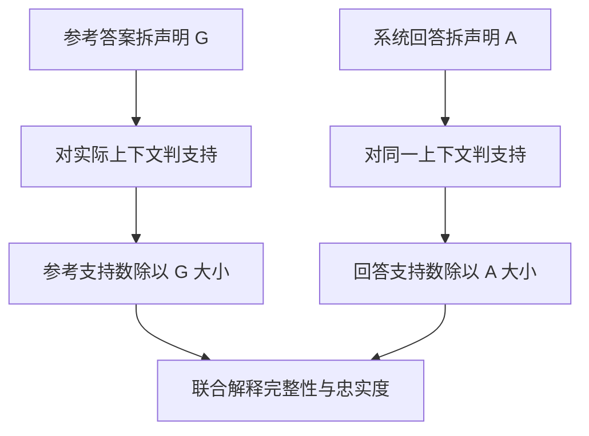
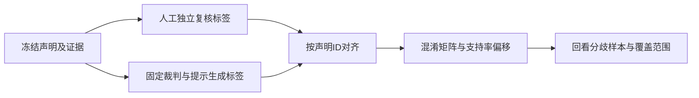

# RAG检索与回答评测

RAG评测要分别解释召回、实际上下文、系统回答和评分裁判。本文不再推导检索算法，而是核对评分器的输入、分母、缺失值和估计误差，防止同名指标测量不同对象。

## 学习目标

- 分开评估检索与回答
- 手算检索指标
- 检查引用支持与无答案处理

## 前置知识

先阅读[评测协议与可复现性](评测协议与可复现性.md)、[RAG与引用回答](RAG与引用回答.md)。理解有序排名与集合的区别，以及相关、支持、正确、完整四种标签。

## 基本机制

本页固定Ragas源码提交 `298b68274234c060deacab3cf5fb52aa3a20e885`，所读 `_context_precision.py`、`_context_recall.py`、`_faithfulness.py`属于旧式API路径；同提交文档也展示collections API，不能假定两条路径所有细节一致。[Legacy API说明](https://github.com/explodinggradients/ragas/blob/298b68274234c060deacab3cf5fb52aa3a20e885/docs/concepts/metrics/available_metrics/context_recall.md#L56)。原论文采用reference-free指标套件，当前框架又提供需要reference或reference_contexts的版本，选择指标前必须逐个核对字段。

每个样本至少保留问题、语料版本、召回列表及顺序、实际上下文、参考答案、系统回答、声明拆分、裁判标签与解析状态。这样才能判断分数变化来自检索、截断、生成还是评分器。[RAGAS §3–5](https://arxiv.org/html/2309.15217v2)

## 推导或示例

完整教学文件：[benchmark-rag.py](../../examples/benchmark/benchmark-rag.py)。每个函数对应下列一个知识点，只使用标准库与小型合成输入；教学计算不代表模型或服务实验。

### 知识点一：上下文AP的分母决定它无法单独衡量漏召回

评测召回排序时，先确定标签是“相关文档ID”还是“裁判认为对给定答案有用的片段”。该版本 `LLMContextPrecisionWithReference`逐片段把问题、reference和context交给模型判0/1，再计算AP式指标。令第 $i$ 个片段标签为 $v_i$，累计命中 $h_i=\sum_{j\le i}v_j$，有：

$$CP=\frac{\sum_{i=1}^K v_i\,h_i/i}{\sum_{i=1}^K v_i+10^{-10}}.$$

它不同于普通 $P@K=h_K/K$，也不同于把分母设为全库相关文档数 $R$的AP。分母只统计已召回片段中的正标签，因此即使只检到唯一一篇排第一的相关资料，CP仍接近1；若库中本来有10篇必需资料，Recall@1仅为0.1。

```python
def context_precision_profile(verdicts, corpus_relevant_count=None):
    """比较Ragas式上下文AP、普通P@K与全库相关数分母，标签按排名排列。"""
    labels = list(verdicts)
    if any(type(v) not in (int, bool) or v not in (0, 1) for v in labels):
        raise ValueError("有用性标签须为0或1")
    hits, numerator = 0, 0.0
    for rank, useful in enumerate(labels, 1):
        hits += useful
        if useful:
            numerator += hits / rank
    if corpus_relevant_count is not None:
        if type(corpus_relevant_count) is not int or corpus_relevant_count < hits or corpus_relevant_count < 0:
            raise ValueError("全库相关项数须非负且不小于已检到的独立相关项数")
    return {"context_ap": numerator / (hits + 1e-10),
            "precision_at_k": hits / len(labels) if labels else None,
            "corpus_ap": numerator / corpus_relevant_count if corpus_relevant_count else None,
            "recall_at_k": hits / corpus_relevant_count if corpus_relevant_count else None,
            "retrieved_count": len(labels), "relevant_retrieved": hits,
            "empty_context": not labels}
```

标签 `[1,0,1]`的分子为 $1+2/3=5/3$，上下文AP约 $5/6$，普通P@3为2/3。若人工完整相关集合有4项，Recall@3=1/2，全库分母AP为5/12。把最后一个正例移到第二名，上下文AP接近1，说明排名改善；它仍没有证明剩余两份证据被找到。函数按排名单次扫描，时间 $O(K)$，不执行任何模型判断。


全零标签与空列表在这段AP代码中均给0，因为分母有epsilon；这不能区分“候选全部无用”和“检索器失败没有结果”，所以示例另返empty_context。WithoutReference变体使用系统response替代reference，有可能奖励只对系统自己答案有用的资料，不能悄悄与参考答案版放在同列。

同一文件的IDBasedContextPrecision则把ID转字符串、去重，再算集合交集比例，完全不看顺序。它与AP式指标名称相似但测量对象不同。正文与报告必须记录类名、字段、候选去重粒度和代码提交，不能只写“Context Precision=0.8”。原论文的Context Relevance还采用相关句子占比，并非这里所有后续API都由论文同一个公式定义。

[Ragas _calculate_average_precision](https://github.com/explodinggradients/ragas/blob/298b68274234c060deacab3cf5fb52aa3a20e885/src/ragas/metrics/_context_precision.py#L114)；[IDBasedContextPrecision](https://github.com/explodinggradients/ragas/blob/298b68274234c060deacab3cf5fb52aa3a20e885/src/ragas/metrics/_context_precision.py#L250)；[Context Precision 公式](https://github.com/explodinggradients/ragas/blob/298b68274234c060deacab3cf5fb52aa3a20e885/docs/concepts/metrics/available_metrics/context_precision.md#L1)；[RAGAS §3](https://arxiv.org/html/2309.15217v2).

### 知识点二：上下文召回与回答忠实度检查不同声明集合

将参考答案拆成声明集合 $G$，系统回答拆成集合 $A$，实际送给生成器的证据为 $C$。LLM上下文召回估计 $G$中有多少能从 $C$推出；Faithfulness估计 $A$中有多少能从 $C$推出：

$$CR=\frac{\sum_{g\in G}\mathbf1[C\models g]}{|G|},\qquad F=\frac{\sum_{a\in A}\mathbf1[C\models a]}{|A|}.$$

这两个分母不同，因此不能把忠实度当答案完整度。参考答案有“方法、条件、版本、限制”四个声明，证据只支持方法；系统只回答方法，得到CR=1/4而F=1。若系统补上三个无依据细节，完整性表面增加，F反而下降。评价时应同时检查参考信息覆盖和回答是否增添无依据内容。

```python
def claim_coverage(reference_attributed, answer_supported):
    """分别用参考答案声明和系统回答声明做分母；空声明集记为未定义。"""
    reference = list(reference_attributed)
    answer = list(answer_supported)
    if any(type(v) not in (int, bool) or v not in (0, 1) for v in reference + answer):
        raise ValueError("声明支持标签须为0或1")
    return {"context_recall": sum(reference) / len(reference) if reference else None,
            "faithfulness": sum(answer) / len(answer) if answer else None,
            "reference_claim_count": len(reference), "answer_claim_count": len(answer),
            "reference_supported": sum(reference), "answer_supported": sum(answer)}
```

函数输入分别是参考声明的attributed标签与系统声明的supported标签，拒绝将非二值评分混入。空声明集返回None，对应源码的NaN语义，不能把空回答当100%忠实。扫描时间为 $O(|G|+|A|)$；它只演示聚合，不模拟语言模型如何拆声明或判断蕴含。



该版 `LLMContextRecall._ascore`拼接retrieved_contexts并使用reference做分类，`Faithfulness`先从response生成声明再做NLI判断。用于评估生成器的retrieved_contexts应当与真正进入模型的上下文一致；若误传预算截断前的全部候选，就会给生成器未见过的证据记功。候选召回和最终上下文覆盖可分两次测量，字段须明确命名。

这里 $C\models a$是语义支持，不是存在一个URL，也不是“相似度高”。忠实复制过期错误来源可能F=1而现实事实错误；正确答案来自模型记忆却缺上下文支持，可能事实正确而F低。多源联合论证还需足够证据组合，不能只找到一个同主题句子。参考答案自身若漏条件或有错误，CR也会偏，因此人工基准不是无需核验的绝对真理。

[LLMContextRecall._compute_score 与 _ascore](https://github.com/explodinggradients/ragas/blob/298b68274234c060deacab3cf5fb52aa3a20e885/src/ragas/metrics/_context_recall.py#L114)；[Faithfulness声明生成与评分](https://github.com/explodinggradients/ragas/blob/298b68274234c060deacab3cf5fb52aa3a20e885/src/ragas/metrics/_faithfulness.py#L144)；[Context Recall 分母](https://github.com/explodinggradients/ragas/blob/298b68274234c060deacab3cf5fb52aa3a20e885/docs/concepts/metrics/available_metrics/context_recall.md#L1)；[Faithfulness 分母](https://github.com/explodinggradients/ragas/blob/298b68274234c060deacab3cf5fb52aa3a20e885/docs/concepts/metrics/available_metrics/faithfulness.md#L1)；[RAGAS Faithfulness](https://arxiv.org/html/2309.15217v2).

### 知识点三：自动支持判断是有误差的估计器

Ragas的最终均值计算很简单，但输入标签来自模型。令真实支持率为 $f$，裁判对支持声明的真阳性率为 $a$，对不支持声明的假阳性率为 $b$。若这两个条件概率在目标样本上稳定，自动支持率满足：

$$\mathbb E[\hat f]=af+b(1-f)=b+(a-b)f.$$

因此更换裁判或提示词即可改变分数，而不改变被测回答。这个式子是教学误差分解，不是论文对某个模型给出的参数保证。若 $a=b$，裁判输出与真实支持性无关；不能用简单校准恢复能力排名。

```python
def judge_error_audit(human_labels, judge_labels):
    """按声明ID对齐人工与裁判标签，返回混淆矩阵和平均支持率偏移。"""
    human, judge = dict(human_labels), dict(judge_labels)
    if human.keys() != judge.keys():
        raise ValueError("两个裁判必须判断完全相同的声明ID")
    if any(type(v) not in (int, bool) or v not in (0, 1) for v in list(human.values()) + list(judge.values())):
        raise ValueError("标签须为0或1")
    counts = {"tp": 0, "fn": 0, "fp": 0, "tn": 0}
    for cid, truth in human.items():
        key = "tp" if truth and judge[cid] else "fn" if truth else "fp" if judge[cid] else "tn"
        counts[key] += 1
    n = len(human)
    positive = counts["tp"] + counts["fn"]
    negative = counts["fp"] + counts["tn"]
    return {**counts, "count": n,
            "sensitivity": counts["tp"] / positive if positive else None,
            "false_positive_rate": counts["fp"] / negative if negative else None,
            "human_support_rate": sum(human.values()) / n if n else None,
            "judge_support_rate": sum(judge.values()) / n if n else None,
            "mean_bias": (counts["fp"] - counts["fn"]) / n if n else None}
```

四个冻结声明，人工标签为 `[1,1,0,0]`，自动标签为 `[1,1,1,0]`，得到TP=2、FN=0、FP=1、TN=1。人工支持率0.5，自动0.75，偏移0.25，且 $0.5+(1-0.5)\times0.5=0.75$。函数按ID对齐，避免两个列表顺序不同却被zip后错误计分；某类人工标签缺失时，对应TPR或FPR返回None，不能伪造为0。



更隐蔽的是声明拆分误差。把一个复杂错误声明拆成三条容易验证的正确前提和一条错误结论，可使按声明平均的分数与原先的一条标签不同。比较系统时应保存拆分结果、裁判版本、提示、采样参数与失败率，必要时使用同一份人工原子声明集合对照。源码的StatementGeneratorPrompt要求拆分并去掉代词，但自然语言提示本身不是可证明的约束。

原论文WikiEval用人工成对偏好检查自动指标的一致性，它衡量“是否选中人工偏好的答案”，不等于裁判逐声明准确率，更不等于RAG任务成功率。教学函数线性扫描 $O(N)$，不含模型调用成本。若自动结果解析失败或生成零声明，应报告缺失比例；只对成功评分样本求平均会改变评估集合。论文局部的一致性成绩也不能替代当前中文、长上下文、冲突证据上的独立校准。

[StatementGeneratorPrompt与NLIStatementPrompt](https://github.com/explodinggradients/ragas/blob/298b68274234c060deacab3cf5fb52aa3a20e885/src/ragas/metrics/_faithfulness.py#L30)；[空声明处理](https://github.com/explodinggradients/ragas/blob/298b68274234c060deacab3cf5fb52aa3a20e885/src/ragas/metrics/_faithfulness.py#L183)；[Faithfulness计算流程](https://github.com/explodinggradients/ragas/blob/298b68274234c060deacab3cf5fb52aa3a20e885/docs/concepts/metrics/available_metrics/faithfulness.md#L1)；[RAGAS §4–5 人工对照](https://arxiv.org/html/2309.15217v2).

## 适用条件与限制

评价数据中的证据集合可能不完整，参考答案也可能遗漏合理替代回答。自动裁判会引入领域与语言偏差；同义文字、版本冲突和多源论证不能只用字符串相似度判断。

本页只计算冻结标签，不调用Ragas、生成模型或裁判，不执行真实RAG基准。None表示指标未定义，不能默认补0或删除后仍声称样本总量不变。

## 实践任务

冻结单源、多源、无答案、冲突和过期版本五类问题，各至少两个。分别保存候选与实际上下文的标签；手算 `[1,0,1]` 的三种分母结果。构造“回答很短但忠实度满分”的样本，再抽样独立标注声明，计算裁判混淆矩阵并复核假阳性。

本页完整实践保持 `designed`。示例测试由统一 UT 流程记录，本页不宣称已测试或论文复现。

## 掌握标准

能解释上下文AP高而召回率低；能从声明集合区分CR与F；能说明链接存在无法产生支持标签；能把模型裁判一致性与被测系统正确率分开。最终报告必须带字段、分母、缺失值策略、裁判版本和分层样本数。

## 评分协议中的对照与反例

固定top-k不等于固定证据预算。一个系统返回三篇长文档，另一个返回三个短chunk，虽然K相同，模型见到的token量和证据覆盖可能完全不同。报告应同时记录文档级、片段级身份和实际token数；比较排名指标时固定候选粒度，比较生成质量时固定或明确解释上下文预算。这里不重新实现重排，重点是确保评分输入对应被测阶段。

参考答案版和无参考版也不能直接互换。假设问题要求比较两种方法，系统只回答其中一种；以该系统回答作为“有用性”判据，检索到另一种方法的资料可能被判无用。以完整参考答案为判据时同一资料又有用。分数改变来自评价目标变化，不代表召回器本身变差。应在实验前选定评测问题，并保留各版本指标的完整类名。

无答案与错误回答需要单列。没有相关资料的问题，集合召回率的分母可能为0；空回答的忠实度也可能未定义。不能简单将这类样本算成成功或失败，而应定义资料不足判断、错误自信回答及拒答覆盖的业务规则。与此同时，引用可以可解析但不支持声明，也可以支持一个旧版本结论却不适用于当前问题；支持标注必须带版本与适用条件。

原论文的人工偏好一致性只在其标注设置和样本中成立。当前评测应让人工和裁判查看相同上下文，避免人工参考全文而裁判只见截断段落。分歧既可能是裁判错误，也可能来自证据访问范围不一致。保存原始判定理由有助于复核，但流畅的理由不能取代明确的证据支持关系。
[WithReference与WithoutReference字段](https://github.com/explodinggradients/ragas/blob/298b68274234c060deacab3cf5fb52aa3a20e885/src/ragas/metrics/_context_precision.py#L93)；[空参考声明处理](https://github.com/explodinggradients/ragas/blob/298b68274234c060deacab3cf5fb52aa3a20e885/src/ragas/metrics/_context_recall.py#L114)；[WikiEval协议与局限](https://arxiv.org/html/2309.15217v2).

---

[返回模块](../modules/Benchmark.md) · [知识点索引](../../docs/知识点索引.md) · [完整教学代码](../../examples/benchmark/benchmark-rag.py) · [提出更正](https://github.com/yanbozhang/llm-systems-wiki/issues/new?template=knowledge.yml)

觉得这篇推导有帮助，可以在 [GitHub](https://github.com/yanbozhang/llm-systems-wiki) 点 Star 收藏更新；分享时欢迎链接到具体知识点，便于读者复核公式、代码与来源。
