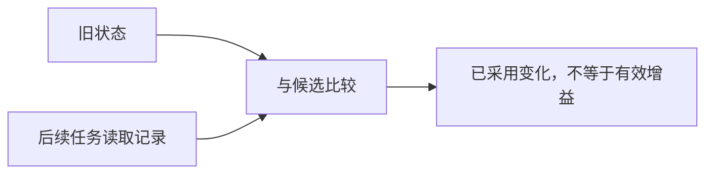
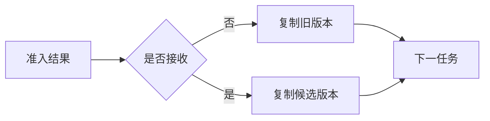

# RSI改进闭环与版本准入

RSI 的最小系统不是“模型反思一下”，而是执行、留存、提议、验证、接收与后续使用的闭环。先确认变化被持久保存并实际使用，再讨论候选是否值得接收，最后处理版本推进与回退。任务系统变好与改进器变好是两个需要分别验证的主张。

## 学习目标

区分单次任务重试与跨任务持久变化；写出不允许候选更改验证器的准入条件；在拒绝候选后保留原版本，且不污染已有状态。

## 前置知识

先读 [Harness任务循环](Harness任务循环.md) 和 [评测协议](评测协议与可复现性.md)。需要理解字典、集合、深复制，以及训练、验证、测试数据承担不同职责。

## 基本机制

分类综述的摘要将参数、记忆、技能、代码列为可保留的修改对象；RRSI 的摘要讨论对候选提议和选择施加约束。本页据此组织教学闭环，不声称实现了论文算法。执行系统、改进器和验证器分别版本化，接收只改变后续任务所用版本，不重写已经发生的轨迹。

## 推导或示例

### 知识点一：持久变化与后续采用

以下是本库的状态模型。设旧状态为 $S_t$ ，候选为 $C_t$ ，后续任务实际读取的键为 $U$ ，可观察到的持久改动集合为：

$$
\Delta_U=\lbrace k\in U:k\in C_t,\ C_t[k]\ne S_t[k]\rbrace .
$$

新增键视为变化；删除键不算作“后续读取了新值”。例如保存了两个技能却只采用其中一个，只能记录一个已采用变化，不能据文件数量推断收益。

```python
from examples.rsi.loop import persistent_changes
assert persistent_changes({"skill": "v1"}, {"skill": "v2"}, ["skill"]) == ["skill"]
```



函数按键比较并按实际读取集合过滤；它没有衡量任务质量，也不能检测语义相同但文本不同的变化。方向依据见[分类综述摘要](https://arxiv.org/abs/2610.14625)，候选约束背景见[RRSI摘要](https://arxiv.org/abs/2609.24972)。

### 知识点二：候选准入不能放宽验证器

令 $g$ 为独立验证集上的质量差， $r$ 为旧能力保留率， $\gamma,\rho$ 为预先声明的门槛， $v$ 表示验证器没有被候选改写。教学准入条件是：

$$
A=v\land(g\ge\gamma)\land(r\ge\rho).
$$

```python
from examples.rsi.loop import accept_candidate
assert not accept_candidate(0.2, 0.8, min_retention=0.95)
```


代码拒绝非有限指标及非法保留率。门槛只是确定性教学策略，不是显著性检验，也不证明重复使用验证集没有过拟合；准入后仍需冻结配置并检查独立测试集。参见[RRSI摘要](https://arxiv.org/abs/2609.24972)与[评测审计摘要](https://arxiv.org/abs/2610.27610)。

### 知识点三：拒绝候选与版本不变性

系统下一版本由明确准入结果决定：

$$
S_{t+1}=A\,C_t+(1-A)\,S_t.
$$

这只是分支选择的记法，不对字典做算术。失败时保留旧版本，成功时复制候选；原始对象不能因后续修改而被间接污染。

```python
from examples.rsi.loop import advance_version
assert advance_version({"version": 1}, {"version": 2}, False) == {"version": 1}
```



代码使用深复制以隔离嵌套状态。这不实现分布式原子发布、外部副作用回滚或模型检查点加载；实际系统必须另行处理这些边界。参见[分类综述摘要](https://arxiv.org/abs/2610.14625)与[RRSI摘要](https://arxiv.org/abs/2609.24972)。

## 适用条件与限制

适用于离线解释状态保留和准入逻辑。指标和读取日志均由调用方提供；伪造日志、评测泄漏及验证器实现错误不能靠这几个函数排除。公开来源本轮仅核对摘要，没有复现实验。

## 实践任务

设计一个候选提高新任务分数却损害旧能力的例子，再设计一个验证器被改写的例子。记录拒绝原因、已消耗成本和继续使用的版本，不允许用“下一次会更好”替代验收。

## 掌握标准

能解释保存、采用、有效、可迁移是四个不同判断；能证明拒绝路径不改变旧对象；能说明准入门槛为什么不能直接证明递归加速。
