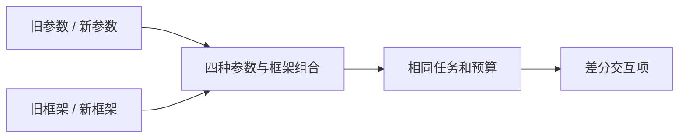
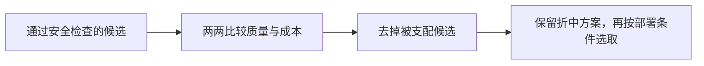
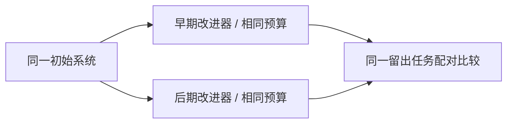

# RSI系统与改进器演化

系统演化可以修改模型参数、工具接口、Harness 代码，甚至修改提出候选的改进器本身。先固定可修改对象，再通过交叉实验与质量—成本对照解释收益；改进器是否更强，必须把早晚版本放回相同起点重新比较，不能只看最终智能体的分数。

## 学习目标

通过新旧参数与框架的四种组合拆分影响；找到质量—成本互不支配的候选；在相同起点、任务与预算下比较改进器，而不是混合比较多个不同最终系统。

## 前置知识

先读 [训练模块](../modules/训练.md)、[Harness模块](../modules/Harness.md) 与 [RSI改进闭环](RSI改进闭环与版本准入.md)。需要理解配对差异、控制变量及预算约束。

## 基本机制

分类综述摘要提供多种修改对象的统一视角；Hyperagents摘要明确区分任务智能体和可修改的元智能体。参数更新可能遗忘旧能力，框架修改可能破坏接口，模拟环境反馈可能失真。这里采用可核算的离线指标，不运行任意自生成代码，也不声称复现开放式自改进。

## 推导或示例

### 知识点一：参数与框架的交叉对照

令 $Q_{ij}$ 是参数版本 $i$ 与框架版本 $j$ 在同一任务集上的成功率，零为旧版、一为新版。教学交互项是：

$$
I=Q_{11}-Q_{10}-Q_{01}+Q_{00}.
$$

```python
from examples.rsi.evolution import cross_effect
assert abs(cross_effect(0.5, 0.6, 0.7, 0.85) - 0.05) < 1e-9
```



代码先验证成功率，再计算差分。正值表示在该测量尺度上的超加性，不是统计显著或因果识别结论；要同时报告各格均值与不确定性。分类依据见[综述摘要](https://arxiv.org/abs/2610.14625)，过程与产物的证据区别见[评测审计摘要](https://arxiv.org/abs/2610.27610)。

### 知识点二：质量与成本的非支配候选

候选 $x$ 的质量越高越好、成本越低越好。 $x$ 支配 $y$ 当且仅当：

$$
q_x\ge q_y,\quad c_x\le c_y,\quad(q_x\gt q_y\lor c_x\lt c_y).
$$

```python
from examples.rsi.evolution import pareto_front
assert pareto_front([{"quality": 0.8, "cost": 4}, {"quality": 0.7, "cost": 5}]) == [{"quality": 0.8, "cost": 4}]
```



代码为可读性采用二次比较，相同质量与成本的并列候选都保留。前沿不自动满足安全、延迟尾部或最低质量要求；进入集合前仍需准入检查。成本与候选约束背景见[RRSI摘要](https://arxiv.org/abs/2609.24972)及[综述摘要](https://arxiv.org/abs/2610.14625)。

### 知识点三：从相同起点比较改进器

早期改进器 $P_a$ 与后期改进器 $P_b$ 都从相同系统 $S_0$ 出发，获得相同预算 $B$ 。对配对任务结果差取均值：

$$
D=\frac{1}{n}\sum_{i=1}^{n}\left(Q(P_b(S_0,B),i)-Q(P_a(S_0,B),i)\right).
$$

```python
from examples.rsi.evolution import compare_improvers
assert compare_improvers([0.1], [0.2], "base", "base", 10, 10) == 0.1
```



代码检查起点标识、预算和数组长度，但无法判断调用方是否真的使用同一任务；任务 ID 与完整配置仍需保存在实验记录中。这个对照区别于只比较最终产物，参见[Hyperagents摘要](https://arxiv.org/abs/2603.19461)与[评测审计摘要](https://arxiv.org/abs/2610.27610)。

## 适用条件与限制

所有函数只计算调用方给定的结果，不训练模型或执行候选代码。代码更新须在隔离环境中进行，保护原始证据、评分器、外部访问和发布权限；模拟反馈需要真实任务校准。

## 实践任务

手算四格成功率与交互项，列出至少两个互不支配的方案；再故意给早晚改进器不同起点，说明为什么即使晚期分数更高，也不能声称改进过程更有效。

## 掌握标准

能区分参数收益、框架收益、交互效应和改进器收益；能说明候选前沿不是部署批准；能写出保护验证器与回退旧版本的实验边界。
