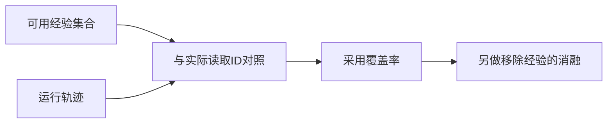

# RSI记忆与技能更新

记忆保存“可能复用的信息”，技能保存“可以重复执行的步骤”。两者都需要来源、适用范围和修订记录。整体流程是先筛选可信且适用的经验，再限制修改范围，最后检查后续任务是否真正采用；内容越来越多不等于系统越来越好。

## 学习目标

为经验绑定来源版本与适用任务族；限制一次技能修改的规模；把保存数量、采用率和任务收益分开报告，避免只用新增文件数描述改进。

## 前置知识

先读 [Agent记忆与保鲜](Agent记忆与保鲜.md) 与 [RSI改进闭环](RSI改进闭环与版本准入.md)。需要理解版本身份、集合去重和受控实验。

## 基本机制

分类综述摘要将记忆和技能列为持久更新对象，RRSI摘要强调限制捆绑修改并筛除不再有用的变化。本页把这些设计方向抽象成三个离线函数，不把固定比例阈值说成某篇论文的原始算法。已有经验还可能错误、过期或只对某类任务适用。

## 推导或示例

### 知识点一：有来源且适用的经验筛选

设经验 $m$ 的来源版本为 $v_m$ ，当前已知来源版本为 $V(s_m)$ ，适用任务族集合为 $F_m$ 。对任务族 $f$ 的教学过滤条件为：

$$
E(m,f)=[m\text{ 已核验}]\land[v_m=V(s_m)]\land[f\in F_m].
$$

```python
from examples.rsi.memory import eligible_experience
assert eligible_experience([], {"run": "v1"}, "coding") == []
```


函数逐条核对状态、版本和范围后复制记录；失效记录不会被静默升级。标签有效仍不代表内容一定正确，来源本身的可信度需要单独审计。参见[分类综述摘要](https://arxiv.org/abs/2610.14625)及[RRSI摘要](https://arxiv.org/abs/2609.24972)。

### 知识点二：有限改动与可归因修订

把技能分为 $n$ 个可审查单元，单轮修改 $c$ 个，允许比例为 $\eta$ ，本库的修改预算模型是：

$$
0\le c\le n,\qquad c/n\le\eta.
$$

```python
from examples.rsi.memory import bounded_edit
assert bounded_edit(1, 10, 0.2)
assert not bounded_edit(4, 10, 0.2)
```


先验证计数与阈值，再计算比例。计量单元必须事先固定，不能通过拆分无关行降低比例；小修改也可能造成大风险。这里仅受[RRSI摘要](https://arxiv.org/abs/2609.24972)的有限候选思路启发，不实现其退火提议器。

### 知识点三：采用率不是有效性

可用经验 ID 集合为 $M$ ，实际采用集合为 $U\subseteq M$ ，定义覆盖型采用率：

$$
a=|U|/|M|.
$$

```python
from examples.rsi.memory import adoption_rate
assert adoption_rate(["check-types", "sort"], ["check-types"]) == 0.5
```



去重后计算，空集合按接口约定返回零；采用记录引用不存在经验则拒绝。使用过不等于帮助过，需移除经验再比较质量与成本。这个教学指标不是论文的标准分数，证据分层参见[评测审计摘要](https://arxiv.org/abs/2610.27610)与[分类综述摘要](https://arxiv.org/abs/2610.14625)。

## 适用条件与限制

适用于固定模型、离线经验与技能更新。无法靠标签筛选自动识别错误知识或提示注入；技能的工具权限、代码执行与外部写操作仍应由 Harness 强制约束。

## 实践任务

构造一条过期经验、一条范围不匹配经验和一条已核验经验。记录哪些被筛除，再将同一任务分别在保留与移除技能的条件下运行；尚未真实运行时只提交实验设计。

## 掌握标准

能说明版本匹配和事实正确的差别，识别通过重定义计量单元规避修改预算的做法，并用消融而不是采用率证明经验是否带来收益。
