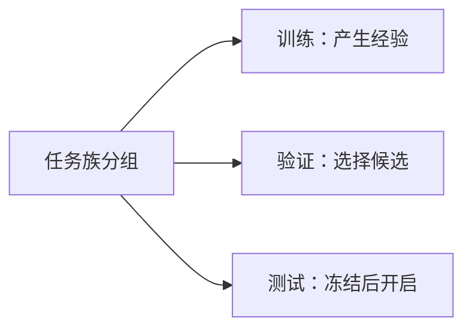
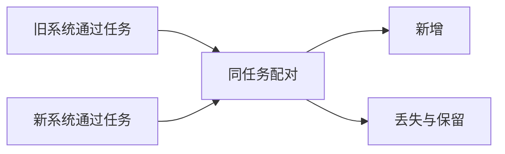
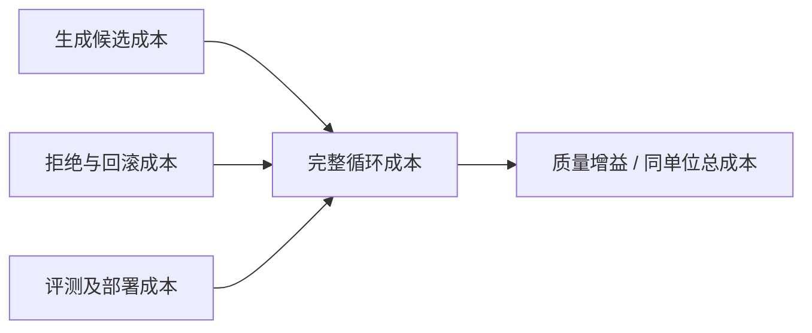

# RSI评测与归因

RSI 评测同时关注新学会什么、忘记什么、付出多少成本以及改进能否迁移。整体顺序是先隔离数据用途，再记录获得与丢失的能力，最后核算完整循环的效率。无更新、简单笔记、固定改进器与待研究方法四类对照承担不同的归因职责。

## 学习目标

按任务族隔离训练、验证与测试；分别统计新增和丢失任务；把拒绝候选、评测、回滚和部署的成本纳入总账，并重复完整学习过程而非只重复最终评分。

## 前置知识

先读 [评测指标与统计推断](评测指标与统计推断.md) 与 [RSI系统演化](RSI系统与改进器演化.md)。需要理解数据泄漏、集合运算及不同计量单位不能直接相加。

## 基本机制

评测审计摘要区分最终产物的能力与改进过程的能力，强调从相同起点和预算比较改进器，以及重复完整循环。RRSI摘要提示开发任务上的收益可能无法迁移。本页的集合与成本公式是教学抽象；它们帮助设计记录，不替代真实基准和统计检验。

## 推导或示例

### 知识点一：按任务族隔离数据用途

训练任务族集合 $T$ 用于产生经验，验证集合 $V$ 用于选择，测试集合 $E$ 只在冻结后打开。最低集合约束是：

$$
T\cap V=T\cap E=V\cap E=\varnothing.
$$

```python
from examples.rsi.evaluation import disjoint_splits
assert disjoint_splits(["family-a"], ["family-b"], ["family-c"])
```



函数验证 ID 集合不相交，但更换任务 ID 不会消除语义泄漏。相同模板的轻微改写应按共同任务族分组；每个集合被谁读取、使用多少次也需记录。参见[评测审计摘要](https://arxiv.org/abs/2610.27610)与[RRSI摘要](https://arxiv.org/abs/2609.24972)。

### 知识点二：新增能力与遗忘必须分开

同一任务宇宙中，旧系统通过集合为 $A$ ，新系统通过集合为 $B$ 。定义新增、丢失及保留率：

$$
G=B\setminus A,\qquad L=A\setminus B,\qquad R=|A\cap B|/|A|.
$$

```python
from examples.rsi.evaluation import capability_changes
assert capability_changes(["a", "b"], ["b", "c"]) == {"gained": ["c"], "lost": ["a"], "retention": 0.5}
```



旧系统没有通过任务时，保留率返回 `None` 而非假装为百分之百。总通过数相同仍可能发生严重遗忘；只测新任务不能计算旧能力保留。证据分层参考[分类综述摘要](https://arxiv.org/abs/2610.14625)与[评测审计摘要](https://arxiv.org/abs/2610.27610)。

### 知识点三：全部改进成本下的效率

设固定任务集上的质量增益为 $\Delta Q$ ，所有候选生成、验证、拒绝、回滚和部署的同单位成本分别为 $C_j$ 。教学效率定义为：

$$
\eta=\frac{\Delta Q}{\sum_j C_j}.
$$

```python
from examples.rsi.evaluation import net_efficiency
assert net_efficiency(0.1, [2, 3, 1, 4]) == 0.01
```



代码拒绝缺失、负成本、非有限数和零总成本，允许负增益。不能把不同模型的 token 数、美元和 GPU 小时直接混加；应分别报告原始分项，再说明转换规则。预算依赖与候选筛选背景见[RRSI摘要](https://arxiv.org/abs/2609.24972)及[评测审计摘要](https://arxiv.org/abs/2610.27610)。

## 适用条件与限制

任务 ID 及成功判定必须固定，成本采用同一单位；函数不提供置信区间或防污染保证。应更换种子与任务顺序，从同一初始版本重复完整学习循环，报告差异和不确定性。

## 实践任务

设计四类对照与旧任务回放集，填写包含失败候选的费用表；构造总分上升但关键旧能力丢失的例子，写出为何不能仅凭最终最强版本宣称持续递归提升。

## 掌握标准

能区分独立测试、重复验证集和旧能力回放；能解释没有旧成功任务时保留率未定义；能用完整账本比较方法而不隐藏被拒绝候选成本。
