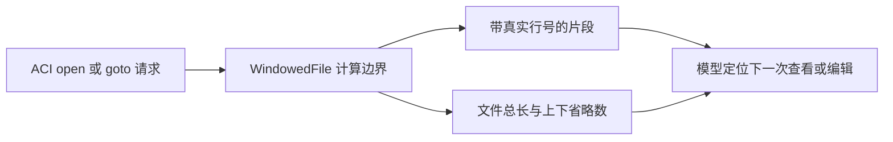
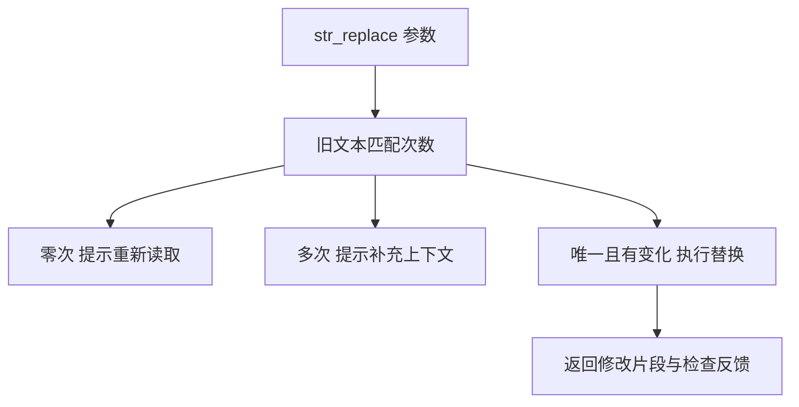
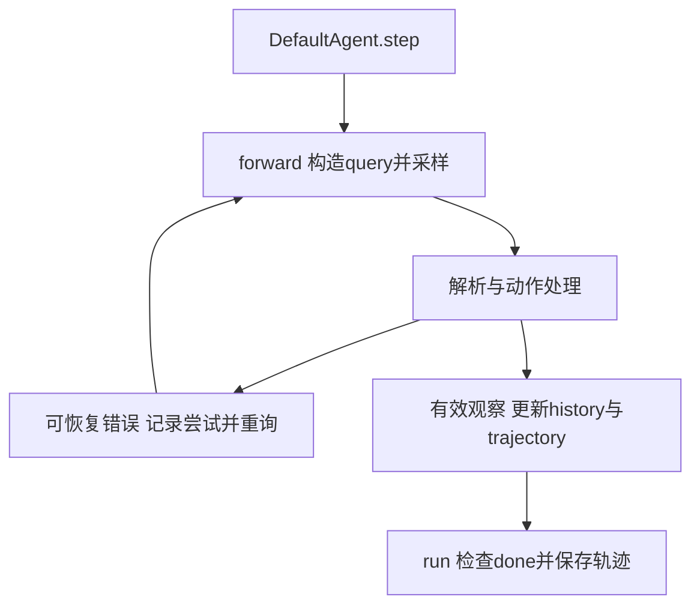

# SWEAgent与智能体计算机接口

SWE-agent的核心研究问题是：面向语言模型设计的命令与反馈接口，怎样改变定位、编辑和纠错过程。本文固定读取SWE-agent源码，逐层区分论文ACI、当前工具配置、执行循环与轨迹记录。维护者已在README推荐mini-swe-agent，这一背景不等于本文分析了后继项目的实现。

## 学习目标

- 解释ACI怎样改变观察与编辑反馈
- 推演编辑失败后的纠错与轨迹状态
- 区分任务停止、补丁生成和代码任务评测

## 前置知识

需理解[AI代码开发与反馈](AI代码开发与反馈.md)、[Harness任务循环](Harness任务循环.md)、文本定位、循环状态与错误分类。动作字符串是待解释数据，只有运行环境实际执行后才有环境观察。

## 基本机制

固定提交为 `3ea751c087f32b16e039a2233dd6eefecef325d5`。本次default.yaml采用function_calling解析，加载registry、edit_anthropic、review_on_submit_m，history processor为cache_control。论文的窗口/行区间编辑设计仍有对应实现，但不是当前默认配置所有细节。[SWE-agent default.yaml](https://github.com/SWE-agent/SWE-agent/blob/3ea751c087f32b16e039a2233dd6eefecef325d5/config/default.yaml)；[原论文ACI设计](https://arxiv.org/html/2405.15793v1).

README明确说主要开发工作转向mini-swe-agent并建议新使用者采用后继项目。本文保留SWE-agent作为ACI研究案例，不把该推荐扩展为无源码支持的迁移机制、自动兼容层或当前性能保证。[维护背景](https://github.com/SWE-agent/SWE-agent/blob/3ea751c087f32b16e039a2233dd6eefecef325d5/README.md#L15)

## 推导或示例

完整教学文件：[swe-agent.py](../../examples/agents/swe-agent.py)。每个函数对应下列一个知识点，只使用标准库与小型合成输入；教学计算不代表模型或服务实验。

### 知识点一：窗口化观察把仓库状态变成可定位的反馈

ACI不是给shell命令换名字。它同时定义动作空间、参数说明和观察格式：模型需要知道当前文件、总行数、显示哪段、还遗漏多少。论文中的viewer最多显示100行，并提供open/goto/scroll操作；当前仓库仍保留WindowedFile实现，但本次default.yaml选择的是edit_anthropic工具包，不能把历史论文的100行窗口写成当前所有入口默认值。

对 $n$ 行文件、请求起点 $r$（从1开始）、窗口上限 $w$，教学起始偏移为 $s=\min(r-1,\max(0,n-w))$，终点为 $e=\min(n,s+w)$。展示行数 $e-s\le w$，上方隐藏 $s$行，下方隐藏 $n-e$行，三者之和为 $n$。到文件末尾时向前移动窗口，可以尽量展示完整上下文。

将上述计算或状态约束集中写为：

$$
s=\min(r-1,\max(0,n-w)),\quad e=\min(n,s+w),\quad s+(e-s)+(n-e)=n.
$$

```python
def file_window(text, requested_start=1, window_size=5):
    """展示最多window_size行，返回一基行号与上下未显示行数；不读取文件。"""
    if not isinstance(text, str) or type(requested_start) is not int or type(window_size) is not int or requested_start < 1 or window_size < 1:
        raise ValueError("需要文本与正整数窗口参数")
    lines = text.splitlines()
    if not lines:
        return {"lines": [], "above": 0, "below": 0, "total": 0}
    start = min(requested_start - 1, max(0, len(lines) - window_size))
    end = min(len(lines), start + window_size)
    return {"lines": [(i + 1, lines[i]) for i in range(start, end)],
            "above": start, "below": len(lines) - end, "total": len(lines)}
```

六行文件请求第6行、窗口3，显示4/5/6行，above=3、below=0。空文件单独返回零行，不产生“第0行”伪记录。函数拆分整段文本为 $O(n)$空间时间，输出至多 $w$行；生产文件读取可能有不同缓存策略，不能把展示条数少直接等同于磁盘读取量小。



窗口化降低单次观察的上下文成本，却会遮住跨窗口依赖，因此模型需要主动跳转而非假设未显示部分不存在。编辑以后应重新反馈更新片段，否则模型继续引用旧行号或旧内容，会把下一次编辑定位到错误位置。论文对ACI的改进是模型、工具与反馈共同条件下的实验结论，不能只复制一个窗口宽度就保证同样成功率。

[WindowedFile.get_window_text](https://github.com/SWE-agent/SWE-agent/blob/3ea751c087f32b16e039a2233dd6eefecef325d5/tools/windowed/lib/windowed_file.py#L117)；[当前default.yaml工具选择](https://github.com/SWE-agent/SWE-agent/blob/3ea751c087f32b16e039a2233dd6eefecef325d5/config/default.yaml#L42)；[SWE-agent §2–3](https://arxiv.org/html/2405.15793v1).

### 知识点二：唯一匹配与具体失败反馈限制错误传播

修改“第几行”依赖最新文件状态；SEARCH式编辑则依赖旧文本唯一匹配。当前工具配置要求old_str逐字匹配且在文件中唯一。设匹配次数为 $c=\operatorname{count}(text,old)$，仅在 $c=1$且 $old\ne new$时应用替换；$c=0$提示重新阅读，$c>1$提示增加上下文，不猜测该改哪一个。

将上述计算或状态约束集中写为：

$$
c=\operatorname{count}(text,old),\qquad \mathrm{apply}\iff (c=1)\land(old\ne new).
$$

```python
def unique_edit(text, old, new):
    """仅当旧字符串恰出现一次且有变化时替换；任何失败都返回原文本。"""
    if not all(isinstance(x, str) for x in (text, old, new)) or not old:
        raise ValueError("输入须为字符串且old不可为空")
    count = text.count(old)
    if count == 0:
        return {"text": text, "status": "missing", "feedback": "重新读取目标片段，旧文本未精确匹配"}
    if count > 1:
        return {"text": text, "status": "ambiguous", "feedback": "补充足够上下文，使目标唯一"}
    if old == new:
        return {"text": text, "status": "unchanged", "feedback": "新旧文本相同，没有编辑"}
    return {"text": text.replace(old, new, 1), "status": "edited",
            "feedback": "匹配已应用，仍需检查语法和任务语义"}
```

`x = 1\ny = 1`中搜索`1`有两处，因此返回ambiguous且原文不变；改为搜索`x = 1`才唯一。新旧字符串相同也应独立标注unchanged，避免模型把一次无变化调用当作修复进度。反馈应说明失败原因和可纠正参数，泛泛的“操作失败”会迫使模型重复尝试相同输入。



该版 `str_replace`会对文件、old、new执行expandtabs，示例保持原字符，因此Tab与空格等价行为不完全相同。源码先写入新内容，再可选运行lint并附加警告；所读路径没有因lint警告自动恢复旧文件。论文描述的编辑guardrail则包括拒绝无效编辑，两者不能混写成当前default工具保证。必须把“匹配检查”“写入”“语法反馈”“任务验证”按版本逐项区分。

Python字符串count与replace对常见输入扫描文本，代码没有构造完整编辑器状态或undo栈；复杂度保守看与文本长、匹配算法有关。生产还可能保留修改历史和上下文片段。即使唯一匹配成功，目标仍可能不是任务需要改变的位置，因此不会从status=edited直接推出修复正确。

[str_replace](https://github.com/SWE-agent/SWE-agent/blob/3ea751c087f32b16e039a2233dd6eefecef325d5/tools/edit_anthropic/bin/str_replace_editor#L516)；[编辑工具唯一匹配契约](https://github.com/SWE-agent/SWE-agent/blob/3ea751c087f32b16e039a2233dd6eefecef325d5/tools/edit_anthropic/config.yaml#L1)；[SWE-agent §3 File editor](https://arxiv.org/html/2405.15793v1).

### 知识点三：一个step可能含多次失败尝试，轨迹与模型历史不同

智能体循环可写为 $H_t\xrightarrow{model}a_t\xrightarrow{parse/execute}o_t\xrightarrow{update}H_{t+1}$。但模型可能给出无效格式，此时没有合法动作被执行，系统先构造纠错反馈再请求模型。设本step已出现 $f$ 次可计数格式失败，上限 $F$；一次这类错误使 $f'=f+1$，当 $f'\ge F$结束格式重试，而不是无限重新采样。

将上述计算或状态约束集中写为：

$$
H_t\xrightarrow{model}a_t\xrightarrow{parse/execute}o_t\xrightarrow{update}H_{t+1},\qquad f^{\prime}=f+1,\quad \mathrm{stop}_{format}\iff f^{\prime}\ge F.
$$

```python
def retry_trace(attempts, max_format_failures=3):
    """模拟一个外层step的格式重试；记录失败尝试，但不执行字符串中的动作。"""
    if type(max_format_failures) is not int or max_format_failures < 1:
        raise ValueError("失败预算须为正整数")
    trace, failures = [], 0
    retryable = {"format_error", "bash_syntax_error", "blocked_action"}
    for attempt in attempts:
        kind = attempt["kind"]
        if kind not in retryable | {"ok", "budget_error"}:
            raise ValueError("教学模型不支持该错误类别")
        trace.append(deepcopy(attempt))
        if kind in retryable:
            failures += 1
            if failures >= max_format_failures:
                return {"trace": trace, "format_failures": failures, "status": "exit_format", "executed": False}
        elif kind == "budget_error":
            return {"trace": trace, "format_failures": failures, "status": "exit_budget", "executed": False}
        else:
            return {"trace": trace, "format_failures": failures, "status": "step_complete", "executed": True}
    return {"trace": trace, "format_failures": failures, "status": "needs_attempt", "executed": False}
```

一次format_error后得到ok，返回两条trace、失败计数1、step_complete。上限2时连续两次格式错误应返回exit_format，不再消耗第三条输入。这里的executed只表示合成记录宣称已有正常执行结果，函数不调用shell。给定记录不足则返回needs_attempt，避免把“暂时没更多输入”冒充成功或失败。



源码 `forward`先deepcopy当次history到step.query，解析模型输出并进入handle_action；`forward_with_handling`为格式、阻断和shell语法错误构造重询历史，也把失败step加入trajectory。最终 `step`再更新正式history、info和最终轨迹。因此trajectory不是“成功执行命令列表”，history也不是完整调试档案。某些内部Retry分支不增加同一个格式计数，教学函数只覆盖明确列出的类别。

官方输出文档说明SWE-agent 1.1.0起用query保存当次真实模型输入，旧message大约对应下一步输入；读旧轨迹必须知道版本。`run`直到done并保存补丁/退出状态，真正SWE-bench验证仍是独立步骤。超时或预算耗尽时甚至可能自动提取现有补丁，所以“产生patch”和“解决issue”之间仍有完整验证边界。

[DefaultAgent.forward](https://github.com/SWE-agent/SWE-agent/blob/3ea751c087f32b16e039a2233dd6eefecef325d5/sweagent/agent/agents.py#L1006)；[forward_with_handling](https://github.com/SWE-agent/SWE-agent/blob/3ea751c087f32b16e039a2233dd6eefecef325d5/sweagent/agent/agents.py#L1062)；[step与run](https://github.com/SWE-agent/SWE-agent/blob/3ea751c087f32b16e039a2233dd6eefecef325d5/sweagent/agent/agents.py#L1220)；[官方轨迹与评测说明](https://github.com/SWE-agent/SWE-agent/blob/3ea751c087f32b16e039a2233dd6eefecef325d5/docs/usage/trajectories.md)；[SWE-agent §3 Context management](https://arxiv.org/html/2405.15793v1).

## 适用条件与限制

示例不创建环境、不执行shell、不改用户文件，也不调用模型或linter。窗口和编辑反馈只表达协议，不证明真实代码任务正确率；任务评测需要固定仓库版本、问题、环境、补丁与判据。

常见误区：把论文编辑guardrail与当前字符串编辑器的lint警告混为一谈；把done当作测试通过；把所有重询都当成新的正式环境步。

## 实践任务

对六行字符串观察末尾窗口，检查行号与隐藏行数守恒。对两处相同代码先故意用歧义old片段，再补充上下文；记录文本是否变化及反馈类别。构造格式错误、正常观察、预算退出三类轨迹，分别说明哪些进入history、哪些保留在trajectory，以及是否已有独立任务评测。

本页完整实践保持 `designed`。示例测试由统一 UT 流程记录，本页不宣称已测试或论文复现。

## 掌握标准

能解释ACI包含动作与观察两侧；能保持编辑失败时原文不变并提供具体纠正方向；能区别模型尝试、执行动作、外层step和完整任务。验收材料是可审查的轨迹与编辑前后对照，不是自行报告的issue解决率。

## 源码导读与版本差异

窗口信息的价值不只是节省token。显示“上面还有多少行”使模型知道证据不完整，显示真实行号使后续定位可复查，编辑后返回片段则减少额外查看动作。若仅截断前若干字符却不说明范围，模型可能把被截断的函数当作完整定义；若没有反馈成功但无输出的情况，模型又可能重复执行已经完成的动作。当前default配置对无输出观察有专门模板，这也是ACI的一部分。

编辑反馈与回滚是不同机制。严格匹配可以阻止改错位置，语法检查可以暴露格式错误，undo可以恢复先前内容，但三者都不能验证业务语义。比如把比较条件从小于改为小于等于，可能唯一匹配且语法通过，却引入边界错误。本页不调用这些真实工具，UT只检查纯字符串契约；不能由教学示例通过推断仓库任务已经通过。

轨迹重放还应考虑query、模型版本、工具配置和环境状态。保存response但没保存工具schema时，很难判断模型为何选了某个参数；保存action却没保存当次文件状态时，难以解释为什么相同搜索片段这次匹配不到。源码对query做deepcopy避免后续history变更污染当次记录，但这仍不是完整环境快照。要做真实任务比较，还需单独固定依赖、停止策略、成本与评测环境。

本页只读了所列SWE-agent版本，并未读取mini-swe-agent的循环来推断行为。README中的后继推荐属于维护状态证据，不能作为两个实现完全等价的证明。早期论文的消融结论应带着任务子集、模型和接口配置解读，不能直接套用到当前配置或其他模型。
[无输出与工具模板](https://github.com/SWE-agent/SWE-agent/blob/3ea751c087f32b16e039a2233dd6eefecef325d5/config/default.yaml#L28)；[实际写入与lint反馈](https://github.com/SWE-agent/SWE-agent/blob/3ea751c087f32b16e039a2233dd6eefecef325d5/tools/edit_anthropic/bin/str_replace_editor#L536)；[保存当次query](https://github.com/SWE-agent/SWE-agent/blob/3ea751c087f32b16e039a2233dd6eefecef325d5/sweagent/agent/agents.py#L1006)；[维护者说明](https://github.com/SWE-agent/SWE-agent/blob/3ea751c087f32b16e039a2233dd6eefecef325d5/README.md#L15).

---

[返回模块](../modules/业务Agent.md) · [知识点索引](../../docs/知识点索引.md) · [完整教学代码](../../examples/agents/swe-agent.py) · [提出更正](https://github.com/yanbozhang/llm-systems-wiki/issues/new?template=knowledge.yml)

觉得这篇推导有帮助，可以在 [GitHub](https://github.com/yanbozhang/llm-systems-wiki) 点 Star 收藏更新；分享时欢迎链接到具体知识点，便于读者复核公式、代码与来源。
