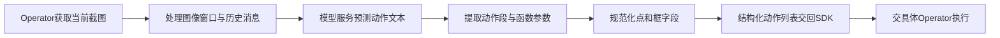
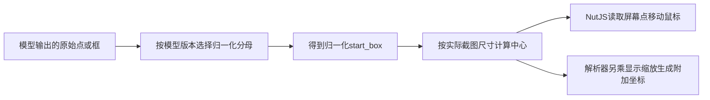
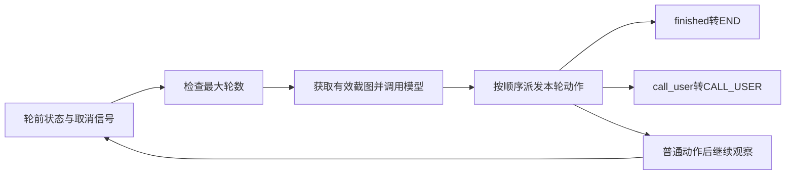

# UITARS感知与动作执行

本文固定 `bytedance/UI-TARS-desktop` 提交 `3ac2cb8d946d78d5ff92ad17b318eaafa18c178c`，对照官方模型论文 `2501.12326v1`。选择 **LocalComputer → @ui-tars/sdk → NutJSElectronOperator/NutJSOperator** 这条真实导入链，以 V1_0 坐标分支为主；V1_5的缩放只作为明确标注的分支差异。仓库另有 Agent TARS 和 `multimodal/gui-agent`，本文不把它们的协议拼接到这条执行链。[Desktop实际导入与本地Operator装配](https://github.com/bytedance/UI-TARS-desktop/blob/3ac2cb8d946d78d5ff92ad17b318eaafa18c178c/apps/ui-tars/src/main/services/runAgent.ts#L5-L37)

完整示例：[ui-tars.py](../../examples/agents/ui-tars.py)。它只解析人工字符串、计算坐标和演示状态，不调用模型、不采集截图、不控制鼠标键盘。所读包清单中桌面应用版本为0.2.4，SDK与NutJS包均为1.2.3；这些版本各自独立，也不等于模型权重版本。[Desktop包版本](https://github.com/bytedance/UI-TARS-desktop/blob/3ac2cb8d946d78d5ff92ad17b318eaafa18c178c/apps/ui-tars/package.json) [SDK包版本与依赖](https://github.com/bytedance/UI-TARS-desktop/blob/3ac2cb8d946d78d5ff92ad17b318eaafa18c178c/packages/ui-tars/sdk/package.json)

## 学习目标

- 区分模型的截图到动作预测、SDK的循环与协议转换、桌面宿主的设备和界面管理。
- 从动作文本经解析和框归一化追踪到实际点击坐标，识别模型版本及显示缩放的影响。
- 推导轮数预算与终态规则，区分执行器返回、模型结束和独立任务验收。

## 前置知识

需要状态机、字符串语法、图像尺寸和归一化坐标。模型动作不是操作系统直接执行的代码：必须经历解析、参数检查和 Operator 分派。截图尺寸 W/H、模型坐标归一化因子 Fx/Fy、设备显示缩放 s 是不同变量；同名“坐标”字段若处在不同层，不能直接互换。

## 基本机制

模型论文将过程表为任务指令与逐轮观测/动作序列，模型用截图及历史产生下一动作。桌面宿主负责选择模型配置、LocalComputer或其他Operator，并提供状态回调与中断信号；SDK的 `GUIAgent.run` 获取截图，调用 `UITarsModel.invoke`，后者请求配置的模型服务并调用 `actionParser`，SDK最后遍历解析结果交给执行器。它不是“模型权重直接点击桌面”。[UI-TARS模型交互架构](https://arxiv.org/html/2501.12326v1#S4.SS1) [SDK Operator和循环接口](https://github.com/bytedance/UI-TARS-desktop/blob/3ac2cb8d946d78d5ff92ad17b318eaafa18c178c/packages/ui-tars/sdk/README.md)

| 层次 | 本文读取的实现 | 承担的职责 |
| --- | --- | --- |
| 模型 | 官方论文、SDK Model适配接口 | 给定观测与历史预测文本动作；模型训练在本宿主之外 |
| SDK | GUIAgent、Model、action-parser | 截图/请求/解析/执行循环，重试与状态回调 |
| 桌面宿主 | runAgent、NutJSElectronOperator | Electron截图、设置装配、界面状态与本机特定输入覆盖 |
| 本地执行器 | NutJSOperator | 将已解析的动作映射为鼠标、键盘或等待 |

宿主还支持浏览器与远端Operator，但本文只读其选择入口，不据此声称这些实现共享相同坐标变换或设备语义。[Operator选择与GUIAgent构造](https://github.com/bytedance/UI-TARS-desktop/blob/3ac2cb8d946d78d5ff92ad17b318eaafa18c178c/apps/ui-tars/src/main/services/runAgent.ts#L121-L243)

## 推导或示例

### 知识点一：截图观测如何经过明确的动作协议

**问题与机制。** 原生GUI模型为何仍需要动作解析？论文建模 $a_t\sim\pi_\theta(\cdot\mid I,H_{t-1},o_t)$，I是任务指令，o是截图，H保留历史交互；统一动作空间包括 click、drag、type、wait，以及 finished、call_user等终端动作。模型决定动作内容，解析器将字符串转成结构化字段，执行器才解释字段对应什么设备操作。[UI-TARS统一动作空间](https://arxiv.org/html/2501.12326v1#S4.SS3)

对本例的协议子集，设 `Call = name(keyword=literal,...)`，可派发条件为

$$
V(call)=\mathbf1[name\in A]\cdot\mathbf1[keys=Schema(name)]\cdot\mathbf1[values\text{为允许字面量}].
$$

这是教学校验模型，不是论文训练损失。它有意要求单个动作、唯一关键字和固定参数集合，避免把可解析的任意函数名直接视为可执行能力。

```python
def parse_action(text):
    """严格解析单个公共动作子集，仅读取字面量；不执行函数或生成代码。"""
    payload = re.split(r'Action[:：]', text)[-1].strip()
    schema = {'click': {'start_box'}, 'drag': {'start_box', 'end_box'}, 'type': {'content'},
              'hotkey': {'key'}, 'scroll': {'start_box', 'direction'},
              'wait': set(), 'finished': set(), 'call_user': set()}
    try:
        node = ast.parse(payload, mode='eval').body
        if not isinstance(node, ast.Call) or not isinstance(node.func, ast.Name) or node.args:
            raise ValueError("要求无位置参数的动作调用")
        name = node.func.id
        if name not in schema or len(node.keywords) != len({k.arg for k in node.keywords}):
            raise ValueError("未知动作或重复参数")
        if {k.arg for k in node.keywords} != schema[name]:
            raise ValueError("参数缺失或多余")
        args = {k.arg: ast.literal_eval(k.value) for k in node.keywords}
        if any(not isinstance(value, str) for value in args.values()):
            raise ValueError("该教学协议要求参数为字符串字面量")
        for key, value in list(args.items()):
            if key.endswith('_box'):
                coords = ast.literal_eval(value)
                if not isinstance(coords, (list, tuple)) or len(coords) not in (2, 4):
                    raise ValueError("框须包含两个点坐标或四个边界坐标")
                if any(isinstance(v, bool) or not isinstance(v, (int, float)) or not math.isfinite(v) for v in coords):
                    raise ValueError("框坐标须为有限数字")
                args[key] = list(coords) * 2 if len(coords) == 2 else list(coords)
        if name == 'scroll' and args['direction'] not in ('up', 'down'):
            raise ValueError("本例仅覆盖所读NutJS实现的上下滚动")
        return {'action_type': name, 'action_inputs': args}
    except (SyntaxError, TypeError, ValueError) as exc:
        raise ValueError("动作不符合教学协议") from exc
```

输入 `Action: click(start_box='[500,250]')` 得到动作类型click和四元框 `[500,250,500,250]`，二维点被扩成退化边界框。字符串内容用字面量解析，不调用函数；`unknown()`、重复参数或任意嵌套可执行表达式会被拒绝。真实源码另外支持中文冒号、多个空行分隔动作、point/bbox标记和不同输出格式，本例仅重写共同子集，不声称完全兼容所有模型响应。

SDK还会处理观测历史。该版本 `processVlmParams` 保留最近N张图并删掉对应旧图占位消息，其余文本历史仍可保留。图像窗口限制不等于整个文本上下文严格有界；若一条旧动作依赖已经删除的截图，后续决策应依赖保留的文字证据，而非假定模型仍看到原图。[SDK 图像窗口与对应消息处理](https://github.com/bytedance/UI-TARS-desktop/blob/3ac2cb8d946d78d5ff92ad17b318eaafa18c178c/packages/ui-tars/sdk/src/utils.ts#L58-L88)



**源码定位。** `UITarsModel.invoke` 预处理图片、拼消息、调用模型服务，再将 prediction、factor、screenContext和modelVer交给 `actionParser`。解析器返回 `action_type/action_inputs`，不会执行模型写出的函数。[模型请求到动作解析的连接](https://github.com/bytedance/UI-TARS-desktop/blob/3ac2cb8d946d78d5ff92ad17b318eaafa18c178c/packages/ui-tars/sdk/src/Model.ts#L276-L359) [parseActionVlm与parseAction](https://github.com/bytedance/UI-TARS-desktop/blob/3ac2cb8d946d78d5ff92ad17b318eaafa18c178c/packages/ui-tars/action-parser/src/actionParser.ts#L172-L329)

**条件与反例。** 解析成功不保证执行器支持该动作，更不保证画面里的目标存在。所读 NutJS手册列有左右滚动，但execute的scroll分支仅处理up/down并对其他方向告警；因此本例只接受上下方向。某些函数缺参数、坐标非有限或动作未知的处理在原解析器较宽松，教学严格拒绝属于额外显式约束，不能当成原版本已有的完整防护。[NutJS实际scroll分支](https://github.com/bytedance/UI-TARS-desktop/blob/3ac2cb8d946d78d5ff92ad17b318eaafa18c178c/packages/ui-tars/operators/nut-js/src/index.ts#L293-L323)

### 知识点二：模型框、屏幕点与显示缩放不能混为一谈

**问题与机制。** 为何同一 `[500,250]` 在不同路径可能得到不同坐标？V1_0路径先将原始框按因子归一化：$\bar x=x/F_x,\bar y=y/F_y$。归一化框中心映射到屏幕为

$$
p_x=Q_{1000}\!\left(\frac{\bar x_1+\bar x_2}{2}W\right),\quad
p_y=Q_{1000}\!\left(\frac{\bar y_1+\bar y_2}{2}H\right),
$$

其中 $Q_f(v)=round(fv)/f$，是千分之一坐标单位的量化，不是最后必须取整数像素。默认因子由SDK常量 `[1000,1000]` 给出。[SDK默认坐标因子](https://github.com/bytedance/UI-TARS-desktop/blob/3ac2cb8d946d78d5ff92ad17b318eaafa18c178c/packages/ui-tars/sdk/src/constants.ts#L8-L10) [parseBoxToScreenCoords](https://github.com/bytedance/UI-TARS-desktop/blob/3ac2cb8d946d78d5ff92ad17b318eaafa18c178c/packages/ui-tars/sdk/src/utils.ts#L29-L55)

```python
def grounding_coordinates(box, screen_size, normalization=(1000.0, 1000.0), display_scale=1.0):
    """分别计算归一化框、NutJS使用的屏幕点与解析器附加的缩放坐标。"""
    if len(box) not in (2, 4) or len(screen_size) != 2 or len(normalization) != 2:
        raise ValueError("要求二维屏幕、二维归一化尺度及二或四个框坐标")
    coords = list(box) * 2 if len(box) == 2 else list(box)
    w, h = screen_size
    fx, fy = normalization
    if not all(math.isfinite(v) for v in coords + [w, h, fx, fy, display_scale]) or min(w, h, fx, fy, display_scale) <= 0:
        raise ValueError("尺度须为正有限数，坐标须有限")
    normalized = [v / (fx if i % 2 == 0 else fy) for i, v in enumerate(coords)]
    x1, y1, x2, y2 = normalized
    if not (0 <= x1 <= x2 <= 1 and 0 <= y1 <= y2 <= 1):
        raise ValueError("归一化框越界或倒置")
    # 所读实现以DEFAULT_FACTORS=1000量化到千分之一屏幕坐标单位。
    point = [math.floor(((x1 + x2) / 2) * w * 1000 + 0.5) / 1000,
             math.floor(((y1 + y2) / 2) * h * 1000 + 0.5) / 1000]
    return {'normalized_box': normalized, 'operator_point': point,
            'parser_start_coords': [v * display_scale for v in point]}
```

在1920×1080屏幕上，原始点 `[500,250]` 归一化为 `[0.5,0.25]`，得到 `operator_point=[960,270]`。若scaleFactor=2，解析器附加的 `start_coords` 为 `[1920,540]`。所读 NutJS `execute` 不消费这个附加字段，它把 `start_box` 交给 `parseBoxToScreenCoords`，且该调用没有传scaleFactor；因此该路径采用前者，不能把后者再当作待归一化坐标。

V1_5是另一个明确分支：`smartResizeForV15` 根据长宽比、像素上下限和对齐因子计算模型空间宽高，然后除以该宽高。其超预算缩放比例可写为 $\beta=\sqrt{WH/P_{max}}$，再对 $W/\beta,H/\beta$ 做因子向下对齐；像素过少时使用相应上采样与向上对齐。不能始终除1000，也不能拿宿主窗口的逻辑宽高代替该模型空间尺寸。教学函数允许显式传normalization，但没有模拟全部smart-resize分支。[V1_5缩放尺寸与模型版本分支](https://github.com/bytedance/UI-TARS-desktop/blob/3ac2cb8d946d78d5ff92ad17b318eaafa18c178c/packages/ui-tars/action-parser/src/actionParser.ts#L28-L58)



**源码定位。** `parseActionVlm` 用默认factor或V1_5的smartResizeFactors归一化框，并另生成带scaleFactor的 `start_coords`。[两类坐标字段的生成](https://github.com/bytedance/UI-TARS-desktop/blob/3ac2cb8d946d78d5ff92ad17b318eaafa18c178c/packages/ui-tars/action-parser/src/actionParser.ts#L191-L239) NutJS明确从 `start_box` 重算中心；Electron子类负责选主屏幕、截图与尺寸调整。[NutJS执行坐标入口](https://github.com/bytedance/UI-TARS-desktop/blob/3ac2cb8d946d78d5ff92ad17b318eaafa18c178c/packages/ui-tars/operators/nut-js/src/index.ts#L94-L106) [Electron截图返回尺寸与scaleFactor](https://github.com/bytedance/UI-TARS-desktop/blob/3ac2cb8d946d78d5ff92ad17b318eaafa18c178c/apps/ui-tars/src/main/agent/operator.ts#L36-L83)

**条件与反例。** 本函数只验证数值范围，不验证命中控件；归一化坐标1对应屏幕边界，具体点击仍需考虑操作系统像素索引和裁剪。模型空间与截图尺寸取错会按比例偏移，即使每个数字都合法。多屏原点、负坐标、横纵显示缩放不同及设备转换均不在本例中，不将单显示器推导推广成全部Operator保证。

**定位误差应怎样记录。** 若模型输出偏差为 $\Delta x$ 个归一化单位，对屏幕横向误差约为 $W\Delta x/F_x$；提高屏幕分辨率不会自动消除模型定位误差。排查点击偏移应同时保存原截图尺寸、原始模型坐标、归一化分母、Operator实际使用的字段和最终输入坐标，而不是只保留一个截图上的红点。

### 知识点三：SDK循环、动作派发与终态的预算

**问题与机制。** 一轮推理会执行多少设备动作，何时停止？该版本 SDK 可从一次预测解析出一个动作列表，按顺序派发。每个有效观测/模型循环增加 `loopCnt`，并在下一轮开始前检查上限。若当前状态 X、已用轮数 n、最大轮数 L，则教学转移先检查

$$
X\ne RUNNING\Rightarrow\text{不推进},\quad
abort\Rightarrow USER\_STOPPED,\quad n\ge L\Rightarrow ERROR;
$$

通过后令 $n'=n+1$，遍历本轮动作；遇到 `finished` 变为END，遇到 `call_user` 变为CALL_USER，并跳过其后的动作。它们的含义来自统一动作协议，不是任务效果的独立证明。[UI-TARS终端动作定义](https://arxiv.org/html/2501.12326v1#S4.SS3)

```python
def agent_loop_transition(state, actions, max_loops, aborted=False):
    """模拟一轮有效截图之后的无异常执行分支；只记录派发意图和终态。"""
    if not isinstance(max_loops, int) or max_loops <= 0:
        raise ValueError("最大轮数须为正整数")
    result = deepcopy(state)
    result['dispatched'] = []
    if result['status'] != 'RUNNING':
        return result
    if aborted:
        result['status'] = 'USER_STOPPED'
        return result
    if result['loops'] >= max_loops:
        result['status'] = 'ERROR'
        result['reason'] = 'REACH_MAXLOOP'
        return result
    result['loops'] += 1
    allowed = {'click', 'drag', 'type', 'hotkey', 'scroll', 'wait', 'finished', 'call_user'}
    for action in actions:
        kind = action['action_type']
        if kind not in allowed:
            raise ValueError("未支持的动作")
        result['dispatched'].append(deepcopy(action))
        if kind == 'finished':
            result['status'] = 'END'
            break
        if kind == 'call_user':
            result['status'] = 'CALL_USER'
            break
    result['needs_next_observation'] = result['status'] == 'RUNNING'
    return result
```

给动作列表 `[call_user(), click(...)]`，只会记录call_user派发意图，状态为CALL_USER，后面的click不会记录；轮数只增加一。若状态已经END，后续调用不再推进。这里“派发”只是写入列表，函数假设执行器未抛异常；它不模拟异步中途取消、暂停恢复、截图失败或网络退避。



**源码定位。** `GUIAgent.run` 检查轮数、分别重试截图和模型请求，再遍历 `parsedPredictions` 调 `operator.execute`；执行器返回状态可更新运行状态，之后对call_user和finished作专门终止映射。[轮数、截图与模型调用](https://github.com/bytedance/UI-TARS-desktop/blob/3ac2cb8d946d78d5ff92ad17b318eaafa18c178c/packages/ui-tars/sdk/src/GUIAgent.ts#L154-L300) [执行器派发和终态映射](https://github.com/bytedance/UI-TARS-desktop/blob/3ac2cb8d946d78d5ff92ad17b318eaafa18c178c/packages/ui-tars/sdk/src/GUIAgent.ts#L350-L421) NutJS会先对这些终端动作返回END，再由SDK将call_user单独映射为CALL_USER；这是实际调用顺序，不能画成模型直接结束宿主进程。

**预算推导。** 在每轮最多K个动作、截图有效、执行器每动作最多重试r次的条件下，动作调用尝试数上界为 $L K(1+r)$；L本身不是鼠标事件数上限。宿主给模型和截图重试5次、执行重试1次，是这次读取版本的装配值；一次动作部分生效后重试仍可能产生重复效果，重试次数不是幂等保证。[Desktop重试与循环配置](https://github.com/bytedance/UI-TARS-desktop/blob/3ac2cb8d946d78d5ff92ad17b318eaafa18c178c/apps/ui-tars/src/main/services/runAgent.ts#L217-L230)

**观测失败与状态含义。** 源码对于无法解码的截图会减少已加的loopCnt并增加独立截图错误计数，因此把全部请求次数简单界定为L也不准确。END可能来自模型自报完成或Operator状态，不等于按钮点击后业务真正保存成功；CALL_USER则是需要用户介入，不能记为任务通过。即便鼠标移动与点击都成功，也需下一张截图或独立系统状态才能验证真实结果。

## 适用条件与限制

原论文中的长期经验学习包括轨迹收集、规则与模型过滤、人工修正以及后续训练；这不是桌面SDK每保存一次会话就自动更新模型权重。原论文的反思训练也不等于宿主必然有Mobile-Agent-v2式独立反思agent。本文只描述实际读取的循环与解析，不报告论文Benchmark成绩的复现。[UI-TARS长期经验与反思训练](https://arxiv.org/html/2501.12326v1#S4.SS5)

## 协议、依赖与许可边界

所读根许可和SDK包均为Apache-2.0；再分发须遵守许可、版权声明、修改说明和适用的NOTICE要求。SDK依赖模型HTTP客户端、Jimp和async-retry，NutJS包依赖 `@computer-use/nut-js`，桌面宿主依赖Electron；这些组件的具体运行环境和依赖条款不能由仓库主许可证代替。模型权重许可、部署服务条款也与Desktop代码许可证分开核验。本组只读取代码和文档，没有安装、构建、执行第三方内容或获取屏幕控制权限。[UI-TARS Desktop许可条款](https://github.com/bytedance/UI-TARS-desktop/blob/3ac2cb8d946d78d5ff92ad17b318eaafa18c178c/LICENSE) [NutJS依赖与包声明](https://github.com/bytedance/UI-TARS-desktop/blob/3ac2cb8d946d78d5ff92ad17b318eaafa18c178c/packages/ui-tars/operators/nut-js/package.json)

## 一个能暴露执行边界的坐标反例

坐标零值得单独核验。所读 NutJS 的点击移动辅助函数以是否为 null 判断位置，允许零；拖动分支却用四个坐标的真假值共同判断是否进入拖动，因而其中一项为零时可能跳过实际拖动。这说明通过解析与归一化的合法边界坐标，并不自动在每一种动作中得到相同执行行为。[NutJS拖动的条件判断](https://github.com/bytedance/UI-TARS-desktop/blob/3ac2cb8d946d78d5ff92ad17b318eaafa18c178c/packages/ui-tars/operators/nut-js/src/index.ts#L213-L234)

教学函数会保留零坐标，用于检查数学边界；它没有复刻该执行器条件，也没有修复或运行上游代码。若后续做真机对齐，应分别比较点击和拖动，并报告具体提交，而不是把一个算术测试通过当成全部动作已验证。

## 实践任务

交付三份对照：动作字符串到结构化字段、模型框到Operator点和附加坐标、普通/finished/call_user/取消/预算耗尽的状态表。真机实验另需固定模型权重、服务协议、桌面版本、显示缩放和目标应用，记录截图前后及业务成功条件；所有这些实际模型和设备实验仍未执行。教学函数由独立单元测试验证；测试结果不自动升级真机实践状态。

## 掌握标准

能从宿主导入语句追到实际SDK与Operator，不能只按仓库名称猜架构；能说清归一化分母、截图尺寸和显示缩放分别在哪里使用；能手算960/270并说明为何附加坐标不同；能区分终端动作、循环状态和真实任务验收。不得把严格教学解析器的校验能力说成原解析器已完整保证。

---

[返回模块](../modules/业务Agent.md) · [知识点索引](../../docs/知识点索引.md) · [完整教学代码](../../examples/agents/ui-tars.py) · [提出更正](https://github.com/yanbozhang/llm-systems-wiki/issues/new?template=knowledge.yml)

觉得这篇推导有帮助，可以在 [GitHub](https://github.com/yanbozhang/llm-systems-wiki) 点 Star 收藏更新；分享时欢迎链接到具体知识点，便于读者复核公式、代码与来源。
