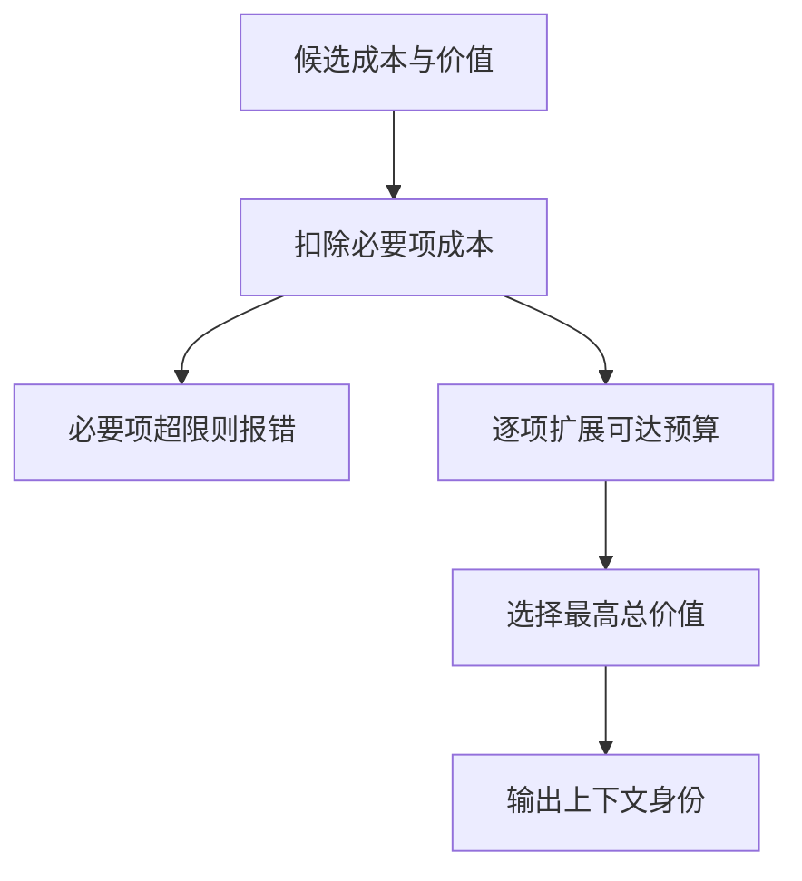
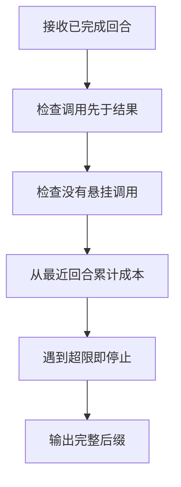
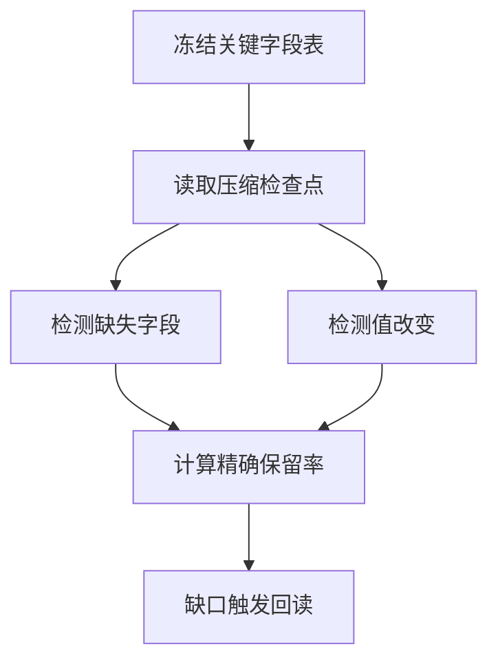

# 上下文选择与压缩

> 上下文选择决定每次模型调用能看到哪些规则、证据与执行状态。压缩的目标是保留足以继续决策的信息；长度变短只是资源变化，不能证明任务约束和证据仍然完整。

## 学习目标

- 按任务选择上下文
- 设计压缩检查点
- 检测信息丢失

## 前置知识

先读[Harness任务循环](Harness任务循环.md)。需要集合、token预算和工具调用配对概念。注意模型的上下文窗口、单次输出上限、整项任务累计token是不同计量对象；本页讨论单次输入选择，预算中必须先为输出留位置。

## 基本机制

官方上下文工程文章把上下文维护描述为循环中的反复选择，并讨论压缩和结构化笔记。AutoGen提供按消息数和按token限制的上下文视图，SWE-agent的历史处理器可把旧观测替换成省略提示。它们分别改变选择单位、长度约束和呈现方式，不能统称为无损摘要。[Effective context engineering for AI agents](https://www.anthropic.com/engineering/effective-context-engineering-for-ai-agents)；[SWE-agent LastNObservations 历史处理](https://github.com/SWE-agent/SWE-agent/blob/3ea751c087f32b16e039a2233dd6eefecef325d5/sweagent/agent/history_processors.py#L147)。

一个可解释设计先划定不可丢失区：当前目标、禁止动作、未完成副作用、产物身份与证据版本；其余资料才按相关性和成本选择。语义摘要、消息裁剪、原文按需回读是三种操作，分别要检查语义保持、协议闭包和来源可达性。

完整教学实现：[运行机制示例](../../examples/harness/context.py)。示例仅使用 Python 标准库，对传入的模拟数据计算结果；本页没有执行模型、外部工具或真实业务实验。

## 推导或示例

### 知识点一：预算选择是带必要项的离散优化

长历史不能简单按“看起来重要”无限追加。设输入窗口为 $W$ 、预留输出为 $O$ 、固定规则和工具定义成本为 $F$ ，可分配预算 $B=W-O-F$ 。每条候选 $i$ 的成本 $c_i$ 以token计，教学价值 $v_i$ 无量纲，选择变量 $z_i\in\lbrace 0,1\rbrace$ 。本页的**教学目标**为

$$
\max_z\sum_i v_i z_i,\quad \sum_i c_i z_i\le B,\quad z_i=1\ (i\in M).
$$

$M$ 是必要项，不能因为价值分低就被删除。若必要项已经超预算，应缩小任务或重新组织输入，而不是静默扔掉约束。代码把必要项成本先扣除，再用离散动态规划枚举可达成本；每次只从旧状态扩展，避免一个条目被多次选中。

手算预算8，目标占2；A占4、价值6，B和C各占3、价值5。按单条价值先选A只能获得6，选B+C获得10。这里的价值由教学输入指定，不是模型真实贡献；检索证据常有互补性，两段分别无用、合起来才有用，此时可加目标就失真。

```python
def select_context(items: list[tuple[str, int, int, bool]], budget: int) -> list[str]:
    """在小整数token预算内精确选择条目，强制保留必要项。"""
    if type(budget) is not int or budget < 0:
        raise ValueError('预算须为非负整数')
    if len({x[0] for x in items}) != len(items):
        raise ValueError('条目身份重复')
    if any(type(c) is not int or c <= 0 or type(v) is not int or v < 0
           or type(m) is not bool for _, c, v, m in items):
        raise ValueError('成本、价值或必选标记不合法')
    mandatory = [name for name, _, _, m in items if m]
    left = budget - sum(c for _, c, _, m in items if m)
    if left < 0:
        raise ValueError('必要上下文已超预算')
    states = {0: (0, ())}
    for name, cost, value, required in items:
        if required:
            continue
        for used, (score, chosen) in list(states.items()):
            new = used + cost
            if new <= left and score + value > states.get(new, (-1, ()))[0]:
                states[new] = score + value, chosen + (name,)
    best = max(states, key=lambda used: (states[used][0], -used))
    return mandatory + list(states[best][1])
```

items 的四元组是身份、token数、价值、是否必选。函数返回选中的身份，预算相同时保留稳定的先到方案，总价值相同时选择更低成本。动态规划复杂度近似为条目数乘整数预算，仅用于小规模教学；生产token计数还应纳入消息封装和工具Schema。



源码与原文：[AutoGen TokenLimitedChatCompletionContext.get_messages](https://github.com/microsoft/autogen/blob/004749e6b7102c8fd317b9b1499ce5807223c278/python/packages/autogen-core/src/autogen_core/model_context/_token_limited_chat_completion_context.py#L57)；[Effective context engineering for AI agents](https://www.anthropic.com/engineering/effective-context-engineering-for-ai-agents)；[LangGraph Memory overview 官方文档](https://docs.langchain.com/oss/python/langgraph/memory)。

该版本 AutoGen get_messages 使用模型客户端计token，并在超限时删除中间消息；它没有实现本文背包模型。可验证性质是必要项保留、总成本不超预算、每个条目最多选一次。反例是多样性、引用配对和互补证据，它们需要额外约束而不能硬套线性价值。

### 知识点二：压缩单位必须维护调用与结果闭包

模型消息是协议对象，不是一袋任意可拼接句子。保留工具结果却丢掉调用会让结果无法归属；保留调用却丢掉结果会让模型误以为仍在等待。定义回合 $G_j$ 中调用身份集合为 $C_j$ 、结果身份集合为 $R_j$ ，本页的严格完成回合要求

$$
C_j=R_j,\quad \forall r\in R_j:\mathrm{pos}(call_r)\lt \mathrm{pos}(result_r).
$$

再按完整回合求最近连续后缀 $G_k,\ldots,G_n$ ，满足 $\sum_{j=k}^n cost(G_j)\le B$ 。这个目标与第一点“从全部历史任意挑价值最大条目”不同：最近回合超大时宁可返回空后缀，也不越过它留下更早的孤立上下文。

AutoGen BufferedChatCompletionContext在裁剪后检测首条是否为工具结果并移除；TokenLimited版本也有首条检查。这是具体局部保护，不是任意多工具图的全局闭包证明。SWE-agent LastNObservations保持历史条目而替换旧观测正文，说明“保留身份”与“保留完整内容”还能分开设计。

例如两回合成本4和5，预算6，只保留后者；预算4也不能跳过最后回合偷偷保留前者，因为这里承诺的是连续最近视图。若最新调用仍在飞行中，它是当前控制状态，应单独保存，不能伪装成已完成历史。

```python
def trim_complete_turns(turns: list[list[dict]], budget: int) -> list[list[dict]]:
    """将完整调用回合作为原子块，保留预算内最近的连续后缀。"""
    if type(budget) is not int or budget < 0:
        raise ValueError('预算须为非负整数')
    costs = []
    for turn in turns:
        pending, seen = set(), set()
        for msg in turn:
            if type(msg['tokens']) is not int or msg['tokens'] < 0:
                raise ValueError('token计数不合法')
            kind = msg['kind']
            if kind == 'call':
                if msg['id'] in seen:
                    raise ValueError('调用身份重复')
                seen.add(msg['id']); pending.add(msg['id'])
            elif kind == 'result':
                if msg['id'] not in pending:
                    raise ValueError('结果缺少对应调用')
                pending.remove(msg['id'])
            elif kind != 'text':
                raise ValueError('消息类型不合法')
        if pending:
            raise ValueError('回合包含未完成调用')
        costs.append(sum(m['tokens'] for m in turn))
    used, start = 0, len(turns)
    for i in range(len(turns) - 1, -1, -1):
        if used + costs[i] > budget:
            break
        used += costs[i]; start = i
    return [list(turn) for turn in turns[start:]]
```

代码逐条维护pending集合，结果必须匹配此前尚未完成的调用，同一回合不能重复使用调用ID。通过验证后才从尾部按回合累计成本。它返回新列表容器，不改原消息；消息字典仍是共享只读视图，调用方若要变更内容需自行深拷贝。



源码与原文：[AutoGen BufferedChatCompletionContext.get_messages](https://github.com/microsoft/autogen/blob/004749e6b7102c8fd317b9b1499ce5807223c278/python/packages/autogen-core/src/autogen_core/model_context/_buffered_chat_completion_context.py#L34)；[AutoGen TokenLimitedChatCompletionContext.get_messages](https://github.com/microsoft/autogen/blob/004749e6b7102c8fd317b9b1499ce5807223c278/python/packages/autogen-core/src/autogen_core/model_context/_token_limited_chat_completion_context.py#L57)；[SWE-agent LastNObservations 历史处理](https://github.com/SWE-agent/SWE-agent/blob/3ea751c087f32b16e039a2233dd6eefecef325d5/sweagent/agent/history_processors.py#L147)；[Effective context engineering for AI agents](https://www.anthropic.com/engineering/effective-context-engineering-for-ai-agents)。

可验证性质包括结果不悬空、未完成回合拒绝、输出为输入连续后缀。边界是多轮工具流或跨回合回调：调用结果不一定能放进同一原子块，此时应由宿主先建立依赖闭包，不能只凭对话的用户轮次分组。

### 知识点三：用关键字段保持率审计压缩损失

“摘要挺像原文”不足以判断能否恢复任务。需要先固定不可改写字段，例如目标版本、输出路径、禁止覆盖、未确认写入、最后失败类型和来源定位。把原字段表记为 $K$ 、压缩结果记为 $S$ ，本页的**审计指标**是

$$
R_{exact}=\frac{\sum_{k\in K}\mathbf1[k\in S\land K[k]=S[k]]}{|K|}.
$$

该值不是自然语言语义召回率，更不是成功概率。若 $|K|=0$ ，函数返回None表示指标未定义，避免把没有要求误称100%保留。对两字段target=repo@v1、rule=保留原文件，摘要只剩target=repo@v2，结果是一个缺失、一个改变，保持率0。

结构化笔记允许把大量工具原文外移，但必须留下原文身份、版本和读取入口；一段把“在特定版本关闭默认优化”概括成“默认关闭优化”的摘要保留了字面主题，却失去了适用范围。为此关键表可把版本与结论分成两个字段，而不是只做文本相似度。

SWE-agent历史处理器的省略标记明确说明旧输出被删除，不伪造它仍然在当前上下文内。教学审计同样需要暴露信息缺口：缺字段时应重新读取权威状态，不能让模型从已有摘要补出从未记录的事实。

```python
def audit_checkpoint(required: dict[str, str], summary: dict[str, str]) -> dict:
    """对必须逐字保持的约束、身份和来源版本做确定性审计。"""
    missing = sorted(required.keys() - summary.keys())
    changed = sorted(k for k in required.keys() & summary.keys()
                     if required[k] != summary[k])
    kept = len(required) - len(missing) - len(changed)
    return {'missing': missing, 'changed': changed,
            'retention': kept / len(required) if required else None}
```

函数分别给出missing、changed以及精确保持率，便于区分遗漏与被改写。新增字段不在此指标分子分母中；因此想检测幻觉还需要独立的来源蕴含检查。任务要求中的路径和commit适合精确比较，一般段落同义改写则不适合直接应用本函数。



源码与原文：[SWE-agent LastNObservations 历史处理](https://github.com/SWE-agent/SWE-agent/blob/3ea751c087f32b16e039a2233dd6eefecef325d5/sweagent/agent/history_processors.py#L147)；[Effective context engineering for AI agents](https://www.anthropic.com/engineering/effective-context-engineering-for-ai-agents)；[LangGraph Persistence 官方文档](https://docs.langchain.com/oss/python/langgraph/persistence)。

官方文章讨论高保真压缩和结构化笔记，未提出本文R_exact。可验证性质是字段顺序无关、遗漏和改写互斥、空关键集返回未定义。反例是把新增假结论加到摘要中：保持率仍可能为1，因此必须同时审计无来源新增信息。

## 适用条件与限制

本页假设宿主能拿到可靠token计数、明确历史边界和冻结的关键字段。真实模型的“价值”没有现成精确标签，压缩收益要在相同任务、模型与总预算下比较。被摘要掉的文件若后来更新，仅保留路径不足以复现，需要commit、文档版本或内容摘要。

常见误区是把更短当更准、把更长当更全、把摘要写入文件当成已验证长期记忆。回读成本也不是零；不可重取的副作用记录不能为了节约token直接删除。

## 实践任务

制作四段模拟材料：一条硬约束、一段长日志、两个必须一起使用的证据。分别设计背包选择和完整回合裁剪输入，手算不同策略的结果。再生成一个故意丢版本的检查点，列出精确审计能发现什么、发现不了什么，保留需回读的原文身份表。

实践状态保持 `designed`。教学函数的测试由统一 UT 流程负责，本页不把手算预期写成已运行结果，也不把示例性质外推为真实模型成功率。

## 掌握标准

- 能区分单次上下文预算与任务累计费用。
- 能给出贪心选取输给组合选择的反例。
- 能为工具调用和结果定义闭包，而非只删第一条消息。
- 能解释保持率1为何仍不能证明摘要无幻觉或可继续任务。

## 源码导读与模型边界

源码阅读从两个AutoGen get_messages比较选择单位，再读LastNObservations的省略策略。三个函数分别刻画价值选择、协议一致和关键字段保持，属于三个不同目标；没有一个指标可以代替另外两个。生产还需处理多模态token、流式消息和来源失效。

### 连贯案例复盘

把一次研究任务拆成目标、限制、证据与历史四类。目标和禁止动作作为必要项，证据以可回读的来源身份组成候选，已经确认的动作结果作为检查点字段。长日志可以省略正文，但“某次写操作结果未知”不能被一起省略，否则压缩后的任务可能重复执行它。

| 材料 | 建议表示 | 压缩后核对 |
|---|---|---|
| 禁止覆盖原文件 | 精确字段 | 逐字值是否保持 |
| 某论文的适用条件 | 结论加版本定位 | 能否回读原段落 |
| 长工具日志 | 失败类别与原文入口 | 错误身份是否丢失 |
| 调用与结果 | 完整回合或依赖闭包 | 是否出现悬挂结果 |

手算背包例子后，不要直接认为B和C适合所有任务。若B是定义、C是限制条件，两者共同价值可能超过各自价值之和；若两者是同一篇文章的重复摘录，又可能几乎没有增量。此时正确改进是调整选择模型或把有依赖材料组成原子组，而不是反复调大一个看似精确的分数。

再检查摘要保持率：必要表全部保留，只能说明这张表中的字段没有改变。如果在旁边新添“用户允许发布”，精确保留率仍为一，但整份摘要已经错误。因此质量审计至少包含约束保持、无来源新增、证据可回读三个维度。一个百分比不应该掩盖另外两类缺口。

恢复任务时应把摘要看成索引和控制状态，不当成所有资料的替代品。需要精确引用、修改原句或复核代码行为时，应按记录版本回读原文；原文已变更则明确处理版本差异，不能从摘要补全不存在的细节。

本文源码链接均锁定实际读取的提交；论文锁定 arXiv 版本，在线官方文档记录读取日和正文指纹。公式中标为“教学模型”的预算、阈值和状态集合是本页设计，不是论文测得的效果。第三方文件只作为阅读依据，教学实现为独立简化。

## 2026研究进展

RE-TRAC把跨轨迹状态组织为结论、证据、未决问题与探索记录。本页的压缩策略可进一步检查：摘要是否保留失败方向和未验证事项，还是只保留一个看似完整的答案。实际读取的是arXiv v1，会议归属另由ICML 2026官方记录确认。 [会议来源与读取范围](../../sources/library/2026-paper-harness-retrac/README.md)

更多公式、代码示例、结构图及当前开源版本见[Harness研究进展](../frontiers/Harness研究进展.md)。新内容未执行真实模型实验。

---

[返回模块](../modules/Harness.md) · [知识点索引](../../docs/知识点索引.md) · [完整教学代码](../../examples/harness/context.py) · [提出更正](https://github.com/yanbozhang/llm-systems-wiki/issues/new?template=knowledge.yml)

觉得这篇推导有帮助，可以在 [GitHub](https://github.com/yanbozhang/llm-systems-wiki) 点 Star 收藏更新；分享时欢迎链接到具体知识点，便于读者复核公式、代码与来源。
