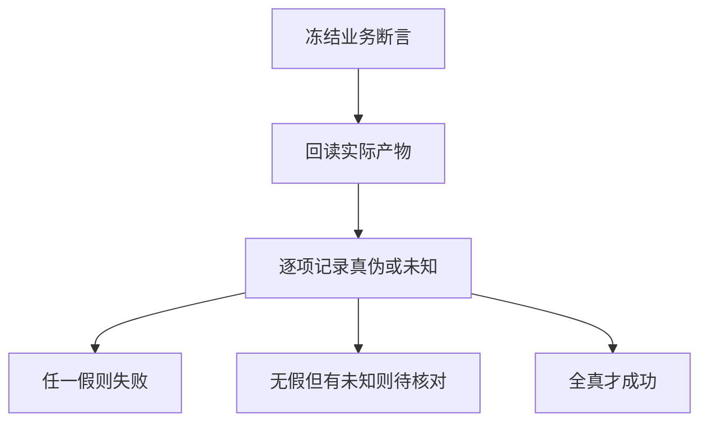
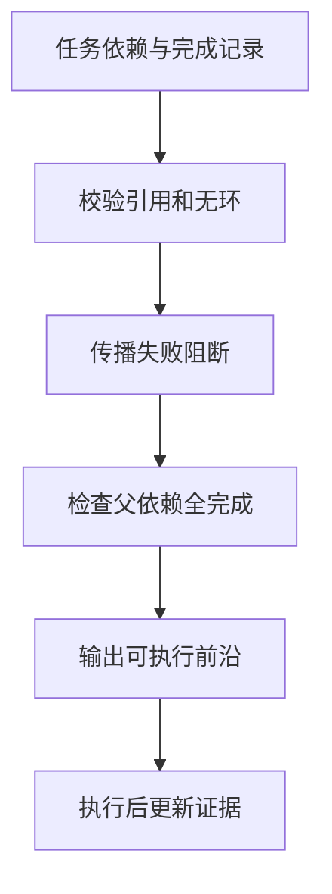
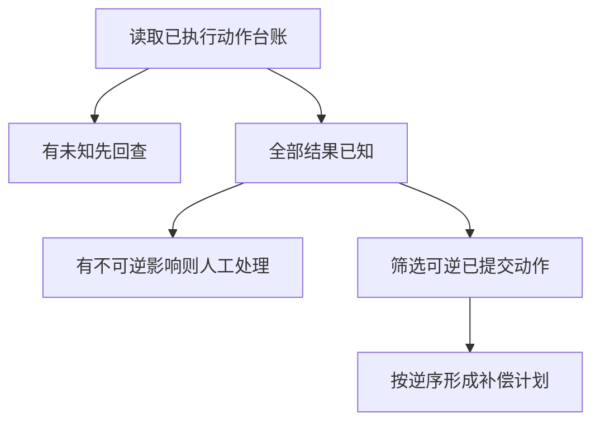

# 业务Agent任务闭环

> 业务Agent的目标是改变外部任务状态，并提供可验收的结果。对话结束、步骤执行完成和用户目标满足是三件事；闭环需要预先冻结终态契约，沿真实依赖推进，并在失败时恢复或补偿已发生的动作。

## 学习目标

- 把用户目标转换成终态契约
- 区分过程和结果
- 设计恢复与补偿

## 前置知识

先读[Harness任务循环](Harness任务循环.md)。需要集合、依赖图和三值逻辑。业务契约应描述产物内容、来源完整性、目标位置以及不可接受副作用，不能只写“工具成功”或“页面出现完成提示”。

## 基本机制

OSWorld论文将真实任务组织为初始环境、指令和任务特定执行式评估。源码DesktopEnv.step允许DONE结束交互，但独立evaluate会获取实际结果、运行指标和组合结果；所以智能体的结束信号与环境验收是不同调用。[OSWorld: Benchmarking Multimodal Agents for Open-Ended Tasks in Real Computer Environments](https://arxiv.org/html/2404.07972v1)；[OSWorld DesktopEnv 观测、步骤与验收](https://github.com/xlang-ai/OSWorld/blob/04718eab9327856efe8192cc58161acc7a7627e2/desktop_env/desktop_env.py#L433)。

下面以“读取两份资料、生成草稿和索引、核对引用”为贯穿任务。主状态至少保留目标版本、输入身份、动作结果、产物位置和断言证据。任务分解改变执行方式，不能改变原始成功条件；失败恢复也必须把曾经发生的副作用保留下来。

完整教学实现：[运行机制示例](../../examples/agents/task-loop.py)。示例仅使用 Python 标准库，对传入的模拟数据计算结果；本页没有执行模型、外部工具或真实业务实验。

## 推导或示例

### 知识点一：把业务成功写成三值终态契约

如果任务要两份资料都入索引、链接正确、原文件未覆盖，那么文件存在只满足一个局部要求。设契约断言为 $p_1,\ldots,p_n$ ，每项取 $\lbrace T,F,U\rbrace$ ，其中U表示证据未知。本文的**三值合取模型**是

$$
Q(p)=\begin{cases}F,&\exists i:p_i=F\cr U,&\neg\exists i:p_i=F\land\exists i:p_i=U\cr T,&\forall i:p_i=T.\end{cases}
$$

失败优先：已有明确违反，即使另一项尚未观察，也不能声称“只待确认”。但应同时保留所有子断言，便于继续诊断。空契约被拒绝，避免空集合上的逻辑真值被误用为“没有检查也算成功”。

手算sources=True、links=None、originals=True得到unknown；links=False得到failed；全部True才succeeded。如果验收器打不开文件，应记录U以及读取错误，不能当成内容错误；如果成功读取且缺链接，则是F。这一区分影响是否重试观测、修复产物或升级人工。

该版本OSWorld的多指标evaluate允许and/or配置，并对部分非零指标组合返回平均值或最大值，不能把所有分数都解释成严格布尔合取。本文使用更小的布尔契约演示业务验收，生产必须定义“分数达到多少才满足目标”。

```python
def terminal_contract(checks: dict[str, bool | None]) -> str:
    """对冻结的非空业务断言做三值合取，失败优先于未知。"""
    if not checks:
        raise ValueError('业务契约不能为空')
    if any(v is not None and type(v) is not bool for v in checks.values()):
        raise ValueError('断言只能为True、False或None')
    if any(v is False for v in checks.values()):
        return 'failed'
    if any(v is None for v in checks.values()):
        return 'unknown'
    return 'succeeded'
```

checks的键是冻结的断言身份，值由外部观测提供。函数先检查非空和类型，再按失败、未知、成功顺序归约；它不生成断言，也不凭产物文本自评。输出终态与每项证据应一起记录，不能只留下一个总分。



源码与原文：[OSWorld DesktopEnv 观测、步骤与验收](https://github.com/xlang-ai/OSWorld/blob/04718eab9327856efe8192cc58161acc7a7627e2/desktop_env/desktop_env.py#L433)；[OSWorld: Benchmarking Multimodal Agents for Open-Ended Tasks in Real Computer Environments](https://arxiv.org/html/2404.07972v1)；[MCP Tools 规范](https://modelcontextprotocol.io/specification/2025-06-18/server/tools)。

可验证性质是空契约拒绝、F优先、U不被真值转换、全T才成功。反例是契约漏掉“不可覆盖原文件”，此时全部已列条件满足仍可能伤害用户目标；归约正确不代表契约完整。

### 知识点二：按证据依赖选择可执行前沿

任务列表与任务依赖不同。读取资料A和B可以互相独立，但形成引用索引必须等需要的资料身份明确，验收又必须等实际草稿存在。设节点集合为V、父依赖为P(v)、已完成集合为C、失败及其后继集合为B，则**教学调度前沿**为

$$
R=\lbrace v\in V\setminus(C\cup B)\mid P(v)\subseteq C\rbrace .
$$

这个式子决定谁有资格执行，不规定运行几个并发工作者，也不决定由哪个模型处理。completed必须只由真实步骤证据更新，不能把计划中的“已安排”算作完成。B由失败节点沿依赖边传播，避免后续节点继续使用缺失输入。

读资料read → 草稿draft → 核对verify，只有read完成时，R只有draft。若read失败，三个节点都在阻断集合；如果另有独立的模板准备节点，它仍可执行。这比“任务一出错全部清零”更精确，也比“忽略错误继续下一行”更可靠。

LangGraph的tick基于检查点和通道变化准备下一批任务，after_tick再合并写入。本文用DAG集合运算教学化表达依赖就绪，但LangGraph还支持循环、动态发送及其他调度语义，不能用这个有限DAG函数描述其全部行为。

```python
def task_frontier(dependencies: dict[str, set[str]], completed: set[str],
                  failed: set[str]) -> dict:
    """求DAG中可执行与受失败阻断的节点，不执行实际业务。"""
    nodes = set(dependencies)
    if not (completed | failed) <= nodes or completed & failed:
        raise ValueError('完成与失败集合不合法')
    if any(not parents <= nodes for parents in dependencies.values()):
        raise ValueError('依赖节点不存在')
    ordered = set()
    while ordered != nodes:
        layer = {n for n in nodes - ordered if dependencies[n] <= ordered}
        if not layer:
            raise ValueError('依赖图存在环')
        ordered |= layer
    if any(not dependencies[n] <= completed for n in completed):
        raise ValueError('完成记录违反依赖顺序')
    blocked = set(failed)
    while True:
        extra = {n for n in nodes - blocked if dependencies[n] & blocked}
        if not extra:
            break
        blocked |= extra
    ready = {n for n in nodes - completed - blocked if dependencies[n] <= completed}
    return {'ready': sorted(ready), 'blocked': sorted(blocked),
            'all_completed': completed == nodes}
```

函数首先检查节点引用、状态冲突与图中环，再拒绝“子任务完成而父任务没完成”的不一致记录。随后从失败集合传播阻断，输出ready和blocked。空DAG会标all_completed=True，这是空工作计划语义；它仍不能替代非空业务验收契约。



源码与原文：[LangGraph PregelLoop 状态推进](https://github.com/langchain-ai/langgraph/blob/4c52e129eb1ab69a3da58b799f67929f77d81149/libs/langgraph/langgraph/pregel/_loop.py#L650)；[LangGraph Persistence 官方文档](https://docs.langchain.com/oss/python/langgraph/persistence)；[OSWorld: Benchmarking Multimodal Agents for Open-Ended Tasks in Real Computer Environments](https://arxiv.org/html/2404.07972v1)。

可验证性质是前沿不含已完成或被阻断节点、缺父依赖时不可执行、环和非法记录拒绝。反例是运行时需要反复修订草稿，这会形成循环，应该在更高层状态机中建模重试轮次而非强行塞进DAG。

### 知识点三：恢复与补偿分别面对未知和已发生

恢复是继续未完成目标，补偿是撤销或抵消已确认发生的影响。二者不能混为“失败就重来”。若串行动作 $a_1,\ldots,a_k$ 已提交，且有业务定义的补偿 $c_i$ ，理想化目标为

$$
c_1\circ c_2\circ\cdots\circ c_k\circ a_k\circ\cdots\circ a_1(x_0)\approx x_0.
$$

函数复合从右往左执行，因此补偿顺序为 $c_k,\ldots,c_1$ 。这里的约等号表示恢复业务可接受状态，并不声称日志、时间或外部观察者完全回到原样。这是**教学恢复模型**，不是LangGraph或MCP提供的分布式回滚保证。

生成草稿后建立索引，若需要撤销，应先移除引用该草稿的索引，再移除草稿。若第二步结果未知，先回查，不能一边可能仍在写索引一边删草稿。如果已把结果交付给不可撤回的外部接收者，简单删除本地产物也不等于撤销交付。

OSWorld源码evaluate的postconfig可能改变环境，说明“用于验证的后处理”也可能具有状态影响；检查点恢复并不会自动撤销这些外部改变。教程选择保守策略：存在unknown先reconcile；存在不可逆已提交动作则manual；其余才返回逆序补偿列表。

```python
def compensation_plan(actions: list[dict]) -> dict:
    """结果未知先回查；仅对全部可逆的已提交动作生成逆序补偿计划。"""
    if len({a['id'] for a in actions}) != len(actions):
        raise ValueError('动作身份重复')
    if any(a['status'] not in {'committed', 'unknown', 'absent'} for a in actions):
        raise ValueError('未知动作状态')
    if any(type(a['reversible']) is not bool for a in actions):
        raise ValueError('可逆性必须显式标注')
    unknown = [a['id'] for a in actions if a['status'] == 'unknown']
    if unknown:
        return {'mode': 'reconcile', 'actions': unknown}
    committed = [a for a in actions if a['status'] == 'committed']
    if any(not a['reversible'] for a in committed):
        return {'mode': 'manual', 'actions': []}
    return {'mode': 'compensate', 'actions': [a['id'] for a in reversed(committed)]}
```

输入actions按原执行顺序排列，status只能为committed、unknown或absent。函数只生成计划，不调用任何删除或回滚工具；absent不需要补偿。不可逆状态阻止本例自动补偿全部链条，避免清理掉人工核对所需产物。生产可细分补偿边界，但必须验证依赖。



源码与原文：[LangGraph PregelLoop 状态推进](https://github.com/langchain-ai/langgraph/blob/4c52e129eb1ab69a3da58b799f67929f77d81149/libs/langgraph/langgraph/pregel/_loop.py#L650)；[LangGraph Persistence 官方文档](https://docs.langchain.com/oss/python/langgraph/persistence)；[MCP Lifecycle 规范](https://modelcontextprotocol.io/specification/2025-06-18/basic/lifecycle)；[OSWorld DesktopEnv 观测、步骤与验收](https://github.com/xlang-ai/OSWorld/blob/04718eab9327856efe8192cc58161acc7a7627e2/desktop_env/desktop_env.py#L433)。

可验证性质是unknown优先、不可逆动作不自动回滚、仅committed进入逆序列表、重复ID拒绝。反例是补偿动作本身失败或被重复调用，本函数未处理；真实系统需要为补偿也建立幂等键、结果未知状态和独立日志。

## 适用条件与限制

闭环依赖可观察的结果和可定义的契约。开放式写作质量可能需要人工评价，确定性断言不能覆盖全部偏好；有时应同时输出规则结果与待审内容。业务成功不能以动作数、响应长度或绿色提示替代。

跨系统事务通常无法让所有副作用同时提交，因此要明确何时允许继续、何时回查、何时停止自动恢复。任务状态、验收状态与补偿状态应分别记录，不用一个done字段覆盖全部。

## 实践任务

为资料整理任务给出正常、缺资料、重复触发和中途失败四个场景。冻结五条终态断言，其中至少一条检测不可接受副作用；为每个场景画依赖前沿和补偿次序。加入一个结果未知以及一个不可逆步骤，说明为何不能直接重新执行整条链。

实践状态保持 `designed`。教学函数的测试由统一 UT 流程负责，本页不把手算预期写成已运行结果，也不把示例性质外推为真实模型成功率。

## 掌握标准

- 能从用户目标推导出完整的终态断言与证据入口。
- 能区分未观测、明确失败与成功。
- 能计算依赖前沿并解释独立分支何时仍可继续。
- 能说明逆序补偿的前提、非严格可逆性以及补偿自身也会失败。

## 源码导读与模型边界

先比较DesktopEnv.step和evaluate，再看PregelLoop.tick与after_tick。三个函数分别回答“能否验收”“下一步谁就绪”“已有影响如何处理”，各自输出不可互相替代。最终业务结论仍由冻结的契约决定。

### 连贯案例复盘

把“整理两份资料”变成终态契约时，可以先写出验收表再分解动作。资料身份、来源版本、索引条目和原文件状态都应该有证据入口；只有明确到这个粒度，恢复时才知道哪一部分可以复用、哪一部分需要重新生成。

| 场景 | 终态判断 | 恢复重点 |
|---|---|---|
| 两份资料均被索引且引用正确 | 按完整契约验收 | 保存证据定位 |
| 一份资料无法读取 | 相关断言未知或失败 | 区分读取故障与资料确实缺失 |
| 重复触发相同任务 | 先回查已有产物 | 保护唯一身份与原文件 |
| 草稿存在但索引写入超时 | 结果未知 | 回查索引后再决定补偿 |

有了依赖图并不意味着所有可执行节点都应该并发。两项工作虽然没有数据依赖，却可能争用同一个输出文件或业务锁。本文前沿函数只解决先决条件，执行器仍需考虑互斥资源和副作用顺序。把资源约束与数据依赖混为一个边，也可能造成无谓串行；应在任务记录中说明各约束含义。

补偿要以目标和影响为中心。例如删除临时草稿通常可逆，撤销已经被其他人引用的索引则可能破坏新工作。可逆性不是动作名的永久属性，而与外部引用、保留时间和用户意图有关。没有证据支持自动补偿时，保留产物并进入人工核对比猜测删除更符合任务契约。

最终记录应同时保留业务状态、停止原因和恢复状态。预算耗尽时可能只完成草稿，业务仍未验收；全部完成后又进行清理，也不应把清理异常误写成主体任务从未成功。各状态域分开记录，才能向使用者准确说明已交付什么和还缺什么。

本文源码链接均锁定实际读取的提交；论文锁定 arXiv 版本，在线官方文档记录读取日和正文指纹。公式中标为“教学模型”的预算、阈值和状态集合是本页设计，不是论文测得的效果。第三方文件只作为阅读依据，教学实现为独立简化。

---

[返回模块](../modules/业务Agent.md) · [知识点索引](../../docs/知识点索引.md) · [完整教学代码](../../examples/agents/task-loop.py) · [提出更正](https://github.com/yanbozhang/llm-systems-wiki/issues/new?template=knowledge.yml)

觉得这篇推导有帮助，可以在 [GitHub](https://github.com/yanbozhang/llm-systems-wiki) 点 Star 收藏更新；分享时欢迎链接到具体知识点，便于读者复核公式、代码与来源。
