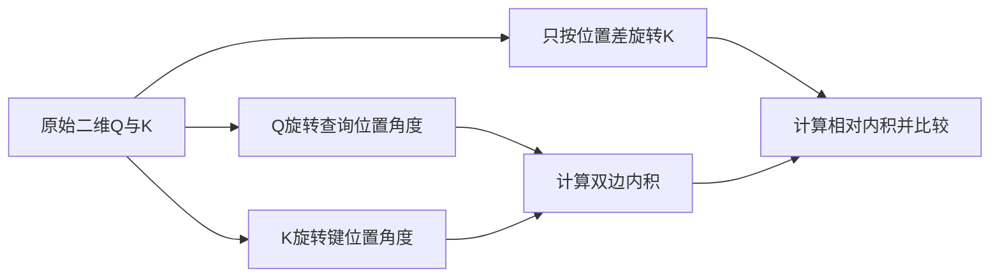
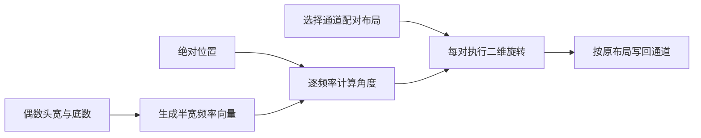
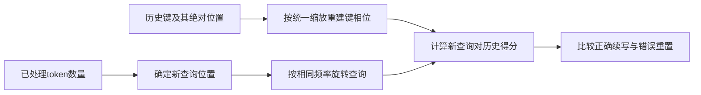

# 位置编码与RoPE

位置表示使模型能区分 token 顺序。RoPE 的关键不是把一个距离数相加到 embedding，而是在注意力内对 Q/K 的成对维度施加旋转，使两者的内积含相对位置差。本文同时检查数学恒等式、内存中的配对约定和缓存续写位置；三者对齐后，才能讨论长上下文质量。[RoFormer 的旋转位置编码](https://arxiv.org/html/2104.09864v5#S3)

前置学习：[Transformer与自回归生成](Transformer与自回归生成.md)。完整示例：[position.py](../../examples/network/position.py)。

## 学习目标

- 推导双边旋转等于相对旋转，并说明范数与内积分别保留什么。
- 对照实际源码区分相邻维与前后半维配对，发现 shape 不变但数值语义错误的问题。
- 推导位置线性缩放与频率缩放的等价条件，设计缓存位置重置反例。

## 前置知识

需要二维旋转、向量内积和缓存基础。本文用列向量，旋转角以弧度为单位；位置索引 $m,n$ 本身没有长度单位。头宽 $d$ 必须为正偶数，底数 $b$ 控制频率族，不能与位置数或温度混为一谈。普通绝对位置编码先加入 token 表示；原 Transformer 的正弦余弦位置向量也不等于 RoPE 对 Q/K 的乘法旋转。[Transformer 绝对位置编码](https://arxiv.org/html/1706.03762v7#S3.SS5)

## 基本机制

设某个头投影后的向量为 $q=W_Qx_m,k=W_Kx_n$。RoPE 得到 $\widetilde q=R_mq,\widetilde k=R_nk$，随后计算缩放内积。该版本 Llama 的 `apply_rotary_pos_emb` 只返回旋转后的 Q/K；V 没有在该调用中旋转。频率生成、旋转应用、缓存更新和 attention 是分开的调用阶段，不应把 `position_ids` 的生成当作全部 RoPE 计算。[Llama 旋转应用与缓存顺序](https://github.com/huggingface/transformers/blob/50e35cc0ca18ec19b80653690de553e6decf74f5/src/transformers/models/llama/modeling_llama.py#L119-L149)

## 推导或示例

### 知识点一：从二维旋转推导相对位置

**问题与机制。** 如何用绝对位置构造变换，又使点积只出现位置差？定义

$$
R(\phi)=\begin{pmatrix}\cos\phi&-\sin\phi\\\sin\phi&\cos\phi\end{pmatrix}.
$$

由于 $R(\phi)^T=R(-\phi)$，并由三角函数和差公式得到 $R(a)R(b)=R(a+b)$，所以

$$
(R(m\theta)q)^T(R(n\theta)k)
=q^TR(m\theta)^TR(n\theta)k
=q^TR((n-m)\theta)k.
$$

同时 $\|R(m\theta)q\|^2=q^TR^TRq=\|q\|^2$。注意“范数不变”不表示不同位置旋转后的内积不变；改变的恰好是 Q 与 K 的相对朝向。若对二者位置同时加偏移 $c$，差仍为 $n-m$，在固定原始向量和同一频率下得分不变。[RoFormer 二维形式及相对旋转等式](https://arxiv.org/html/2104.09864v5#S3.SS2)

```python
def relative_rotation(q, k, m, n, theta):
    """二维列向量旋转，返回双边旋转与仅相对旋转的点积。"""
    if len(q) != 2 or len(k) != 2 or not all(math.isfinite(x) for x in list(q) + list(k) + [m, n, theta]):
        raise ValueError("要求有限二维向量和角度参数")
    qm, kn = _rotate_pair(q, m * theta), _rotate_pair(k, n * theta)
    relative_k = _rotate_pair(k, (n - m) * theta)
    return {"both": sum(a * b for a, b in zip(qm, kn)),
            "relative": sum(a * b for a, b in zip(q, relative_k)),
            "q_norm_squared": sum(x * x for x in q),
            "rotated_norm_squared": sum(x * x for x in qm)}
```

代码的 `both` 计算两端旋转后的内积，`relative` 只旋转 K，再与原 Q 相乘；另外返回两个范数平方供独立核对。取 $q=k=(1,0),m=0,n=1,\theta=\pi/2$，内积约为0，原始内积为1；若两者位置同时加7，相对内积仍约为0。再取 $q=(3,4)$，旋转前后范数平方应都为25。浮点三角函数通常不会返回严格的数学零，应使用容差。



**源码定位。** 该版本 `q*cos + rotate_half(q)*sin` 是旋转矩阵的稀疏实现；它不构造大块矩阵。`cos`、`sin` 增加头维后可广播到所有查询或 KV 头。[Llama apply_rotary_pos_emb](https://github.com/huggingface/transformers/blob/50e35cc0ca18ec19b80653690de553e6decf74f5/src/transformers/models/llama/modeling_llama.py#L126-L149) 数学依据是 [RoFormer 式13至16](https://arxiv.org/html/2104.09864v5#S3.SS2)。

**条件与反例。** 恒等式要求 Q/K 使用相同频率和配对约定，且没有额外的非单位幅度缩放。如果把 Q 的角度取为 $m\theta$、K 取为 $2n\theta$，就不再仅依赖 $n-m$。此外，真实模型的原始 Q/K 本身依赖上下文，不能据这个局部恒等式断言任意整段文本平移后模型输出都不变。

### 知识点二：多频率与两种维度配对布局

**问题与机制。** 为什么照抄二维公式却可能无法对齐现有 checkpoint？将 $d$ 维拆为 $d/2$ 个二维子空间，用零起始频率索引 $j$：

$$
\omega_j=b^{-2j/d},\qquad \phi_{m,j}=m\omega_j,\qquad 0\le j<d/2.
$$

RoFormer 论文展示相邻维配对 $(0,1),(2,3),\ldots$。本次读取的 Llama 实现使用前后半配对 $(0,d/2),(1,d/2+1),\ldots$：`rotate_half` 先取前半 $x_1$ 与后半 $x_2$，返回 $[-x_2,x_1]$；频率也被连接为 `[freqs,freqs]`。两种写法可经固定置换 $P$ 对应，满足 $R_{split}=P R_{adj}P^T$，前提是投影通道也使用相应置换。[RoFormer 多维旋转矩阵](https://arxiv.org/html/2104.09864v5#S3.SS2.SSS2) [Llama 频率拼接和 rotate_half](https://github.com/huggingface/transformers/blob/50e35cc0ca18ec19b80653690de553e6decf74f5/src/transformers/models/llama/modeling_llama.py#L100-L123)

```python
def rope_layout(vector, position, base=10000.0, layout="split"):
    """对偶数宽向量应用RoPE；split按前后半配对，interleaved按邻接维配对。"""
    d = len(vector)
    if not d or d % 2 or base <= 0 or layout not in ("split", "interleaved"):
        raise ValueError("要求正偶数宽、正底数和合法布局")
    if not all(math.isfinite(x) for x in list(vector) + [position, base]):
        raise ValueError("输入须有限")
    out = [0.0] * d
    for j in range(d // 2):
        left, right = (j, j + d // 2) if layout == "split" else (2 * j, 2 * j + 1)
        angle = position * base ** (-2 * j / d)
        out[left], out[right] = _rotate_pair([vector[left], vector[right]], angle)
    return out
```

当 $d=4,b=10000$，频率为 `[1,0.01]`。对前后半布局的 $x=[1,2,3,4]$、位置1，结果为

$$
[\cos1-3\sin1,\;2\cos0.01-4\sin0.01,\;
\sin1+3\cos1,\;2\sin0.01+4\cos0.01].
$$

第二个二维对变化较慢，这就是频率族的作用。若把同一存储向量直接按相邻维旋转，第一个对会变成 `(1,2)`，输出不同；正确比较应先把相邻形式 `[a0,b0,a1,b1]` 置换为分半形式 `[a0,a1,b0,b1]`，完成旋转后再逆置换。函数显式提供 `layout`，便于做这一逐元素检查。



**源码定位。** 该版本 `compute_default_rope_parameters` 按 `arange(0,dim,2)/dim` 生成频率，`forward` 将位置与频率相乘并重复到全宽。[Llama 默认频率与旋转表示生成](https://github.com/huggingface/transformers/blob/50e35cc0ca18ec19b80653690de553e6decf74f5/src/transformers/models/llama/modeling_llama.py#L89-L116) 论文给出成对子空间组合的机制，但并未要求所有框架采用同一通道存储顺序。

**条件与反例。** 示例使用全头旋转、固定默认频率、幅度1，没有部分旋转、动态更新或模型特有的缩放。奇数宽度没有完整配对，因此拒绝。位置0时两种布局都返回原向量，这是必要检查，却不足以发现配对错误；必须检查非零位置和不同通道的非对称输入。缓存中的 K 和新 Q 若采用不同布局，也可能保持 shape 完全一致而悄悄损坏注意力。

### 知识点三：线性缩放与缓存位置的一致性

**问题与机制。** 扩大位置范围为什么不仅是改一个最大长度？对线性缩放因子 $s>0$，有

$$
(m/s)\omega_j=m(\omega_j/s),\qquad
\widetilde q_m^T\widetilde k_n=q^TR((n-m)\omega_j/s)k
$$

（最后一式按每个二维子空间理解）。这证明缩放位置与反频率等价，但前提是 Q/K 共享同一个 $s$。若缓存键仍用旧 $s_1$、新 Q 用 $s_2$，相位差变成 $n\omega/s_1-m\omega/s_2$，不再等于一致的相对距离。该版本线性 RoPE 参数函数明确用 `inv_freq /= factor`，它并不是论文默认 RoPE 的定义。[Transformers 线性缩放参数](https://github.com/huggingface/transformers/blob/50e35cc0ca18ec19b80653690de553e6decf74f5/src/transformers/modeling_rope_utils.py#L174-L190)

```python
def cached_rope_scores(query, raw_keys, query_position, key_positions, scale=1.0):
    """从原始键重建旋转后内积，检查缓存位置；不实现生产缓存。"""
    if not raw_keys or len(raw_keys) != len(key_positions):
        raise ValueError("键与位置须一一对应且非空")
    if any(len(k) != len(query) for k in raw_keys) or not math.isfinite(scale) or scale <= 0:
        raise ValueError("键宽度须匹配且缩放因子为有限正数")
    rotated_q = rope_layout(query, query_position / scale)
    rotated_keys = [rope_layout(k, p / scale) for k, p in zip(raw_keys, key_positions)]
    return [sum(a * b for a, b in zip(rotated_q, k)) / math.sqrt(len(query)) for k in rotated_keys]
```

函数接受原始键和显式位置，重建旋转后得分，只用于检查语义。设已有键位置 `[0,1]`，新查询应在2；所有原始二维向量均为 `[1,0]`，默认最高频率为1。正确得分是 `[cos(2),cos(1)]/sqrt(2)`。如果新查询错误重置为0，则变成 `[1,cos(1)]/sqrt(2)`：第一个键的相对位置完全错了。选择只检查最近键会漏掉这个反例。

再把所有键位置与查询位置同时加5，固定缩放时得分应保持不变；把 $s$ 改成2，并对全部原始键重新生成旋转，得分变成 `[cos(1),cos(0.5)]/sqrt(2)`。这两种检查分别验证平移一致性与缩放生效，不代表延长上下文质量已得到验证。



**源码定位。** 该版本 `LlamaModel.forward` 在未显式传 `position_ids` 时，用 `past_key_values.get_seq_length()` 为新位置加偏移；`LlamaAttention.forward` 对 K 旋转之后才追加缓存。[Llama 默认续写位置与缓存长度](https://github.com/huggingface/transformers/blob/50e35cc0ca18ec19b80653690de553e6decf74f5/src/transformers/models/llama/modeling_llama.py#L372-L389) [Llama K旋转与缓存更新](https://github.com/huggingface/transformers/blob/50e35cc0ca18ec19b80653690de553e6decf74f5/src/transformers/models/llama/modeling_llama.py#L243-L251) 这只是该版本的一条默认路径，复杂 padding、打包或滑窗时应核对调用者传入位置的语义。

**条件与反例。** 函数每次从原始 K 重算，是教学检查器，不能当作高效缓存。生产缓存通常已存旋转后的 K；频率策略改变后，旧 K 是否可复用需由该策略明确定义。线性插值使原先相邻位置的相位差也变小，会改变短距离分辨能力。位置可计算到十万不意味着模型能可靠理解十万 token；还需训练分布与分长度、分证据位置的任务评测。

## 适用条件与限制

RoPE 的局部正交结构给出可检查恒等式，不能单独证明长上下文的事实检索或推理能力。二维单频率内积随距离振荡，不能把论文对频率组合的长程性质简化成“任意 Q/K 内积都会严格单调下降”。此处没有给出未经核验的扩展参数，也没有把某个模型的默认底数泛化到全部 RoPE 模型。

## 实践任务

交付三个小表：二维旋转与范数、分半/相邻布局置换、正确/错误缓存位置得分。模型实验另建“输入长度×证据位置”矩阵，至少覆盖开头、中间、末尾，保留模板、缩放策略和位置 ID；未执行的格子保持空白。本组未运行示例，教学验证交主 agent 常驻 UT。

## 掌握标准

能不查代码推导 $R_m^TR_n=R_{n-m}$；能对四维向量指出实际配对；能说明换布局为何需同步投影；能用明确数值发现位置重置。对长上下文须区分“接口允许”“相位实现一致”“任务质量通过”三个条件，不能以其中一项替代其他项。

## 源码与后续阅读

证据为固定版 RoFormer、Transformer 论文与 Transformers 的 Llama、RoPE 参数函数。未独立复现 RoFormer 训练或长上下文扩展实验。关联阅读：[MHA与MQA及GQA](MHA与MQA及GQA.md)、[KV缓存原理与显存估算](KV缓存原理与显存估算.md)。

---

[返回模块](../modules/模型网络.md) · [知识点索引](../../docs/知识点索引.md) · [完整教学代码](../../examples/network/position.py) · [提出更正](https://github.com/yanbozhang/llm-systems-wiki/issues/new?template=knowledge.yml)

觉得这篇推导有帮助，可以在 [GitHub](https://github.com/yanbozhang/llm-systems-wiki) 点 Star 收藏更新；分享时欢迎链接到具体知识点，便于读者复核公式、代码与来源。
