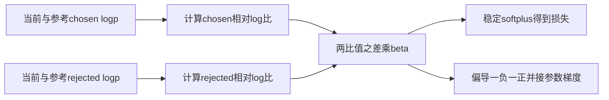
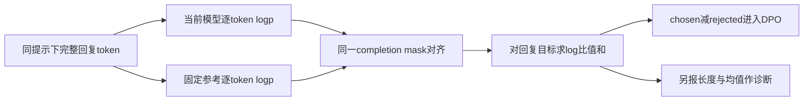

# 偏好学习与DPO

DPO 用同一提示下的偏好回答与非偏好回答，优化当前策略相对参考策略的概率比。它把一类 KL 正则奖励优化改写成偏好似然，不需要在标准训练步骤中另训并在线查询独立奖励模型；这不表示没有偏好模型假设，也不表示偏好标签自动等同事实真值。[DPO 原论文第3至4节](https://arxiv.org/html/2305.18290v3#S4)

前置学习：[监督微调与LoRA](监督微调与LoRA.md)。完整示例：[preference.py](../../examples/training/preference.py)。

## 学习目标

- 从约束优化推导最优策略，解释同一提示下配分函数为何能抵消。
- 对标准 DPO 的单对损失求导，用数值说明相对目标与绝对概率的区别。
- 从 token logp 正确构造回复序列概率，识别提示 mask、长度归一化和参考策略版本引起的目标变化。

## 前置知识

需要条件概率、对数、KL 散度与链式法则。记提示为 x，偏好回答为 $y_w$，非偏好回答为 $y_l$；$\pi_\theta$ 是当前模型，$\pi_{ref}$ 是参考策略，$\beta>0$ 控制 KL 正则的尺度。本文先用有限回答空间推导，再连接语言模型的 token 序列；数值例子没有真正优化模型参数。

## 基本机制

标准离线 DPO 输入是 `(prompt,chosen,rejected)`。需先冻结参考模型身份和预处理，把同一个回答在当前/参考模型下的对数概率相减，再将两个回答的相对量相减。该版本 TRL 的标准分支使用 `f_divergence_type="reverse_kl"` 和 `loss_type="sigmoid"`；同一个 Trainer 还支持许多不同目标，不能从类名推断训练一定在执行原始 DPO。[TRL 相对log比值及标准sigmoid分支](https://github.com/huggingface/trl/blob/1117c3b9c1632ee9814c30f6c9fc884b792a54e5/trl/trainer/dpo_trainer.py#L1401-L1447) [TRL DPO目标类型说明](https://github.com/huggingface/trl/blob/1117c3b9c1632ee9814c30f6c9fc884b792a54e5/docs/source/dpo_trainer.md)

## 推导或示例

### 知识点一：KL最优策略与配分函数抵消

**问题与机制。** 奖励训练与直接偏好拟合如何联系？固定 x，令候选回答概率为 $p_y$，参考概率为 $q_y>0$、奖励为 $r_y$，求

$$
\max_p\sum_y p_y r_y-\beta\sum_y p_y\log(p_y/q_y),\qquad \sum_yp_y=1.
$$

引入约束乘子 $\lambda$，对 $p_y$ 求导：$r_y-\beta(\log(p_y/q_y)+1)+\lambda=0$。整理并归一化得

$$
p_y^*=q_y e^{r_y/\beta}/Z(x),\quad
Z(x)=\sum_yq_y e^{r_y/\beta},\quad
r_y=\beta\log(p_y^*/q_y)+\beta\log Z(x).
$$

Bradley–Terry 模型令偏好概率为 $P(y_w\succ y_l\mid x)=\sigma(r_w-r_l)$。同一 x 下，两个奖励的 $\beta\log Z(x)$ 相消；代入后只剩当前/参考 log 比值的差。DPO 于是用参数模型 $\pi_\theta$ 拟合这种偏好似然。[DPO 最优策略与奖励重参数化](https://arxiv.org/html/2305.18290v3#S4)

```python
def optimal_policy(reference, rewards, beta=1.0):
    """有限回答空间内解KL正则奖励最大化；返回策略与配分函数对数。"""
    if not reference or len(reference) != len(rewards) or not math.isfinite(beta) or beta <= 0:
        raise ValueError("概率与奖励须同长非空，beta须为有限正数")
    if any(not math.isfinite(p) or p <= 0 for p in reference) or not math.isclose(sum(reference), 1.0):
        raise ValueError("参考概率须严格为正且和为一")
    if not all(math.isfinite(r) for r in rewards):
        raise ValueError("奖励须有限")
    scores = [math.log(p) + r / beta for p, r in zip(reference, rewards)]
    peak = max(scores)
    shifted = [math.exp(s - peak) for s in scores]
    total = sum(shifted)
    return {"policy": [p / total for p in shifted], "log_partition": peak + math.log(total)}
```

函数在有限候选空间内用稳定 softmax 计算 $p^*$，并返回 $\log Z$。参考 `[0.5,0.5]`，奖励 `[ln3,0]`，$\beta=1$ 时，未归一化权重 `[1.5,0.5]`，得到 `[0.75,0.25]`。给两个奖励同时加常数7，$Z$ 乘 $e^7$，策略不变；隐式奖励只在同一提示内的差值上可辨认。

真实语言模型的回答空间巨大，不能像这个二元素表一样枚举所有 y 计算 Z；DPO 恰好通过偏好差值避开它。这里的函数是验证解析关系，不是 DPOTrainer 实际运行的枚举算法。若偏好对来自不同提示 $x_1,x_2$，两个 Z 一般不同，不能直接套用上述抵消。


**源码定位。** 该版本 `DPOTrainer._compute_loss` 直接构造 chosen/rejected 的策略对参考 log 比值，reverse-KL 分支原样使用它们；源码没有枚举 Z。[TRL DPO比值构造](https://github.com/huggingface/trl/blob/1117c3b9c1632ee9814c30f6c9fc884b792a54e5/trl/trainer/dpo_trainer.py#L1401-L1407) 这是论文重参数化在执行上的落点，不是一个独立 reward model 的前向调用。

**条件与反例。** 参考在训练支持集上需有正概率，否则 log 比值不可定义；本例拒绝零参考概率。有限空间、自由分布的解析最优不保证有限容量神经网络、有限偏好数据与优化预算下必然达到同一点。偏好标签若违反该模型假设，仍可能拟合出模型，但不能沿用无条件的最优性解释。

### 知识点二：相对margin、稳定损失与梯度符号

**问题与机制。** chosen 的概率下降，DPO loss 能不能同时下降？令

$$
\Delta=(\log\pi_\theta(y_w|x)-\log\pi_{ref}(y_w|x))
-(\log\pi_\theta(y_l|x)-\log\pi_{ref}(y_l|x)),\quad z=\beta\Delta,
$$

$$
L=-\log\sigma(z)=\operatorname{softplus}(-z),\quad
\frac{\partial L}{\partial\log\pi_\theta(y_w|x)}=-\beta\sigma(-z),\quad
\frac{\partial L}{\partial\log\pi_\theta(y_l|x)}=+\beta\sigma(-z).
$$

再对参数应用链式法则，得到 $-\beta\sigma(-z)(\nabla\log\pi_\theta(y_w)-\nabla\log\pi_\theta(y_l))$。偏好差距反向或不足时权重较大；正 margin 很大时梯度趋小。这里两个 logp 是理解局部偏导的中间量，真实网络参数共享，不能把它们当成可以独立拨动的旋钮。[DPO 目标与更新梯度](https://arxiv.org/html/2305.18290v3#S4)

```python
def dpo_loss(chosen_logp, rejected_logp, ref_chosen_logp, ref_rejected_logp, beta=0.1):
    """标准sigmoid DPO单偏好对损失及对两项策略logp的偏导。"""
    if not all(math.isfinite(x) for x in [chosen_logp, rejected_logp, ref_chosen_logp, ref_rejected_logp, beta]) or beta <= 0:
        raise ValueError("输入须有限，beta须为正数")
    delta = (chosen_logp - ref_chosen_logp) - (rejected_logp - ref_rejected_logp)
    margin = beta * delta
    loss = max(0.0, -margin) + math.log1p(math.exp(-abs(margin)))
    wrong_probability = (math.exp(-margin) / (1 + math.exp(-margin)) if margin >= 0
                         else 1 / (1 + math.exp(margin)))
    return {"relative_delta": delta, "margin": margin, "loss": loss,
            "grad_chosen_logp": -beta * wrong_probability,
            "grad_rejected_logp": beta * wrong_probability}
```

当当前与参考完全相同，$\Delta=0,L=\ln2$；$\beta=0.1$ 时两项偏导分别为-0.05、0.05。当 $z=\ln3$，偏好概率为0.75，损失为 $\ln(4/3)$；实现用 `max(0,-z)+log1p(exp(-abs(z)))`，避免直接计算极大指数。参考模型在这些偏导中保持固定。

一个绝对概率反例：固定参考，某次更新让 chosen logp 下降0.1、rejected logp 下降0.5，则 $\Delta$ 增加0.4，DPO loss 下降，尽管 chosen 的绝对概率也下降。回答空间还有其他序列可吸收概率质量，因此这并不违反归一化。仅看 chosen 概率或奖励曲线不足以判断训练达成了什么，还要看 pair margin、独立任务与长度分层。



**源码定位。** 该版本标准 `sigmoid` 分支是 `-F.logsigmoid(beta*delta_score)`；它本身没有将 label_smoothing 混入这个分支。其他 loss 类型必须另查公式和参数，不能把 API 有某参数就解释成全部目标均使用它。[TRL 标准sigmoid实现](https://github.com/huggingface/trl/blob/1117c3b9c1632ee9814c30f6c9fc884b792a54e5/trl/trainer/dpo_trainer.py#L1435-L1447) [TRL 各loss类型说明](https://github.com/huggingface/trl/blob/1117c3b9c1632ee9814c30f6c9fc884b792a54e5/docs/source/dpo_trainer.md)

**条件与反例。** 大 beta 会改变 margin 和梯度饱和区，但“beta越大每个样本梯度都越大”不成立，因为还有 $\sigma(-\beta\Delta)$。若两个答案都错、chosen 只是更流畅，梯度会强化该相对偏好而不会自动发明事实监督。需要另外的正确性依据和标签协议，不能把偏好胜率当成事实正确率。

### 知识点三：序列log概率、回复mask与长度偏差

**问题与机制。** 从 token logp 到 DPO 标量时该求和还是平均？对完整回答 $y_{1:T}$，链式法则给出

$$
\log\pi(y|x)=\sum_{t=1}^{T}\log\pi(y_t|x,y_{<t}),\quad
R(y)=\sum_tm_t(\log\pi_\theta(y_t|\cdot)-\log\pi_{ref}(y_t|\cdot)).
$$

mask 应保留回复目标，排除 prompt、padding，并与下一 token logits 对齐；包含 EOS 的方式也需两模型一致。标准 DPO 使用序列 log 概率和。若改为 $R(y)/T$，就改变了目标和长度权重，不能称为无影响的数值稳定化。[DPO 以回答概率定义的目标](https://arxiv.org/html/2305.18290v3#S4)

```python
def completion_logratio(policy_logps, reference_logps, mask):
    """输入逐token且已错位对齐的logp，返回回复log比值总和及诊断用均值。"""
    if not policy_logps or len(policy_logps) != len(reference_logps) or len(mask) != len(policy_logps):
        raise ValueError("概率序列和mask须同长非空")
    if any(m not in (0, 1, False, True) for m in mask):
        raise ValueError("mask须为二值")
    if not all(math.isfinite(x) for x in list(policy_logps) + list(reference_logps)):
        raise ValueError("logp须有限")
    ratios = [p - q for p, q, m in zip(policy_logps, reference_logps, mask) if m]
    if not ratios:
        raise ValueError("至少保留一个回复目标")
    total = sum(ratios)
    return {"sum": total, "mean": total / len(ratios), "tokens": len(ratios), "per_token": ratios}
```

函数接收已对齐的逐 token logp，返回和与诊断均值；它不再做标签移位。chosen 有两个 token，每项相对参考增加0.3，总比值为0.6、均值0.3；rejected 只有一个 token，增加0.5。求和的相对差值为0.1，按各自长度平均后变为-0.2，连方向都翻转了。这说明长度归一化是独立方法选择，应记录在实验配置中。

提示部分对同一 x 在数学上可抵消，但在模板不一致、padding或截断不对称时未必按预想实现；显式 completion mask 可减少歧义。当前与参考必须对同一 token 序列评分，不能用不同 tokenizer 的“第t个token”强行相减。如果预计算参考 logp 后改变模板、截断长度或基础模型，其缓存不再对应同一目标。



**源码定位。** 该版本 `_compute_loss` 先将 completion mask 外标签设为 -100，取得逐 token logp 后在 `ld_alpha is None` 路径按序列求和。参考也按相同逻辑处理；`sigmoid_norm` 是单列分支，会对分数除长度。[TRL 回复mask、当前与参考logp聚合](https://github.com/huggingface/trl/blob/1117c3b9c1632ee9814c30f6c9fc884b792a54e5/trl/trainer/dpo_trainer.py#L1348-L1399) [TRL sigmoid_norm分支](https://github.com/huggingface/trl/blob/1117c3b9c1632ee9814c30f6c9fc884b792a54e5/trl/trainer/dpo_trainer.py#L1556-L1561)

参考策略还需注意 PEFT：该版本对新 adapter 可禁用适配器获得基础参考，对继续训练已有 adapter 则使用名为 `ref` 的初始副本。不能把“没有单独 ref_model 对象”理解为没有参考分布。是否能节省一份模型存储属于实现安排，不改变比值目标。[TRL PEFT参考策略选择](https://github.com/huggingface/trl/blob/1117c3b9c1632ee9814c30f6c9fc884b792a54e5/trl/trainer/dpo_trainer.py#L1379-L1390)

**条件与反例。** 示例只处理有限 logp 和二值 mask，不包含视觉 token、虚拟提示、ld_alpha 或其他长度修正。没有有效回复 token 时拒绝计算。评估应同时按长度、题型、事实/格式标签分层；标准目标可能受长度与数据构造影响，但不能仅凭某个短例推断任何归一化方法一定更优。

## 适用条件与限制

偏好优化依赖偏好数据与参考支持集。原论文主要任务和规模下的结果不是所有领域优于 PPO 的证明，作者也讨论分布外泛化、过优化和评审提示敏感性。本页没有训练模型，没有生成新的胜率或事实性数据。标准库手算只核验局部公式及其执行映射。

## 实践任务

交付二回答解析最优表、margin/loss/偏导表与不同长度的log比值表。再设计四类偏好对：正确性、格式、长短、两者皆错，分别说明标签教的是什么；训练与独立评测需分开。本组未运行示例，测试交由主 agent 常驻 UT；模型偏好优化保持已设计。

## 掌握标准

能从拉格朗日一阶条件得到 $q e^{r/\beta}/Z$；能解释为什么必须是同提示的奖励差；能正确写出两个偏导符号；能用数值证明求和改均值会改变目标。能指出参考身份、模板和mask是哪一版，而不是仅说“跑了DPO”。

## 源码与后续阅读

固定证据包含 DPO 原论文、TRL 具体提交下的 Trainer 及配套文档。未独立复现论文偏好胜率与分布外泛化。关联阅读：[策略优化与GRPO](策略优化与GRPO.md)。

---

[返回模块](../modules/训练.md) · [知识点索引](../../docs/知识点索引.md) · [完整教学代码](../../examples/training/preference.py) · [提出更正](https://github.com/yanbozhang/llm-systems-wiki/issues/new?template=knowledge.yml)

觉得这篇推导有帮助，可以在 [GitHub](https://github.com/yanbozhang/llm-systems-wiki) 点 Star 收藏更新；分享时欢迎链接到具体知识点，便于读者复核公式、代码与来源。
