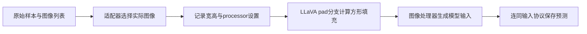
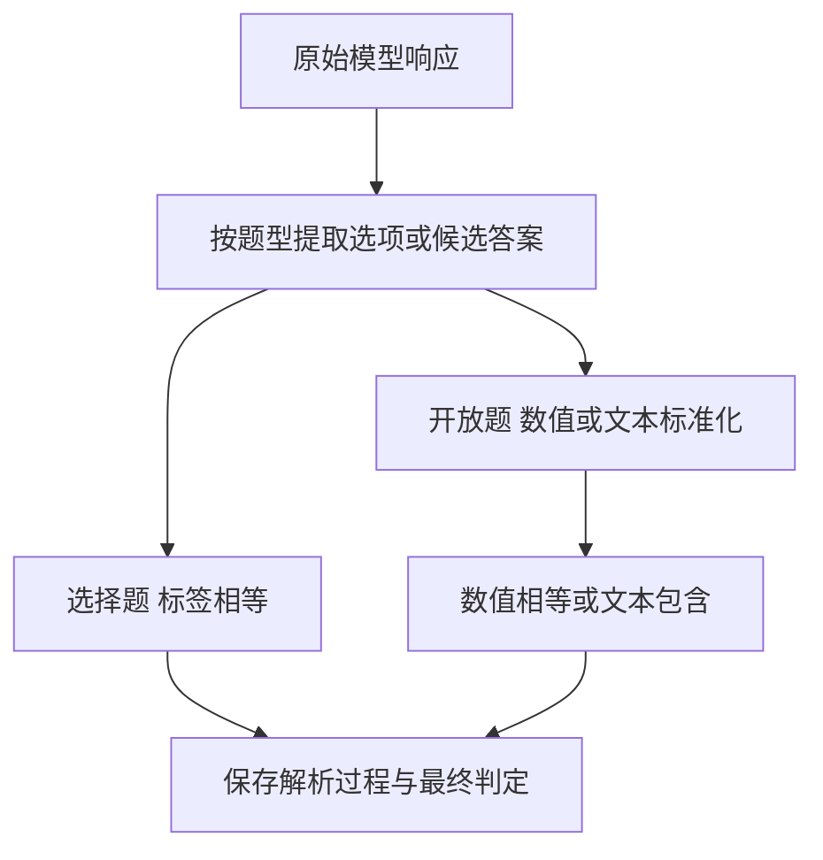
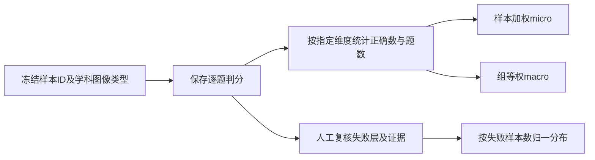

# 多模态与界面感知评测

多模态基准测量的结果由输入管线、任务答案判据和样本分布共同决定。本页以MMMU为主要答题基准，并用实际LLaVA预处理代码说明输入几何；不把多学科视觉理解简化为GUI定位。

## 学习目标

- 区分感知、推理和交互
- 固定多模态预处理
- 设计分层误差分析

## 前置知识

先阅读[评测协议与可复现性](评测协议与可复现性.md)。理解原图坐标与处理后坐标、选择题与开放题、总体准确率与分层统计，以及模型错误与评分器错误。

## 基本机制

固定MMMU提交 `268471d0d488258990025331c7528359c324aa25`，LLaVA提交 `c121f0432da27facab705978f83c4ada465e46fd`。MMMU覆盖多学科、异构图像与领域推理；本页使用其原始MMMU评估路径，不混用MMMU-Pro或第三方框架的成绩。[MMMU官方介绍与评估说明](https://github.com/MMMU-Benchmark/MMMU/blob/268471d0d488258990025331c7528359c324aa25/README.md)。

实际实验链是样本读取→图像和prompt处理→模型响应→答案解析→逐题判分→分层汇总。任何阶段改动都可能改变分数，应保存对应版本和中间产物。[MMMU运行链](https://github.com/MMMU-Benchmark/MMMU/blob/268471d0d488258990025331c7528359c324aa25/mmmu/run_llava.py#L18)

## 推导或示例

完整教学文件：[benchmark-multimodal.py](../../examples/benchmark/benchmark-multimodal.py)。每个函数对应下列一个知识点，只使用标准库与小型合成输入；教学计算不代表模型或服务实验。

### 知识点一：输入预处理先决定模型到底看到了什么

多模态误差首先可能出现在模型之前。图像被裁掉图例、图像顺序改变、只取第一张、加入OCR文本，都会改变可用信息。MMMU覆盖图表、地图、谱表、化学结构等任务，不能把这些输入都当成一次GUI截图定位。应保存原图身份、尺寸、图像数量与顺序、实际processor配置及OCR/字幕来源。

以维护者源码中的LLaVA `expand2square`为例：原图宽 $W$、高 $H$，填充边长 $L=\max(W,H)$，平移量 $d_x=\lfloor(L-W)/2\rfloor,d_y=\lfloor(L-H)/2\rfloor$。原图点 $(x,y)$在填充图中是 $(x+d_x,y+d_y)$；以填充图归一化时再除以 $L$。原内容面积占比为 $WH/L^2$。

将上述计算或状态约束集中写为：

$$
L=\max(W,H),\quad (d_x,d_y)=\left(\left\lfloor\frac{L-W}{2}\right\rfloor,\left\lfloor\frac{L-H}{2}\right\rfloor\right),\quad (u,v)=\left(\frac{x+d_x}{L},\frac{y+d_y}{L}\right).
$$

```python
def square_pad_geometry(width, height, box):
    """按LLaVA expand2square计算原图区域的平移；只做填充，不模拟后续缩放裁剪。"""
    if type(width) is not int or type(height) is not int or min(width, height) <= 0:
        raise ValueError("图像宽高须为正整数")
    if len(box) != 4 or any(not math.isfinite(v) for v in box):
        raise ValueError("矩形须含四个有限坐标")
    left, top, right, bottom = box
    if not (0 <= left < right <= width and 0 <= top < bottom <= height):
        raise ValueError("矩形须位于原图内且面积为正")
    side = max(width, height)
    dx, dy = (side - width) // 2, (side - height) // 2
    moved = (left + dx, top + dy, right + dx, bottom + dy)
    return {"side": side, "offset": (dx, dy), "translated_box": moved,
            "normalized_box": tuple(v / side for v in moved),
            "content_area_fraction": width * height / (side * side)}
```

640×320原图填成640×640，垂直偏移160，原内容占画布1/2。原图底部图例框 `(0,280,640,320)`应变成 `(0,440,640,480)`，相对坐标为 `(0,0.6875,1,0.75)`。直接把原图的归一化坐标当成填充图坐标，会错报图例位置。此处矩形只是检验预处理是否保留关键信息，不是把MMMU答题改成框命中任务。计算为 $O(1)$，不加载真实图像。



该版LLaVA `process_images`只有image_aspect_ratio为pad时走这一路，还存在anyres等路径。MMMU所读 `llava_image_processor`直接调用vis_processors.preprocess，并未在该包装函数显式调用expand2square，因此不能声称这个MMMU runner默认使用上述填充。`process_single_sample`也有image_1和多选项图像处理分支，不能仅凭数据集支持多图就认定每个适配器均完整支持。

填充保留原像素区域，不代表后续缩放仍保留小字可读性；本函数不推断插值后的信息损失。论文也将OCR/图像字幕辅助的文本模型作为不同输入设置。比较原图与OCR辅助分数时，被测系统已经增加了外部模块，应分别报告而不是归因于同一模型感知能力。

[LLaVA expand2square与process_images](https://github.com/haotian-liu/LLaVA/blob/c121f0432da27facab705978f83c4ada465e46fd/llava/mm_utils.py#L152)；[pad配置说明](https://github.com/haotian-liu/LLaVA/blob/c121f0432da27facab705978f83c4ada465e46fd/README.md#L379)；[MMMU llava_image_processor](https://github.com/MMMU-Benchmark/MMMU/blob/268471d0d488258990025331c7528359c324aa25/mmmu/utils/model_utils.py#L71)；[process_single_sample](https://github.com/MMMU-Benchmark/MMMU/blob/268471d0d488258990025331c7528359c324aa25/mmmu/utils/data_utils.py#L87)；[MMMU §4.1 输入设置](https://arxiv.org/html/2311.16502v4).

### 知识点二：答案解析和判分规则也是被测协议的一部分

同一个模型输出，经过不同解析器可能得到不同得分。所读MMMU选择题解析先找括号选项，再找独立字母，再尝试答案内容；多候选时偏向最后出现的候选，完全没识别到则随机选一个。最终 `eval_multi_choice`按预测标签与允许答案相等判定。四选一全部解析失败仍随机猜时，期望准确率为1/4，不能把这部分当成模型理解题目。

开放题先提取可能答案字符串和数值，再标准化：数字去逗号后转float并四舍五入到两位，字符串转小写；`eval_open`对数值候选检查相等，对字符串检查参考答案是否为预测字符串的子串。简化判据为 $correct=\mathbf1[\exists g\in G,p\in P:\ match(norm(g),norm(p))]$。

将上述计算或状态约束集中写为：

$$
\mathrm{correct}=\mathbf1\left\{\exists g\in G,\ p\in P:\ \operatorname{match}(\operatorname{norm}(g),\operatorname{norm}(p))\right\}.
$$

```python
def mmmu_answer_score(question_type, gold, prediction):
    """复述MMMU核心判分：选择题标签匹配；开放题输入为已抽取候选，非完整原文解析器。"""
    answers = gold if isinstance(gold, list) else [gold]
    if not answers:
        raise ValueError("参考答案不能为空")
    if question_type == "multiple-choice":
        if not isinstance(prediction, str):
            raise ValueError("选择题预测须为选项标签")
        return any(answer == prediction for answer in answers)
    if question_type != "open" or not isinstance(prediction, list):
        raise ValueError("开放题须传入已抽取的候选列表")
    def normalize(value):
        text = str(value).strip()
        try:
            number = float(text.replace(",", ""))
        except ValueError:
            lowered = text.lower()
            return [" " + lowered, lowered + " "] if len(lowered) == 1 else [lowered]
        if not math.isfinite(number):
            raise ValueError("数值候选须为有限数")
        return [round(number, 2)]
    targets = [item for answer in answers for item in normalize(answer)]
    candidates = [item for pred in prediction for item in normalize(pred)]
    for pred in candidates:
        if isinstance(pred, str):
            if any(isinstance(target, str) and target in pred for target in targets):
                return True
        elif pred in targets:
            return True
    return False
```

预测数值3.144与参考3.14都变为3.14，因此通过；这不是数学上要求精确相等，也不是相对误差容差。`1,000`会变成1000，但该归一化不会自动把米换成厘米。字符串子串匹配也会有反例，例如参考art出现在earth中；评分器判True不证明自然语言语义等价。样例故意保留这项规则，用于解释自动分数的边界。



函数只实现核心判分，并对开放题再次规范化已抽取候选，未实现完整指标词/正则提取逻辑。复杂度约 $O(|G||P|)$再加字符串处理成本。空候选得到False；无参考答案则拒绝评分，不偷偷生成一个答案。源码中的随机回退受全局随机状态和样本顺序影响，固定一个seed不一定使不同执行顺序逐题得到相同猜测。

论文使用规则解析选择题并为短开放题定义匹配，当前README已发布测试答案并更新本地评估说明。比较历史成绩时须固定split、题型、答案版本和解析代码。若最终回答正确但解析失败，应单列answer_extraction错误；若模型只输出一串候选覆盖所有选项，也不能由宽松匹配高分推断其推理正确。

[选择题解析与随机回退](https://github.com/MMMU-Benchmark/MMMU/blob/268471d0d488258990025331c7528359c324aa25/mmmu/utils/eval_utils.py#L10)；[normalize_str](https://github.com/MMMU-Benchmark/MMMU/blob/268471d0d488258990025331c7528359c324aa25/mmmu/utils/eval_utils.py#L76)；[eval_multi_choice与eval_open](https://github.com/MMMU-Benchmark/MMMU/blob/268471d0d488258990025331c7528359c324aa25/mmmu/utils/eval_utils.py#L175)；[官方Evaluation说明](https://github.com/MMMU-Benchmark/MMMU/blob/268471d0d488258990025331c7528359c324aa25/README.md)；[MMMU Evaluation](https://arxiv.org/html/2311.16502v4).

### 知识点三：样本加权总分、学科宏平均与错误层必须分开

MMMU不同学科和图像类型的难度不同。设第 $g$组有 $n_g$题、正确 $c_g$题，样本加权准确率为 $A_{micro}=\sum_g c_g/\sum_g n_g$；组宏平均为 $A_{macro}=\frac1G\sum_g c_g/n_g$。两者衡量不同分布。80道图表题正确72、20道医学题正确10，总分0.82，学科等权宏平均0.7；只给总分会遮住医学层明显退化。

将上述计算或状态约束集中写为：

$$
A_{micro}=\frac{\sum_g c_g}{\sum_g n_g},\qquad A_{macro}=\frac1G\sum_g\frac{c_g}{n_g}.
$$

```python
def stratified_accuracy(rows, group_key="subject", expected_ids=None):
    """固定样本ID后计算样本加权准确率、组宏平均及人工错误层标签分布。"""
    rows = list(rows)
    ids = [r["id"] for r in rows]
    if len(set(ids)) != len(ids):
        raise ValueError("样本ID不能重复")
    if expected_ids is not None and set(ids) != set(expected_ids):
        raise ValueError("被评分样本集合与冻结集合不一致")
    groups = defaultdict(lambda: {"correct": 0, "count": 0})
    errors = defaultdict(int)
    for row in rows:
        if type(row["correct"]) is not bool:
            raise ValueError("correct须为布尔值")
        group = groups[row[group_key]]
        group["correct"] += row["correct"]
        group["count"] += 1
        if not row["correct"]:
            errors[row.get("error_layer") or "unclassified"] += 1
    for group in groups.values():
        group["accuracy"] = group["correct"] / group["count"]
    correct = sum(g["correct"] for g in groups.values())
    failures = len(rows) - correct
    return {"count": len(rows), "groups": dict(groups),
            "micro_accuracy": correct / len(rows) if rows else None,
            "macro_accuracy": sum(g["accuracy"] for g in groups.values()) / len(groups) if groups else None,
            "error_counts": dict(errors),
            "error_rates_among_failures": {k: v / failures for k, v in errors.items()} if failures else {}}
```

所读 `calculate_ins_level_acc`以各组acc乘num_example后求总和，是样本加权口径。示例同时提供macro作为诊断扩展，不冒称官方另一个主指标。样例图表2/2、医学0/1，micro为2/3、macro为1/2。expected_ids使缺失或重复样本不会悄悄改变分母；输入协议不支持某些样本时应报告覆盖率或按预定规则计分，而不是直接丢弃难题。



错误层可区分输入预处理、基础感知、领域知识、推理、答案抽取、标注问题及未分类。函数只汇总人工标签，不通过回答措辞自动猜原因。MMMU论文的错误分析基于专家审阅一批已失败样本，并利用领域知识和golden explanations；其错误百分比分母是这批错误，不是所有测试问题。若失败率20%、失败中的感知错误占35%，在相同抽样假设下占全部题目的比例约7%，不能直接说全部题目35%感知失败。

关联不等于因果。低分辨率配置更差，可能来自图例丢失，也可能同时换了模板或OCR设置。应在相同ID上做成对输入对照，保留实际送入模型的材料，再人工复核失败环节。单题答错可能同时涉及感知与知识；若强制单标签，应说明主因判定规则，若多标签则总比例可能超过100%。函数采用单个error_layer字段，需明确这一限制。

MMMU答题准确率、界面目标框命中率和完整GUI任务成功率对应不同因变量。几何变换正确只能说明坐标契约一致，不能证明模型理解图表；答对题也不能证明它能在环境中完成多步操作。

[evaluate与calculate_ins_level_acc](https://github.com/MMMU-Benchmark/MMMU/blob/268471d0d488258990025331c7528359c324aa25/mmmu/utils/eval_utils.py#L219)；[学科映射](https://github.com/MMMU-Benchmark/MMMU/blob/268471d0d488258990025331c7528359c324aa25/mmmu/utils/data_utils.py#L9)；[MMMU §5 专家错误分析](https://arxiv.org/html/2311.16502v4)；[MMMU任务覆盖](https://github.com/MMMU-Benchmark/MMMU/blob/268471d0d488258990025331c7528359c324aa25/README.md).

## 适用条件与限制

本页不加载图片、不运行视觉模型、不调用OCR或真实界面，也不执行原始仓库代码。几何示例仅对应特定方形填充分支，未覆盖后续resize/crop/插值、anyres切片及多图适配。

自动答案匹配存在数值舍入与字符串包含的局限；错误归因仍需专家依据同一份输入与参考解释复核。

## 实践任务

对同一组图像问题冻结ID，设计原图、方形填充、低分辨率、OCR辅助四种输入协议，记录图像数量和顺序。手算图例矩形平移，再构造选择题解析失败、开放题舍入和字符串包含反例。按学科及图像类型分别汇总，并对失败样本人工区分输入、感知、知识、推理与抽取环节。

本页完整实践保持 `designed`。示例测试由统一 UT 流程记录，本页不宣称已测试或论文复现。

## 掌握标准

能从框架源码解释输入变换而不泛化为所有默认设置；能区分原始响应、parsed_pred与最终correct；能算出micro/macro并正确解释错误分布分母。不得用MMMU总分替代GUI定位或任务成功，必须保留尚未执行真实模型评测的边界。

## 输入协议与评分器的核验记录

预处理对照应改变单一因素。若把原图改成OCR文本，同时更换提示模板和输出长度，就无法把分数变化归因于OCR。OCR可能提供模型原先看不清的小字，也可能丢失表格布局与图形关系。评价对象应写成“模型加OCR管线”，同时保存OCR输出和图像版本，而不是只记录一个视觉模型名称。

所读MMMU的LLaVA适配器并不等于所有LLaVA使用方式。数据助手有把某些多图选项样本标为无单图输入的逻辑，runner再调用专用包装函数；应核对实际样本是否被支持并记录适配器失败。源码注释声称的意图也不能替代可执行路径验证，本轮没有运行适配器，因此不报告其覆盖率或性能。教学填充函数只说明一个有源码依据的几何转换，不暗示它就是MMMU默认预处理。

答案解析必须留档。保留raw response才能区分模型答错和解析错；只保存parsed_pred会失去这个证据。选择题输出同时谈到多个选项时，解析器取最后候选的规则可能碰巧正确，也可能选中被否定的选项。开放题用子串与数值标准化时，计分通过也不等于解释完整。实验应另行报告解析失败和随机回退数量，避免解析器行为被算成模型推理增益。

分层统计需要一致的抽样方案。使用validation调参数后再报告同一集合分数，不能当成独立测试泛化；不同学科题数变化也会改变micro总分。官方README的现行测试答案公开状态与早期论文不同，基准版本和数据访问时间必须明确。本文仅使用公开资料解释评分机制，不声称任何模型的新成绩，也未将论文中的历史错误比例外推到当前模型。
[LLaVA适配器与输入处理](https://github.com/MMMU-Benchmark/MMMU/blob/268471d0d488258990025331c7528359c324aa25/mmmu/utils/model_utils.py#L4)；[解析与判分函数](https://github.com/MMMU-Benchmark/MMMU/blob/268471d0d488258990025331c7528359c324aa25/mmmu/utils/eval_utils.py#L10)；[现行Evaluation说明](https://github.com/MMMU-Benchmark/MMMU/blob/268471d0d488258990025331c7528359c324aa25/README.md)；[数据与错误分析范围](https://arxiv.org/html/2311.16502v4).

---

[返回模块](../modules/Benchmark.md) · [知识点索引](../../docs/知识点索引.md) · [完整教学代码](../../examples/benchmark/benchmark-multimodal.py) · [提出更正](https://github.com/yanbozhang/llm-systems-wiki/issues/new?template=knowledge.yml)

觉得这篇推导有帮助，可以在 [GitHub](https://github.com/yanbozhang/llm-systems-wiki) 点 Star 收藏更新；分享时欢迎链接到具体知识点，便于读者复核公式、代码与来源。
