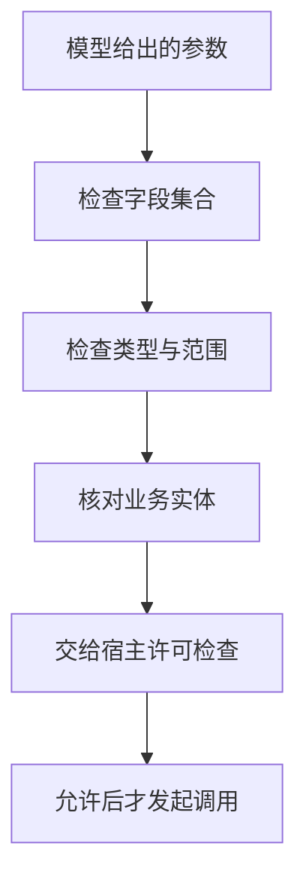
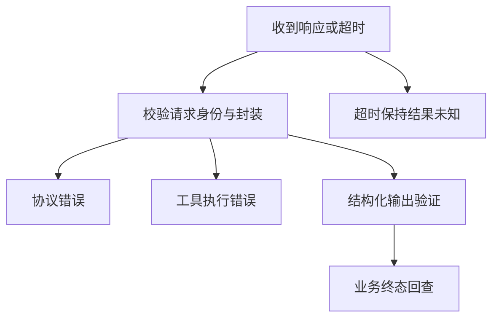
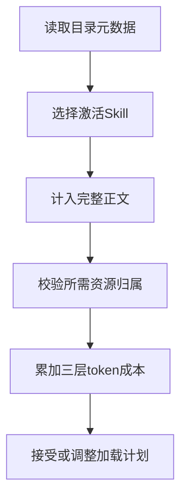

# 工具协议与MCP及Skill

> 工具定义可调用能力，MCP规定客户端与服务端如何发现和交换这些能力，Skill组织可复用任务方法。参数合法、协议成功、工具执行成功和业务完成分别位于不同边界，必须逐层判断。

## 学习目标

- 区分工具Schema与任务方法
- 设计协议错误处理
- 验证副作用边界

## 前置知识

先读[Harness任务循环](Harness任务循环.md)。需要JSON对象、请求身份、输入输出契约和调用错误概念。本文固定MCP 2025-06-18规范作为协议说明；读取的Python SDK提交还支持更新扩展，不能把当前SDK所有行为倒推成旧协议要求。

## 基本机制

MCP的tools/list提供工具元数据和Schema，tools/call执行调用；规范将JSON-RPC错误与result中的isError工具错误分开。Skill规范则描述元数据、正文、按需资源的逐步加载。它没有把任务方法自动变成远端工具，也不替代宿主的授权和业务验收。[MCP Tools 规范](https://modelcontextprotocol.io/specification/2025-06-18/server/tools)；[Agent Skills Specification](https://agentskills.io/specification)。

将一次调用画成“选择方法 → 获取能力定义 → 准备参数 → 协议交换 → 结果校验 → 业务验收”有助于定位失败。工具返回的文本是结果数据；即使包含看似指令的内容，也不能凭返回位置自行改变宿主权限与任务目标。

完整教学实现：[运行机制示例](../../examples/harness/tools-skills.py)。示例仅使用 Python 标准库，对传入的模拟数据计算结果；本页没有执行模型、外部工具或真实业务实验。

## 推导或示例

### 知识点一：结构合法与业务参数正确是两道门

合法JSON只说明能被解析；Schema合法说明符合声明的字段、类型和取值范围；业务合法还需要实体与目标匹配。令参数为 $x$，结构判据为 $J(x)$，语义判据为 $D(x,g)$，宿主许可为 $A(x)$，本页的**准入模型**是

$$
permit(x,g)=J(x)\land D(x,g)\land A(x).
$$

$g$表示当前任务，三个判据均是布尔值，不是可互相抵消的加权分数。示例函数演示前两项，宿主许可不在此函数内，也不会因为函数返回True就自动获得。

天气查询中city必须为字符串、days必须为1至7的整数。传入同名城市却不符合业务词表，结构可合法而语义不合法。Python中bool是int子类，直接isinstance(True,int)会接受True；示例使用type(x) is int，对齐本地模拟中“天数不能是布尔值”的契约。

MCP规范要求服务端校验输入；所读取的SDK ClientSession在call_tool后还会校验有声明的结构化输出。这说明Schema是双向契约，而不是只约束模型生成参数。输入结构通过也不应跳过输出结构、业务含义或产物身份检查。

```python
def validate_query(arguments: dict, allowed_cities: set[str]) -> tuple[bool, str]:
    """验证简化查询结构和业务词表；不实现完整JSON Schema。"""
    if type(arguments) is not dict or set(arguments) != {'city', 'days'}:
        return False, 'schema_fields'
    if type(arguments['city']) is not str or type(arguments['days']) is not int:
        return False, 'schema_types'
    if not 1 <= arguments['days'] <= 7:
        return False, 'schema_range'
    if arguments['city'] not in allowed_cities:
        return False, 'semantic_city'
    return True, 'accepted'
```

函数按字段集合、精确类型、数值范围、允许城市依次返回可区分的原因。它严格禁止额外字段是教学契约选择，不代表JSON Schema默认禁止additionalProperties。真实日期、时区、同名地点和权限需要单独规则；词表不是通用实体链接算法。



源码与原文：[MCP Python SDK 工具调用与结果校验](https://github.com/modelcontextprotocol/python-sdk/blob/2af9e3089ac66b35c1550c500aae86a82efb1e17/src/mcp/client/session.py#L1052)；[MCP Tools 规范](https://modelcontextprotocol.io/specification/2025-06-18/server/tools)；[MCP Lifecycle 规范](https://modelcontextprotocol.io/specification/2025-06-18/basic/lifecycle)。

可验证性质是bool不能冒充整数、未知字段拒绝、结构合法但城市歧义可单独报告。反例是城市词表中有“朝阳”但未区分城市和区县，此时词表通过仍不足以证明语义正确，必须使用更精确实体ID。

### 知识点二：错误分层决定下一步而不是统一重试

一次调用至少可能停在五种不同位置：请求没有匹配响应、协议层拒绝、工具内部执行失败、返回结构不符合Schema、返回有效但业务尚未验收。本页定义**分类函数**

$$
C(r)=\begin{cases}unknown,&r=\varnothing\\protocol\_error,&r.error\text{ 存在}\\tool\_error,&r.result.isError=true\\schema\_error,&\neg valid(r.result)\\verify,&\text{其余有效结果}\end{cases}
$$

这是解释型分类，代码还优先检查jsonrpc版本、请求ID以及error/result是否恰好存在一个。空响应被标记unknown，因为客户端不知道服务是否已产生副作用；不能仅凭超时决定重发。协议参数错通常需要修正请求，业务错误可能需要换策略，输出结构错需要修复服务或适配器。

MCP 2025-06-18明确给出协议错误与isError:true工具错误的区别。所读取SDK的call_tool在非错误CallToolResult上调用validate_tool_result，存在outputSchema但缺失structuredContent时会拒绝；它没有据此确认用户业务目标。

例如工具返回count=2，只证明一个非负计数符合Schema。用户要整理两份指定文档，还需要确认这两个对象是否正确、是否遗漏引用、是否出现重复输出。“正常result”在本例最终分类中仍是verify_business，而不是success。

```python
def classify_response(response: dict | None, expected_id: str) -> str:
    """区分超时、协议错误、工具错误、结果畸形与业务待验证。"""
    if response is None:
        return 'unknown'
    if response.get('jsonrpc') != '2.0' or response.get('id') != expected_id:
        return 'protocol_mismatch'
    if ('error' in response) == ('result' in response):
        return 'malformed'
    if 'error' in response:
        error = response['error']
        if not isinstance(error, dict) or type(error.get('code')) is not int:
            return 'malformed'
        return 'protocol_error'
    result = response['result']
    if not isinstance(result, dict) or type(result.get('isError', False)) is not bool:
        return 'malformed'
    if result.get('isError', False):
        return 'tool_error'
    data = result.get('structuredContent')
    if not isinstance(data, dict) or type(data.get('count')) is not int or data['count'] < 0:
        return 'output_schema_error'
    return 'verify_business'
```

函数消费模拟响应而不发网络请求。expected_id使串台响应与本次业务结果分开；error/result同时存在会被视为畸形。count字段验证仅代表一个教学输出Schema，不能用于任意MCP工具。分类结果供宿主决定回查、纠正参数或验收，不在此处盲目执行重试。



源码与原文：[MCP Python SDK 工具调用与结果校验](https://github.com/modelcontextprotocol/python-sdk/blob/2af9e3089ac66b35c1550c500aae86a82efb1e17/src/mcp/client/session.py#L1052)；[MCP Tools 规范](https://modelcontextprotocol.io/specification/2025-06-18/server/tools)；[MCP Lifecycle 规范](https://modelcontextprotocol.io/specification/2025-06-18/basic/lifecycle)。

可验证性质是超时不等于失败、isError不会进入业务成功路径、错误请求ID拒绝、输出缺失可单独归类。反例是把HTTP 200当作工具成功：JSON-RPC的error与工具isError都可能出现在正常传输响应中。

### 知识点三：Skill分层加载控制上下文而非扩大权限

把所有Skill全文放进每轮输入既耗预算，又增加无关方法干扰。Agent Skills规范描述三层：启动时提供元数据，激活时加载正文，需要时读取资源。参考实现to_prompt遍历Skill目录，只把name、description和location输出到可用技能块；它本身并没有替宿主执行激活或资源调用。

设目录集合为 $S$、激活集合为 $A\subseteq S$、需要的资源集合为 $R$，元数据、正文、资源成本分别为 $m_s,b_s,c_r$。本页的**加载预算模型**为

$$
T=\sum_{s\in S}m_s+\sum_{s\in A}b_s+\sum_{r\in R}c_r,\quad T\le B,\quad owner(r)\in A.
$$

资源归属约束使一次偶然出现的文件名不能把未激活方法整套引入。例：两个Skill元数据各10，激活a正文50，所需参考30，总量100；b正文80并未计入。预算99时应该拒绝这个完整计划，重新组织任务或减少可选资源，不能只读半段必要方法后假装完整执行。

规范中的allowed-tools是实验字段，支持程度取决于宿主。资源文件中的建议或命令是否能执行，仍取决于已有任务授权和运行机制；“已加载正文”只改变可见信息，不是权限提升事件。

```python
def skill_load_plan(catalog: dict[str, int], bodies: dict[str, int],
                    active: set[str], resources: dict[str, tuple[str, int]],
                    requested: set[str], budget: int) -> dict:
    """规划元数据、激活正文和所需资源的token成本，不读取或运行文件。"""
    if type(budget) is not int or budget < 0:
        raise ValueError('预算须为非负整数')
    costs = list(catalog.values()) + list(bodies.values()) + [c for _, c in resources.values()]
    if any(type(c) is not int or c < 0 for c in costs):
        raise ValueError('成本必须是非负整数')
    if not active <= catalog.keys() or not active <= bodies.keys():
        raise ValueError('激活项缺少目录或正文')
    if not requested <= resources.keys():
        raise ValueError('请求了不存在的资源')
    if any(resources[r][0] not in active for r in requested):
        raise ValueError('资源所属Skill尚未激活')
    cost = sum(catalog.values()) + sum(bodies[s] for s in active)
    cost += sum(resources[r][1] for r in requested)
    return {'accepted': cost <= budget, 'tokens': cost,
            'bodies': sorted(active), 'resources': sorted(requested)}
```

函数检查激活项存在、请求资源存在、资源所有者已激活，再计算三层成本。输出accepted表示计划是否容纳在预算内，不代表实际文件读取成功；bodies和resources是排序后的待加载身份。示例没有文件访问、命令执行或认证操作。



源码与原文：[Agent Skills 参考实现 to_prompt](https://github.com/agentskills/agentskills/blob/69ef37e9424c0a7ea9dd2293b559e43ec8176379/skills-ref/src/skills_ref/prompt.py#L9)；[Agent Skills Specification](https://agentskills.io/specification)；[AutoGen TokenLimitedChatCompletionContext.get_messages](https://github.com/microsoft/autogen/blob/004749e6b7102c8fd317b9b1499ce5807223c278/python/packages/autogen-core/src/autogen_core/model_context/_token_limited_chat_completion_context.py#L57)；[Effective context engineering for AI agents](https://www.anthropic.com/engineering/effective-context-engineering-for-ai-agents)。

可验证性质是未激活资源拒绝、未选正文不占成本、预算边界包含等号、加载计划无外部副作用。反例是资源引用递归成环或动态展开新资源，本函数只覆盖已经展开的一级清单，生产需做访问集合和额外预算控制。

## 适用条件与限制

协议与SDK会演进，本文仅使用固定版本中已核实的共有机制。完整JSON Schema、分页工具发现、资源订阅、流式进度和连接生命周期需要真实SDK支持；教学函数不构成协议兼容实现。

工具、MCP、Skill与Harness是职责概念，不是必须拆成四个进程。最常见误区是安装协议就自动拥有长期记忆、合法参数就可以直接写、Skill允许工具字段就能越过宿主权限。学习时应逐项指出由谁解释、由谁执行、由谁验收。

## 实践任务

为只读天气工具冻结输入与输出Schema，设计五个反例：缺字段、布尔天数、同名地点、工具isError、超时。分别写宿主下一步。再为两个模拟Skill填写三层token表，比较全量加载与按需加载；明确哪些信息是必须完整读取的正文。

实践状态保持 `designed`。教学函数的测试由统一 UT 流程负责，本页不把手算预期写成已运行结果，也不把示例性质外推为真实模型成功率。

## 掌握标准

- 能给出结构合法而业务错误的调用。
- 能区分传输状态、JSON-RPC错误和工具错误。
- 能解释输出Schema通过后为什么仍需业务回查。
- 能手算Skill加载预算，并说明加载不赋予额外权限。

## 源码导读与模型边界

ClientSession.call_tool → validate_tool_result展示调用后验证；Agent Skills to_prompt展示目录层元数据而非完整任务执行器。三段示例分别用于参数门、响应分类、加载预算。MCP结果未知时的写入恢复继续参考[Harness任务循环](Harness任务循环.md)。

### 连贯案例复盘

贯穿例子是“查询某城市未来三天天气，再生成一段草稿”。Skill可以定义先消歧城市、确认日期与组织回答；工具Schema表达字段类型；MCP负责发现和交换；宿主负责当前动作是否符合目标、失败后如何恢复以及何时可以停止。将这些责任写在同一进程里也可以，但边界仍然存在。

| 返回或输入 | 当前能证明什么 | 仍不能证明什么 |
|---|---|---|
| JSON可解析 | 序列化成立 | 字段正确 |
| Schema校验通过 | 声明的结构成立 | 业务实体匹配 |
| 无工具错误 | 调用报告了正常结果 | 用户目标满足 |
| Skill正文已加载 | 方法已进入可见上下文 | 资源有权限执行 |

对同名城市案例，正确下一步是补足实体身份，而不是把工具超时时间调大。对输出缺少count的案例，应区分服务违反输出契约和业务查询没有结果；缺字段与count等于零不是同一状态。对没有收到响应的写工具，应保持结果未知并回查，而不是把只读查询的重试习惯原样应用到写操作。

协议版本也是契约的一部分。规范允许的字段、SDK支持的扩展和服务当前协商出的能力应分别记录。本文引用旧规范解释共有概念，并引用固定SDK代码说明一个实现观察；不能因为SDK里出现新字段就把它描述成旧版本客户端必须发送。

Skill加载预算同样要尊重完整性。必要正文超预算意味着需要重新组织任务或上下文，不意味着可以读取开头几行后宣称已遵循全部方法。资源清单应按实际需求展开，并记录已读取的版本；引用到的外部文本仍然是数据，不自动升级成宿主规则。

本文源码链接均锁定实际读取的提交；论文锁定 arXiv 版本，在线官方文档记录读取日和正文指纹。公式中标为“教学模型”的预算、阈值和状态集合是本页设计，不是论文测得的效果。第三方文件只作为阅读依据，教学实现为独立简化。

---

[返回模块](../modules/Harness.md) · [知识点索引](../../docs/知识点索引.md) · [完整教学代码](../../examples/harness/tools-skills.py) · [提出更正](https://github.com/yanbozhang/llm-systems-wiki/issues/new?template=knowledge.yml)

觉得这篇推导有帮助，可以在 [GitHub](https://github.com/yanbozhang/llm-systems-wiki) 点 Star 收藏更新；分享时欢迎链接到具体知识点，便于读者复核公式、代码与来源。
