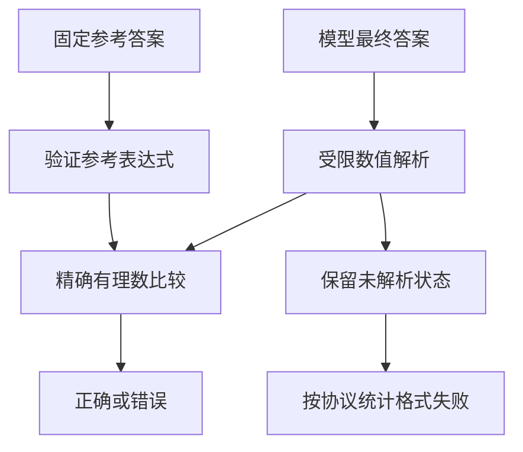
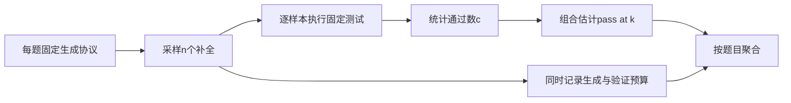
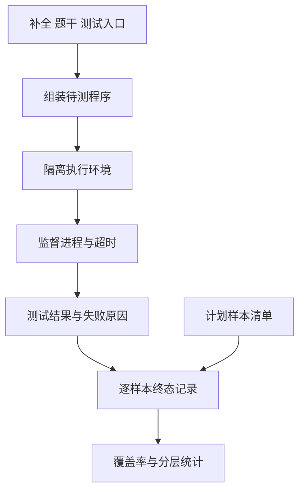

# 推理与代码生成评测

推理与代码评测需要把三个问题分开：最终答案怎样判定，多个采样结果怎样聚合，生成代码怎样在固定执行条件下得到结果。一个看似解释完整的推理过程不自动证明答案正确，一段通过给定测试的代码也不证明对所有输入正确。本页结合GSM8K与HumanEval的论文和源码，逐层分析评分机制。

## 学习目标

- 能为数值答案定义明确的等价与未解析状态，避免用任意文本清洗代替判定。
- 能推导HumanEval常用pass@k估计，并区分样本池组合概率与单次成功率。
- 能从代码执行器追到逐样本结果，保留超时、运行失败与未运行状态。

## 前置知识

需要条件概率、组合数、分数表示与程序测试基础。先阅读[通用能力基准与选型](通用能力基准与选型.md)和[评测协议与可复现性](评测协议与可复现性.md)。区分生成模型、答案验证器、执行环境和测试判据，避免把这些角色合成一个模糊的“评测模型”。

## 基本机制

数学题可以采用最终数值、符号等价或人工规则等判据；代码题通常将补全与给定测试组合后执行。对多次采样，需要固定每题预算并按题目统计覆盖概率。评分器越宽松越严格都不天然更好，关键是它是否与题目语义及预先定义的协议一致。

## 推导或示例

### 知识点一：最终答案等价需要先限定表达空间

“0.5”和“1/2”表示同一个有理数，但字符串比较会判不同；“100厘米”和“1米”也可等价，却需要单位换算。若试图用一套通用清洗规则处理所有答案，很容易删掉负号、单位或有意义的小数精度。正确做法是先限定题型和表达空间，再选择判定方法。

本例只处理有理数文本，不解析任意自然语言、LaTeX或程序表达式，也不调用eval。参考答案无法解析意味着数据本身有问题，应报错；预测无法解析则保留None，供下游按协议记录格式失败。这样的区分可以避免把数据标注错误归到模型身上。

#### 公式与推导

$$
\mathrm{Correct}(a,\hat a)=\mathbf{1}\lbrace \mathrm{Fraction}(a)=\mathrm{Fraction}(\hat a)\rbrace ,\qquad \hat a\notin\mathcal Q_{\mathrm{text}}\Rightarrow \mathrm{Unknown}
$$

Q_text在本例中是Fraction可解析的有理数文本集合。十进制0.5被精确表示为1/2，因此与“1/2”比较为真；“0.5001”与“1/2”不同。没有浮点容差，也没有把近似答案自动判对。对于测量误差或浮点输出任务，应另行定义绝对/相对容差，并说明单位和参考精度，而不是悄悄改变本例的精确等价契约。

#### 代码与逐步说明

```python
def numeric_equivalence(prediction, reference):
    """参考答案须为合法有理数文本；预测不可解析返回None，其他按精确值比较。"""
    if not isinstance(reference, str) or not reference.strip():
        raise ValueError('参考答案须为非空有理数文本')
    try:
        expected = Fraction(reference.strip())
    except (ValueError, ZeroDivisionError) as exc:
        raise ValueError('参考答案不是合法有理数') from exc
    if not isinstance(prediction, str):
        return None
    try:
        actual = Fraction(prediction.strip())
    except (ValueError, ZeroDivisionError):
        return None
    return actual == expected
```

函数先解析参考答案，再解析预测。Reference解析失败抛出ValueError，预测失败返回None，其余返回布尔等价结果。标准库Fraction避免了将小数先转成二进制浮点再比较的表示误差。该实现既不验证推理步骤，也不判断含单位的文本；调用方应保留原始回答，以便区分格式失败、计算错误和题目歧义。

#### 核心实现结构



参考答案和模型预测具有不同错误责任，因此图中不把两者解析失败混成一种“答错”。如果任务要求验证推导过程，还需在最终答案判定之外增加独立机制。

#### 源码导读与边界

GSM8K公开代码extract_answer查找明确的####数值标记并移除逗号，is_correct将抽取结果与参考字符串比较；这是特定任务协议，并不是任意数学表达式等价器。GSM8K论文还研究了从多个候选解中选择答案的验证器。本例的Fraction判定是另一种受限教学方案，用于展示如何明确表达空间。

依据：[GSM8K 最终答案提取与正确性检查](https://github.com/openai/grade-school-math/blob/3101c7d5072418e28b9008a6636bde82a006892c/grade_school_math/dataset.py#L23)；[数学文字题验证器与GSM8K](https://arxiv.org/html/2110.14168)。

答案正确可能来自有效推理、猜测或数据记忆，最终答案评测不能独自区分它们。需要研究推理过程时，应另外定义过程标签与可靠判据，不能把输出很长当作过程正确。

### 知识点二：pass@k衡量固定采样预算下的覆盖

代码模型可能一次采样失败，但多次采样中出现正确程序。pass@k关注每题给定k次机会时是否至少有一个通过测试。它不能与只运行一次的成功率混用，也不能把挑选结果所需的评估成本隐藏掉。

HumanEval方法先为每题生成n个样本并执行测试，得到其中c个通过，再使用组合估计计算pass@k。该估计对每道题单独计算，之后按题目聚合；不能把所有题的样本混在一起，让采样更多的题获得更高权重。

#### 公式与推导

$$
\widehat{\mathrm{pass@}k}=1-\frac{\binom{n-c}{k}}{\binom{n}{k}},\qquad 1\le k\le n,\quad 0\le c\le n
$$

在n个已经判定的样本中，等可能选择k个子集。全部失败的子集有C(n-c,k)种，全部子集有C(n,k)种，取补事件得到公式。若n=5、c=2、k=2，则失败子集3种、全部子集10种，所以估计为0.7。将c/n代入1-(1-p)^k得到0.64，是另一种插值方式，不能直接替代这里的组合估计。若失败样本数少于k，任何子集都至少包含一个成功样本，结果为1。

#### 代码与逐步说明

```python
def pass_at_k(n, correct, k):
    """n个已判定样本中无放回选k个，至少一个正确的组合估计。"""
    if any(type(v) is not int for v in (n, correct, k)):
        raise ValueError('计数须为整数')
    if n < 1 or not 0 <= correct <= n or not 1 <= k <= n:
        raise ValueError('需要n>=1、0<=correct<=n、1<=k<=n')
    if n - correct < k:
        return 1.0
    return 1.0 - comb(n - correct, k) / comb(n, k)
```

代码明确拒绝k>n或非法计数，使用Python整数的组合数进行小规模教学计算。它没有生成样本，也没有选择正确代码的能力。把估计解释为模型在未来独立采样的覆盖概率时，需要相同采样协议与相应统计假设；有限样本中估计为1，并不意味着未来永远成功。

#### 核心实现结构



预算信息与指标一同进入报告。若系统还使用一个模型从多个候选中选择答案，应把选择器作为额外组件评测；“候选中存在正确程序”与“系统能选中它”并不相同。

#### 源码导读与边界

HumanEval的estimate_pass_at_k在docstring中写出组合公式，内部用乘积形式实现以避免直接计算巨大组合数；当n-c<k时返回1。论文将它描述为对每题采样池的无偏估计。教学代码保留相同数学对象，但只针对小输入使用comb，不能据此推断大规模运行性能。

依据：[HumanEval pass@k与执行汇总](https://github.com/openai/human-eval/blob/b9453e8f1865df0a0057a1383767caa400acfbcf/human_eval/evaluation.py#L13)；[代码大模型评估与HumanEval](https://arxiv.org/html/2107.03374)。

不要在不同温度、不同n或不同测试预算之间直接比较pass@k。测试集不充分也会影响c的含义：通过现有单元测试只是通过这套判据，并不证明完整功能正确。

### 知识点三：执行器结果不是只有通过与未通过

生成代码的评测要跨越模型输出、程序组装、执行监督、资源限制和测试结果等边界。assertion失败、语法或运行错误、超时、根本未执行，都可能得到零分，但工程含义完全不同。混合这些状态会让人误以为模型不会做题，实际问题却可能是环境或任务配置。

本例只汇总已经产生的执行记录，不执行任意生成程序。sample_id必须表示一个计划样本，并且唯一；同题多个补全需要不同样本身份，再在上层按题目聚合。not_run保留计划覆盖缺口，不能被无声删除。

#### 公式与推导

$$
N_{\mathrm{attempt}}=N-N_{\mathrm{not\ run}},\qquad C=\frac{N_{\mathrm{attempt}}}{N},\qquad S=\frac{N_{\mathrm{passed}}}{N}
$$

N表示计划样本数，C表示执行覆盖，S表示完整分母下的成功率。三条记录分别passed、timeout、not_run时，覆盖为2/3，成功率为1/3，而已执行样本中的成功率为1/2。三个值回答不同问题。当全部样本未运行时，已执行成功率没有定义，应保留None，而不是填0来伪装完成了评测。

#### 代码与逐步说明

```python
def execution_summary(records):
    """一条记录代表一个计划样本；未运行、超时、运行错误与测试失败分开。"""
    statuses = ('passed', 'assertion_failed', 'timeout', 'runtime_error', 'not_run')
    if not isinstance(records, list) or not records:
        raise ValueError('计划样本记录必须非空')
    counts, seen = dict.fromkeys(statuses, 0), set()
    for row in records:
        if not isinstance(row, dict):
            raise ValueError('记录须为对象')
        key, state = row.get('sample_id'), row.get('status')
        if not isinstance(key, str) or not key or key in seen:
            raise ValueError('样本ID缺失或重复')
        if not isinstance(state, str) or state not in counts:
            raise ValueError('执行状态无效')
        seen.add(key)
        counts[state] += 1
    n = len(records)
    attempted = n - counts['not_run']
    return {'counts': counts, 'planned': n, 'attempted': attempted,
            'coverage': attempted / n, 'success_rate': counts['passed'] / n,
            'attempted_success_rate': counts['passed'] / attempted if attempted else None}
```

函数将终态分为五类，先验证样本唯一性与枚举，再计算完整计数。记录中的runtime_error与assertion_failed都不通过，但保留不同计数以支持排障；timeout也仍进入计划分母。函数没有建立安全沙箱，没有启动进程，也没有验证日志真实性，这些责任属于实际评测运行时。

#### 核心实现结构



隔离执行环境是独立组件，不由统计函数提供。实际实现还需明确文件系统、网络、进程与资源边界；图中每层都应保留可回查记录，以区分模型错误和评测器故障。

#### 源码导读与边界

HumanEval的check_correctness为每个补全启动子进程，等待到限定时间并在必要时终止，再返回task_id、passed、result和completion_id；unsafe_execute将prompt、completion和test组合后运行。源码明确提醒执行不受信任的生成代码需要合适隔离，reliability_guard不是完整安全边界。本页只阅读这条调用链，不运行该执行器。

依据：[HumanEval 执行检查与隔离说明](https://github.com/openai/human-eval/blob/b9453e8f1865df0a0057a1383767caa400acfbcf/human_eval/execution.py#L12)；[HumanEval 执行检查与隔离说明](https://github.com/openai/human-eval/blob/b9453e8f1865df0a0057a1383767caa400acfbcf/human_eval/execution.py#L62)；[HumanEval pass@k与执行汇总](https://github.com/openai/human-eval/blob/b9453e8f1865df0a0057a1383767caa400acfbcf/human_eval/evaluation.py#L42)。

若执行环境改变了依赖、超时或可访问资源，评分对象也随之改变。尤其不能把一次本地宽松执行的通过率直接标为正式基准结果，或把未运行样本从报告中消失。

## 适用条件与限制

最终答案、给定测试通过和完整业务正确性是不同层次。本页没有运行真实代码模型或生成程序，只提供可检查的数学与记录处理示例。HumanEval论文中讨论的早期Codex模型与现代Codex CLI工程系统不是同一个版本对象，不能互相替代实现说明。

## 实践任务

对0.5、1/2、0.5001和带单位文本比较解析与等价结果；为五个补全列出两个成功样本，手工枚举十个二元子集验证pass@2。再构造通过、断言失败、运行错误、超时和未运行五类日志，核对完整分母与覆盖率，并写出一次真实代码评测还需要固定哪些隔离和依赖条件。

完整教学示例：[源码文件](../../examples/benchmark/benchmark-reasoning-code.py)。它使用 Python 3.11+ 标准库，不调用真实模型；页内代码是对应函数片段。单元测试证明本例的数学或状态性质，完整基准实验仍为“已设计”。

## 掌握标准

能说明自己的答案表达空间，解释None与False的区别；能从组合计数推导pass@k并识别k>n不合法；能沿HumanEval执行调用链指出程序组装、超时监督和结果字段，且不把监督子进程等同于完整沙箱。报告应包含每题采样预算与失败分类。

## 源码阅读路径与继续学习

继续阅读[Agent任务基准与执行评估](Agent任务基准与执行评估.md)、[稳健性与工具安全评测](稳健性与工具安全评测.md)和[AI代码开发与反馈](AI代码开发与反馈.md)。单函数补全、仓库级修复和长期编程Agent任务的完成判据不同，迁移指标时应重新核对执行环境与验收层。

返回[Benchmark模块](../modules/Benchmark.md)，或查看[能力地图](../../docs/能力地图.md)。

---

[返回模块](../modules/Benchmark.md) · [知识点索引](../../docs/知识点索引.md) · [完整教学代码](../../examples/benchmark/benchmark-reasoning-code.py) · [提出更正](https://github.com/yanbozhang/llm-systems-wiki/issues/new?template=knowledge.yml)

觉得这篇推导有帮助，可以在 [GitHub](https://github.com/yanbozhang/llm-systems-wiki) 点 Star 收藏更新；分享时欢迎链接到具体知识点，便于读者复核公式、代码与来源。
