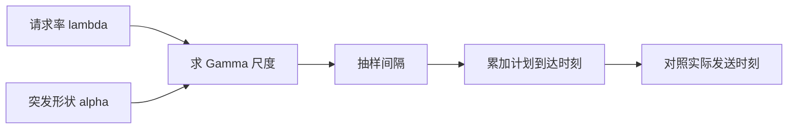
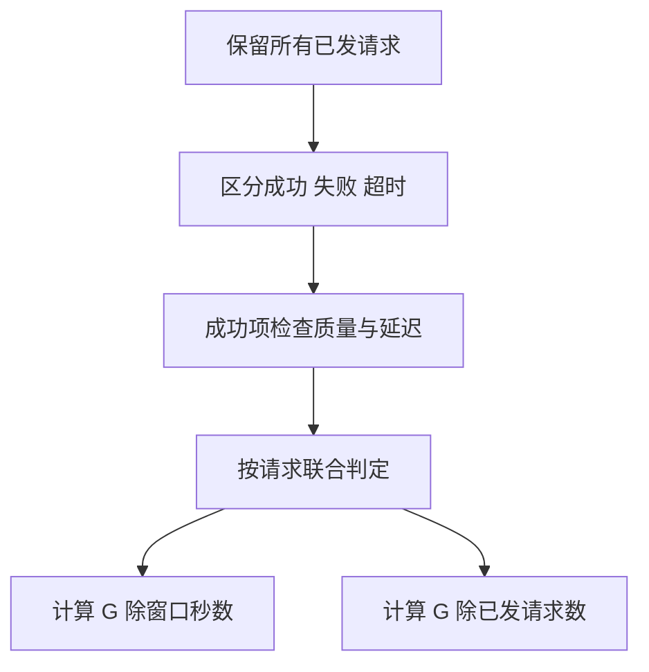
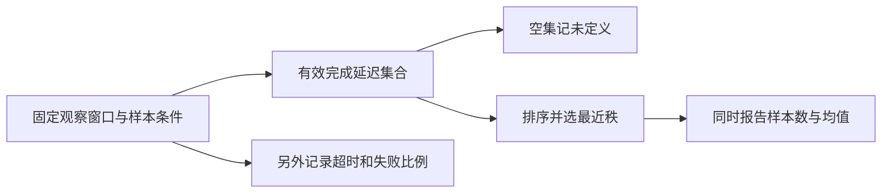

# 推理框架与性能实验

推理框架比较的核心是固定工作负载、正确性和观察口径，再解释差异。本页通过真实压测源码与论文定义，构造到达过程、联合达标统计和尾延迟三个可审查示例，不提供未经验证的通用框架排行。

## 学习目标

- 写出可重复性能协议
- 区分微基准与服务负载
- 解释质量约束下的吞吐

## 前置知识

需理解[Prefill与Decode](Prefill与Decode.md)、[缓存分页与连续批处理](缓存分页与连续批处理.md)、基本概率与分位数。统一使用秒与请求/秒，统计输出时再换算毫秒。

## 基本机制

vLLM与SGLang各有论文关注点和持续演进实现。一次比较至少要确定代码提交、模型版本、请求数据及缓存状态；将算法名称与端到端性能直接画等号会掩盖关键变量。[SGLang 实验设置](https://arxiv.org/html/2312.07104v2)展示受控负载，[DistServe goodput研究](https://arxiv.org/html/2401.09670v3)展示延迟约束下的容量目标。

本页源码读取的是固定提交，不意味着已部署这些框架。所有数值都是手算或合成统计，生成器只返回时间数组；质量评判、GPU执行和服务压测均不在本轮示例内。

## 推导或示例

完整教学文件：[inference-frameworks.py](../../examples/inference/inference-frameworks.py)。每个函数对应下列一个知识点，只使用标准库与小型合成输入；教学计算不代表模型或服务实验。

### 知识点一：到达率与突发度是两个独立负载参数

服务容量不能从一个循环串行请求中推断。闭环客户端等上一请求完成再发送，会在服务器变慢时自动降低到达率；开环负载按预定时刻到达，才能显露过载排队。先明确选择，再比较引擎。该版本vLLM `get_request`用Gamma间隔表达请求到达，形状 $\alpha\gt 0$ ，尺度 $\theta=1/(\lambda\alpha)$ ，其中 $\lambda$ 的单位为请求/秒：

$$
\mathbb E[\Delta t]=\alpha\theta=1/\lambda,\quad \mathrm{Var}(\Delta t)=\alpha\theta^2=1/(\lambda^2\alpha),\quad CV=1/\sqrt\alpha.
$$

$\alpha=1$ 是指数间隔，即Poisson过程的间隔； $\alpha\lt 1$ 更突发；增大 $\alpha$ 使间隔更集中。到达率2请求/秒时，均值0.5秒； $\alpha=1$ 方差0.25秒平方， $\alpha=4$ 方差0.0625秒平方。单次少量抽样的实际均值不会必然等于理论值。

```python
def arrival_schedule(count, rate, burstiness=1.0, seed=0):
    """用Gamma间隔构造到达时刻，首请求在0秒；不执行等待或网络请求。"""
    if type(count) is not int or count < 0:
        raise ValueError("请求数须为非负整数")
    if not math.isfinite(rate) or not math.isfinite(burstiness) or min(rate, burstiness) <= 0:
        raise ValueError("到达率和形状须为有限正数")
    rng = random.Random(seed)
    result, time = [], 0.0
    for i in range(count):
        if i:
            time += rng.gammavariate(burstiness, 1.0 / (rate * burstiness))
        result.append(time)
    return result
```

函数用局部随机数生成器，固定seed使合成时间表可重复而不影响全局随机状态；返回时刻，不等待也不访问服务。首请求固定在0，此后只抽 $n-1$ 个间隔。时间/空间为 $O(n)$ 。生产压测还必须记录计划发送与实际发送的差，客户端CPU或连接池饱和会让实际到达过程失真。



输入/输出长度及共享前缀也属于负载维度。固定平均长度但把请求集中成突发批次，会改变排队与缓存局部性；复制同一prompt则可能意外形成暖缓存压测。论文性能结果只能在其模型、GPU、长度与SLO条件内解释，不能把历史vLLM与SGLang不同版本的论文数字拼成今天的排行。

[vLLM get_request](https://github.com/vllm-project/vllm/blob/7a64fb8fc9239cb65e0df9313fa759594dfb206a/vllm/benchmarks/serve.py#L431)；[DistServe §2、§3.3](https://arxiv.org/html/2401.09670v3)；[SGLang §6.1 实验设置](https://arxiv.org/html/2312.07104v2).

### 知识点二：联合达标吞吐与SLO容量不是同一个量

设已发请求集合大小为 $N$ ，观察时长 $W$ 秒。对请求 $i$ 定义成功标志 $S_i$ 、外部质量标志 $Q_i$ ，阈值 $\tau_f,\tau_p$ 。窗口内合格请求数为：

$$
G=\sum_i\mathbf1[S_i\land Q_i\land(\mathrm{TTFT}_i\le\tau_f)\land(\mathrm{TPOT}_i\le\tau_p)],\quad g=G/W,\quad A=G/N.
$$

$g$ 是请求/秒， $A$ 无量纲。质量标签由固定判据独立产生，不由响应耗时或HTTP成功自动推断。该版vLLM `calculate_metrics`联合检查指定延迟约束，未内置本例的语义质量门槛；教学函数显式增加 `quality_ok`，不能把扩展写成源码原有功能。

```python
def qualified_metrics(rows, duration, ttft_limit, tpot_limit):
    """统计所有已发请求；quality_ok为外部判据，失败请求保留在达标率分母。"""
    if any(not math.isfinite(x) for x in (duration, ttft_limit, tpot_limit)) or duration <= 0 or min(ttft_limit, tpot_limit) < 0:
        raise ValueError("时间窗口须正，延迟阈值须非负")
    rows = list(rows)
    completed = good = output_tokens = 0
    for r in rows:
        if not r["success"]:
            continue
        ttft, latency, n = r["ttft"], r["latency"], r["output_tokens"]
        if not math.isfinite(ttft) or not math.isfinite(latency) or not 0 <= ttft <= latency or type(n) is not int or n < 1:
            raise ValueError("成功请求需有效计时及至少一个输出token")
        completed += 1
        output_tokens += n
        # 单token的TPOT阈值在本教学协议中不适用。
        tpot_ok = n == 1 or (latency - ttft) / (n - 1) <= tpot_limit
        good += bool(r["quality_ok"] and ttft <= ttft_limit and tpot_ok)
    return {"offered": len(rows), "completed": completed, "qualified": good,
            "attainment": good / len(rows) if rows else None,
            "completion_rate": completed / len(rows) if rows else None,
            "request_rps": completed / duration, "qualified_rps": good / duration,
            "output_tokens_per_s": output_tokens / duration}
```

对2秒窗口中3个请求，一个成功且合格、一个成功但质量失败、一个请求失败，合格吞吐是0.5请求/秒、成功吞吐1请求/秒、达标率1/3。删掉失败行会把分母改成2，已经换了问题。单token没有TPOT观测，本例将这一约束视为不适用；协议须提前固定，不能在看到结果后改规则。



DistServe论文的goodput定义强调“满足目标达标率时可承载的最大到达率”，还可按GPU归一；它是扫描到达率后得到的容量点，不能与单次窗口 $G/W$ 直接等同。另一个陷阱是联合事件：100个请求中90个TTFT合格、90个TPOT合格，如果失败集合不重叠，只有80个同时合格。因此分别报告两个p90不足以证明90%请求都同时达标。函数线性扫描 $O(N)$ ，不模拟饱和边界；需要真实多档负载才能判断最大可承载率。

[vLLM calculate_metrics 联合SLO](https://github.com/vllm-project/vllm/blob/7a64fb8fc9239cb65e0df9313fa759594dfb206a/vllm/benchmarks/serve.py#L669)；[DistServe goodput定义](https://arxiv.org/html/2401.09670v3)；[vLLM 分块与延迟取舍](https://github.com/vllm-project/vllm/blob/7a64fb8fc9239cb65e0df9313fa759594dfb206a/docs/configuration/optimization.md#L49).

### 知识点三：分位数、缺失值和受截断样本

对排序样本 $x_{(1)}\le\cdots\le x_{(n)}$ ，本例选最近秩定义 $q_p=x_{(\lceil pn\rceil)}$ ， $0\lt p\le1$ 。样本 `[1,1,1,1,6]` 秒的均值2秒、p95为6秒；系统全部样本都为2秒时均值相同，p95却是2秒。小样本p95容易等于最大值，不能因为算出了分位数就宣称估计稳定。

将上述计算或状态约束集中写为：

$$
q_p=x_{(\lceil pn\rceil)},\quad 0\lt p\le1,\qquad \overline{x}=\frac1n\sum_{i=1}^n x_i.
$$

```python
def latency_summary(values, percentile=0.95):
    """返回有限非负样本的均值与最近秩分位数；空集返回None，不伪造零延迟。"""
    if not math.isfinite(percentile) or not 0 < percentile <= 1:
        raise ValueError("分位点须在 (0,1] 内")
    values = list(values)
    if any(not math.isfinite(v) or v < 0 for v in values):
        raise ValueError("延迟须为有限非负数")
    if not values:
        return {"count": 0, "mean": None, "percentile": None}
    ordered = sorted(values)
    rank = math.ceil(percentile * len(ordered))
    return {"count": len(ordered), "mean": sum(ordered) / len(ordered),
            "percentile": ordered[rank - 1]}
```

函数排序需要 $O(n\log n)$ 时间、 $O(n)$ 空间；没有样本时返回 `None`，避免把“没有任何成功请求”显示成0ms。该版本vLLM调用 `numpy.percentile`，其插值分位数与这里的最近秩可能不同，特别在小样本下；对比工具之前应先统一定义。本函数不执行重复抽样、不计算置信区间，也不声称与生产基准逐值一致。



如果最长的请求都在5秒被取消，完成样本的p95可能变小。取消项的真实完成时间未知，只知道大于取消时刻，它属于受截断观察，不能默认为5秒完成、更不能悄悄删除后报告“整体更快”。同理，完成窗口选择会偏向先完成的短请求；应事先固定发起窗口、排空窗口和未完成处理方式。

每次协议至少保存模型revision、tokenizer、模板、精度、停止条件、硬件、框架commit、请求长度分布、到达率、缓存冷热、预热方式与失败分类。预热排除规则要事先指定，且单独报告冷启动；先保证相同任务输出与预算，再比较延迟。源码的默认统计是实现事实，论文的实验设置是局部证据；二者都不能代替本机可重复协议。

[vLLM 分位数计算](https://github.com/vllm-project/vllm/blob/7a64fb8fc9239cb65e0df9313fa759594dfb206a/vllm/benchmarks/serve.py#L773)；[DistServe §2、§3.3](https://arxiv.org/html/2401.09670v3)；[SGLang §6.1](https://arxiv.org/html/2312.07104v2).

## 适用条件与限制

真实负载通常既非固定长度也非严格Poisson，合成负载需要与追踪数据对照。测量时客户端也可能成为瓶颈；设置无限并发不能证明服务无限容量。精度或停止条件改变时，性能与输出质量需一起重验。

常见误区：成功样本p95改善就宣布整体改善；把窗口goodput等同最大容量；把每GPU与整集群吞吐混用。报告须携带分母、窗口、失败和资源数。

## 实践任务

填写一份A/B协议，限定唯一主变化为框架及必要配置，冻结质量判据。为到达率2构造两种突发度，说明理论间隔均值方差。手算联合SLO失败集合不重叠的100请求例子，再分析超时删除如何偏置p95。设计冷启动、稳态与暖前缀三种独立场景。

本页完整实践保持 `designed`。示例测试由统一 UT 流程记录，本页不宣称已测试或论文复现。

## 掌握标准

能给出请求/秒与秒平方的正确量纲；能算出3请求例子的合格率1/3；能区分窗口合格吞吐与SLO容量；能解释最近秩和插值分位数的差异。最终产物应包含逐请求表和完整协议，不能只给一个tokens/s。


## 源码导读与边界推演

可以将容量扫描写成显式判定，而不是寻找单次最快结果。对每档到达率 $\lambda$ 记录实际发起数、完成数、联合达标数及设备数，设目标达标率为 $a_0$ ，候选容量是满足 $A(\lambda)\ge a_0$ 的最大已测到达率。它仍只是离散测点中的最大值，测点之间和更高负载处没有证据；若只有三档负载，不能声称找到了连续意义的精确极限。出现偶然高分时需要检查样本量、稳态与缓存状态是否一致。

每GPU归一还需要固定设备异构情况。4块相同GPU达到8请求/秒，可以报告2请求/秒/GPU；两种不同GPU简单相加后平均，往往掩盖成本与能力差异。Prefill/Decode分离部署还需计算KV传输：若每请求需移动 $M$ 字节，到达率为 $\lambda$ ，仅这项平均负载就约为 $\lambda M$ 字节/秒。单次KV更小不必然使网络总负载更低，因为服务可能承载更多请求；同时要留意带宽峰值、尾部和阶段排队。

输出正确性也影响可比性。固定最大输出长度并不固定实际生成长度；EOS规则、stop字符串、chat template与采样参数都可能改变有效输出。一个引擎提前截断长答案，会获得较短E2E，但不代表完成同一任务更快。协议应区分正常停止、长度上限停止、取消、错误和不符合格式，并在质量判据中说明哪些算有效完成。客户端重试要同时保留逻辑请求ID与尝试ID，避免把成功重试遮盖掉先前失败成本。

预热应描述“预热了什么”。模型加载、编译、内核捕获、前缀缓存和连接池是不同状态；用同一prompt重复预热会同时改变前缀缓存，可能把冷检索条件变成热检索。可将启动耗时单独记录，稳态样本使用与目标负载一致的长度与前缀分布。选择一段平稳观测区间需要事先规则，不能事后删去所有慢样本再称其为预热。最后保存原始逐请求事件，让他人可以按不同但明确的统计口径复算，而不仅保存终端打印的均值。

[DistServe goodput与KV通信](https://arxiv.org/html/2401.09670v3)；[请求聚合指标](https://github.com/vllm-project/vllm/blob/7a64fb8fc9239cb65e0df9313fa759594dfb206a/vllm/benchmarks/serve.py#L602)；[启动缓存与调优条件](https://github.com/vllm-project/vllm/blob/7a64fb8fc9239cb65e0df9313fa759594dfb206a/docs/configuration/optimization.md#L20)；[实验条件 §6.1](https://arxiv.org/html/2312.07104v2).

---

[返回模块](../modules/推理.md) · [知识点索引](../../docs/知识点索引.md) · [完整教学代码](../../examples/inference/inference-frameworks.py) · [提出更正](https://github.com/yanbozhang/llm-systems-wiki/issues/new?template=knowledge.yml)

觉得这篇推导有帮助，可以在 [GitHub](https://github.com/yanbozhang/llm-systems-wiki) 点 Star 收藏更新；分享时欢迎链接到具体知识点，便于读者复核公式、代码与来源。
