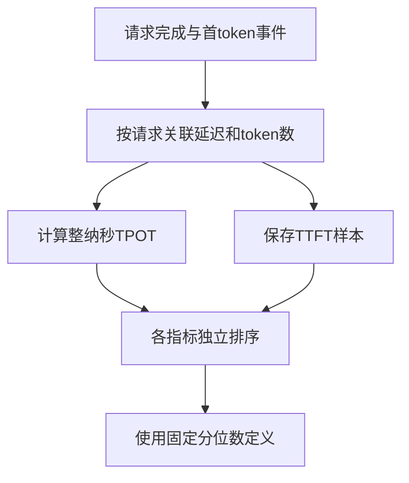
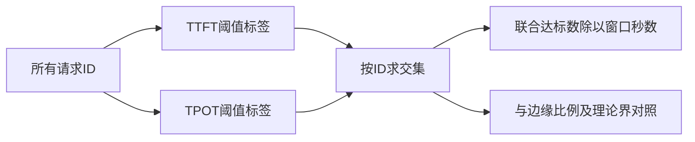
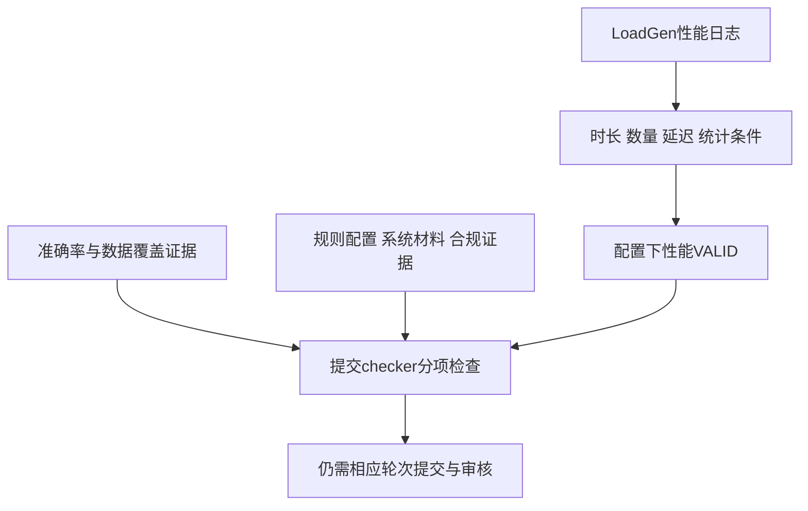

# 推理系统性能基准

推理系统评测必须把统计定义、服务目标和正式提交规则分开。本页以MLPerf LoadGen与提交检查代码为主，连接已有TTFT、TPOT和缓存知识，解释“数值可计算”“运行达标”“结果可正式提交”分别需要什么证据。

## 学习目标

- 定义系统负载与计时边界
- 比较质量约束下的吞吐
- 区分自测与正式提交

## 前置知识

先阅读[评测协议与可复现性](评测协议与可复现性.md)、[推理框架与性能实验](推理框架与性能实验.md)。理解请求、样本、观测窗口、分位数与布尔事件交集；时间统一到秒或纳秒后再比较。

## 基本机制

固定读取MLCommons inference提交 `3fbc329939999c13d0a7b5e67fb2092287e06047`，规则仓库提交 `d3eba2f21026d868ad65cdcad2bb81e4a17ce3d3`。二者是本页证据快照，不代表随意组合版本就符合某正式轮次；实际提交需锁定该轮模型、配置、规则和工具版本。[LoadGen职责](https://github.com/mlcommons/inference/blob/3fbc329939999c13d0a7b5e67fb2092287e06047/loadgen/README.md)；[MLPerf Inference Rules](https://github.com/mlcommons/inference_policies/blob/d3eba2f21026d868ad65cdcad2bb81e4a17ce3d3/inference_rules.adoc).

LoadGen产生和记录流量，SUT执行推理，QSL提供样本；模型准确率评估由模型相关脚本处理。教学工程压测可以借用LoadGen，但必须如实标注自定义设置，不能把它与正式MLPerf提交混为一谈。

## 推导或示例

完整教学文件：[benchmark-systems.py](../../examples/benchmark/benchmark-systems.py)。每个函数对应下列一个知识点，只使用标准库与小型合成输入；教学计算不代表模型或服务实验。

### 知识点一：计时边界、token分母与分位数定义必须一起冻结

时间指标首先是事件协议。TTFT应由请求起点到首token事件计算，TPOT用末输出完成与首token之间的时间除以 $m-1$，其中 $m$为输出token数。该版LoadGen日志记录两类延迟，TPOT在整纳秒域计算。它对 $m\le1$记录错误，不能照搬vLLM自测中单token为goodput填0的约定。

排序延迟为 $x_1\le\cdots\le x_n$，所读 `ProcessLatencies`实际用零基索引 `n*p`，相当于 $Q_p=x_{\lfloor np\rfloor+1}$，$0\le p<1$。它不同于最近秩 $x_{\lceil np\rceil}$，也不同于线性插值。对 `[10,20,30,100]` 纳秒取p=0.5，三种定义分别给30、20、25；不核对实现便比较“p50”，可能比较了不同统计量。

将上述计算或状态约束集中写为：

$$
\mathrm{TTFT}=t_{first}-t_{request},\quad \mathrm{TPOT}=\frac{t_{last}-t_{first}}{m-1}\ (m>1),\quad Q_p=x_{\lfloor np\rfloor+1}.
$$

```python
def loadgen_latency_profile(samples, percentile=0.99):
    """模拟所读LoadGen的零基floor(n*p)分位数及整纳秒TPOT，要求输出至少2token。"""
    rows = list(samples)
    if not math.isfinite(percentile) or not 0 <= percentile < 1:
        raise ValueError("该分位数定义要求0 <= p < 1")
    ttft, tpot = [], []
    for row in rows:
        first, total, tokens = row["ttft_ns"], row["latency_ns"], row["tokens"]
        if any(type(v) is not int for v in (first, total, tokens)) or not 0 <= first <= total or tokens <= 1:
            raise ValueError("要求有序整纳秒延迟及至少2个输出token")
        ttft.append(first)
        tpot.append((total - first) // (tokens - 1))
    def summarize(values):
        if not values:
            return {"mean_ns": None, "percentile_ns": None}
        ordered = sorted(values)
        return {"mean_ns": sum(values) // len(values),
                "percentile_ns": ordered[int(len(values) * percentile)]}
    return {"count": len(rows), "ttft": summarize(ttft), "tpot": summarize(tpot),
            "tpot_per_request_ns": tpot}
```

样例每请求首token后还有30纳秒、3个后续间隔，TPOT均为10纳秒；TTFT的p50按本实现为30纳秒。代码对每请求计算TPOT，再排序聚合；不能先把所有输出token数求和，用一条总时间相除后称为平均请求TPOT。排序成本 $O(n\log n)$，额外空间 $O(n)$。空集合返回None以表明未观测，不伪造零延迟。



还要辨认query和sample：SingleStream是一查询一个样本且完成后再发下一条；MultiStream的一查询含多个样本，其query延迟由最晚完成样本决定；Server按Poisson到达，Offline一次投递大量样本。把MultiStream样本延迟当query延迟会漏掉组内最慢项。

上述函数只重现描述统计，不重现正式early-stopping延迟估计。规则会根据样本数加入统计要求，不能以四个样本的p99声称达到正式尾延迟结论。流式传输若将多个token合并，TTFT标记、最终token计数与完成事件也必须按接口核验。

[PerformanceSummary.ProcessLatencies](https://github.com/mlcommons/inference/blob/3fbc329939999c13d0a7b5e67fb2092287e06047/loadgen/results.cc#L21)；[ProcessTokenLatencies](https://github.com/mlcommons/inference/blob/3fbc329939999c13d0a7b5e67fb2092287e06047/loadgen/results.cc#L86)；[token数与TPOT记录](https://github.com/mlcommons/inference/blob/3fbc329939999c13d0a7b5e67fb2092287e06047/loadgen/logging.cc#L442)；[TestScenario](https://github.com/mlcommons/inference/blob/3fbc329939999c13d0a7b5e67fb2092287e06047/loadgen/test_settings.h#L35)；[LoadGen职责](https://github.com/mlcommons/inference/blob/3fbc329939999c13d0a7b5e67fb2092287e06047/loadgen/README.md).

### 知识点二：边缘分位数达标不能推出联合请求goodput

一个请求可能首token很快但后续输出很慢，也可能相反。令事件A表示TTFT不超过阈值，B表示TPOT不超过阈值；知道 $P(A)$和 $P(B)$，只能得到Fréchet界：

$$\max(0,P(A)+P(B)-1)\le P(A\cap B)\le\min(P(A),P(B)).$$

100个请求各有90个通过两项边缘指标，如果两项各失败10个且互不重叠，只有80个同时通过。若两组失败完全重叠，则90个同时通过。两个边缘p90不能唯一确定联合达标率，更不能假设二者独立后直接相乘。

```python
def slo_overlap(ttft_ok, tpot_ok, duration_s):
    """逐请求计算两个延迟条件的联合达标与Fréchet界；未完成请求应显式标False。"""
    first, later = dict(ttft_ok), dict(tpot_ok)
    if first.keys() != later.keys() or any(type(v) is not bool for v in list(first.values()) + list(later.values())):
        raise ValueError("两条件须覆盖同一请求ID并使用布尔标签")
    if not math.isfinite(duration_s) or duration_s <= 0:
        raise ValueError("观测窗口秒数须为有限正数")
    n = len(first)
    a, b = sum(first.values()), sum(later.values())
    both = sum(first[rid] and later[rid] for rid in first)
    return {"offered": n, "both_pass": both,
            "ttft_rate": a / n if n else None, "tpot_rate": b / n if n else None,
            "joint_rate": both / n if n else None,
            "lower_bound": max(0, a + b - n) / n if n else None,
            "upper_bound": min(a, b) / n if n else None,
            "latency_goodput_rps": both / duration_s}
```

函数按请求ID而非列表位置关联标签。样例三请求中两个通过TTFT、另两个通过TPOT，只有a两项都过，联合比例1/3；1秒窗口的延迟goodput为1请求/秒。分母包括所有已发请求，超时或失败应明确标记未达标，而不是删除后重新算一个更好看的比例。时间和空间均为 $O(n)$。



该版vLLM `calculate_metrics`按每请求对指定SLO取all，得出窗口goodput；所读LoadGen `PerfConstraintsMet`则分别检查目标TTFT分位数和TPOT分位数。两者实现不同，不应为了统一术语而改写正式规则。DistServe论文还用满足目标达标率的最大可承载到达率定义容量型goodput，并可能按GPU归一；它也不同于单次窗口交集数除以秒。

教学函数只检查延迟，不能把结果称为包含语义质量的合格吞吐。正式生成任务通常有准确率和输出长度约束；提前截断答案虽然可能提高速度，却改变任务。负载扫描应同时保存实际到达率、成功率、各边缘分位数、联合达标、输出质量和设备数，不能只挑最好的峰值点。

[LoadGen PerfConstraintsMet](https://github.com/mlcommons/inference/blob/3fbc329939999c13d0a7b5e67fb2092287e06047/loadgen/results.cc#L339)；[vLLM逐请求联合SLO](https://github.com/vllm-project/vllm/blob/7a64fb8fc9239cb65e0df9313fa759594dfb206a/vllm/benchmarks/serve.py#L669)；[DistServe goodput定义](https://arxiv.org/html/2401.09670v3)；[正式场景与约束](https://github.com/mlcommons/inference_policies/blob/d3eba2f21026d868ad65cdcad2bb81e4a17ce3d3/inference_rules.adoc#L132).

### 知识点三：性能VALID、提交检查与正式发布是不同证据层

LoadGen并不理解模型的答案质量。该版 `LogSummary`的VALID主要由最小持续时间、查询/样本数量、性能约束和early-stopping条件相与得到。令这些布尔项为 $d,q,s,l,e$，性能层为 $V_{perf}=d\land q\land s\land l\land e$。它是在给定TestSettings下成立，不表示配置本身符合某一正式轮次规则。

提交层还要核验准确率、允许的模型/分区、日志错误、规定seed及设置、合规材料、system和measurement信息等。未知项不能当真；因此教学汇总使用三态逻辑：有False为failed，没有False但有None为incomplete，全部True才passed。

将上述计算或状态约束集中写为：

$$
V_{perf}=d\land q\land s\land l\land e,\qquad V_{submission}=V_{perf}\land V_{accuracy}\land V_{rules}\land V_{materials}.
$$

这里后三项依次表示准确率、轮次规则和提交材料审查；任一未知项须保持待核验。

```python
def submission_layers(loadgen_checks, submission_checks):
    """汇总有限教学检查项的三态结果；缺失不算通过，结果不构成MLPerf认证。"""
    required_loadgen = ("min_duration", "min_queries", "min_samples", "latency", "early_stopping")
    required_submission = ("accuracy", "seed_and_settings", "no_log_errors", "compliance", "system_and_measurements", "division_and_model")
    def summarize(provided, required):
        if any(v is not None and type(v) is not bool for v in provided.values()):
            raise ValueError("检查值仅允许True、False或None")
        failed = [k for k in required if provided.get(k) is False]
        missing = [k for k in required if provided.get(k) is None]
        return {"status": "failed" if failed else "incomplete" if missing else "passed",
                "failed": failed, "missing": missing}
    performance = summarize(loadgen_checks, required_loadgen)
    submission = summarize(submission_checks, required_submission)
    return {"loadgen_layer": performance, "submission_layer": submission,
            "all_recorded_checks_passed": performance["status"] == submission["status"] == "passed"}
```

样例性能五项全True而提交层没有任何材料，应显示性能passed、提交incomplete。若只看LoadGen摘要里的VALID就结束，会漏掉准确率、数据覆盖或错误日志。函数只演示有限检查项的依赖关系，不包含所有模型、端点后端、功耗、分区和版本例外；即使all_recorded_checks_passed为真，也仅表示传入的这些项通过。



所读 `PerformanceCheck.setup_checks`注册日志、seed、场景、延迟与数量等检查；`llm_check`核对token-latency设置和阈值；`AccuracyCheck`另查准确率结果、准确率文件及数据覆盖。源码中的TestSettings默认最小时长是可复用工具的默认值，规则文档场景表则列出600秒等正式条件；不能拿默认10秒跑一次就冠以MLPerf成绩。

缓存也受协议约束。所读规则允许按参考实现使用单查询内KV，要求每个输入查询完整计算，不能把普通服务跨查询前缀复用直接带入正式结果；模型/管线的特殊规则另需回查。性能工程上合理的优化不自动等于正式提交允许的优化。发布与审核还有独立流程，本文不运行checker、不生成提交，也不宣称任何正式认证。

[LoadGen VALID合取条件](https://github.com/mlcommons/inference/blob/3fbc329939999c13d0a7b5e67fb2092287e06047/loadgen/results.cc#L485)；[PerformanceCheck.setup_checks](https://github.com/mlcommons/inference/blob/3fbc329939999c13d0a7b5e67fb2092287e06047/tools/submission/submission_checker/checks/performance_check.py#L76)；[AccuracyCheck.setup_checks](https://github.com/mlcommons/inference/blob/3fbc329939999c13d0a7b5e67fb2092287e06047/tools/submission/submission_checker/checks/accuracy_check.py#L77)；[Submission checker检查范围](https://github.com/mlcommons/inference/blob/3fbc329939999c13d0a7b5e67fb2092287e06047/tools/submission/README.md#L71)；[KV-cache正式约束](https://github.com/mlcommons/inference_policies/blob/d3eba2f21026d868ad65cdcad2bb81e4a17ce3d3/inference_rules.adoc#L895)；[Submission Considerations](https://github.com/mlcommons/inference/blob/3fbc329939999c13d0a7b5e67fb2092287e06047/loadgen/README.md#L70).

## 适用条件与限制

硬件、模型、精度、长度分布、停止条件和到达过程共同定义被测系统。分位数与early stopping不同；完成样本统计与所有已发请求不同；自定义阈值和正式规则不同。功耗与端点型提交还有独立要求，本例没有覆盖。

所有函数只读合成记录，不执行LoadGen、不发请求、不运行测试或官方提交检查。

## 实践任务

手算四延迟样本的三种p50，解释差异。构造两组边缘达标率相同而联合达标不同的请求，再写一份性能VALID但准确率缺失的材料表。设计冷启动、同查询内KV与跨查询暖前缀三种测量设置，注明哪些只是工程自测、哪些仍需正式规则核验。

本页完整实践保持 `designed`。示例测试由统一 UT 流程记录，本页不宣称已测试或论文复现。

## 掌握标准

能给出指标的单位、分母和分位数算法；能说明联合goodput不是两个边缘分位数的同义词；能从LoadGen VALID继续追查提交证据。报告必须保存原始样本、失败、配置、规则版本和准确率材料，不能只有峰值tokens/s。

## 实验协议中的计时与资源边界

Server的目标到达率是生成器设置，实际发送率还可能受客户端限制；应保留计划发送、实际发出、服务完成与排空时间。闭环SingleStream在完成后才发下一请求，与开环Server过载排队行为不同。不能把闭环低延迟直接解释为在线高容量，也不能用Offline一次性吞吐代替交互请求的尾延迟。

MultiStream还提醒我们，组延迟是组内最慢完成时间。两个样本分别10毫秒与100毫秒完成，这个查询需要100毫秒；把两者平均成55毫秒便改变了用户等待的对象。对于生成请求，首token延迟与最终完成延迟也有不同边界，网络缓冲和token计数接口必须一致。单token输出在某些工程统计中可另行处理，但不满足本页所读LoadGen token路径的要求。

正式规则中的统计保障也不能以“跑够一个固定次数”简单替代。early stopping会因有限样本带来附加惩罚，少量样本的经验p99不等于可靠尾部分位数。LoadGen摘要的普通分位数可帮助诊断，却未必就是场景最终报告的early-stopping latency estimate。对比前要明确所引用的是哪一个字段。

最后保留优化与协议之间的边界。共享前缀、提前返回缓存答案、改变输出长度、量化和分离部署各会影响测量对象或有效性；它们是否允许应按特定模型与轮次规则核对。本文解释缓存为何能提高工程性能，但不会把所有优化自动归为允许的MLPerf实现。正式checker的局部跳过选项适合排查，不代表被跳过的材料已经得到验证。
[场景定义](https://github.com/mlcommons/inference/blob/3fbc329939999c13d0a7b5e67fb2092287e06047/loadgen/test_settings.h#L35)；[有限样本与early stopping](https://github.com/mlcommons/inference_policies/blob/d3eba2f21026d868ad65cdcad2bb81e4a17ce3d3/inference_rules.adoc#L147)；[checker材料范围](https://github.com/mlcommons/inference/blob/3fbc329939999c13d0a7b5e67fb2092287e06047/tools/submission/README.md).

同一阈值的等号边界也应按校验层读取。在本次提交中，LoadGen `PerfConstraintsMet`用“大于阈值”判失败；提交工具的 `PerformanceCheck.llm_check`却要求TTFT和TPOT都严格小于限制。测量值恰等于阈值时，两处判断可能不同。因此性能日志VALID不能替代提交工具对相应模型和场景的检查，也不能自行把两个实现统一成一个比较运算。本页只记录这两个路径的实际行为，不将其外推为所有版本的规则。

这个例子也说明应保留原始纳秒数。若把99.6毫秒四舍五入显示为100毫秒，再拿显示值与100毫秒限制比较，可能改变边界判定；展示精度与判定精度应分开。重算时使用原始字段和相同版本比较逻辑，报告则同时注明显示舍入方式。

[LoadGen 阈值判断](https://github.com/mlcommons/inference/blob/3fbc329939999c13d0a7b5e67fb2092287e06047/loadgen/results.cc#L339)；[提交工具 LLM 阈值判断](https://github.com/mlcommons/inference/blob/3fbc329939999c13d0a7b5e67fb2092287e06047/tools/submission/submission_checker/checks/performance_check.py#L441)。

---

[返回模块](../modules/Benchmark.md) · [知识点索引](../../docs/知识点索引.md) · [完整教学代码](../../examples/benchmark/benchmark-systems.py) · [提出更正](https://github.com/yanbozhang/llm-systems-wiki/issues/new?template=knowledge.yml)

觉得这篇推导有帮助，可以在 [GitHub](https://github.com/yanbozhang/llm-systems-wiki) 点 Star 收藏更新；分享时欢迎链接到具体知识点，便于读者复核公式、代码与来源。
