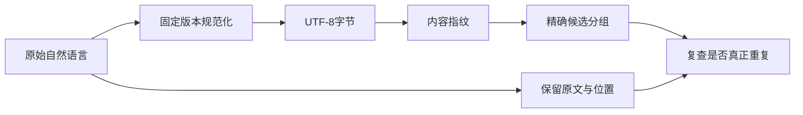
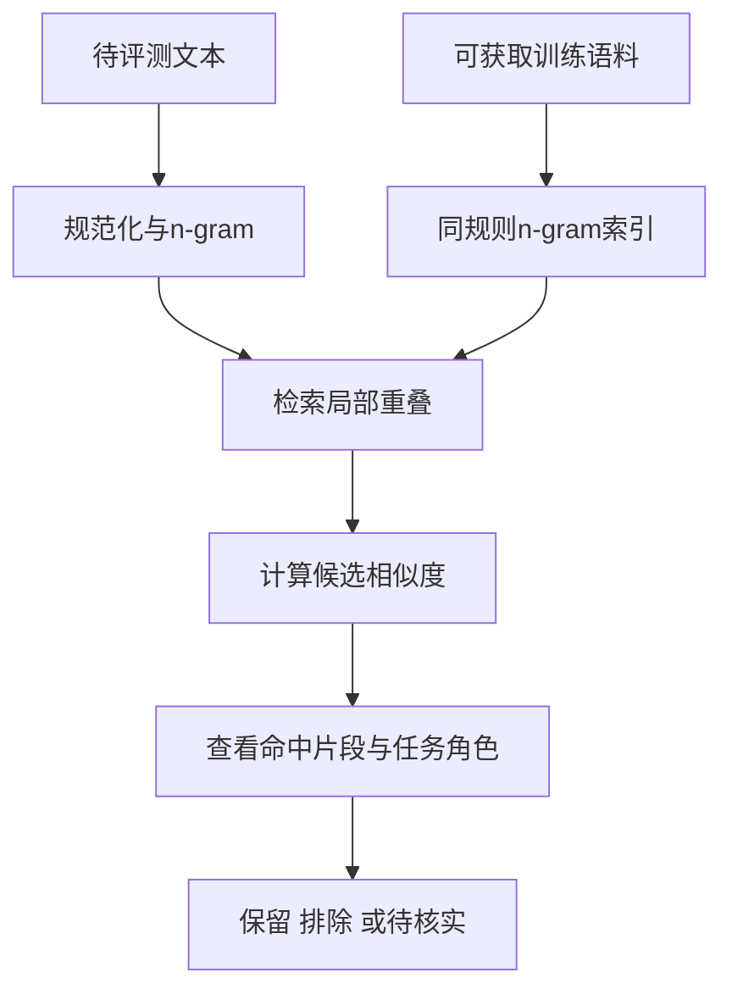
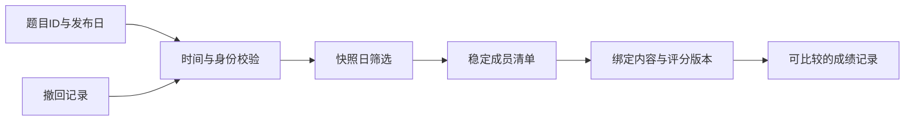

# 数据污染与评测集治理

数据污染治理需要回答三个不同问题：是否出现了同一份内容，是否存在值得复查的近重复，以及某次成绩究竟使用了哪个评测集版本。把它们都叫“去重”会隐藏检测能力的边界。本页将文本指纹、n-gram候选和发布快照拆开，结合LM Evaluation Harness与LiveBench的源码，建立可追溯的检查过程。

## 学习目标

- 能定义并解释文本规范化规则，区分字节相同、规范化相同与语义相同。
- 能手算n-gram Jaccard并说明阈值的误报和漏报来源。
- 能按发布时间和移除时间冻结评测快照，解释版本变化如何影响成绩可比性。

## 前置知识

需要集合、字符串处理、哈希和日期边界知识。先阅读[评测协议与可复现性](评测协议与可复现性.md)，明确训练、开发和报告集的用途。污染不是单一布尔属性：同题出现、答案泄漏、任务模板记忆和来源相似需要分别记录证据。

## 基本机制

工程流程通常先对可获取的语料做可重复的规范化与精确匹配，再用近重复规则生成候选，最后结合原文、时间线及任务结构复查。评测集本身也会增加、撤回和修订样本，因此每次报告必须冻结有效成员与内容身份；没有检测到重叠不等于证明训练语料干净。

## 推导或示例

### 知识点一：规范化指纹检测的是一个明确的等价关系

原始文件可能因为全角字符、大小写或空白不同而字节不一致，却仍是同一道自然语言问题。精确字节哈希会漏掉这类副本。可以先定义规范化函数，再对其输出取哈希，让想要忽略的差异明确进入协议。

同时，规范化越强，越可能抹掉有意义的区别。代码标识符通常区分大小写，数学式中的字符形式也可能承载意义。本例使用NFKC、casefold与空白合并，只适合展示自然语言候选筛选；真实项目应按语言和任务决定规则，并把规则版本与指纹一起保存。

#### 公式与推导

$$
x\sim_N y\iff N(x)=N(y),\qquad H_N(x)=\mathrm{SHA256}(N(x))
$$

N表示固定版本的规范化函数，H_N是对应内容身份。字符串“Ａ  B”经过全角兼容归一化、大小写折叠和空白合并后成为“a b”，所以与后者得到同一指纹。此处的“相同”是相对于N定义的等价关系，不是语义判断。若N把程序中的变量A与a合并，哈希相等仍可能对应不同程序。空文本被拒绝，是为了避免采集失败产生的大量空内容被当成真正重复样本。

#### 代码与逐步说明

```python
def normalized_fingerprint(text):
    """对自然语言文本做NFKC、casefold和空白合并后取指纹；空文本拒绝。"""
    if not isinstance(text, str):
        raise ValueError('文本必须是字符串')
    normalized = ' '.join(unicodedata.normalize('NFKC', text).casefold().split())
    if not normalized:
        raise ValueError('规范化文本不能为空')
    return hashlib.sha256(normalized.encode('utf-8')).hexdigest()
```

函数按固定顺序执行三种转换，再对UTF-8字节取摘要。返回摘要前没有删除标点、替换数字或改写句子，这些额外规则都可能改变检测目标。调用方还应保存原文定位和规范化版本，以便命中后能够查看是什么转换导致了相同；只留一个哈希无法进行人工复核。

#### 核心实现结构



原文保留为单独一条路径，避免不可逆规范化之后再试图还原证据。指纹只是快速索引键，人工或程序复查仍应回到原始任务内容和来源。

#### 源码导读与边界

lm-eval的get_train_overlap先对文档调用Janitor.normalize_string，再通过word_ngrams建立查找表，说明规范化和匹配属于两个不同步骤。EvaluationTracker保存doc_hash等身份信息，服务于结果追踪。本例的NFKC组合是自主教学规则，不声称与Janitor的具体实现完全相同。

依据：[LM Evaluation Harness 文本规范化与Ngram](https://github.com/EleutherAI/lm-evaluation-harness/blob/d6de81643928d653435c431bae19945d41d32520/lm_eval/decontamination/janitor.py#L211)；[LM Evaluation Harness 去污染实现](https://github.com/EleutherAI/lm-evaluation-harness/blob/d6de81643928d653435c431bae19945d41d32520/lm_eval/decontamination/decontaminate.py#L35)；[LM Evaluation Harness 结果追踪](https://github.com/EleutherAI/lm-evaluation-harness/blob/d6de81643928d653435c431bae19945d41d32520/lm_eval/loggers/evaluation_tracker.py#L249)。

把多个版本的规范化指纹混在一个索引里会使命中含义不一致。规则变化后应重新计算相关身份或明确双版本对照，不能只更新一条全局“已去重”标记。

### 知识点二：局部重叠用于生成候选，不是污染判决

精确指纹无法发现只改写了一部分文本的副本。n-gram把文本拆成连续词片段，以局部重叠寻找近重复。较小n容易被常见短语命中，较大n更严格但可能漏掉轻微改写；中文、分词不一致和文档长度差异又会改变匹配行为。

本例用Jaccard表示两份n-gram集合的重合比例，适合给候选排序。真实污染判定还应知道命中的是题干、答案还是通用说明，以及训练数据是否在模型训练前出现。若只因一道题含有常见短语就删除它，可能损害评测集的代表性。

#### 公式与推导

$$
G_n(x)=\{(w_i,\ldots,w_{i+n-1})\},\qquad J(x,y)=\frac{|G_n(x)\cap G_n(y)|}{|G_n(x)\cup G_n(y)|}
$$

对“a b c d”和“a b c e”取二元词组，集合分别为{ab,bc,cd}与{ab,bc,ce}。交集大小2，并集大小4，所以J=0.5。注意集合会忽略重复次数，因此这不是词频相似度。如果任一文本短于n，就没有足够的局部片段，本例返回None表示无法按该规则比较，而不是把两个空集合当作100%重复。

#### 代码与逐步说明

```python
def ngram_jaccard(left, right, n=2):
    """按空白分词的n-gram集合Jaccard；任一侧不足n词时返回None。"""
    if not isinstance(left, str) or not isinstance(right, str) or type(n) is not int or n <= 0:
        raise ValueError('需要字符串及正整数n')
    def grams(text):
        words = unicodedata.normalize('NFKC', text).casefold().split()
        return {tuple(words[i:i + n]) for i in range(len(words) - n + 1)}
    a, b = grams(left), grams(right)
    if not a or not b:
        return None
    return len(a & b) / len(a | b)
```

内部grams函数按声明的空白分词规则生成元组集合。集合交并直接对应公式；返回值没有自动带上“污染”标签。要应用阈值，需要另行建立标注样本集，检查不同阈值下的误报、漏报与领域分布。对于大型语料，可采用倒排索引或近似索引缩小候选，但最终仍应保存实际命中的片段作为证据。

#### 核心实现结构



检测流程的终点有三种处置，而不是“命中即有罪”。索引只减少候选搜索成本，不能证明不可获取的训练语料中不存在其他匹配。

#### 源码导读与边界

所读lm-eval代码建立ngram到文档ID的倒排表，再扫描训练ngram文件并登记命中的评测文档；其说明中采用任意13-gram重叠作为简化规则。这个判据与本例Jaccard阈值不是同一个算法：源码帮助理解候选索引结构，Jaccard教学帮助理解连续相似度与阈值取舍。不可把两者的检测比例直接比较。

依据：[LM Evaluation Harness 去污染实现](https://github.com/EleutherAI/lm-evaluation-harness/blob/d6de81643928d653435c431bae19945d41d32520/lm_eval/decontamination/decontaminate.py#L19)；[LM Evaluation Harness 文本规范化与Ngram](https://github.com/EleutherAI/lm-evaluation-harness/blob/d6de81643928d653435c431bae19945d41d32520/lm_eval/decontamination/janitor.py#L42)；[LM Evaluation Harness 去污染说明](https://github.com/EleutherAI/lm-evaluation-harness/blob/d6de81643928d653435c431bae19945d41d32520/docs/decontamination.md)。

未命中可能来自训练数据不可见、分词不一致、改写或翻译，不代表排除了污染。报告中应写明可检查语料的范围、n与规范化规则，并保留无法判断的情况。

### 知识点三：动态评测集需要冻结成员与撤回边界

动态基准可以不断加入新问题，减少长期固定题集的暴露问题，但也会让不同日期的分数对应不同样本。只保存一个基准名称无法恢复当时的成员；题目被撤回、答案被更正或评分器升级后，还需决定旧结果继续保留、标记失效还是重新计算。

本例把样本有效期建模为左闭右开区间：发布当日可用，移除当日不再可用。时间筛选仅决定成员，内容修订仍需单独的版本或指纹。一个样本ID在两次快照都存在，并不意味着题干、参考答案和评分规则完全一致。

#### 公式与推导

$$
D(t)=\{x:\ t_{\mathrm{release}}(x)\le t<t_{\mathrm{remove}}(x)\},\qquad t_{\mathrm{remove}}=\infty\ \text{表示尚未移除}
$$

假设a在1月1日发布、3月1日移除，b在2月1日发布且未移除。在2月15日，成员为{a,b}；在3月1日，只剩{b}。边界应在协议中写清，而不是依赖某个语言日期比较的偶然行为。若移除早于发布，元数据本身矛盾，应拒绝生成看似有效的快照。

#### 代码与逐步说明

```python
def release_membership(items, as_of):
    """返回快照日有效的ID；released含当日、removed不含当日，ID唯一。"""
    def iso(value):
        if not isinstance(value, str):
            raise ValueError('日期须为YYYY-MM-DD')
        parsed = date.fromisoformat(value)
        if parsed.isoformat() != value:
            raise ValueError('日期须为YYYY-MM-DD')
        return parsed
    now = iso(as_of)
    if not isinstance(items, list):
        raise ValueError('条目须为列表')
    seen, active = set(), []
    for item in items:
        if not isinstance(item, dict):
            raise ValueError('条目须为对象')
        key = item.get('id')
        if not isinstance(key, str) or not key or key in seen:
            raise ValueError('ID缺失或重复')
        seen.add(key)
        released = iso(item.get('released'))
        removed = iso(item['removed']) if item.get('removed') is not None else None
        if removed is not None and removed < released:
            raise ValueError('移除不能早于发布')
        if released <= now and (removed is None or now < removed):
            active.append(key)
    return sorted(active)
```

函数严格解析YYYY-MM-DD日期，检查ID唯一及时间顺序，再按有效区间筛选，最后对ID排序以生成稳定成员清单。它不会声称“发布日期晚于训练日期就绝无污染”：上游材料可能更早公开，模型训练时间也可能未知。输出适合进一步绑定题干、答案和评分器摘要，形成完整评测集版本。

#### 核心实现结构



日期筛选之后还有内容与评分身份绑定。这样可以区分成员变化、内容更正和算法变化，避免把三者都归为模型能力进步或退化。

#### 源码导读与边界

LiveBench的load_questions检查question_id唯一，规范化日期字段，通过允许的release集合筛选问题，并在指定版本时排除removal_date不再有效的题目。源码使用发布集合而不是本例的单一日期区间，因此本例是教学化的快照模型；共同原则是显式记录发布与移除条件，而不是随手读取“最新数据”。

依据：[LiveBench 数据版本与公共评测逻辑](https://github.com/LiveBench/LiveBench/blob/1d1006a0d10ece52c2e706f8a208a659b5bbb96f/livebench/common.py#L182)；[LM Evaluation Harness 结果追踪](https://github.com/EleutherAI/lm-evaluation-harness/blob/d6de81643928d653435c431bae19945d41d32520/lm_eval/loggers/evaluation_tracker.py#L249)。

动态更新不能成为隐藏旧成绩变化的理由。应保留旧快照身份和更正理由，在同一批固定样本上做必要对照，再说明新增样本上的差异。

## 适用条件与限制

这些检查只能覆盖已获取的文本和明确的元数据。私有预训练数据、语义改写和未知时间线仍可能无法核实；相似度也不是模型记忆程度的直接测量。发现候选后应保留证据与分层结果，避免只删除难题、只保留有利样本或把全部不确定性归结为污染。

## 实践任务

准备两份大小写与空白不同的自然语言文本，再准备一对大小写敏感的代码标识符，解释同一规范化规则为何可能不适用于两者。手算二元词组Jaccard，改变n观察可比较性与命中变化。最后为三条题目制作发布/撤回时间线，冻结两个日期的成员列表，并记录哪些变化需要重新评测。

完整教学示例：[源码文件](../../examples/benchmark/benchmark-contamination.py)。它使用 Python 3.11+ 标准库，不调用真实模型；页内代码是对应函数片段。单元测试证明本例的数学或状态性质，完整基准实验仍为“已设计”。

## 掌握标准

能说明一个指纹究竟忽略了哪些差异；能展示真实命中的n-gram及其任务角色；能正确处理短文本、日期边界和版本更正。结论应区分“已发现重叠”“高风险候选”“未发现可见重叠”和“无法核实”，而不是只有一个清洁/污染标签。

## 源码阅读路径与继续学习

继续阅读[评测协议与可复现性](评测协议与可复现性.md)、[来源接入与版本管理](来源接入与版本管理.md)和[通用能力基准与选型](通用能力基准与选型.md)。将本页候选证据与知识库的来源版本绑定，才可在来源更正时找到受影响的声明、练习和成绩。

返回[Benchmark模块](../modules/Benchmark.md)，或查看[能力地图](../../docs/能力地图.md)。

---

[返回模块](../modules/Benchmark.md) · [知识点索引](../../docs/知识点索引.md) · [完整教学代码](../../examples/benchmark/benchmark-contamination.py) · [提出更正](https://github.com/yanbozhang/llm-systems-wiki/issues/new?template=knowledge.yml)

觉得这篇推导有帮助，可以在 [GitHub](https://github.com/yanbozhang/llm-systems-wiki) 点 Star 收藏更新；分享时欢迎链接到具体知识点，便于读者复核公式、代码与来源。
